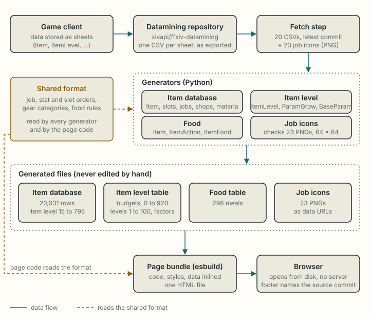

# Data pipeline

How game data gets from the game client into the page. This page covers where the data comes from, which rules turn it into the two data tables the page uses, and how to refresh it after a game patch. How the numbers are then used is in [math.md](math.md) (stat budgets, sync caps, speed) and [optimizer.md](optimizer.md) (gear search).

Every count on this page was produced by running the generators' rules over the CSVs in the local clone, or by importing the generated tables in Node. They describe datamining commit `d9582a6` (30 September 2026).

## 1. Source

The data comes from [xivapi/ffxiv-datamining](https://github.com/xivapi/ffxiv-datamining), a public repository of the game client's data sheets saved as CSV files. A *sheet* is one of the game's internal data tables, for example `Item` (one row per item). The files are exported straight from the client, by XIVData Oxidizer since January 2026 and by SaintCoinach before that. The miners do not compute or derive anything: a row in a CSV is a row in the game's own data. **Verified**: the repository's own commit history shows the exporter change (commit `d3eb86d`, 4 January 2026, "Migrate to XIVData Oxidizer").

The project fetches ten sheets (English column names, `csv/en/`). Eight supply data to the generators; `ClassJob` only tells the fetch step which icon belongs to which job (section 2); `BaseParam` is only checked: the slot percentages the page uses are kept in the shared format definition (section 3), and the generator stops if `BaseParam` disagrees with them.

| Sheet | Read by | What it contributes |
| --- | --- | --- |
| `Item` | item database generator | One row per item: name, equip slot category, item level, equip level, job category, up to six stat id and value pairs, up to six HQ bonus pairs, `CanBeHq`, `IsUnique`. 52,801 rows. |
| `EquipSlotCategory` | item database generator | Which gear slots an item occupies (1) or blocks (−1). 25 rows. |
| `ClassJobCategory` | item database generator | Which classes and jobs may equip an item (`True`/`False` per job). 206 rows. |
| `ItemLevel` | item level generator | The stat budget of every stat at every item level. 921 rows, ids 0 to 920. |
| `ParamGrow` | item level generator | Per character level data, including the speed constants. Rows 0 to 201; levels 1 to 100 are used. |
| `Recipe` | item database generator (sources) | One row per recipe; `ItemResult` is the item it makes. 14,909 rows. |
| `SpecialShop` | item database generator (sources) | Exchange shops: up to 60 listings each, with what a listing gives (`Item`) and costs (`ItemCost`), and the shop's `UseCurrencyType`. 1,489 rows. |
| `TomestonesItem` | item database generator (sources) | The tomestone currencies and which are current (`Tomestones` 1 to 4). 24 rows. |
| `ClassJob` | fetch step (job icons) | One row per class and job with its abbreviation (`PLD`, `SGE`, ...); the row number picks the job's icon. |
| `BaseParam` | item level generator (check only) | One row per stat, including the share of the budget each slot gets (two-handed weapon 140, one-handed 100, off-hand 40, head/hands/feet 85, body/legs 135, accessories 67, in thousandths). |

**Verified on every regeneration**: for all 12 stats the project uses, the item level generator reads the stat's `BaseParam` row and compares each slot column with the percentage the page uses. Any difference, a missing column or a missing stat row stops it with an error that lists every mismatch (for example `mind RingPercent = 70, page uses 67`). With the current data all 12 rows match. The `BaseParam` columns are `TwoHandWeaponPercent`, `OneHandWeaponPercent`, `OffHandPercent`, `HeadPercent`, `ChestPercent`, `HandsPercent`, `LegsPercent`, `FeetPercent`, `EarringPercent`, `NecklacePercent`, `BraceletPercent` and `RingPercent`. The sheet has more columns for gear that covers several slots (for example `ChestHeadPercent` = 220); the project leaves that gear out (section 4), so they are not checked. See [math.md](math.md) for how the percentages are used.

**Column checks.** Before using a sheet, each generator checks that every column it reads is in the sheet's header, and stops with an error naming the sheet and each missing column. That covers every job of the shared format in `ClassJobCategory`, every stat column in `ItemLevel`, every slot column (plus `MainHand` and `OffHand`) in `EquipSlotCategory`, the `Item` columns listed in the table above (the 24 stat pair columns, `CanBeHq`, `IsUnique`, `LevelItem`, `LevelEquip`, `ClassJobCategory`, `EquipSlotCategory`, `Name`) and the three `ParamGrow` columns. The item database generator also stops if any job ends up with no item at all, which catches a change in how the job columns are written (for example `1` instead of `True`). An error exits with status 1 and writes no file, so the full regeneration stops too.

## 2. Fetching

The fetch step makes a **sparse, shallow, blobless** clone of the datamining repository into `data/ffxiv-datamining/` (gitignored):

- *shallow*: only the latest commit, no history;
- *sparse*: only the ten `csv/en/<Sheet>.csv` paths are checked out;
- *blobless*: file contents are downloaded only for those paths.

For the current data that is about 7 MB of git data and 20 MB of CSV files on disk, mostly `Item.csv`, instead of the whole repository. Running the fetch again when the clone exists does a fast-forward pull, which picks up whatever the miners published since. The step fails if any of the ten files is missing afterwards.

### Job icons

The job picker shows the game's framed, role-coloured job icons. The CSVs hold no images, so the fetch step downloads them from xivapi's asset endpoint, which converts the game's own icon textures to PNG, into `data/icons/<JOB>.png` (gitignored). Each job's icon number is $62100 + r$, where $r$ is the job's row in `ClassJob` (Paladin, row 19, is icon 062119). **Verified** by looking at all 22 icons; the rule itself is a numbering pattern of the game's icon files, not a column in any sheet. The high-resolution versions (64 × 64 pixels) are used.

The icon generator embeds the 22 PNG files in `src/data/job-icons.js` as data URLs, so the page still makes no image requests. It stops with an error if a job's icon is missing or is not a 64 × 64 PNG. FINAL FANTASY XIV icons © SQUARE ENIX; the page footer says so.

## 3. The shared format definition

The generators are written in Python; the page is JavaScript. Both have to agree on what the numbers in a generated row mean. That agreement lives in one JSON file that both sides read, so they cannot drift apart. It defines three orders:

**Job order.** The 22 combat jobs, in this order (bit index $i$ in parentheses):

PLD (0), WAR (1), DRK (2), GNB (3), WHM (4), SCH (5), AST (6), SGE (7), MNK (8), DRG (9), SAM (10), RPR (11), NIN (12), VPR (13), BRD (14), MCH (15), DNC (16), BLM (17), SMN (18), RDM (19), PCT (20), BLU (21).

**Stat order.** The 12 stats stored per item, each with its column in the `ItemLevel` sheet and its row id in `BaseParam` (the id the `Item` sheet uses to name a stat):

| Position | Stat | `ItemLevel` column | `BaseParam` id |
| --- | --- | --- | --- |
| 0 | Strength | Strength | 1 |
| 1 | Dexterity | Dexterity | 2 |
| 2 | Intelligence | Intelligence | 4 |
| 3 | Mind | Mind | 5 |
| 4 | Vitality | Vitality | 3 |
| 5 | Piety | Piety | 6 |
| 6 | Tenacity | Tenacity | 19 |
| 7 | Direct Hit Rate | DirectHitRate | 22 |
| 8 | Critical Hit | CriticalHit | 27 |
| 9 | Determination | Determination | 44 |
| 10 | Skill Speed | SkillSpeed | 45 |
| 11 | Spell Speed | SpellSpeed | 46 |

**Slot codes.** Each code names a slot type and the `EquipSlotCategory` column that identifies it. Each slot also carries its share of the budget (`percent`, in thousandths) and the `BaseParam` column that holds it; the page reads its slot shares from here, and the item level generator checks them against `BaseParam` (section 1).

| Code | Slot | Column | Code | Slot | Column |
| --- | --- | --- | --- | --- | --- |
| 0 | two-handed weapon | MainHand (off-hand blocked) | 6 | legs | Legs |
| 1 | one-handed weapon | MainHand (off-hand free) | 7 | feet | Feet |
| 2 | off-hand (shield) | OffHand | 8 | earring | Ears |
| 3 | head | Head | 9 | necklace | Neck |
| 4 | body | Body | 10 | bracelet | Wrists |
| 5 | hands | Gloves | 11 | ring | FingerL |

Belts (`Waist`) and soul crystals have no slot code, so items in those slots are dropped.

Changing any order in this file changes the meaning of the already generated item database, so the data must be regenerated afterwards. A unit test checks that the page's job list, stat order, slot table and slot shares are exactly the ones in the file.

## 4. Item database generation

### Selection

An `Item` row becomes a database row when all of these hold:

1. it has a name;
2. its equip slot category resolves to one of the 12 slot codes (below), which rules out belts, soul crystals and non-gear;
3. its item level is at least 100;
4. at least one of the 22 combat jobs may equip it (job mask $> 0$), which rules out crafter and gatherer gear and gear only a base class (for example Gladiator) can wear;
5. at least one of its 12 stats is non-zero after the HQ rule below.

For the current data, each rule leaves:

| Step | Rows left |
| --- | --- |
| all `Item` rows | 52,801 |
| has a name | 50,880 |
| resolves to a slot | 29,026 |
| item level ≥ 100 | 19,843 |
| a combat job can equip it | 17,627 |
| at least one stat | 17,579 |
| occupies a single slot (multi-slot gear such as cloaks that also cover the head is left out) | **17,577** |

The item level floor of 100 is a choice of this project, not a game rule; gear below it is not useful for the sync caps the page targets.

### Slot

The slot is the first slot code, in format order, whose `EquipSlotCategory` column is 1. A main-hand item is **two-handed when the same category also blocks the off-hand** (off-hand column $= -1$) and one-handed when the off-hand column is 0. Body pieces that also block other slots (robes that block the legs, for example) have Body = 1, so they become body pieces. Rings set both FingerL and FingerR to 1 and are matched by FingerL.

### Job mask

The job mask packs "who can equip this" into one integer. With $\text{job}_i$ the $i$-th job of the shared order and $[\cdot]$ equal to 1 when the condition is true and 0 otherwise:

$$
\text{mask} = \sum_{i=0}^{21} 2^{i}\,\bigl[\text{job}_i \text{ can equip the item}\bigr]
$$

"Can equip" means the job's column in the item's `ClassJobCategory` row is `True`. Base classes (Gladiator, Conjurer, ...) and crafting or gathering classes have no bit. In the example above, category 59 lists GLA MRD PLD WAR DRK GNB; Gladiator and Marauder are base classes, so only bits 0 to 3 are set and $\text{mask} = 2^0 + 2^1 + 2^2 + 2^3 = 15$. An item every job can wear has $\text{mask} = 2^{22} - 1 = 4{,}194{,}303$ (1,079 rows).

### Stats and the HQ bonus

An `Item` row lists up to six stats as pairs (stat id, value), plus up to six more pairs for the high-quality (HQ) bonus that a crafted HQ copy gets on top. Each id is looked up in the stat order and added to that position; ids outside the 12 (Defense, Magic Defense and similar) are ignored. For stat position $k$ with `BaseParam` id $\text{id}(k)$:

$$
\text{stat}_k = \sum_{j=0}^{5} \bigl[\text{id}_j = \text{id}(k)\bigr]\,\text{value}_j \;+\; \bigl[\text{can be HQ}\bigr] \sum_{j=0}^{5} \bigl[\text{id}^{\text{HQ}}_j = \text{id}(k)\bigr]\,\text{value}^{\text{HQ}}_j
$$

The HQ bonus is added **only when the item's `CanBeHq` flag is true**, so the database holds the HQ version of every craftable item and the only version of everything else. Why the flag matters: 293 `Item` rows have non-zero HQ bonus values for one of the 12 stats although they cannot be high quality, and 290 of them pass the other selection rules. An earlier version added the bonus to every item and inflated their stats; the problem was found by diffing the two versions (**verified** by count: 290 now, "about 290" in the original finding). By name they are mostly upgradeable gear families (Phantom Vision, 140 rows, item level 780; Arcanaut's, 105 rows, item level 745) plus 45 item level 130 "Captain's" weapons (Serpent, Storm and Flame, 15 each). With the rule, the bonus is applied to 4,398 rows.

Melds (materia) are not part of the item data and are not included.

### Unique flag

`IsUnique` becomes 1 or 0. A Unique item can be equipped only once, which matters for rings: two copies of the same Unique ring are not allowed in one set. 12,780 of the 17,577 rows are Unique. How the optimizer uses the flag is in [optimizer.md](optimizer.md).

### Sources

Each row carries a bit mask of where the item comes from, as far as the game files can say. A gear piece can have none, one or several. The game files do not record dungeon drops: loot tables live on the game's servers, and no client sheet lists them (**verified**: the loot-related sheets `Treasure`, `InstanceContentRewardItem`, `ContentRewardCondition` and `LootModeType` hold no item ids). Dungeon gear is therefore not flagged.

- **Crafted** (bit 0): the item is the `ItemResult` of a recipe. 3,450 rows. **Verified** against the Lodestone (section 10).
- **Tomestone** (bit 1): an exchange listing costs a tomestone to get it, or it is made by trading in such a piece. 1,833 rows. Shops do not store most currency costs as item ids: a cost below 8 is a code, read through the shop's `UseCurrencyType` as SaintCoinach's shop reader does. Types 4 and 2: codes 1 to 4 are the current tomestones (code 1 is Poetics; SaintCoinach does not decode type 2, and the Lodestone shows its code 1 as Poetics, for example "Deepshadow Necklace of Healing ×1 + Allagan Tomestone of Poetics ×100"). Type 16: code 1 is Poetics; 2, 4, 6 and 7 are crafter and gatherer scrips. Type 8: gil. A tomestone's own item id as a cost also counts, and so does a listing that also takes a piece of gear in (augmentation and repair exchanges). A piece made by trading in tomestone gear counts too (for example Augmented Quetzalli, made from Quetzalli and Surgelight Twine), repeated until nothing changes. The piece traded in is not flagged by that trade: retired sets that are no longer sold (the un-augmented Ironworks, Shire, Lost Allagan, Scaevan, Deepshadow, Crystarium, Cryptlurker, Lunar Envoy and Credendum pieces, removed in patch 5.3 or later) carry no tomestone cost in the current game files, and no source checked (Lodestone, Garland Tools, the Console Games Wiki) records how they were sold. The flag therefore means *the game files sell it for tomestones, or it is made from such a piece*. A shop the game no longer uses can still be in the files: the Allagan Tomestones of Heliometry shop still sells Quetzalli gear, while the Lodestone shows only today's Sack of Nuts exchange.
- **Ultimate** (bit 2): an exchange listing sells it for one of the seven ultimate totems (Dreadwyrm, Ultima, Colossus, Dragonsong, Omega, Oracle, Mad Harlequin's). 136 rows: the 16, 16, 18, 20, 22, 22 and 22 weapons of the seven ultimates. Item names are not used: the Weapon's Refrain weapons end in "Ultima" and the Dancing Mad weapons are named "Palazzo Diamond". Which duty a totem comes from is not in the game files: six pairs match Teamcraft's data, and the Console Games Wiki says Mad Harlequin's Totem drops in Dancing Mad (Ultimate) (**verified** there; the game files still do not link them). The generator stops if any totem id no longer has its expected name.

### Row format and order

Each database row is a fixed list of nine fields:

| Field | Type | Meaning |
| --- | --- | --- |
| name | text | Item name as in the English client. |
| slot code | integer 0 to 11 | Slot, per the shared slot table. |
| item level | integer | The item's own item level (`LevelItem`), 100 to 795 in the current data. |
| equip level | integer | Character level needed to wear it (`LevelEquip`). |
| job mask | integer, $0 < \text{mask} < 2^{22}$ | Who can equip it, as defined above. |
| stats | 12 comma-separated integers | Stat values in the shared stat order, HQ bonus included when the item can be HQ. |
| unique | 0 or 1 | 1 when only one copy can be worn. |
| hq | 0 or 1 | 1 when the item can be high quality (`CanBeHq`), so its stats are the HQ ones; the page marks it HQ. |
| sources | integer 0 to 7 | Bit mask: 1 crafted, 2 tomestone, 4 ultimate (section *Sources*). |

The example row is

| name | slot | item level | equip level | job mask | stats | unique | hq | sources |
| --- | --- | --- | --- | --- | --- | --- | --- | --- |
| Void Ark Helm of Fending | 3 | 200 | 60 | 15 | 46,0,0,0,45,0,0,0,0,35,50,0 | 1 | 0 | 0 |

Rows are sorted by item level (highest first), then slot code, then name. The stats are stored as one string per row to keep the file small; the page splits it when it reads a row.

## 5. Item level table and level data

The second generator writes one file with three parts.

**Stat budgets.** For each of the 12 stats, the `ItemLevel` column of that stat as a list indexed by item level: $\text{budget}_s(\ell)$ for $\ell = 0, \dots, 920$. The ids must run 0, 1, 2, ... without gaps, so that the list position equals the item level; the generator stops with an error otherwise. For example, at item level 123: Mind 355, Vitality 375, Spell Speed 346. How a budget becomes the stat on a piece is in [math.md](math.md).

**Level data.** For character levels 1 to 100, three `ParamGrow` columns:

| Column | Meaning | Level 90 | Level 100 |
| --- | --- | --- | --- |
| BaseSpeed | a character's own speed stat at that level, with no gear | 400 | 420 |
| LevelModifier | the divisor in the speed formulas | 1900 | 2780 |
| ItemLevelSync | the game's own sync item level for that level (shown on the page as information) | 660 | 690 |

A missing level or column stops the generator with an error. The speed formulas are in [math.md](math.md).

**Source record.** Which datamining commit the data came from (next section).

## 6. Provenance

When the data is regenerated, the commit id and commit date of the local datamining clone are recorded. They appear in three places:

- in the item and item level files, a one-line "do not edit" notice naming the repository, the full commit id and the date;
- in the same two files, a source record (repository, commit, date); the page reads it from the item level file;
- the page footer, as "Game data: ffxiv-datamining" plus the short commit id and the date. The current footer reads `Game data: ffxiv-datamining d9582a6, 2026-09-30`.

The full regeneration refuses to run when it cannot read the clone's commit. The generators run on their own (for example on test files) write "commit unknown" and an empty source record, and the footer then shows nothing.

The recorded commit is the clone's newest commit, not the newest commit that changed one of the six sheets. Commit `d9582a6` ("TC 7.25") changed no English CSV. The six sheets were last changed by:

| Sheet | Last changed in |
| --- | --- |
| `Item` | `a67c23b`, patch 7.56, 8 September 2026 |
| `ClassJobCategory` | `d71de32`, 7.56 hotfix 1, 17 September 2026 |
| `ItemLevel`, `BaseParam` | `50686a9`, patch 7.50, 28 April 2026 |
| `ParamGrow`, `EquipSlotCategory` | `d3eb86d`, exporter migration, 4 January 2026 |

## 7. Facts about the current data

| Fact | Value |
| --- | --- |
| Database rows | 17,577 |
| Lowest / highest item level in the database | 100 / **795** (66 rows at 795) |
| `ItemLevel` rows | 921 (ids 0 to 920) |
| Level data | levels 1 to 100 |
| Unique rows | 12,780 |
| Rows wearable by every job | 1,079 |

Rows per slot:

| Slot | Rows | Slot | Rows |
| --- | --- | --- | --- |
| two-handed weapon | 4,264 | feet | 1,743 |
| one-handed weapon | 263 | earring | 990 |
| off-hand | 260 | necklace | 990 |
| head | 1,748 | bracelet | 990 |
| body | 1,852 | ring | 993 |
| hands | 1,743 | | |
| legs | 1,743 | | |

### Item levels above 795

The `ItemLevel` sheet has rows up to 920, but no gear has an item level above 795. The page therefore limits item level inputs to the highest real item level, which it computes from the database rather than storing.

Where the extra rows come from (**verified** against the datamining repository's history for `ItemLevel.csv`, which has two commits):

| Snapshot | Rows | Highest gear item level |
| --- | --- | --- |
| January 2026, exporter migration (`d3eb86d`) | 901 (ids 0 to 900) | 795 |
| Patch 7.50, April 2026 (`50686a9`) | 921 (ids 0 to 920) | 795 |

Between the two, 20 rows were added (901 to 920) and 120 existing rows changed, from row 766 up. In rows 766 to 795 only crafting and gathering columns changed (CP, Control, Craftsmanship, GP, Gathering, Perception); the 12 combat stat columns this project uses changed only in rows 796 to 900. So every row that real gear uses is the same in both snapshots. The current `ItemLevel.csv` is identical to the 7.50 one.

Since these rows are in the client's own data, they are not something the miners added. The values climb smoothly and almost linearly: from row 896 to row 920, Mind goes from 10,415 to 11,742, each substat from 4,385 to 4,626, and Vitality from 11,409 to 13,163. That looks like budget room prepared ahead of gear that is not released yet, but that is an **inference**: the data cannot show intent, and nothing above 795 can be checked against a real item.

## 8. Building the page

The page bundle takes the page code, the stylesheet and both generated data files and writes them into one HTML file, so it opens from disk without a server. Its only external reference is the Google Fonts stylesheet; without a network connection the page falls back to system fonts. The data is part of the code bundle, not loaded at run time.

| Part | Size |
| --- | --- |
| item database (generated file) | 1,430,576 bytes |
| item level table and level data (generated file) | 51,940 bytes |
| job icons (generated file) | 206,351 bytes |
| finished page, minified | 1,808,181 bytes at the last build (about 1.8 MB) |

The item database is close to 80% of the page, the icons about 12%.

## 9. Updating after a game patch

1. **Fetch**: pull the newest CSVs into the local clone.
2. **Regenerate**: run the three generators (the item and item level ones record the new commit) and rebuild the page.
3. **Check**: run the full check (lint, build, unit tests, generator tests, browser smoke test). Every test must pass.
4. Review the change in the two generated files (the diff shows new items and any changed table rows) and update counts quoted in the docs, such as the 17,577 rows above.

Some test expectations are allowed to move, others must not:

| Expectation | After a patch |
| --- | --- |
| Highest real item level, row counts | Move when new gear is added. The page computes the highest item level itself. |
| Formula accuracy per item level band (at least 95% exact, at least 96% within 1) | The shares can move as new gear arrives; the thresholds should still hold. A drop below them means the model needs a look, not a lower threshold. |
| Regression values tied to specific old items (item lookups and optimizer totals on them) | Must not move. Old items do not change. |
| Wiki sync caps at item level 475 | Must not move. They are published numbers; a change means the game changed old `ItemLevel` rows. |
| Generic maximum at cap 123 (296 Spell Speed, 2.22 s GCD) | Depends only on `ItemLevel` rows 123 and 475. Should not move unless those rows change; investigate if it does. |
| Format, row shape and provenance tests, generator tests on test files | Must not move. They test the pipeline, not the game data. |

If a patch adds a job or a stat, the shared format definition and the page's job table have to be extended first; the format test fails until both agree. If a patch renames a column the generators read, or changes a slot share in `BaseParam`, the regeneration stops with an error naming it (section 1); update the shared format definition (and, for a slot share, check the math) rather than working around it.

## 10. How the pipeline is tested

**Generator tests** (Python, on small test CSVs in the test folder):

- The test files use the real sheet headers. The `EquipSlotCategory` and `ClassJobCategory` rows are copied from the real sheets; the `Item` rows are made-up test items built on the real header.
- `ItemLevel` values are synthetic: the value in row $r$, column position $c$ is $1000\,r + c$, so reading the wrong column shows up as a wrong number. `ParamGrow` is written by the test with distinct values per column ($1000 + \ell$, $2000 + \ell$, $3000 + \ell$ for level $\ell$).
- The `BaseParam` test file holds the real rows of the 12 stats.
- They check slot detection (two-handed vs one-handed, every slot type), exclusions (belt, soul crystal, missing or non-gear category, base-class-only, crafter-only, unknown category, no stats, empty name, item level 99), stat placement including a stat in the sixth pair after empty ones, the HQ rule in both directions, job mask bits, the Unique flag, sort order, the 12 `ItemLevel` columns, levels 1 to 100, and the errors for a missing level and for non-contiguous `ItemLevel` ids.
- Schema drift, on edited copies of the test files: a renamed job column (`SGE` to `SAGE`), job values written as `1` instead of `True`, missing `EquipSlotCategory` columns, missing `Item` columns, a missing `ItemLevel` stat column, a missing `ParamGrow` column, a `BaseParam` slot share that differs from the page, a missing `BaseParam` column and a missing stat row each stop the generator with an error naming the sheet and column, and no file is written. Run from the command line, the generator exits with status 1 and a one-line message.

**Format tests** (Node, on the real generated data):

- the page's job order, stat order and slot table equal the shared format definition;
- the budget table has one column per stat, all the same length, and the level data has 100 rows;
- every database row has nine fields, a valid slot code, a job mask in $(0, 2^{22})$, 12 stats, 0/1 Unique and HQ flags and a source mask below 8;
- the slot shares the page uses (per slot, per weapon mode and per job) equal the `percent`s in the shared format definition;
- every job has at least one item for each of its active slots, with the weapon matching its weapon mode. One exception is listed in the test: Blue Mage weapons exist in `Item` (10 rows) but carry no stats, so none are in the database. The test fails if that changes.

**Job icon tests**: the generator tests check a missing icon and a file that is not a 64 × 64 PNG; a format test (Node) checks that every job is in the picker exactly once and has an embedded 64 × 64 PNG.

**Provenance tests** (Node): the source record names the datamining repository, a full 40-character commit id and an ISO date; both generated data files carry the same source record and name its commit in their notice; the footer text is short and empty when the source is unknown.

**Source flags against the Lodestone** (a manual check, not part of the test suite): 175 randomly chosen pieces (two samples: 15 and 20 per flag plus twice as many unflagged pieces), each compared with its Lodestone item page at one request every 2.5 seconds. A page counts as crafted when it links a recipe, tomestone when a shop cost is an Allagan Tomestone, ultimate when a cost is an ultimate totem. 167 agree. All 8 differences are tomestone pieces the page shows no tomestone for, and each has a known cause: the game files still hold a retired tomestone shop that sells it (Quetzalli, Moonward: the page shows only today's Sack of Nuts exchange; Radiant's: the page lists no source at all), or the piece is made from tomestone gear (Augmented Bygone Brass from Bygone Brass plus a glaze or twine, Exquisite Isnae Phis from Augmented Isnae Phis plus an Elevated Ester). No crafted, ultimate or unflagged piece disagrees. The first sample found two generator bugs, both fixed (see [history.md](history.md)).

## Where this lives

| Concept | File |
| --- | --- |
| Fetch (sparse clone and job icons) | `scripts/data/fetch.py` |
| Shared format definition | `src/core/item-format.json` |
| Format loading, CSV reading and the column and slot share checks | `scripts/data/item_format.py` |
| Item database generator | `scripts/data/gen_items.py` |
| Item level table and level data generator | `scripts/data/gen_item_level.py` |
| Job icon generator | `scripts/data/gen_job_icons.py` |
| Source commit detection and the generated-file notice | `scripts/data/provenance.py` |
| Regenerate everything | `scripts/data/regen.py` (`npm run update-data` runs fetch, then this) |
| Generated data (never edit by hand) | `src/data/items.json`, `src/data/item-level.json`, `src/data/job-icons.js` |
| Tables, highest real item level, footer text | `src/core/tables.js` (`MAX_REAL`, `MAX_ILVL`, `dataSourceLabel`) |
| Page's job, stat and slot tables; hard-coded slot percentages | `src/core/constants.js` |
| Page bundle | `scripts/build/build.mjs` (`npm run build`) |
| Generator tests and test CSVs | `tests/data/test_generators.py`, `tests/data/fixtures/` (part of `npm test`) |
| Format and provenance tests | `tests/unit/data-format.test.js`, `tests/unit/provenance.test.js` |
| Local CSV clone (gitignored) | `data/ffxiv-datamining/csv/en/` |
| Diagrams | `docs/diagrams/data-flow.svg`, `docs/diagrams/data-item-row.svg` |
