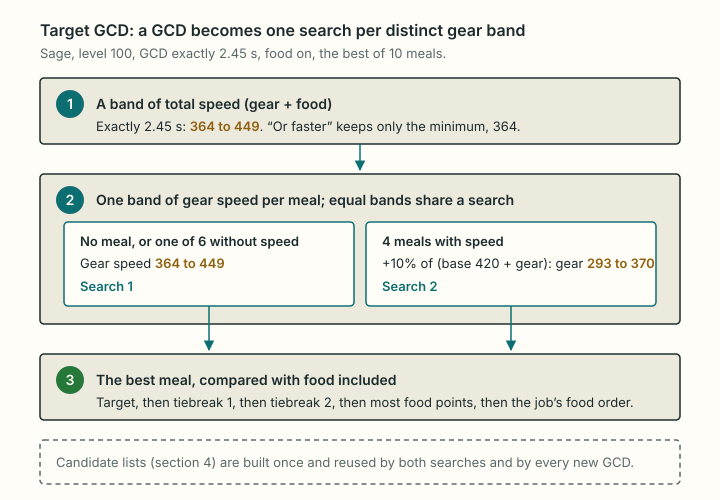
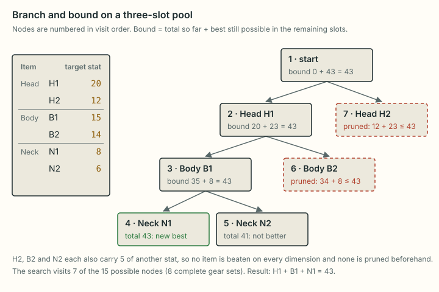

# The gear optimizer

Given a pool of items and a job, the optimizer picks one item per gear slot so that a chosen stat is as high as possible, with up to two tiebreak stats. The overview below says how, in plain words. Section 1 is the game background and the problem, section 2 states it in the terms of optimization, sections 3 to 5 are the search that solves it and section 6 adds the materia. The page argues why the answer is optimal unless the search hits its node limit. From section 2 on it is written for a reader versed in integer programming and knapsack methods but new to this code base and the game.

Related pages: [math.md](../mechanics/math.md) (how a piece's stats are computed and what level sync does to them), [data-pipeline.md](data-pipeline.md) (where the item data comes from), [materia.md](../mechanics/materia.md) (the meld rules), [tier-ranking.md](tier-ranking.md) (ranking by stat tiers, built on this search), [glossary.md](../glossary.md).

## Overview in plain words

What happens when the user presses Fill on a set page, step by step (each step's section has the details and the proof):

1. **The pool.** Every piece the job can wear that the Gear to search filters let through (section 7), with its synced stats when sync applies to it, and its best melds when it is not synced and Materia is on (section 6).
2. **One number per piece.** Each piece's stats become one integer that ranks weapon damage first, then the target stat, then tiebreak 1 and tiebreak 2, so comparing two gear sets is comparing two sums (section 3).
3. **Drop pieces that cannot matter.** Within a slot, a piece that enough others beat on every stat that counts is never in a best gear set, so it is removed (dominance, section 4). For the Sage example below, 1,999 pieces become 119.
4. **Search the rest.** Fill one slot at a time, shortest list first, best pieces first. At each partly filled gear set, a quick upper bound says how much the empty slots could still add; when even that cannot beat the best full gear set found so far, the whole branch is skipped (branch and bound, section 5). When the search ends, the best gear set found is the best there is, unless the search stopped at its node limit, which the page reports.
5. **Options on top.** A Target GCD turns into a range the speed stat must stay in (sections 2 and 5); "Spare points to tiebreaks" runs one such search per ranked stat ([tier-ranking.md](tier-ranking.md)).

The code is in `src/core/optimizer/`: `index.js` (`optimize`, the entry point), `candidates.js` (the stats, melds, scores and dominance of steps 1 to 3) and `search.js` (the branch and bound). A piece's stats under sync come from `src/core/piece.js`, shared with the rest of the page. The page builds the pool itself (section 7), and runs the search in a Web Worker, so the page stays responsive during a long one ([architecture.md, section 9](architecture.md#9-the-optimizers-worker)). [glossary.md](../glossary.md#project-terms) defines the search words (candidate, dominance, incumbent, fathom, node limit).

How to read the rest: section 1 is the game background and the problem in plain words, section 2 the formulation. Sections 3 to 5 are the algorithm, in the order it runs. Section 6 adds melds, section 7 is how the page uses the engine (its controls and menus are in [ui.md](ui.md)), and sections 8 and 9 are the evidence, timings and limits.

## 1. The problem

What does the optimizer choose, and from what?

**Gear and stats.** In Final Fantasy XIV a character wears one item in each gear slot: weapon, head, body, hands, legs, feet, earrings, necklace, bracelets and **two** rings. Each item carries a few stats as integers: the job's **main stat** (Strength, Dexterity, Intelligence or Mind), Vitality, and usually two **substats** such as Critical Hit or Spell Speed (all in the [glossary](../glossary.md#game-terms)). A gear set's stat is the sum over its items.

**Slots that are not independent.**

- Paladin and Beastmaster carry a one-handed weapon plus a shield (the off-hand slot); every other job uses a two-handed weapon, which leaves the off-hand empty. White Mage has both kinds at item level 100 (one wand and shield pair from A Realm Reborn).
- A few body pieces (the Vermilion Cloaks) also cover the head and leave it empty.
- A ring marked [Unique](../glossary.md#game-terms) can be worn only once, so it cannot fill both ring slots.

**The task.** The user's job decides which items are wearable; they form the **pool** of candidate items (real gear from the game data). The optimizer chooses a **gear set**, one item per slot, that:

1. maximizes the weapon's **weapon damage** (the job's physical or magic one; skipped for Blue Mage, whose spells scale with Intelligence only),
2. then, among gear sets with the most weapon damage, the total of a **target** stat (for example Spell Speed or Tenacity),
3. then, among gear sets with the same target total, **tiebreak 1**,
4. then **tiebreak 2**.

This is a lexicographic order: a tiebreak only matters between gear sets that are equal on every higher-ranked stat. Weapon damage comes first on every search (owner's decision): it multiplies nearly all of a job's damage, so no gear set should give it up for more of the target stat or the tiebreaks.

It is an implicit key: the page does not offer it as a goal, names it only in a note under the result, and the rest of this page calls the target the first key the user picks. Its values, and its sync rule (**inferred**), are in [math.md, section 4](../mechanics/math.md#weapon-damage-and-defense). The Target GCD's fastest-GCD search leaves it out, since it only asks how fast the gear can go.

**Constraints.**

- **Copies.** Each pool item has a number of copies. A Unique ring can be worn once; any other ring can be worn in both ring slots, so it gets 2 copies. Everything else has 1 copy (it only fits one slot anyway). The copies come from the game data when an item is added and are not edited on the page; the gear table marks a 2-copy ring ×2.
- **A speed range** (optional): a minimum and a maximum for the speed stat (Skill Speed or Spell Speed). Other stats have no limits, except the minimums tier ranking adds (section 5). The Target GCD layer (section 2) sets the range from a [GCD](../glossary.md#game-terms), the time between most actions; the page's control is in [ui.md, section 2](ui.md#target-gcd).

**The pool** on the page is every piece the job can wear that the "Gear from" filter lets through; the rest is removed before the optimizer runs, so the search itself is unchanged (section 7).

**Effective stats.** Some content lowers gear to a fixed item level ([item level sync](../glossary.md#game-terms)): sync caps each stat on a piece above the cap item level; see [math.md, section 5](../mechanics/math.md#5-item-level-sync). The optimizer uses the **effective** stats: the synced stats when sync is on, the item's own stats otherwise. With **melds** on (the page's default), every piece that is not synced first gets its best [materia](../glossary.md#game-terms) melds (stones that add a substat) for the objective, and its stats include them. Without a speed range one melded version per piece is enough, as section 6 shows, so the search itself does not change; with one, a piece brings each meld split worth keeping (section 6).

**Why not try everything.** The running example on this page is Sage's pool of every piece it can equip at item level 100 and up: 1,999 items, the pool used for the measurements of 2026-10-12. The database's item level floor is now 15, so today's full Sage pool is larger (2,422 pieces on data `d9582a6`, [section 4](#pruning-with-a-speed-range)); the figures on this page that use the 1,999-item pool were not re-run.

The 1,999-item pool's slots hold 108 to 237 items each, which allows about $10^{25}$ gear sets. Removing the items that cannot matter (section 4) leaves 119 candidates synced to item level 123, still about $10^{11.5}$ gear sets, and the branch and bound (section 5) then settles the best one, 344 Spell Speed, after visiting 137 nodes. (Gear set counts: the product of each slot's choices, rings as pairs, so a slight overcount; computed 2026-10-16 on data `d9582a6`.)

## 2. Formal statement

**The problem in standard terms.** In optimization terms it is a multiple-choice knapsack problem with conflict constraints, side constraints on the speed stat (and, for tier ranking, minimums on others) and a preemptive (lexicographic) objective, solved exactly by depth-first branch and bound after dominance reduction. Each term in plain words:

- **Multiple-choice knapsack:** a knapsack problem chooses items to maximize a total value under a limit on what they add up to; "multiple-choice" means the items come in classes and exactly one is taken from each. Here a class is a gear slot.
- **Conflict constraints:** some choices rule others out: a two-handed weapon leaves the off-hand empty, a few body pieces leave the head empty, and a Unique ring fits only one ring slot (section 1).
- **Side constraints on the speed stat:** a minimum and a maximum on the total of one stat (the Target GCD layer below sets them); tier ranking adds minimums on other stats ([tier-ranking.md](tier-ranking.md)).
- **Preemptive (lexicographic) objective:** the stats are ranked, and a lower-ranked stat only decides between gear sets equal on every higher one ([glossary](../glossary.md#project-terms)).
- **Depth-first branch and bound:** build a gear set slot by slot, and abandon a partly filled gear set as soon as an optimistic bound shows it cannot beat the best full gear set found so far ([glossary](../glossary.md#project-terms)).
- **Dominance reduction:** first remove the pieces that another piece of the same slot beats on every stat ([glossary](../glossary.md#project-terms)).

This page states the formulation, then the four steps that solve it, one per section:

- an exact weighted-sum scalarization of the objective (section 3: the ranked stats are packed into one integer score, so comparing two gear sets is comparing two sums);
- dominance reduction (section 4);
- branch and bound with the relaxations behind its bounds (section 5; a relaxation is an easier problem with some rules dropped, whose best value bounds the real one from above);
- the per-piece meld subproblem (section 6: the best materia stones for one piece).

It argues why the answer is optimal unless the search hits its node limit.

The problem as a 0-1 program, the game rules behind each row, and the Target GCD layer that sets the speed range.

### The formulation

**Data.**

- **Positions** $s = 1, \dots, n$ with $n \le 12$, each of a slot type $t(s)$. The ring type has two positions, $r_1$ and $r_2$; write $k_t$ for the number of positions of type $t$ ($k_{\text{ring}} = 2$, otherwise $k_t = 1$). A slot type with no item in the pool is left out.
- **Classes.** $P_t$ is the set of pool items of type $t$. Item $i$ has a number of copies $c(i) \in \{1, 2\}$ and a set $B(i)$ of slot types it leaves empty. It also has an integer vector $v(i)$ with one entry per dimension $d$: the job's stats (main stat, Vitality, Critical Hit, Determination, Direct Hit, the speed stat, and for tanks and healers Tenacity or Piety). The entries are the effective stats of section 1.
- **Objective keys:** the target $k_0$ and tiebreaks $k_1, k_2$ (either may be absent).
- **Limits** (all optional): a speed minimum $m$ and maximum $M$; minimums $m_d$ on a set $D_{\min}$ of other stats (tier ranking, section 5).

**Variables.** $x_{s,i} \in \{0, 1\}$ for $i \in P_{t(s)}$, with $x_{s,i} = 1$ when item $i$ fills position $s$; and $b_s \in \{0, 1\}$, with $b_s = 1$ when position $s$ is blocked. Totals are $T_d = \sum_s \sum_i v_d(i)\, x_{s,i}$.

**Model.**

$$
\begin{aligned}
\operatorname{lex\,max}\quad & \bigl(T_{k_0},\ T_{k_1},\ T_{k_2}\bigr) \\
\text{s.t.}\quad & \textstyle\sum_{i \in P_{t(s)}} x_{s,i} + b_s = 1 && \text{every position } s \quad \text{(choice)} \\
& b_s \ge x_{s',i} && \text{every } s' \text{ and } i \in P_{t(s')} \text{ with } t(s) \in B(i) \quad \text{(conflict)} \\
& b_s \le \textstyle\sum_{s'} \sum_{i \in P_{t(s')} :\, t(s) \in B(i)} x_{s',i} && \text{every position } s \quad \text{(only a blocker empties a slot)} \\
& \textstyle\sum_{s} x_{s,i} \le c(i) && \text{every item } i \quad \text{(copies)} \\
& m \le T_{\text{spd}} \le M && \text{(speed range)} \\
& T_d \ge m_d && d \in D_{\min} \quad \text{(minimums)}
\end{aligned}
$$

One exception to the choice row: when the ring class holds fewer than two copies in all (a single Unique ring), $r_2$ stays empty, since every candidate for it is already used up. That is the only way a slot is left empty without being blocked.

**The problem in standard terms.**

- **No limits.** The objective is separable over positions, and the only couplings are the ring pair (through the copy rows) and the conflict rows. Each item fits one slot type, so the copy rows bind only on rings. The problem is easy here, and the bound of section 5 is exact.
- **A speed range.** A multiple-choice knapsack problem (MCKP) with speed as the weight: $M$ is a capacity row, $m$ a covering row.
- **Minimums on other stats.** One more row per stat: a multi-dimensional MCKP (MMKP).
- Throughout: conflict constraints between classes (a piece in one class forces another class empty), at most 12 classes of 108 to 237 items before reduction, small integer data (totals of a few thousand), and a preemptive objective.

Standard references for these problems are Kellerer, Pferschy and Pisinger (2004), *Knapsack Problems* (Springer), with a chapter on the MCKP; Sinha and Zoltners (1979, *Operations Research*) for MCKP dominance; and Ehrgott (2005), *Multicriteria Optimization* (Springer), for lexicographic optimization.

### The game rules in the model

**Blocked slots.** $B(i)$ is the off-hand for a two-handed weapon, the head for a cloak, the feet for legs that cover them, the hands, legs and feet for Herklaedi, nothing otherwise. It comes from the item's slot code. A piece with no slot code (a hand-made or generated piece, which the page does not make but the engine accepts) blocks nothing, except that a weapon on a two-handed job blocks the off-hand. The conflict rows make a gear set legal only if every slot in $B(i)$ of a chosen $i$ is empty, and a blocked slot takes no item and adds 0. Dominance (section 4) and the bounds (section 5) both respect blocked slots.

**Branching order.** The positions are taken in a fixed order: weapon, off-hand, head, body, hands, legs, feet, ear, neck, wrist, ring, ring. A slot some pool item can leave empty (the off-hand; the head, hands, legs or feet when a piece covering them is in the pool) moves to the end, in the same order. So a blocked slot always comes after the piece that blocks it, and the search knows whether a slot is blocked when it reaches it. The search then reorders the slots that nothing can block by the length of their lists after its filters (section 5); the blockable ones stay last.

**Gear sets.** A gear set $L$ is a feasible assignment; write $i \in L$ for its items, and $\varnothing$ for an empty slot, with $v(\varnothing) = 0$. Emptiness is never a free decision, and two policies follow from that, both deliberate:

- **A single ring only when no pair exists.** If the pool allows any legal pair of rings, a gear set with one ring is not considered, even when every pair breaks a maximum and one ring alone would meet it.
- **A slot is never left empty to meet a constraint.** If every candidate in a slot breaks a maximum, the answer is "no feasible gear set", not a gear set with that slot empty (section 9).

The brute-force reference in the tests copies both rules, so each also has a direct test on a two-item pool (the "policy: ..." tests in the exhaustive test file). Changing one means changing the engine, the reference and those tests together.

**Pinned pieces.** A set can keep pieces and search the rest (`fixed` in `prepare`, `src/core/optimizer/candidates.js` and `index.js`). A pinned piece is one candidate with one meld, the stones it was pinned with (`fixedCandidate`, the same `applyStones` the set's own evaluation uses). The search does not fill its slot: that slot has no list, a pool piece that would cover it is left out, and a slot the pinned piece covers is empty.

With one ring pinned, the other ring is a slot of its own (`FREE_RING` in `slot-index.js`: the search knows only two ring slots as a pair). Its pieces have their copies less the pinned ring's, so a pinned Unique ring is no choice for it. With both pinned there is none. The same Unique ring pinned on both ring rows cannot be worn (`pinProblem`, the copy count the search keeps).

`solve` adds the pinned pieces' points to the totals and takes them off every limit (a speed minimum or band, a stat minimum, a seed, a proven maximum). So a pinned speed stone counts toward a Target GCD, and the searches are the ones of the remaining slots.

With no pinned piece nothing changes: same lists, same node counts (checked on 540 searches, 106,307 nodes).

Tests: `core-optimizer.pinned.test.js` against the brute-force reference with the same pins (`fixed` in `tests/unit/helpers/exhaustive.js`, written independently), and `core-recipe.pins.test.js`.

### Target GCD: from a GCD to a speed range

A player thinks in GCDs, not speed points. So the Target GCD layer takes a GCD $G$ and one of two modes and sets $m$ and $M$ from them. It then runs the optimizer as a small parametric family: one search per distinct speed interval, with the meal chosen outside the searches.

- **"Exactly"** (xivgear's meld solver): the GCD must be $G$. Some jobs want this because their cooldowns drift at a faster GCD (The Balance's Dragoon, Dark Knight and Gunbreaker guides).
- **"Or faster":** the GCD must be $G$ or shorter. The result can come out faster than asked, but only when that gear set ties or wins on the target and tiebreaks.

The diagram's numbers, for that Sage:

- **Step 1:** the GCD needs 364 to 449 total speed, gear plus food ("or faster" keeps only the minimum, 364).
- **Step 2:** no meal and the 6 meals without speed ask for 364 to 449 from gear. The 4 meals with speed (10% of base 420 plus gear) ask for 293 to 370. Equal bands share a search, so 2 searches run.
- **Step 3:** the best meal has the highest target with food, then tiebreak 1, then tiebreak 2 with food, then the most food points, then the job's food order.
- The candidate lists are built once and reused by both searches and every new GCD.

The GCD falls in steps of 0.01 s as speed rises, so each GCD value is reached by an interval of speed. The steps, as in the diagram:

1. **A band of speed** $[m_G, M_G]$, counted as gear plus [food](../glossary.md#game-terms), with the job's always-on [haste](../glossary.md#game-terms) ([math.md, section 6](../mechanics/math.md#6-speed-and-substat-tiers)). "Exactly" uses both ends, "or faster" only $m_G$.
2. **One band of gear speed per meal.** A meal adds $f(g)$ speed, and $g + f(g)$ rises with every gear point, so the gear speeds whose total lands in the band form an interval. Meals that ask for the same interval share one search.
3. **The best meal,** compared with food included. Food is chosen with the gear here: unlike a plain run ([math.md, section 6](../mechanics/math.md#6-speed-and-substat-tiers)), the meal changes which gear fits.
4. **No answer.** "Exactly" a GCD slower than the GCD with no speed (2.40 for a level 100 Ninja, whose GCD with no speed is 2.12) is **unreachable**, and no search runs. When the searches find no gear set, the answer is **none**. Both report the fastest GCD the pool can reach.

The candidate lists of section 4 depend on the objective and on the kind of rule (none, minimum, or band), not on $m$ and $M$, so one build serves every meal and every new GCD; a list built for a band also serves a minimum.

## 3. Turning the lexicographic order into one number

The branch and bound needs one scalar objective that is linear in $x$. A preemptive objective over bounded integer criteria has an exact weighted-sum equivalent when each weight exceeds the largest swing all lower-ranked criteria can produce (Sherali 1982, *European Journal of Operational Research*, on equivalent weights for lexicographic programs). The engine derives such weights from the pool, so the scalarization is exact, not a big-$M$ estimate.

**The rule.** Each item gets a score, and the objective becomes $\max \sum_{s,i} \sigma(i)\, x_{s,i}$:

$$
\sigma(i) = W_0\, v_{k_0}(i) + W_1\, v_{k_1}(i) + W_2\, v_{k_2}(i), \qquad \sigma(L) = \sum_{i \in L} \sigma(i).
$$

For each key $k_q$, let $R_q$ be the widest range its gear set total can span, with the $0$ accounting for an empty slot:

$$
R_q = \sum_{s=1}^{n} \Bigl( \max\bigl(0,\ \max_{i \in P_{t(s)}} v_{k_q}(i)\bigr) - \min\bigl(0,\ \min_{i \in P_{t(s)}} v_{k_q}(i)\bigr) \Bigr).
$$

Then, from the lowest key up,

$$
W_2 = 1, \qquad W_1 = R_2 + 1, \qquad W_0 = R_1 W_1 + R_2 + 1 = (R_1 + 1)(R_2 + 1).
$$

In general $W_q = 1 + \sum_{q' > q} R_{q'} W_{q'}$. With fewer keys, the missing ones are dropped (one key gives $W_0 = 1$). With weapon damage first (section 1) there are up to four keys, weapon damage as $k_0$ and the target and tiebreaks after it; the rule is the same. Only the weapon slot carries weapon damage, so $R_0$ is the spread of the pool's weapons, and the weights above it barely grow. Four keys is the limit (`MAX_KEYS` in `candidates.js`): `makeScorer` throws on a fifth rather than drop it, because a fifth key would push the score past $2^{53}$; more keys belong in tier ranking.

**Why this is lexicographic.** Take two gear sets that first differ at key $q$, by at least 1 (stats are integers). The keys below $q$ can change the score difference by at most $\sum_{q' > q} R_{q'} W_{q'} = W_q - 1$. So the score difference is at least $W_q - (W_q - 1) = 1 > 0$, and the gear set that is better on key $q$ always scores higher.

The weights on the 1,999-item Sage pool (target Spell Speed, tiebreaks Critical Hit then Determination), as measured:

| | $R_1$ (Crit) | $R_2$ (Det) | $W_0, W_1, W_2$ |
| --- | ---: | ---: | --- |
| Synced to item level 123 | 344 | 373 | 129,030 ; 374 ; 1 |
| Unsynced | 3,149 | 3,141 | 9,897,300 ; 3,142 ; 1 |

**Exactness.** Scores are IEEE doubles (JavaScript numbers), exact for integers up to $2^{53} - 1 \approx 9.0 \times 10^{15}$. The engine bounds the largest possible score magnitude,

$$
B = \sum_q W_q \sum_{s=1}^{n} \max\bigl(0,\ \max_{i} v_{k_q}(i),\ -\min_{i} v_{k_q}(i)\bigr),
$$

and refuses to run (it raises an error saying the totals are too large to rank exactly) if $B$ or any weight exceeds $2^{53} - 1$. It does not fall back to an approximate ranking. Measured over every combat job's full real-gear pool, unsynced, for every choice of three different keys: the largest $B$ is $1.27 \times 10^{11}$ (Ninja, main stat / Vitality / Critical Hit), about 70,000 times below the limit (re-measured 2026-10-16, with and without melds).

**What failed.** Fixed weights do not work: fixed weights such as $10^8, 10^4, 1$ stop being lexicographic once a tiebreak total reaches 10,000 ([history.md](../history.md)). **Verified** by test: a head piece with 20,000 of a tiebreak stat does not outrank one with a higher target stat.

## 4. Fewer candidates: dominance pruning

Which variables can be fixed to 0 before the search without losing every optimum? The tool is MCKP item dominance (Sinha and Zoltners 1979; Kellerer, Pferschy and Pisinger 2004): within a class, an item no better in profit and no lighter in weight than another can be dropped. Here it is extended in three ways: to every stat dimension, to the conflict sets $B(i)$, and to a class with two positions (the rings).

The reduction is what keeps the search fast: the 1,999-item Sage pool shrinks to 119 distinct candidates synced to 123, and to 169 unsynced (129 and 207 with melds).

**Beats.** Within one slot type, item $i$ **beats** item $j$, written $i \succ j$, when

$$
v_d(i) \ge v_d(j) \ \text{for every dimension } d, \quad B(i) \subseteq B(j), \quad\text{and}\quad \bigl(v(i) \ne v(j) \ \text{or } i \text{ comes before } j \text{ in the pool}\bigr).
$$

- **Every dimension** includes all of the job's stats, not just the target and tiebreaks. That way an item kept for its speed, which may have a minimum, is not thrown away.
- **The condition on blocked slots** means $i$ leaves empty nothing that $j$ does not: a cloak that beats a body piece on every stat never removes it, because the head may be worth more.
- **The tie rule** makes $\succ$ a strict order: it is transitive and never cyclic.

**Drop rule.** Drop $j$ only if the items beating it have enough copies between them to fill every position of its type:

$$
\sum_{i \succ j} c(i) \ \ge\ k_t .
$$

For a single-slot type this means "something beats it". For rings it means "two copies beat it": one ring with 2 copies, or two different rings. Copies are counted once per item, so two candidate versions of one Unique ring are still one ring.

**Computing it.** The candidates are sorted by score, then by the sum of their stats, with exact ties in pool order. A beater scores at least as much as what it beats (every weight is positive) and, unless it is an exact tie, has a larger stat sum, so every beater of $j$ comes before $j$.

Each candidate is then compared only with the candidates already kept: by fact 1 below, the kept beaters always have enough copies, so this drops exactly the same candidates as comparing with all of them. On 23,652 real slot lists (22 jobs, before Beastmaster, six item level ranges, three sync settings, melds on and off, three objectives) both ways kept the same candidates, and the kept-only scan was 7 times faster. **Verified**.

### Why one better ring is not enough

A tempting rule drops an item if any single item with at least as many copies beats it ([history.md](../history.md)). That is safe for a class with one position, not for two. With three Unique rings worth 10, 9 and 5, ring A beats both others, so B and C would be dropped and the optimizer would return A plus an empty slot (10) instead of A + B (19). **Verified** by tests for this pool, for two identical Unique rings (20, not 10), and for a 2-copy ring that still correctly beats two worse Unique rings (20).

### Why the rule is safe

Two facts together show that the reduction never removes every optimal gear set.

**1. The kept items that beat $j$ still have enough copies.** Suppose $j$ was dropped, but the kept items that beat it have fewer than $k_t$ copies. Then some dropped item beats $j$. Among those, pick one, $j'$, that no other dropped item beats ($\succ$ is a strict order on a finite set, so one exists). $j'$ was dropped, so the items beating $j'$ have at least $k_t$ copies. Each of them beats $j$ (transitivity), and each is kept (a dropped one would be a dropped beater of $j$ that beats $j'$, contradicting the choice of $j'$). So the kept beaters of $j$ have at least $k_t$ copies, a contradiction.

**2. Any gear set using a dropped item can swap it for a kept one without getting worse.** Let $L$ use dropped item $j$ in a slot of type $t$. The kept beaters of $j$ have at least $k_t$ copies. The other $k_t - 1$ positions of that type use at most $k_t - 1$ of those copies, so at least one copy of a kept beater $i$ is free. Replace $j$ by $i$. Since $v(i) \ge v(j)$ in every dimension and $B(i) \subseteq B(j)$:

- every total stays the same or rises, so the score does not drop (all weights are positive);
- a speed minimum that held before still holds.

Repeat until no dropped item is used. This ends, because each swap moves to an item higher in the strict order $\succ$. The result uses only kept items and is at least as good as $L$.

**Where it breaks.** Step 2 assumes that more of a stat never hurts, which holds for the objective and covering rows but not for a capacity row: a speed maximum breaks it. In the tested example, head H1 (20 Spell Speed, 30 Crit) beats H2 (15, 25), and rings A, B and C carry 10, 9 and 5 Spell Speed. With "Spell Speed at most 33" every gear set with H1 reaches 34 or more, so only H2 is allowed. The right answer is Critical Hit 25 (H2 with two of the rings), **verified** by test.

### Pruning with a speed range

With a speed range the search looks at only two numbers per candidate: its score $\sigma$ (the profit) and its speed (the weight). So pruning compares only those, as in two-dimensional MCKP dominance:

- **Minimum only** (a covering row: more weight is better): $i$ beats $j$ when $\sigma(i) \ge \sigma(j)$, $v_{\text{spd}}(i) \ge v_{\text{spd}}(j)$ and $B(i) \subseteq B(j)$, with the same tie rule as above.
- **A maximum too:** the same, but with $v_{\text{spd}}(i) = v_{\text{spd}}(j)$. Candidates with different speeds never prune each other.

The drop rule and both steps of the proof carry over. In step 2, a swap does not lower the score, and the speed total rises (minimum only) or stays the same (with a maximum), so the speed rule still holds.

The other stats play no part, so a minimum keeps far fewer candidates than full dominance, and a maximum far more. Example: the full Sage pool (2,422 pieces on data `d9582a6`), unsynced, Critical Hit then Determination, counting the ring list once per ring slot (rerun 2026-10-16):

| Rule | Candidates | With melds (versions, section 6) |
| --- | ---: | ---: |
| Full dominance (no speed range) | 212 | 257 |
| Speed minimum | 38 | 84 |
| Speed maximum | 702 | 1,406 |

Between gear sets with exactly the same score, the one returned can differ from a run without a speed range. The exhaustive-search tests compare the target and tiebreak totals, so they allow that.

The candidates are sorted by score, then by speed, then by stat sum. As above, every beater comes first, and each candidate is compared only with the kept ones. With a maximum, the scan runs once for each speed value.

**Minimums on other stats** (the engine side of tier ranking, roadmap A7) work the same way: each stat with a minimum joins speed in the comparison, and $i$ must have at least $j$'s value of every one. The swap keeps every minimum, so the proof is unchanged. The candidates are then sorted by score, then by the sum of the limited stats.

## 5. The search: depth-first branch and bound

With a few dozen candidates per slot left, how is the optimum found and proved? By depth-first branch and bound over the positions, fathoming a node when a relaxation of the remaining subproblem cannot beat the incumbent. This section states each bound as the relaxation it solves and what that relaxation drops.

**Branching.** Positions come in the order of section 2, except that after the filters the slots nothing can block are searched shortest list first (the ring list counts twice); the blockable slots stay last, in their order.

Any order fills every slot, so the answer's score is the same. Short lists first keep the top of the tree narrow and leave the long lists for the depths where the bounds and the memo are tightest. Measured (2026-10-17) in a solver review credited in [tier-ranking.md, section 4.4](tier-ranking.md#44-regain-cuts-from-the-stages-before): on one Black Mage stage, 699,000 nodes and 4.6 s became 341,000 and 1.3 s in its measurements.

At each position the candidates are branched on in decreasing score, then stat sum (exact ties keep pool order). The incumbent, with score $\sigma^*$, is replaced only by a strictly higher score, so among equal scores the first one found is kept.

**Fathoming.** At a node where positions $1, \dots, p-1$ are fixed, with partial score $\sigma$ and partial totals $T_d$, the node is fathomed when one of these bounds fails:

| Bound | Relaxation | Drops | Applies |
| --- | --- | --- | --- |
| Score bound $U_p$ | Separable, per position | Copies (not the ring pair), all limits | Always |
| Speed minimum | Separable, on speed | All but speed | Speed minimum |
| Speed maximum | Feasibility test | Nothing | Speed maximum |
| Speed tables | Exact DP, speed as weight | Copies, other limits | Speed range |
| Per-stat tables | Exact DP per stat; least taken | Copies, other limits | Stat minimums |
| Band reach | Exact DP, speed as weight, a held stat as value; a feasibility test | Copies, other limits | Speed band and minimums |
| Regain cut | Valid inequality from an earlier stage | Nothing (cuts no feasible gear set) | Tier ranking |
| Lagrangian bound | Limits priced into objective | Limit rows | Tier ranking |

The first three rows are below; the tables and band reach are in the two subsections that follow, the regain cut in [tier-ranking.md, section 4.4](tier-ranking.md#44-regain-cuts-from-the-stages-before) and the Lagrangian bound in [tier-ranking.md, section 4.2](tier-ranking.md#42-pruning-against-the-gear-set-in-hand). With the best multipliers the Lagrangian bound equals the linear-programming relaxation's value (as tier-ranking.md notes), so it is the only bound here that relaxes integrality.

**Score bound: the separable relaxation.** Drop every limit row and every copy row except the ring pair's; what is left decomposes by position, and the remaining positions can add at most

$$
U_p = \sum_{s \ge p} u_s, \qquad u_s = \max\Bigl(0,\; \max_{i \in P_{t(s)}} \bigl(\sigma(i) - \textstyle\sum_{s' :\, t(s') \in B(i),\, s' > s} u_{s'}\bigr)\Bigr),
$$

so if $\sigma + U_p \le \sigma^*$, nothing below this node can be strictly better.

- For a piece that blocks no later slot, $u_s$ is just the best score in the slot.
- A piece that blocks later slots (legs that cover the feet) is bounded together with them. Its score is spread over its own slot and the ones it empties, so $\sigma(i) \le u_s + \sum_{s' :\, t(s') \in B(i)} u_{s'}$, and the sum never counts both the piece and the slots it blocks. The speed bound uses the same spread.
- Why that matters: counting both, with the best feet piece on top of a legs piece already worth legs and feet, the search hit its node limit under level sync below 50. There every piece syncs to nearly the same item level and gear sets tie. With the spread, those searches take a few hundred nodes.
- **Blocked slots come off.** While a chosen piece blocks a later slot, that slot's bound $u_{s'}$ and speed come off the bounds, so a cloak's branch is pruned like any other. Without this, ceiling runs on the full Sage pool synced to 123 hit their 150,000-node limit; with it the largest takes 181 nodes.

**Ring pair.** The separable bound treats each remaining position independently, except that the two ring positions are bounded together. At $r_1$ the two add at most the best **legal pair**: the best ring twice if it has 2 copies, otherwise the best ring plus the best ring of another item (the best alone if there is none). Every legal pair is at most this: a pair with the best ring adds the best other item at most, and a pair without it has both members at most the best other item.

Two independent position bounds would count the best Unique ring twice. That leaves the bound too high, and the search cannot fathom the many near-ties below it (one real run fell from 80,290 nodes to 170 with the pair bound). The bounds still drop copies in other ways and can overestimate; a valid but loose bound never fathoms a node that should be kept, it only costs nodes.

**Speed minimum.** The same separable relaxation applied to the covering row: if $T_{\text{spd}} + \sum_{s \ge p} \max\bigl(0, \max_{i \in P_{t(s)}} v_{\text{spd}}(i)\bigr) < m$, the minimum can no longer be reached.

**Speed maximum.** A candidate is skipped if adding it would push the speed total past $M$. All real item stats are non-negative (checked over all 20,210 database rows), so the total can only grow along a branch and the test is exact.

**Ring symmetry.** The two ring positions share one list. Choosing (A, B) or (B, A) gives the same gear set, so the symmetry is broken by requiring the second ring's position in the sorted list to be at least the first ring's. The same ring can fill both positions only if it has 2 copies.

**Empty slot.** A slot is left empty only when no candidate for it has a copy left. Candidates skipped by the ring symmetry rule or by the speed maximum still count as available here.

**Node limit.** Every visited node counts. When the count passes the limit, the search stops, returns the incumbent and marks the result as **truncated**. A truncated result may not be the best one. The page uses a limit of 700,000 nodes and shows a note under a truncated result. The engine's own default, when no limit is given, is 1,500,000.

**Why the answer is exact.** Every fathoming is justified by an upper bound of a relaxation (or, for the speed rules, by a constraint that can no longer hold), and section 4 showed that some optimal gear set uses only kept candidates. So unless the node limit stops it, the search returns an optimal gear set.

### With a speed range

The separable bound takes each position's best score and best speed from different items. Under a speed row that is weak: the best-scoring pieces often carry no speed, so the score bound stays high while the speed has to come from elsewhere. Before the Target GCD work, a synthetic pool where every piece trades Critical Hit for speed ran to the 700,000-node limit. Three additions fix that, and each one keeps the search exact.

**Speed tables: the MCKP relaxation, solved by DP.** Before the search, a table gives $\text{rest}(p, c)$: the most score positions $p, \dots, n$ can still add when the gear set so far has speed $c$ and the speed rule must still hold at the end. It replaces the separable score bound with $\sigma + \text{rest}(p, T_{\text{spd}}) \le \sigma^*$. This is the standard MCKP dynamic program with speed as the weight, built from the last position back:

- **Minimum only:** $\text{need}_p(r)$ is the most score positions $p, \dots, n$ add while adding at least $r$ speed, for $r$ from 0 to $m$. Each position contributes only its frontier: the best score at each speed, and only speeds where no faster piece scores as much (the 2-D dominance of section 4).
- **With a maximum:** $\text{exact}_p(s)$ is the most score while adding exactly $s$ speed, for $s$ from 0 to $M$. The bound is the best value over the speeds that still land in $[m, M]$. A running maximum, and a sliding maximum over a window the band's width, read it in constant time.

The relaxation keeps the speed row exactly and drops the copy rows: each position is counted on its own, so a Unique ring may count twice. It also lets a position stay empty where a legal gear set can leave it empty: a blockable slot, a slot with no candidates, or a ring slot whose list holds fewer than two copies. So the table never falls below what some legal completion adds, and it fathoms nothing it should keep. A maximum at or above the most speed the slots can add is treated as no maximum.

**One table per set of blocked slots.** Once a chosen piece blocks a later slot (a two-handed weapon the off-hand, a cloak the head), that slot adds nothing to any completion. The table for no blocked slots still counts its best piece there, so the bound stays too high and branches under that piece are almost never fathomed. The search therefore keeps one table per set of blocked slots, built the first time it is needed, in which those slots can only stay empty. That is still a relaxation: a blocked slot is empty in every completion.

A table costs 1 to 50 ms to build, more than a small search takes, so the extra tables are built only after 2,000 nodes. Before that the table for no blocked slots stands in, which is a looser bound but still a bound.

With one table for all, a White Mage search with a two-handed weapon still counted the best shield and ran 110,000 to 420,000 nodes at item level 400 instead of under 120.

Measured (2026-10-16): White Mage and Black Mage were the slow cases, since 98 of White Mage's 116 weapon candidates and 107 of Black Mage's 124 are two-handed. White Mage at cap 400, Piety then Determination and Direct Hit, exactly 2.40 with food, searched 1,120,206 nodes over its four meal bands and took 5.3 s; with the tables it takes 92 ms. Black Mage at cap 660, exactly 2.34 with food: 10.2 s without the tables, 84 ms with them (warm runs, one process, nothing else running).

**Speed groups.** At each node a position's candidates are grouped by speed and by the slots they block. Within a group the table's term for the rest is the same, so the groups are tried in order of their bound and each is scanned by score until a candidate cannot beat $\sigma^*$. Groups come sorted by their best score, so the loop stops at the first group that cannot beat $\sigma^*$ even with the table's most at any speed.

**State dominance.** Two partial gear sets at the same position have the same set of feasible completions when they have:

- the same speed total (with a minimum and no maximum, any total at or past $m$ counts as $m$);
- the same blocked slots;
- at the second ring position, the same first ring.

So a later one is fathomed unless its score is higher. Copies need no place in the state: only the two ring positions share items, and the first ring is in it. This is DP state dominance used inside the branch and bound, the reverse of Morin and Marsten's (1976, *Operations Research*, "Branch-and-bound strategies for dynamic programming") use of bounds inside a DP.

**A trap.** Blocked slots are not taken off the table bounds as they are off the separable ones. The tables already leave a blocked slot empty (and let a blockable one stay empty), so taking a blocked slot's best score off as well can undercut the bound. That gave one wrong White Mage answer in 41,000 runs of the review's prototype sweep, which is how it was found.

Measured on the synthetic pool above: 29 nodes with a speed minimum and 12 with a band, both against 700,001 (truncated) before.

### With minimums on other stats

A search may also hold any stat to a minimum (tier ranking, roadmap A7), alone or with the speed range: the MMKP case. Each limited stat gets everything speed has above:

- its own table, built the same way;
- its own minimum check;
- a place in the group key and the state key.

**State dominance with several limits.** Equal states are not the only ones that can be cut. With two or more limits, a later state is also cut when an earlier one:

- is at the same position, with the same blocked slots and first ring and the same exact totals of the limits with a maximum;
- has at least its score;
- has at least each minimum-only total (capped at its minimum).

Every completion of the later one then completes the earlier one with no lower score and no broken limit. Each such key keeps at most 32 states no other one beats; dropping one only cuts less.

On White Mage at level 100, exactly 2.30, food off, Direct Hit > Piety > Determination, the Determination search fell from 1,253,132 to 1,114,095 nodes. Equality alone missed the states that differ in a held total: on White Mage at level 100, exactly 2.31, Piety > Determination > Direct Hit, food off, it took 11.8 million nodes to prove Direct Hit 0.

The bound is the **smallest** of the tables. Each table is the exact value of a relaxation that keeps one limit row and drops the others, so each is an upper bound and so is the smallest. A joint table over every limited stat would be the exact DP but far too large ($10^{10}$ cells at level 100). Candidates must be prepared for the stats that may get a minimum, since pruning and meld versions depend on them.

**Band reach.** The minimum check above takes each remaining slot's most of a held stat, ignoring speed. Under a speed band, each held stat also gets a table of the most of it the remaining slots can add while speed still lands in the band. It is the band table of the previous subsection with the held stat as the value instead of the score.

A node is fathomed when even that cannot reach the minimum. It keeps the speed rows and one minimum row exactly and drops the copy rows, like every table, so it cuts no feasible gear set. On White Mage at level 100, cap 690, Piety > Critical Hit > Determination, the solver review measured 6.0 s against 4.1 s on its prototype.

**Groups with several limits.** A group's value for a limit other than the first must give a table bound at least every member's:

- the most any member adds, for a minimum only (its table only rises with the total so far);
- the least, for a maximum only (its table only falls: a regain cut);
- a second band goes into the group key.

Taking the most for every limit would be right only if speed, the first limit, were the only one with a maximum. The key holds only the first limit's value and the bands: grouping by every limited value made nearly every candidate its own group, and bounding each group at every node cost more than it saved (Sage at level 100, three limits: 9 s).

Tier ranking's searches hold two or three stats near their most, often with a speed band, where these tables alone are weak. More steps run before the search there, all explained in [tier-ranking.md](tier-ranking.md):

- a shortfall filter, which fixes to 0 every candidate that cannot reach a minimum even with the best of every other slot ([section 4.1](tier-ranking.md#41-the-shortfall-filter));
- pruning against a gear set already in hand (a seed), in [section 4.2](tier-ranking.md#42-pruning-against-the-gear-set-in-hand):
  - the Lagrangian relaxation of the limit rows (Geoffrion 1974; Fisher 1981, *Management Science*), with multipliers from subgradient steps; its bound is also used at nodes, with the multipliers fixed at the root;
  - reduced-cost fixing of candidates against the seed's score (as in Crowder, Johnson and Padberg 1983, *Operations Research*);
- regain cuts: each earlier stage's proven most of its key becomes a valid inequality on how much of it the pieces give up against a swap ([section 4.4](tier-ranking.md#44-regain-cuts-from-the-stages-before));
- a trial search of at most 20,000 nodes, and only when it does not finish, Pareto fronts, the Nemhauser and Ullmann (1969, *Management Science*) dynamic program with Morin and Marsten's bounding, which often settle the search without a tree ([section 5](tier-ranking.md#5-pareto-fronts)).

The shortfall filter also runs on Target GCD searches (their speed minimum).

With no minimums the search is the one above. Against the search before this change (2026-10-16), the plain optimizer gave the same results with the same node counts in 5,580 runs (`scripts/perf/compare.mjs --quick`). Target GCD gave the same results in 2,045 runs of each mode, with slightly fewer nodes (198,473 against 199,862 in "exactly" mode) from the shortfall filter.

## 6. Melds in the search

With melds on, every piece that is not synced enters the search with its best melds for the objective. Each piece carries a small integer subproblem: how to allocate its stones among the keys. How is it solved, and why is one melded version per piece enough? The meld rules themselves (stone values, item level gates, caps, sync) are in [materia.md, section 2](../mechanics/materia.md#2-the-rules).

Notation from there:

- a piece has $B$ **big** stones (guaranteed slots and the first overmeld slot, any grade) and $S$ **small** ones (later overmeld slots, no grade VI, VIII, X or XII), worth $V$ and $v$ at the best grade its item level allows;
- $h_k$ is its **room** on substat $k$, the points left below its cap.

### The best melds of one piece

The objective ranks substats in order, keys $k_1, k_2, k_3$: the target, then up to two tiebreaks. Only keys that are combat substats can take stones; a main stat target alone melds nothing, and weapon damage (section 1) takes none.

**Example: greedy filling is not exact.** Putting the biggest stone into the first key that still has room loses on some pieces. Courtly Lover's Earrings of Healing (item level 770) has Critical Hit 142 against a cap of 203, so 61 of room, and takes 2 big stones (XII, 54) and 3 small (XI, 18), as in the diagram in [materia.md, section 2](../mechanics/materia.md#2-the-rules). With Critical Hit as the target and Determination as the tiebreak:

- Greedy puts both XII into Critical Hit: 108 for 61 of room, 47 lost. The three XI give Determination 54.
- XII + XI reach the cap just as well and leave a XII for Determination: 54 + 18 + 18 = 90.

Over every meldable piece of all 22 jobs before Beastmaster and every ordered pair of substats (615,204 cases), greedy is worse in 13,543 (2.20%). **Verified** by running both.

**The exact rule.** A meld plan puts $b_q$ big and $s_q$ small stones into key $k_q$. The rest are spare and stay empty. With big value $V$ and small value $v$, the gain on key $k_q$ is capped by its room:

$$
\text{gain}_q = \min\bigl(h_{k_q},\ b_q V + s_q v\bigr), \qquad \sum_q b_q \le B, \quad \sum_q s_q \le S .
$$

The best plan maximizes $(\text{gain}_1, \text{gain}_2, \text{gain}_3)$ in lexicographic order: first the target's gain, then the first tiebreak's, then the second's.

- **Ties** go to the plan that leaves the most slots empty, then to the one whose stones are worth the least. A stone that adds nothing to a key is not melded: no stones go into substats the objective doesn't score (the owner's decision). The page names only the stones, not the slots left empty ("3 slots empty" under a piece read like a bug when the goal takes no materia).
- **Full enumeration.** The search tries every split of the $B$ big and $S$ small stones among the keys and the spare bucket. That is at most 200 splits per piece, and the result is cached for each combination of stones, values and rooms.
- **Always the best grade:** for a fixed split, a bigger stone never lowers a gain, so using the most valuable allowed grade loses nothing.

**A missing substat can be melded.** Kirin's Osode of Fending (5 guaranteed slots, grade VI) maximizing Skill Speed, which it doesn't carry, gets five VI: $5 \times 16 = 80$, below its cap of 110. Maximizing Determination instead, it gets two VI and one V ($77 \to 110$; three VI reach the same 110, and the fewest-big-stones rule of [materia.md, section 2](../mechanics/materia.md#which-stones-are-shown) prefers the V). Its other two slots stay empty; with Direct Hit as a tiebreak, those two take VI and give Direct Hit 32 (computed 2026-10-16).

**Order.** The page lists the stones in slot order, the order they are melded in: the big stones (slots 1 to $B$), then the small ones. Read left to right, every list is a legal melding order. A test checks this for every meldable piece of three jobs under four objectives.

### Why one melded version per piece is exact

The optimizer scores a gear set as the sum of per-piece scores, $\sigma(L) = \sum_{i \in L} \sigma(i)$, with the weights of section 3. Those weights are derived from the vectors the search can use, so they are computed after melding.

- **Melds belong to one piece.** A piece's melds change only that piece's vector (its column). Copies (a Unique ring is worn once) and blocked slots (a cloak empties the head) depend on the item, not on its melds.
- **The best version wins every swap.** Take any legal gear set and replace one worn piece's melds with that piece's best plan. The gear set stays legal, and its score can only go up, because $\sigma$ restricted to one piece orders plans exactly as their lexicographic gain tuples. Repeat for every piece.
- **So one version per piece is enough.** Some optimal gear set uses only best-melded pieces, so each meldable piece enters the search as one candidate and the search itself is unchanged. This holds even for two copies of one ring, since each copy takes the same best plan.
- **It does not hold with a speed range.** Under a speed minimum or maximum, a piece's best melds depend on the rest of the gear set. A stone in speed can be worth more than a stone in the target if the rest of the gear set falls a few points short. Under a speed range each piece brings several versions (below).

### Meld versions under a speed range

With a speed range, speed joins the keys of the split search above, and every split is kept that no other split **beats**. Each piece is expanded into the nondominated set of its meld plans (its Pareto set), and each kept plan becomes one item of the piece's class.

- **Minimum only:** another split beats it when it gains at least as much on every key, speed included.
- **With a maximum:** the same, but only at the same speed gain. A split with less speed can be what keeps a gear set under $M$.

A stat with a minimum (tier ranking) joins the keys the same way as speed with a minimum only. Each surviving split is one candidate of the piece. Every version shares the item, so copies and Unique rings still count once per piece. Pruning (section 4) then drops the versions that another candidate beats on score and speed.

**Why this is exact.** Take an optimal gear set and one of its pieces with melds $P$. Some kept split $Q$ gains at least as much as $P$ on every key, and (with a maximum) the same speed. Swapping $P$ for $Q$ does not lower the score, and the speed total rises (minimum only) or stays the same. So some optimal gear set uses only kept versions.

**Details.**

- Among splits with the same gains, the one with the fewest stones wins, then the fewest big stones, as for one best split ([materia.md, section 2](../mechanics/materia.md)).
- A small stone in a big slot can be the split shown, but never adds a version: with a maximum its lower speed could, but it was left out for no gain in gear sets ([materia.md, "Which stones are shown"](../mechanics/materia.md#which-stones-are-shown)).
- The lists are cached by stones and room. Room beyond what all the stones can add changes nothing, so it is clamped first, and more pieces share one list.
- Tier ranking's stages build one candidate list each, all on the same version keys, so each piece's versions are built once per ranking and copied into each list (2026-10-17; the solver review measured 5 to 15% off a tier ranking).
- Example: the full Sage pool, unsynced, Critical Hit then Determination (the table in section 4). After pruning, a band keeps 1,406 candidates, a minimum 84, and no speed range 257.

**What failed.** The first version of this kept only the splits beaten by nothing on every key, including speed, even with a maximum. That dropped splits with less speed that a band needed. The solver review flagged it too, and the exhaustive test with a band now covers it.

## 7. The page's pool and its filters

What does the page hand to the engine? (What it shows back is in [ui.md](ui.md).)

**No pool to build.** The optimizer searches every database piece the job can wear (built once per job, about 5 to 10 ms) that passes the filters under **Gear to search**.

- The page has no pool step: it searches every piece the job can wear, since searching everything proved as fast as searching a pool the user picked (**owner's decision**).
- A sweep compared that with era gear only (pieces the sync leaves untouched, which keep their materia): it ran 1,971 times (every job, 17 sync settings, every target, materia on). It was a one-off sweep on 2026-10-15, measured once; the script is not kept. Searching every piece:
  - gave a better target total in 70% of runs (median +2%, at most +35%);
  - never gave a worse one (era gear is a subset);
  - has best gear sets that are about three quarters synced high-level pieces.

**Gear to search** has the Gear browser's filters, in the same order, with the optimizer's own values:

- Expansion, Equip level (pieces up to that equip level), item level from and to (each empty means no limit; the equip level starts at the job's level cap), and Gear from.
- A piece passes exactly when the browser would list it with the same filters and no name or slot. The filters only narrow the pool, so they never make the search slower.
- **Gear from** (owner's design) is a dropdown of 20 boxes by what a player does to get a piece, in two columns of sections: Everyday and Time-limited, Side content and Hard content.
  - *Rule:* a piece is searched when one of its ways to get it needs only ticked boxes (its routes, from the game files: [data-pipeline.md, section 4.6](data-pipeline.md#46-sources)). Savage and Extreme have a Current box (the level cap) and a Legacy one (below it, farmable unsynced); Ultimate is one box.
  - *Controls:* at the top of the menu, a market board switch (on by default) searches every tradeable piece whatever its boxes, then All, None and Default.
  - *Feedback:* a line under the boxes describes the one under the pointer or keyboard focus; a box with nothing for the job and the other filters is greyed out but can still be ticked.
  - *Defaults and saving:* nine boxes are off by default (`on` in the format file); the button reads "11 of 20", and adds "· no market board" only when the switch is off. A saved choice, including every box ticked, is kept.
- The heading counts the pieces searched out of every piece the job can wear (for Sage at level 50 with the default filters, "searching 2,153 of 2,422 pieces", 2026-10-20).
- **Relics whose substats the player allocates** are always left out of the search (the page shows no note; roadmap A11 models them). Such a relic has no substats in the game files (category relic, no meld slots, no substats; `allocatedRelic`), but the highest weapon damage of its time, so with weapon damage first it would win with none of the goal's stats. Modeling the allocation is roadmap A11.
- The Gear browser has its own filters, so looking gear up never changes the search; when no piece passes, the page says so instead of a result.

- The page keeps the candidate lists and the fastest GCD between runs, so a new GCD reruns only the search.

What the page shows back, and its controls around the search (the Target GCD box, Fill, the "Spare points to tiebreaks" switch, the character panel totals, the Food row's menu), is in [ui.md, section 2](ui.md#2-fill-the-search-on-a-set-page).

## 8. Correctness and performance

How do we know the answers are right, and how fast are they? The short version first; the checks follow, and the dated measurements are in the [performance log](perf-log.md).

**Summary.**

| Claim | Status | Evidence |
| --- | --- | --- |
| The search returns a best gear set under the rules of section 2, unless truncated | **Verified** | Exhaustive tests against the brute-force reference (random and real pools, with melds, speed ranges and Target GCD); real-gear probe, 0 misses in 9,800 runs |
| Pruning (section 4) and meld versions (section 6) never remove every best gear set | **Verified** | Proofs in those sections; the same exhaustive tests; regression tests for the ring and speed maximum examples |
| The score order is lexicographic, even with huge tiebreaks | **Verified** | Proof in section 3; 200 random pools with tiebreaks up to 50,000 per item |
| Target GCD finds the best gear set and meal | **Verified** | Exhaustive tests; a sweep of 252,112 runs with 0 mismatches |
| The stats the search is given are the game's | Not tested here | The checks share the optimizer's synced stats, so they test the search, not the sync model (section 9) |

### Current timings

Today's figures, each with its date and the command that reproduces it. Earlier runs, and figures that look like they conflict with these (for example 22.4 / 34.6 ms on 2026-10-15), are in the [performance log](perf-log.md#1-how-to-read-this-log).

| Measure (Node 22, owner's PC) | Result | Date | Command |
| --- | --- | --- | --- |
| Quick benchmark (6 jobs, 7,884 runs), median, melds off / on | 12.7 / 19.0 ms | 2026-10-17 | `npm run perf` |
| The same, largest search, melds off / on | 310 / 458 nodes | 2026-10-17 | `npm run perf` |
| Target GCD, a new GCD for the same goal, median / slowest | 5 ms / 1,075 ms | 2026-10-16 | `node scripts/perf/target-gcd-sweep.mjs` |
| The page, Paladin: main thread blocked from the first Fill on, longest (0: no task over 50 ms) | 0 ms | 2026-11-10 | `npm run perf:browser -- --runs 2 --rates 1,4 --jobs PLD,SGE` |

Most of a run is building the candidate lists (syncing, melds, vectors, pruning: about 90%), not the search.

### Correctness evidence

| Check | Kind | Size | Result |
| --- | --- | --- | --- |
| Real-gear pools, seven jobs | test | 3,072 to 147,456 gear sets | all equal |
| Unique rings | test | one real pool | all equal |
| Page views and the built page | test | real pools | all equal |
| Exhaustive search, random pools | test | 400 pools | all equal |
| Exhaustive search, huge tiebreaks | test | 200 pools | all equal |
| Speed constraints | test | one small real pool | all equal |
| Regressions | test | 5 small pools | pass |
| Known values | test | generic gear | pass |
| Exhaustive search with melds | test | 40 pools | all equal |
| Target GCD against the exhaustive search | test | small real pools | all equal |
| Target GCD sweep, every job | probe | 252,112 runs | **0 mismatches** |
| Melds against xivgear | probe | 10,534 pieces | all equal |
| Real gear, exact optimum | probe | 9,800 runs | **0 misses** |

A **test** runs with `npm test`; a **probe** is a one-off measurement for the docs that `npm test` does not re-check. Notes on each row:

- **Real-gear pools.** White Mage, Sage, Warrior, Paladin, Dragoon, Bard and Black Mage, each with every item it can equip in a small item level window between 120 and 135. For every substat as the target, synced to 123 and unsynced, the target, main stat and Vitality totals equal the brute force.
- **Unique rings.** Item level 130 Sage gear whose only ring is Unique wears it once (235 Spell Speed synced, 243 unsynced); with two copies allowed the same ring is worn twice (258 / 267).
- **Page views and the built page.** The optimizer view on real Black Mage gear, and the smoke test's Sage and Warrior pools (Spell Speed 247 / 255, Skill Speed 85 / 87).
- **Exhaustive search, random pools.** Seeded random pools with rings of 1 and 2 copies, Unique items, empty slot types, sync on and off, tiebreaks, speed minimums and maximums. The optimizer is compared with trying every legal gear set.
- **Huge tiebreaks.** Random pools with tiebreak stats up to 50,000 per item.
- **Speed constraints.** A small pool of real items: speed minimum, maximum and range, and infeasible cases, against an independent brute force.
- **Regressions.** The three ring pools of section 4 (best totals 19, 20 and 20), the large-tiebreak case of section 3, and the speed maximum example of section 4.
- **Known values.** Generic item level 475 gear synced to 123 gives 296 Spell Speed, a 2.22 s GCD at level 50.
- **Exhaustive search with melds.** Random pools of real pieces (some meldable, some synced), against a reference that enumerates every stone placement on its own ([materia.md](../mechanics/materia.md)).
- **Target GCD against the exhaustive search.** Both modes with melds, on small real pools with Unique rings, two-handed weapons, shields and the A Realm Reborn tank pieces that cover several slots (Flanchards, Herklaedi). GCDs slower than the free result (the drift case) are included. With food and haste, the reference finds each meal's band by scanning every gear speed, with no use of the engine's band arithmetic.
- **Target GCD sweep.** Not a committed test (`node scripts/perf/target-gcd-sweep.mjs`); details in the [performance log, section 6.1](perf-log.md#61-target-gcd-sweep). Every 4th run without food is solved again by the plain search, and each job and sync setting adds four small random pools checked by the exhaustive search. The tables for blocked slots are checked against the exhaustive search in `npm test` with `lazyTables: 0`, since small pools never reach 2,000 nodes.
- **Melds against xivgear.** Meld caps, stones, sync decisions and the target after melds ([materia.md, section 3](../mechanics/materia.md#3-checks)). The target matches once xivgear's 2-point overcap allowance is lifted.
- **Real gear, exact optimum.** Not a committed test. 22 jobs (measured before Beastmaster was added) × 35 item level windows $[\ell, \ell + 40]$ for $\ell = 100, 120, \dots, 780$ × sync on and off at cap 123 × every stat as target. Reference: with one target and no constraints, the best gear set is just the best item per slot (best ring pair respecting copies).

**The old ring rule, measured.** The real-gear probe was rerun for this page with the current code. With the old ring rule plugged into the same search, it misses in **360 of 9,800** runs, the number recorded in [history.md](../history.md#results-of-the-tool), including its example (Paladin, items 160 to 200, synced, Critical Hit: 322 instead of 345). With the cap at the middle of each window instead of 123, the current code again misses 0 and the old rule 590.

**What these checks do not cover.** The brute force shares the optimizer's rule for a piece's synced stats, so these checks test the search, not the sync model; none of these totals has been checked in game ([validation.md, section 8](../mechanics/validation.md#8-in-game-captures-still-missing)).

The exhaustive and constraint tests run with `npm test`. If a change to scoring, pruning or the search makes any of them disagree with the reference, the test fails and names the pool.

### What the perf scripts measure

The runs of these scripts, with their dates, are in the [performance log](perf-log.md).

The workloads live in `scripts/perf/workloads.mjs`, the budgets in `bench.mjs` and `memory.mjs`.

- **Workloads:**
  - W1: every job with its full pool, sync settings, levels, melds on and off and about 40 objectives;
  - X: all the Gear from box settings of `excludeMasks` (none left out, the default nine, each of those nine back on, and others);
  - OFULL: every target with every first and second tiebreak;
  - adversarial pools (`adversarial.mjs`): near-ties, a Unique ring storm, blocking pieces, huge stats, a forced 700,000-node truncation.
- **Budgets.** `bench.mjs` exits 1 when a run is truncated or takes more than 1,000 nodes: those are counts, the same on every PC. It prints the timing budgets' misses as information only (timing matters only above about 0.5 s); `--strict` makes a timing miss exit 1 too. `adversarial.mjs` exits 1 when a hostile pool run is truncated; its forced stall is meant to reach the limit and only prints a note when it no longer does (with the speed tables it stops after a few dozen nodes).

| Metric | Budget |
| --- | --- |
| Melds on, median / 95th / largest | 35 / 60 / 80 ms |
| Melds on, first call in a process | 60 ms |
| Melds off, 95th percentile | 30 ms |
| Nodes per run | 1,000 |
| Truncated runs | 0 |
| Second identical sweep (`memory.mjs`) | 0 new meld memo entries, 1 MB of heap |

- **Known misses on this PC** (per the owner's rule, timing matters only above about 0.5 s):
  - the first call and the node count: 83.9 ms and 1,209 nodes in the [full sweep](perf-log.md#81-every-jobs-full-pool). `npm run perf` stayed within 1,000 nodes on 2026-10-19, 458 at most, and a sweep over 1,000 now exits 1;
  - the timing budgets after the [item level floor drop](perf-log.md#71-item-level-floor-15).
- **If a budget fails,** try in this order, each keeping results identical: profile; fix the hot path; cache candidate lists across runs; bound the meld memo. (The last item, a Web Worker, is done: [the page with a Web Worker](perf-log.md#31-the-page-with-a-web-worker); it keeps the page responsive, it does not make a search faster.)
- **`compare.mjs`** checks that a faster version gives the same answers. Copy `src/` of the old commit to `<dir>/src` (outside the repo, or under the gitignored `scripts/perf/out/baseline/<label>`; it aborts if `items.json` differs), then run `node scripts/perf/compare.mjs --baseline <dir> [--quick] [--nodes-may-differ]`. Both copies get the same item objects. Picks, totals and truncation must be byte-equal, and so must node counts unless the search was meant to change; `--quick` runs four jobs.

## 9. Known behaviours and limits

- **Empty pool:** the result is "ok" with no picks and all totals 0 (**verified** by test). The page shows its own message instead ("No gear to search") when the filters leave nothing.
- **Missing slot types** are left out of the gear set.
- **Truncated results** may not be optimal, so the page puts a note under them. In a single search, no real or hostile pool comes near the page's limit of 700,000 (the largest is 1,209 nodes); without the speed tables, only a speed range could reach it (section 5). Tier ranking runs several searches with minimums, and a few of its cases still stop early: 4 of 5,028 in the 2026-10-17 sweep, healers at level 100, cap 690, GCD 2.29 ([performance log, section 5.1](perf-log.md#51-tier-ranking-after-the-regain-cuts-the-trial-search-the-slot-order-and-band-reach)).
- **Ties:** among gear sets with exactly the same score, the first one found wins: higher-ranked items first, then pool order. The slot order depends on the lists left after the filters (section 5), so which of several tied gear sets comes back can change with the settings; the score, and so the target and tiebreak totals, cannot. Tied gear sets can differ in the stats that are not ranked, and there is no tie rule yet (owner's decision; [tier-ranking.md, section 9](tier-ranking.md#9-known-limits)).
- **Meals of equal goal:** Target GCD picks the meal whose gear set scores most on the goal and tiebreaks, then the one that adds most in total. That last step uses whichever tied gear set each meal's search returned, so it is not the most any tied gear set could get with that meal. In 71 of 252,112 sweep runs the meal changed when the search order changed; the goal and tiebreaks were the same.
- **A speed maximum never empties a slot.** If every candidate in a slot would break it, the result is "no feasible gear set", even though leaving that slot empty would satisfy it. For Target GCD this is the "none" answer.
- **Scores too large to rank exactly** raise an error instead of returning a possibly wrong answer (section 3). Real gear stays far below that point.
- **Relics with allocated substats** are left out of the search (section 7); a gear set that would use one, with the player's own allocation, is not found.
- **Model assumptions** carry over from the stat model: synced stats follow the clamp rule in [math.md](../mechanics/math.md) (verified against the Wiki's item level 475 caps); melds follow [materia.md](../mechanics/materia.md), with every meld assumed to succeed. Items in the pool use their real stats, so the empirical substat shares do not affect the optimizer.

## Where this lives

| Concept | File |
| --- | --- |
| A piece under sync: its synced item level, effective stats, caps, whether it keeps its melds | `src/core/piece.js` (`itemSyncIlvl`, `effStats`, `itemCaps`, `meldCaps`, `keepsMelds`) |
| Item vectors, score weights, dominance pruning, candidate lists; weapon damage as the first key | `src/core/optimizer/candidates.js` (`makeScorer`, `rankedKeys`, `pruneDominated`, `pruneForLimits`, `buildCandidates`) |
| A weapon's weapon damage after sync | `src/core/damage-defense.js` (`weaponDamage`) |
| Best melds of a piece; meld versions under a speed range | `src/core/meld.js` (`bestMeld`, `meldVersions`) |
| Bounds, limit tables, filters before the search, slot order and depth-first branch and bound | `src/core/optimizer/search.js` (`branchAndBound` runs them; functions and constants in note 1 below the table) |
| Regain cuts (tier ranking) | `src/core/optimizer/regain.js` (`addRegainCuts`) |
| Pareto fronts (tier ranking's searches) | `src/core/optimizer/front.js` (`frontSearch`) |
| Slot positions and blocked-slot masks | `src/core/optimizer/slot-index.js` (`slotPositions`, `positionMask`, `blockableTypes`, `typeMask`) |
| Entry points: candidates once, search many times; which stats may get a minimum | `src/core/optimizer/index.js` (`prepare` with `minStats`, `solve`, `optimize`) |
| Target GCD: GCD to speed band, meals, haste | `src/core/target-gcd.js` (`optimizeGcd`, `goalSettings`); `src/core/speed.js` (`speedForGcd`, `hasteFor`); the meal choice `pickMeal` in `src/core/food.js` |
| Which slots a job uses | `src/core/job-context.js` (`activeSlotTypes` in `makeJobContext`) |
| Sync clamp | `src/core/formulas.js` (`syncStats`) |
| Copies (Unique rings), pool items from the database | `src/core/items.js` (`poolItemFromRow`, `browseItems`) |
| A result's rows, totals, tiers, defense and GCD (the gear set it shows) | `src/core/set.js` (`setFromPicks`, `evaluateSet`), called by `runRecipe` in `src/core/recipe.js` and by a set page's views (`src/ui/views/set-totals.js`, `meal-menu.js`) |
| Other pieces with the same result (A9) | `src/core/same-result.js` (`resultOf`, `sameOutcome`, `sameResult`), called by `runRecipe`; the unpruned candidates are `buildCandidates` with pruning off |
| The Food row's menu | `allMeals` in `src/core/food.js`; `src/ui/views/meal-menu.js` (`mealMenu`, `mealsPassing`, `mealPillOff`, `mealEmptyReason`, `sortMeals`, `mealList`) and `setMealMenuView` in `src/ui/views/set-meal-menu.js`; its search, pills and sort in `src/ui/components/meal-menu.js` (`mealMenu`, `mealView`) |
| Page use: the job's gear, Gear from, node limit, the solve, result | `src/core/recipe.js`, `src/core/session.js`, `src/core/items.js`, `src/ui/views/solve.js`, `src/ui/views/fill.js`, `src/ui/helpers.js` (functions in note 2 below the table) |
| Page timing marks (`fill`, `save`) | `src/ui/components/set-page/fill.js`, `settings.js`, `src/main.js` |
| Dated benchmark runs | `docs/engineering/perf-log.md` |
| Stress-test scripts | `scripts/perf/` (`bench.mjs`, `split.mjs`, `adversarial.mjs`, `browser.mjs`, `db-parse.mjs`, `compare.mjs`, `memory.mjs`, `workloads.mjs`, `target-gcd-sweep.mjs`) |
| Tests | `tests/unit/core-optimizer.test.js`, `tests/unit/core-optimizer.exhaustive.test.js` (with the brute-force reference in `tests/unit/helpers/exhaustive.js`), `tests/unit/core-optimizer.speed-limits.test.js`, `tests/unit/core-target-gcd.test.js`, `tests/unit/core-target-gcd.exhaustive.test.js`, `tests/unit/core-optimizer.stat-minimums.test.js`, `tests/unit/core-optimizer-regain.test.js` |

Notes on the table:

1. **`search.js`:**
   - before the search: `suffixBounds`, `limitTables`, `dropShortfalls`, `improveStart`, `lagrangeBound`, `fixByReducedCost`, `shortListsFirst`;
   - built for the search: `combinedLimitBound` (the smallest of the limit tables), `childGroups` (speed groups), `bandReachTables`, `makeMemo` (state dominance);
   - the search: `prepareSearch` (the filters and slot order), `newSearch` (its one state object), `dfs`, `tryGroups`, `tryInOrder`, `tryChild`; `branchAndBound` runs them;
   - constants: `LAZY_TABLES`, the 2,000-node threshold for the tables per set of blocked slots; `TRIAL_NODES`, the trial search before the fronts; `MEMO_FRONT`, the 32 states per memo key.
2. **Page use:**
   - `src/core/recipe.js`: `runRecipe`, `recipePool`, `emptyGearFrom`, `NODE_LIMIT`, `recipeKey`;
   - `src/core/session.js`: `makeSession`; `src/core/items.js`: `jobGear`;
   - the views `solveView` (with a Fill's `pins` and its `badpin` answer) and `gearToSearchView` in `src/ui/views/solve.js`;
   - a saved set's pins, count and result mapping in `src/ui/views/fill.js`;
   - the filter `withActivities` and relics with allocated substats `allocatedRelic` in `src/core/items.js`;
   - the menu `gearFromToggles` in `src/ui/helpers.js`.
