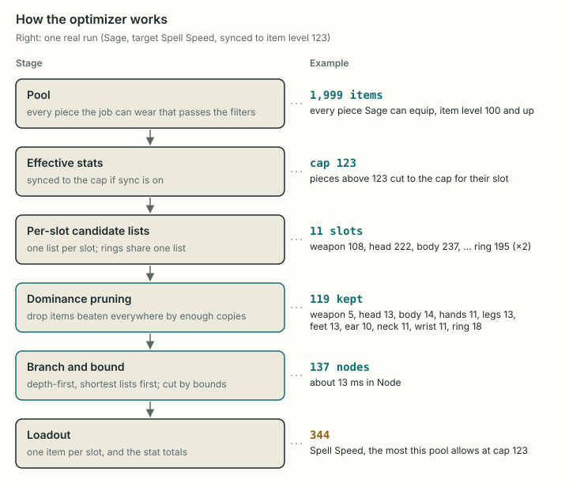
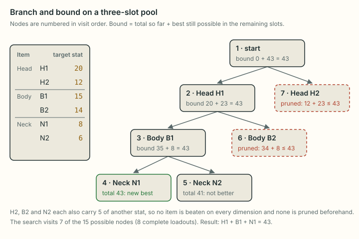

# The gear optimizer

Given a pool of items and a job, the optimizer picks one item per gear slot so that a chosen stat is as high as possible, with up to two tiebreak stats. In optimization terms it is a multiple-choice knapsack problem with conflict constraints, side constraints on the speed stat (and, for tier ranking, minimums on others) and a preemptive (lexicographic) objective, solved exactly by depth-first branch and bound after dominance reduction. This page states the formulation, then the four steps that solve it (an exact weighted-sum scalarization of the objective, dominance reduction, branch and bound with the relaxations behind its bounds, and the per-piece meld subproblem), and argues why the answer is optimal unless the search hits its node limit. It is written for a reader versed in integer programming and knapsack methods but new to this code base and the game.

Related pages: [math.md](../mechanics/math.md) (how a piece's stats are computed and what level sync does to them), [data-pipeline.md](data-pipeline.md) (where the item data comes from), [materia.md](../mechanics/materia.md) (the meld rules), [tier-ranking.md](tier-ranking.md) (ranking by stat tiers, built on this search), [glossary.md](../glossary.md).

How to read it: section 1 is the game background and the problem in plain words, section 2 the formulation. Sections 3 to 5 are the algorithm, in the order it runs. Section 6 adds melds, section 7 is how the page uses the engine, and sections 8 and 9 are the evidence, timings and limits.

## 1. The problem

What does the optimizer choose, and from what?

**Gear and stats.** In Final Fantasy XIV a character wears one item in each gear slot: weapon, head, body, hands, legs, feet, earrings, necklace, bracelets and **two** rings. Each item carries a few stats as integers: the job's **main stat** (Strength, Dexterity, Intelligence or Mind), Vitality, and usually two **substats** such as Critical Hit or Spell Speed (all in the [glossary](../glossary.md#game-terms)). A gear set's stat is the sum over its items.

**Slots that are not independent.**

- Paladin and Beastmaster carry a one-handed weapon plus a shield (the off-hand slot); every other job uses a two-handed weapon, which leaves the off-hand empty. White Mage has both kinds at item level 100 (one wand and shield pair from A Realm Reborn).
- A few body pieces (the Vermilion Cloaks) also cover the head and leave it empty.
- A ring marked [Unique](../glossary.md#game-terms) can be worn only once, so it cannot fill both ring slots.

**The task.** The user's job decides which items are wearable; they form the **pool** of candidate items (real gear from the game data). The optimizer chooses a **loadout**, one item per slot, that:

1. maximizes the weapon's **weapon damage** (the job's physical or magic one; skipped for Blue Mage, whose spells scale with Intelligence only),
2. then, among loadouts with the most weapon damage, the total of a **target** stat (for example Spell Speed or Tenacity),
3. then, among loadouts with the same target total, **tiebreak 1**,
4. then **tiebreak 2**.

This is a lexicographic order: a tiebreak only matters between loadouts that are equal on every higher-ranked stat. Weapon damage comes first on every search (owner's decision, 2026-10-18): it multiplies nearly all of a job's damage, so no set should give it up for more of the goal's stats. It is an implicit key: the page does not offer it as a goal, names it only in a note under the result, and the rest of this page calls the target the first key the user picks. Its values, and its sync rule (a guess), are in [math.md, section 4](../mechanics/math.md#weapon-damage-and-defense). The Target GCD's fastest-GCD search leaves it out, since it only asks how fast the gear can go.

**Constraints.**

- **Copies.** Each pool item has a number of copies. A Unique ring can be worn once; any other ring can be worn in both ring slots, so it gets 2 copies. Everything else has 1 copy (it only fits one slot anyway). The copies come from the game data when an item is added and are not edited on the page; the gear table marks a 2-copy ring ×2.
- **A speed range** (optional): a minimum and a maximum for the speed stat (Skill Speed or Spell Speed). Other stats have no limits, except the minimums tier ranking adds (section 5). The Target GCD layer (section 2) sets the range from a [GCD](../glossary.md#game-terms), the time between most actions; the page's control is in section 7.

**The pool** on the page is every piece the job can wear that the "Gear from" filter lets through; the rest is removed before the optimizer runs, so the search itself is unchanged (section 7).

**Effective stats.** Some content lowers gear to a fixed item level ([item level sync](../glossary.md#game-terms)): sync caps each stat on a piece above the cap item level; see [math.md, section 5](../mechanics/math.md#5-item-level-sync). The optimizer uses the **effective** stats: the synced stats when sync is on, the item's own stats otherwise. With **melds** on (the page's default), every piece that is not synced first gets its best [materia](../glossary.md#game-terms) melds (stones that add a substat) for the objective, and its stats include them. Without a speed range one melded version per piece is enough, as section 6 shows, so the search itself does not change; with one, a piece brings each meld split worth keeping (section 6).

**Why not try everything.** The running example on this page is Sage's pool of every piece it can equip at item level 100 and up: 1,999 items, the pool used for the measurements of 2026-10-12. Its slots hold 108 to 237 items each, which allows about $10^{25}$ loadouts. Removing the items that cannot matter (section 4) leaves 119 candidates synced to item level 123, still about $10^{11.5}$ loadouts, and the branch and bound (section 5) then settles the best one, 344 Spell Speed, after visiting 137 nodes. (Loadout counts: the product of each slot's choices, rings as pairs, so a slight overcount; computed 2026-10-16 on data `d9582a6`.)

## 2. Formal statement

The problem as a 0-1 program, the game rules behind each row, and the Target GCD layer that sets the speed range.

### The formulation

**Data.**

- **Positions** $s = 1, \dots, n$ with $n \le 12$, each of a slot type $t(s)$. The ring type has two positions, $r_1$ and $r_2$; write $k_t$ for the number of positions of type $t$ ($k_{\text{ring}} = 2$, otherwise $k_t = 1$). A slot type with no item in the pool is left out.
- **Classes.** $P_t$ is the set of pool items of type $t$. Item $i$ has a number of copies $c(i) \in \{1, 2\}$, a set $B(i)$ of slot types it leaves empty, and an integer vector $v(i)$ with one entry per dimension $d$: the job's stats (main stat, Vitality, Critical Hit, Determination, Direct Hit, the speed stat, and for tanks and healers Tenacity or Piety). The entries are the effective stats of section 1.
- **Objective keys:** the target $k_0$ and tiebreaks $k_1, k_2$ (either may be absent).
- **Limits** (all optional): a speed minimum $m$ and maximum $M$; minimums $m_d$ on a set $D_{\min}$ of other stats (tier ranking, section 5).

**Variables.** $x_{s,i} \in \{0, 1\}$ for $i \in P_{t(s)}$, with $x_{s,i} = 1$ when item $i$ fills position $s$; and $b_s \in \{0, 1\}$, with $b_s = 1$ when position $s$ is blocked. Totals are $T_d = \sum_s \sum_i v_d(i)\, x_{s,i}$.

**Model.**

$$
\begin{aligned}
\operatorname{lex\,max}\quad & \bigl(T_{k_0},\ T_{k_1},\ T_{k_2}\bigr) \\
\text{s.t.}\quad & \textstyle\sum_{i \in P_{t(s)}} x_{s,i} + b_s = 1 && \text{every position } s \quad \text{(choice)} \\
& b_s \ge x_{s',i} && \text{every } s' \text{ and } i \in P_{t(s')} \text{ with } t(s) \in B(i) \quad \text{(conflict)} \\
& b_s \le \textstyle\sum_{s'} \sum_{i \in P_{t(s')} :\, t(s) \in B(i)} x_{s',i} && \text{every position } s \quad \text{(only a blocker empties a slot)} \\
& \textstyle\sum_{s} x_{s,i} \le c(i) && \text{every item } i \quad \text{(copies)} \\
& m \le T_{\text{spd}} \le M && \text{(speed range)} \\
& T_d \ge m_d && d \in D_{\min} \quad \text{(minimums)}
\end{aligned}
$$

One exception to the choice row: when the ring class holds fewer than two copies in all (a single Unique ring), $r_2$ stays empty, since every candidate for it is already used up. That is the only way a slot is left empty without being blocked.

**The problem in standard terms.**

- **No limits.** The objective is separable over positions, and the only couplings are the ring pair (through the copy rows) and the conflict rows. Each item fits one slot type, so the copy rows bind only on rings. The problem is easy here, and the bound of section 5 is exact.
- **A speed range.** A multiple-choice knapsack problem (MCKP) with speed as the weight: $M$ is a capacity row, $m$ a covering row.
- **Minimums on other stats.** One more row per stat: a multi-dimensional MCKP (MMKP).
- Throughout: conflict constraints between classes (a piece in one class forces another class empty), at most 12 classes of 108 to 237 items before reduction, small integer data (totals of a few thousand), and a preemptive objective.

Standard references for these problems are Kellerer, Pferschy and Pisinger (2004), *Knapsack Problems* (Springer), with a chapter on the MCKP; Sinha and Zoltners (1979, *Operations Research*) for MCKP dominance; and Ehrgott (2005), *Multicriteria Optimization* (Springer), for lexicographic optimization.

### The game rules in the model

**Blocked slots.** $B(i)$ is the off-hand for a two-handed weapon, the head for a cloak, the feet for legs that cover them, the hands, legs and feet for Herklaedi, nothing otherwise. It comes from the item's slot code. A piece with no slot code (a hand-made or generated piece, which the page no longer makes but the engine still accepts) blocks nothing, except that a weapon on a two-handed job blocks the off-hand. The conflict rows make a loadout legal only if every slot in $B(i)$ of a chosen $i$ is empty, and a blocked slot takes no item and adds 0. Dominance (section 4) and the bounds (section 5) both respect blocked slots.

**Branching order.** The positions are taken in a fixed order: weapon, off-hand, head, body, hands, legs, feet, ear, neck, wrist, ring, ring, except that a slot some pool item can leave empty (the off-hand; the head, hands, legs or feet when a piece covering them is in the pool) moves to the end, in the same order. So a blocked slot always comes after the piece that blocks it, and the search knows whether a slot is blocked when it reaches it. The search then reorders the slots that nothing can block by the length of their lists after its filters (section 5); the blockable ones stay last.

**Loadouts.** A loadout $L$ is a feasible assignment; write $i \in L$ for its items, and $\varnothing$ for an empty slot, with $v(\varnothing) = 0$. Emptiness is never a free decision, and two policies follow from that, both deliberate:

- **A single ring only when no pair exists.** If the pool allows any legal pair of rings, a loadout with one ring is not considered, even when every pair breaks a maximum and one ring alone would meet it.
- **A slot is never left empty to meet a constraint.** If every candidate in a slot breaks a maximum, the answer is "no feasible loadout", not a loadout with that slot empty (section 9).

The brute-force reference in the tests copies both rules, so each also has a direct test on a two-item pool (the "policy: ..." tests in the exhaustive test file). Changing one means changing the engine, the reference and those tests together.

### Target GCD: from a GCD to a speed range

A player thinks in GCDs, not speed points, so the Target GCD layer takes a GCD $G$ and one of two modes, sets $m$ and $M$ from them, and runs the optimizer as a small parametric family: one search per distinct speed interval, with the meal chosen outside the searches.

- **"Exactly"** (xivgear's meld solver): the GCD must be $G$. Some jobs want this because their cooldowns drift at a faster GCD (The Balance's Dragoon, Dark Knight and Gunbreaker guides).
- **"Or faster":** the GCD must be $G$ or shorter. The result can come out faster than asked, but only when that set ties or wins on the target and tiebreaks.

![Target GCD in three steps, for a level 100 Sage at exactly 2.45 s with food on (the best of 10 meals for the goal). Step 1: the GCD needs 364 to 449 total speed, gear plus food ("or faster" keeps only the minimum, 364). Step 2: no meal and the 6 meals without speed ask for 364 to 449 from gear; the 4 meals with speed (10% of base 420 plus gear) ask for 293 to 370; equal bands share a search, so 2 searches run. Step 3: the best meal has the highest target with food, then tiebreak 1, then tiebreak 2 with food, then the most food points, then the job's food order. The candidate lists are built once and reused by both searches and every new GCD.](../diagrams/optimizer-target-gcd.svg)

The GCD falls in steps of 0.01 s as speed rises, so each GCD value is reached by an interval of speed. The steps, as in the diagram:

1. **A band of speed** $[m_G, M_G]$, counted as gear plus [food](../glossary.md#game-terms), with the job's always-on [haste](../glossary.md#game-terms) ([math.md, section 6](../mechanics/math.md#6-speed-and-substat-tiers)). "Exactly" uses both ends, "or faster" only $m_G$.
2. **One band of gear speed per meal.** A meal adds $f(g)$ speed, and $g + f(g)$ rises with every gear point, so the gear speeds whose total lands in the band form an interval. Meals that ask for the same interval share one search.
3. **The best meal,** compared with food included. Food is chosen with the gear here: unlike a plain run ([math.md, section 6](../mechanics/math.md#6-speed-and-substat-tiers)), the meal changes which gear fits.
4. **No answer.** "Exactly" a GCD slower than the GCD with no speed (2.40 for a level 100 Ninja, whose GCD with no speed is 2.12) is **unreachable**, and no search runs. When the searches find no set, the answer is **none**. Both report the fastest GCD the pool can reach.

The candidate lists of section 4 depend on the objective and on the kind of rule (none, minimum, or band), not on $m$ and $M$, so one build serves every meal and every new GCD; a list built for a band also serves a minimum.

## 3. Turning the lexicographic order into one number

The branch and bound needs one scalar objective that is linear in $x$. A preemptive objective over bounded integer criteria has an exact weighted-sum equivalent when each weight exceeds the largest swing all lower-ranked criteria can produce (Sherali 1982, *European Journal of Operational Research*, on equivalent weights for lexicographic programs). The engine derives such weights from the pool, so the scalarization is exact, not a big-$M$ guess.

**The rule.** Each item gets a score, and the objective becomes $\max \sum_{s,i} \sigma(i)\, x_{s,i}$:

$$
\sigma(i) = W_0\, v_{k_0}(i) + W_1\, v_{k_1}(i) + W_2\, v_{k_2}(i), \qquad \sigma(L) = \sum_{i \in L} \sigma(i).
$$

For each key $k_q$, let $R_q$ be the widest range its loadout total can span, with the $0$ accounting for an empty slot:

$$
R_q = \sum_{s=1}^{n} \Bigl( \max\bigl(0,\ \max_{i \in P_{t(s)}} v_{k_q}(i)\bigr) - \min\bigl(0,\ \min_{i \in P_{t(s)}} v_{k_q}(i)\bigr) \Bigr).
$$

Then, from the lowest key up,

$$
W_2 = 1, \qquad W_1 = R_2 + 1, \qquad W_0 = R_1 W_1 + R_2 + 1 = (R_1 + 1)(R_2 + 1).
$$

In general $W_q = 1 + \sum_{q' > q} R_{q'} W_{q'}$. With fewer keys, the missing ones are dropped (one key gives $W_0 = 1$). With weapon damage first (section 1) there are up to four keys, weapon damage as $k_0$ and the target and tiebreaks after it; the rule is the same. Only the weapon slot carries weapon damage, so $R_0$ is the spread of the pool's weapons, and the weights above it barely grow. Four keys is the limit (`MAX_KEYS` in `candidates.js`): `makeScorer` throws on a fifth rather than drop it, because a fifth key would push the score past $2^{53}$; more keys belong in tier ranking.

**Why this is lexicographic.** Take two loadouts that first differ at key $q$, by at least 1 (stats are integers). The keys below $q$ can change the score difference by at most $\sum_{q' > q} R_{q'} W_{q'} = W_q - 1$. So the score difference is at least $W_q - (W_q - 1) = 1 > 0$, and the loadout that is better on key $q$ always scores higher.

The weights on the 1,999-item Sage pool (target Spell Speed, tiebreaks Critical Hit then Determination), as measured:

| | $R_1$ (Crit) | $R_2$ (Det) | $W_0, W_1, W_2$ |
| --- | ---: | ---: | --- |
| Synced to item level 123 | 344 | 373 | 129,030 ; 374 ; 1 |
| Unsynced | 3,149 | 3,141 | 9,897,300 ; 3,142 ; 1 |

**Exactness.** Scores are IEEE doubles (JavaScript numbers), exact for integers up to $2^{53} - 1 \approx 9.0 \times 10^{15}$. The engine bounds the largest possible score magnitude,

$$
B = \sum_q W_q \sum_{s=1}^{n} \max\bigl(0,\ \max_{i} v_{k_q}(i),\ -\min_{i} v_{k_q}(i)\bigr),
$$

and refuses to run (it raises an error saying the totals are too large to rank exactly) if $B$ or any weight exceeds $2^{53} - 1$. It does not fall back to an approximate ranking. Measured over every combat job's full real-gear pool, unsynced, for every choice of three different keys: the largest $B$ is $1.27 \times 10^{11}$ (Ninja, main stat / Vitality / Critical Hit), about 70,000 times below the limit (re-measured 2026-10-16, with and without melds).

**What failed.** Fixed weights do not work: the earlier $10^8, 10^4, 1$ stopped being lexicographic once a tiebreak total reached 10,000 ([history.md](../history.md)). **Verified** by test: a head piece with 20,000 of a tiebreak stat no longer outranks one with a higher target stat.

## 4. Fewer candidates: dominance pruning

Which variables can be fixed to 0 before the search without losing every optimum? The tool is MCKP item dominance (Sinha and Zoltners 1979; Kellerer, Pferschy and Pisinger 2004): within a class, an item no better in profit and no lighter in weight than another can be dropped. Here it is extended in three ways: to every stat dimension, to the conflict sets $B(i)$, and to a class with two positions (the rings).

The reduction is what keeps the search fast: the 1,999-item Sage pool shrinks to 119 distinct candidates synced to 123, and to 169 unsynced (129 and 207 with melds).

**Beats.** Within one slot type, item $i$ **beats** item $j$, written $i \succ j$, when

$$
v_d(i) \ge v_d(j) \ \text{for every dimension } d, \quad B(i) \subseteq B(j), \quad\text{and}\quad \bigl(v(i) \ne v(j) \ \text{or } i \text{ comes before } j \text{ in the pool}\bigr).
$$

- **Every dimension** includes all of the job's stats, not just the target and tiebreaks. That way an item kept for its speed, which may have a minimum, is not thrown away.
- **The condition on blocked slots** means $i$ leaves empty nothing that $j$ does not: a cloak that beats a body piece on every stat never removes it, because the head may be worth more.
- **The tie rule** makes $\succ$ a strict order: it is transitive and never cyclic.

**Drop rule.** Drop $j$ only if the items beating it have enough copies between them to fill every position of its type:

$$
\sum_{i \succ j} c(i) \ \ge\ k_t .
$$

For a single-slot type this means "something beats it". For rings it means "two copies beat it": one ring with 2 copies, or two different rings. Copies are counted once per item, so two candidate versions of one Unique ring are still one ring.

**Computing it.** The candidates are sorted by score, then by the sum of their stats, with exact ties in pool order. A beater scores at least as much as what it beats (every weight is positive) and, unless it is an exact tie, has a larger stat sum, so every beater of $j$ comes before $j$. Each candidate is then compared only with the candidates already kept: by fact 1 below, the kept beaters always have enough copies, so this drops exactly the same candidates as comparing with all of them. On 23,652 real slot lists (22 jobs, before Beastmaster, six item level ranges, three sync settings, melds on and off, three objectives) both ways kept the same candidates, and the kept-only scan was 7 times faster. **Verified**.

### Why one better ring is not enough

An earlier rule dropped an item if any single item with at least as many copies beat it ([history.md](../history.md)). That is safe for a class with one position, not for two. With three Unique rings worth 10, 9 and 5, ring A beats both others, so B and C were dropped and the optimizer returned A plus an empty slot (10) instead of A + B (19). **Verified** by tests for this pool, for two identical Unique rings (now 20, was 10), and for a 2-copy ring that still correctly beats two worse Unique rings (20).

### Why the rule is safe

Two facts together show that the reduction never removes every optimal loadout.

**1. The kept items that beat $j$ still have enough copies.** Suppose $j$ was dropped, but the kept items that beat it have fewer than $k_t$ copies. Then some dropped item beats $j$. Among those, pick one, $j'$, that no other dropped item beats ($\succ$ is a strict order on a finite set, so one exists). $j'$ was dropped, so the items beating $j'$ have at least $k_t$ copies. Each of them beats $j$ (transitivity), and each is kept (a dropped one would be a dropped beater of $j$ that beats $j'$, contradicting the choice of $j'$). So the kept beaters of $j$ have at least $k_t$ copies, a contradiction.

**2. Any loadout using a dropped item can swap it for a kept one without getting worse.** Let $L$ use dropped item $j$ in a slot of type $t$. The kept beaters of $j$ have at least $k_t$ copies. The other $k_t - 1$ positions of that type use at most $k_t - 1$ of those copies, so at least one copy of a kept beater $i$ is free. Replace $j$ by $i$. Since $v(i) \ge v(j)$ in every dimension and $B(i) \subseteq B(j)$:

- every total stays the same or rises, so the score does not drop (all weights are positive);
- a speed minimum that held before still holds.

Repeat until no dropped item is used. This ends, because each swap moves to an item higher in the strict order $\succ$. The result uses only kept items and is at least as good as $L$.

**Where it breaks.** Step 2 assumes that more of a stat never hurts, which holds for the objective and covering rows but not for a capacity row: a speed maximum breaks it. In the tested example, head H1 (20 Spell Speed, 30 Crit) beats H2 (15, 25), and rings A, B and C carry 10, 9 and 5 Spell Speed. With "Spell Speed at most 33" every loadout with H1 reaches 34 or more, so only H2 is allowed. The right answer is Critical Hit 25 (H2 with two of the rings), **verified** by test. Until the Target GCD work (2026-10-16), pruning was simply off under a maximum. The rule below replaces that.

### Pruning with a speed range

With a speed range the search looks at only two numbers per candidate: its score $\sigma$ (the profit) and its speed (the weight). So pruning compares only those, as in two-dimensional MCKP dominance:

- **Minimum only** (a covering row: more weight is better): $i$ beats $j$ when $\sigma(i) \ge \sigma(j)$, $v_{\text{spd}}(i) \ge v_{\text{spd}}(j)$ and $B(i) \subseteq B(j)$, with the same tie rule as above.
- **A maximum too:** the same, but with $v_{\text{spd}}(i) = v_{\text{spd}}(j)$. Candidates with different speeds never prune each other.

The drop rule and both steps of the proof carry over. In step 2, a swap does not lower the score, and the speed total rises (minimum only) or stays the same (with a maximum), so the speed rule still holds.

The other stats play no part, so a minimum keeps far fewer candidates than full dominance, and a maximum far more. Example: the full Sage pool (2,422 pieces on data `d9582a6`), unsynced, Critical Hit then Determination, counting the ring list once per ring slot (rerun 2026-10-16):

| Rule | Candidates | With melds (versions, section 6) |
| --- | ---: | ---: |
| Full dominance (no speed range) | 212 | 257 |
| Speed minimum | 38 | 84 |
| Speed maximum | 702 | 1,406 |

Between loadouts with exactly the same score, the one returned can differ from a run without a speed range. The exhaustive-search tests compare the target and tiebreak totals, so they allow that.

The candidates are sorted by score, then by speed, then by stat sum. As above, every beater comes first, and each candidate is compared only with the kept ones. With a maximum, the scan runs once for each speed value.

**Minimums on other stats** (the engine side of tier ranking, roadmap A7) work the same way: each stat with a minimum joins speed in the comparison, and $i$ must have at least $j$'s value of every one. The swap keeps every minimum, so the proof is unchanged. The candidates are then sorted by score, then by the sum of the limited stats.

## 5. The search: depth-first branch and bound

With a few dozen candidates per slot left, how is the optimum found and proved? By depth-first branch and bound over the positions, fathoming a node when a relaxation of the remaining subproblem cannot beat the incumbent. This section states each bound as the relaxation it solves and what that relaxation drops.

**Branching.** Positions come in the order of section 2, except that after the filters the slots nothing can block are searched shortest list first (the ring list counts twice); the blockable slots stay last, in their order. Any order fills every slot, so the answer's score is the same; short lists first keep the top of the tree narrow and leave the long lists for the depths where the bounds and the memo are tightest (2026-10-17, from Perplexity's solver review: on one Black Mage stage, 699,000 nodes and 4.6 s became 341,000 and 1.3 s in its measurements). At each position the candidates are branched on in decreasing score, then stat sum (exact ties keep pool order). The incumbent, with score $\sigma^*$, is replaced only by a strictly higher score, so among equal scores the first one found is kept.

**Fathoming.** At a node where positions $1, \dots, p-1$ are fixed, with partial score $\sigma$ and partial totals $T_d$, the node is fathomed when one of these bounds fails:

| Bound | Relaxation | Drops | Applies |
| --- | --- | --- | --- |
| Score bound $U_p$ | Separable, per position | Copies (not the ring pair), all limits | Always |
| Speed minimum | Separable, on speed | All but speed | Speed minimum |
| Speed maximum | Feasibility test | Nothing | Speed maximum |
| Speed tables | Exact DP, speed as weight | Copies, other limits | Speed range |
| Per-stat tables | Exact DP per stat; least taken | Copies, other limits | Stat minimums |
| Band reach | Exact DP, speed as weight, a held stat as value; a feasibility test | Copies, other limits | Speed band and minimums |
| Regain cut | Valid inequality from an earlier stage | Nothing (cuts no feasible set) | Tier ranking |
| Lagrangian bound | Limits priced into objective | Limit rows | Tier ranking |

The first three rows are below; the tables and band reach are in the two subsections that follow, the regain cut in [tier-ranking.md, section 4.4](tier-ranking.md#44-regain-cuts-from-the-stages-before) and the Lagrangian bound in [tier-ranking.md, section 4.2](tier-ranking.md#42-pruning-against-the-set-in-hand). With the best multipliers the Lagrangian bound equals the linear-programming relaxation's value (as tier-ranking.md notes), so it is the only bound here that relaxes integrality.

**Score bound: the separable relaxation.** Drop every limit row and every copy row except the ring pair's; what is left decomposes by position, and the remaining positions can add at most

$$
U_p = \sum_{s \ge p} u_s, \qquad u_s = \max\Bigl(0,\; \max_{i \in P_{t(s)}} \bigl(\sigma(i) - \textstyle\sum_{s' :\, t(s') \in B(i),\, s' > s} u_{s'}\bigr)\Bigr),
$$

so if $\sigma + U_p \le \sigma^*$, nothing below this node can be strictly better.

- For a piece that blocks no later slot, $u_s$ is just the best score in the slot.
- A piece that blocks later slots (legs that cover the feet) is bounded together with them: its score is spread over its own slot and the ones it empties, so $\sigma(i) \le u_s + \sum_{s' :\, t(s') \in B(i)} u_{s'}$ and the sum never counts both the piece and the slots it blocks. The speed bound uses the same spread.
- Why that matters: counting both, with the best feet piece on top of a legs piece already worth legs and feet, the search hit its node limit under level sync below 50, where every piece syncs to nearly the same item level and loadouts tie; now those searches take a few hundred nodes.
- **Blocked slots come off.** While a chosen piece blocks a later slot, that slot's bound $u_{s'}$ and speed come off the bounds, so a cloak's branch is pruned like any other. Without this, ceiling runs on the full Sage pool synced to 123 hit their 150,000-node limit; now the largest takes 181 nodes.

**Ring pair.** The separable bound treats each remaining position independently, except that the two ring positions are bounded together. At $r_1$ the two add at most the best **legal pair**: the best ring twice if it has 2 copies, otherwise the best ring plus the best ring of another item (the best alone if there is none). Every legal pair is at most this: a pair with the best ring adds the best other item at most, and a pair without it has both members at most the best other item.

Two independent position bounds would count the best Unique ring twice. That leaves the bound too high, and the search cannot fathom the many near-ties below it (one real run fell from 80,290 nodes to 170 with the pair bound). The bounds still drop copies in other ways and can overestimate; a valid but loose bound never fathoms a node that should be kept, it only costs nodes.

**Speed minimum.** The same separable relaxation applied to the covering row: if $T_{\text{spd}} + \sum_{s \ge p} \max\bigl(0, \max_{i \in P_{t(s)}} v_{\text{spd}}(i)\bigr) < m$, the minimum can no longer be reached.

**Speed maximum.** A candidate is skipped if adding it would push the speed total past $M$. All real item stats are non-negative (checked over all 20,031 database rows), so the total can only grow along a branch and the test is exact.

**Ring symmetry.** The two ring positions share one list. Choosing (A, B) or (B, A) gives the same loadout, so the symmetry is broken by requiring the second ring's position in the sorted list to be at least the first ring's. The same ring can fill both positions only if it has 2 copies.

**Empty slot.** A slot is left empty only when no candidate for it has a copy left. Candidates skipped by the ring symmetry rule or by the speed maximum still count as available here.

**Node limit.** Every visited node counts. When the count passes the limit, the search stops, returns the incumbent and marks the result as **truncated**. A truncated result may not be the best one. The page uses a limit of 700,000 nodes and shows a note under a truncated result. The engine's own default, when no limit is given, is 1,500,000.

**Why the answer is exact.** Every fathoming is justified by an upper bound of a relaxation (or, for the speed rules, by a constraint that can no longer hold), and section 4 showed that some optimal loadout uses only kept candidates. So unless the node limit stops it, the search returns an optimal loadout.

### With a speed range

The separable bound takes each position's best score and best speed from different items. Under a speed row that is weak: the best-scoring pieces often carry no speed, so the score bound stays high while the speed has to come from elsewhere. Before the Target GCD work, a synthetic pool where every piece trades Critical Hit for speed ran to the 700,000-node limit. Three additions fix that, and each one keeps the search exact.

**Speed tables: the MCKP relaxation, solved by DP.** Before the search, a table gives $\text{rest}(p, c)$: the most score positions $p, \dots, n$ can still add when the loadout so far has speed $c$ and the speed rule must still hold at the end. It replaces the separable score bound with $\sigma + \text{rest}(p, T_{\text{spd}}) \le \sigma^*$. This is the standard MCKP dynamic program with speed as the weight, built from the last position back:

- **Minimum only:** $\text{need}_p(r)$ is the most score positions $p, \dots, n$ add while adding at least $r$ speed, for $r$ from 0 to $m$. Each position contributes only its frontier: the best score at each speed, and only speeds where no faster piece scores as much (the 2-D dominance of section 4).
- **With a maximum:** $\text{exact}_p(s)$ is the most score while adding exactly $s$ speed, for $s$ from 0 to $M$. The bound is the best value over the speeds that still land in $[m, M]$. A running maximum, and a sliding maximum over a window the band's width, read it in constant time.

The relaxation keeps the speed row exactly and drops the copy rows: each position is counted on its own, so a Unique ring may count twice. It also lets a position stay empty where a legal loadout can leave it empty: a blockable slot, a slot with no candidates, or a ring slot whose list holds fewer than two copies. So the table never falls below what some legal completion adds, and it fathoms nothing it should keep. A maximum at or above the most speed the slots can add is treated as no maximum.

**One table per set of blocked slots.** Once a chosen piece blocks a later slot (a two-handed weapon the off-hand, a cloak the head), that slot adds nothing to any completion. The table for no blocked slots still counts its best piece there, so the bound stays too high and branches under that piece are almost never fathomed. The search therefore keeps one table per set of blocked slots, built the first time it is needed, in which those slots can only stay empty. That is still a relaxation: a blocked slot is empty in every completion. A table costs 1 to 50 ms to build, more than a small search takes, so the extra tables are built only after 2,000 nodes; before that the table for no blocked slots stands in, which is a looser bound but still a bound. With one table for all, a White Mage search with a two-handed weapon still counted the best shield and ran 110,000 to 420,000 nodes at item level 400 instead of under 120.

Measured (2026-10-16): White Mage and Black Mage were the slow cases, since 98 of White Mage's 116 weapon candidates and 107 of Black Mage's 124 are two-handed. White Mage at cap 400, Piety then Determination and Direct Hit, exactly 2.40 with food, searched 1,120,206 nodes over its four meal bands and took 5.3 s; with the tables it takes 92 ms. Black Mage at cap 660, exactly 2.34 with food: 10.2 s, now 84 ms (warm runs, one process, nothing else running).

**Speed groups.** At each node a position's candidates are grouped by speed and by the slots they block. Within a group the table's term for the rest is the same, so the groups are tried in order of their bound and each is scanned by score until a candidate cannot beat $\sigma^*$. Groups come sorted by their best score, so the loop stops at the first group that cannot beat $\sigma^*$ even with the table's most at any speed.

**State dominance.** Two partial loadouts at the same position have the same set of feasible completions when they have:

- the same speed total (with a minimum and no maximum, any total at or past $m$ counts as $m$);
- the same blocked slots;
- at the second ring position, the same first ring.

So a later one is fathomed unless its score is higher. Copies need no place in the state: only the two ring positions share items, and the first ring is in it. This is DP state dominance used inside the branch and bound, the reverse of Morin and Marsten's (1976, *Operations Research*, "Branch-and-bound strategies for dynamic programming") use of bounds inside a DP.

**A trap.** Blocked slots are not taken off the table bounds as they are off the separable ones. The tables already leave a blocked slot empty (and let a blockable one stay empty), so taking a blocked slot's best score off as well can undercut the bound. That gave one wrong White Mage answer in 41,000 runs of the prototype sweep, which is how it was found.

Measured on the synthetic pool above: 29 nodes with a speed minimum and 12 with a band, both against 700,001 (truncated) before.

### With minimums on other stats

A search may also hold any stat to a minimum (tier ranking, roadmap A7), alone or with the speed range: the MMKP case. Each limited stat gets everything speed has above:

- its own table, built the same way;
- its own minimum check;
- a place in the group key and the state key.

**State dominance with several limits.** Equal states are not the only ones that can be cut. With two or more limits, a later state is also cut when an earlier one at the same position, blocked slots, first ring and exact totals of the limits with a maximum has at least its score and at least each minimum-only total (capped at its minimum): every completion of the later one completes the earlier one with no lower score and no broken limit. Each such key keeps at most 32 states no other one beats; dropping one only cuts less. On White Mage at level 100, exactly 2.30, food off, Direct Hit > Piety > Determination, the Determination search fell from 1,253,132 to 1,114,095 nodes. Equality alone missed the states that differ in a held total: on White Mage at level 100, exactly 2.31, Piety > Determination > Direct Hit, food off, it took 11.8 million nodes to prove Direct Hit 0.

The bound is the **smallest** of the tables. Each table is the exact value of a relaxation that keeps one limit row and drops the others, so each is an upper bound and so is the smallest. A joint table over every limited stat would be the exact DP but far too large ($10^{10}$ cells at level 100). Candidates must be prepared for the stats that may get a minimum, since pruning and meld versions depend on them.

**Band reach (2026-10-17).** The minimum check above takes each remaining slot's most of a held stat, ignoring speed. Under a speed band, each held stat also gets a table of the most of it the remaining slots can add while speed still lands in the band: the band table of the previous subsection with the held stat as the value instead of the score. A node is fathomed when even that cannot reach the minimum. It keeps the speed rows and one minimum row exactly and drops the copy rows, like every table, so it cuts no feasible set. On White Mage at level 100, item level 690, Piety > Critical Hit > Determination, Perplexity measured 6.0 s against 4.1 s on its prototype.

**Groups with several limits.** A group's value for a limit other than the first must give a table bound at least every member's: the most any member adds for a minimum only (its table only rises with the total so far), the least for a maximum only (its table only falls: a regain cut), and a second band goes into the group key. Until 2026-10-17 the code took the most for every limit, which was right only because speed, the first limit, was the only one with a maximum. The key holds only the first limit's value and the bands: grouping by every limited value made nearly every candidate its own group, and bounding each group at every node cost more than it saved (Sage at level 100, three limits: 9 s).

Tier ranking's searches hold two or three stats near their most, often with a speed band, where these tables alone are weak. More steps run before the search there, all explained in [tier-ranking.md](tier-ranking.md):

- a shortfall filter, which fixes to 0 every candidate that cannot reach a minimum even with the best of every other slot ([section 4.1](tier-ranking.md#41-the-shortfall-filter));
- pruning against a set already in hand (a seed): the Lagrangian relaxation of the limit rows (Geoffrion 1974; Fisher 1981, *Management Science*), with multipliers from subgradient steps, and reduced-cost fixing of candidates against the seed's score (as in Crowder, Johnson and Padberg 1983, *Operations Research*) ([section 4.2](tier-ranking.md#42-pruning-against-the-set-in-hand)); its bound is also used at nodes, with the multipliers fixed at the root;
- regain cuts: each earlier stage's proven most of its key becomes a valid inequality on how much of it the pieces give up against a swap ([section 4.4](tier-ranking.md#44-regain-cuts-from-the-stages-before));
- a trial search of at most 20,000 nodes, and only when it does not finish, Pareto fronts, the Nemhauser and Ullmann (1969, *Management Science*) dynamic program with Morin and Marsten's bounding, which often settle the search without a tree ([section 5](tier-ranking.md#5-pareto-fronts)).

The shortfall filter also runs on Target GCD searches (their speed minimum).

With no minimums the search is the one above. Against the search before this change (2026-10-16), the plain optimizer gave the same results with the same node counts in 5,580 runs (`scripts/perf/compare.mjs --quick`), and Target GCD gave the same results in 2,045 runs of each mode, with slightly fewer nodes (198,473 against 199,862 in "exactly" mode) from the shortfall filter.

## 6. Melds in the search

With melds on, every piece that is not synced enters the search with its best melds for the objective. Each piece carries a small integer subproblem: how to allocate its stones among the keys. How is it solved, and why is one melded version per piece enough? The meld rules themselves (stone values, item level gates, caps, sync) are in [materia.md, section 2](../mechanics/materia.md#2-the-rules).

Notation from there: a piece has $B$ **big** stones (guaranteed slots and the first overmeld slot, any grade) and $S$ **small** ones (later overmeld slots, no grade VI, VIII, X or XII), worth $V$ and $v$ at the best grade its item level allows, and $h_k$ is its **room** on substat $k$, the points left below its cap.

### The best melds of one piece

The objective ranks substats in order, keys $k_1, k_2, k_3$: the target, then up to two tiebreaks. Only keys that are combat substats can take stones; a main stat target alone melds nothing, and weapon damage (section 1) takes none.

**Example: greedy filling is not exact.** Putting the biggest stone into the first key that still has room loses on some pieces. Courtly Lover's Earrings of Healing (item level 770) has Critical Hit 142 against a cap of 203, so 61 of room, and takes 2 big stones (XII, 54) and 3 small (XI, 18), as in the diagram in [materia.md, section 2](../mechanics/materia.md#2-the-rules). With Critical Hit as the target and Determination as the tiebreak:

- Greedy puts both XII into Critical Hit: 108 for 61 of room, 47 lost. The three XI give Determination 54.
- XII + XI reach the cap just as well and leave a XII for Determination: 54 + 18 + 18 = 90.

Over every meldable piece of all 22 jobs before Beastmaster and every ordered pair of substats (615,204 cases), greedy is worse in 13,543 (2.20%). **Verified** by running both.

**The exact rule.** A meld plan puts $b_q$ big and $s_q$ small stones into key $k_q$. The rest are spare and stay empty. With big value $V$ and small value $v$, the gain on key $k_q$ is capped by its room:

$$
\text{gain}_q = \min\bigl(h_{k_q},\ b_q V + s_q v\bigr), \qquad \sum_q b_q \le B, \quad \sum_q s_q \le S .
$$

The best plan maximizes $(\text{gain}_1, \text{gain}_2, \text{gain}_3)$ in lexicographic order: first the target's gain, then the first tiebreak's, then the second's.

- **Ties** go to the plan that leaves the most slots empty, then to the one whose stones are worth the least. A stone that adds nothing to a key is not melded: no stones go into substats the objective doesn't score (the owner's decision, 2026-10-15; until then they went into the job's other substats in order). The page lists the empty slots after the stones ("3 slots empty").
- **Full enumeration.** The search tries every split of the $B$ big and $S$ small stones among the keys and the spare bucket. That is at most 200 splits per piece, and the result is cached for each combination of stones, values and rooms.
- **Always the best grade:** for a fixed split, a bigger stone never lowers a gain, so using the most valuable allowed grade loses nothing.

**A missing substat can be melded.** Kirin's Osode of Fending (5 guaranteed slots, grade VI) maximizing Skill Speed, which it doesn't carry, gets five VI: $5 \times 16 = 80$, below its cap of 110. Maximizing Determination instead, it gets two VI and one V ($77 \to 110$; three VI reach the same 110, and the fewest-big-stones rule of [materia.md, section 2](../mechanics/materia.md#which-stones-are-shown) prefers the V), and its other two slots stay empty; with Direct Hit as a tiebreak, those two take VI and give Direct Hit 32 (computed 2026-10-16).

**Order.** The page lists the stones in slot order, the order they are melded in: the big stones (slots 1 to $B$), then the small ones. Read left to right, every list is a legal melding order. A test checks this for every meldable piece of three jobs under four objectives.

### Why one melded version per piece is exact

The optimizer scores a loadout as the sum of per-piece scores, $\sigma(L) = \sum_{i \in L} \sigma(i)$, with the weights of section 3. Those weights are derived from the vectors the search can use, so they are computed after melding.

- **Melds belong to one piece.** A piece's melds change only that piece's vector (its column). Copies (a Unique ring is worn once) and blocked slots (a cloak empties the head) depend on the item, not on its melds.
- **The best version wins every swap.** Take any legal loadout and replace one worn piece's melds with that piece's best plan. The loadout stays legal, and its score can only go up, because $\sigma$ restricted to one piece orders plans exactly as their lexicographic gain tuples. Repeat for every piece.
- **So one version per piece is enough.** Some optimal loadout uses only best-melded pieces, so each meldable piece enters the search as one candidate and the search itself is unchanged. This holds even for two copies of one ring, since each copy takes the same best plan.
- **It does not hold with a speed range.** Under a speed minimum or maximum, a piece's best melds depend on the rest of the loadout: a stone in speed can be worth more than a stone in the target if the rest of the set falls a few points short. Until 2026-10-16 the engine refused melds together with a speed range; now each piece brings several versions (below).

### Meld versions under a speed range

With a speed range, speed joins the keys of the split search above, and every split is kept that no other split **beats**: each piece is expanded into the nondominated set of its meld plans (its Pareto set), and each kept plan becomes one item of the piece's class.

- **Minimum only:** another split beats it when it gains at least as much on every key, speed included.
- **With a maximum:** the same, but only at the same speed gain. A split with less speed can be what keeps a set under $M$.

A stat with a minimum (tier ranking) joins the keys the same way as speed with a minimum only. Each surviving split is one candidate of the piece. Every version shares the item, so copies and Unique rings still count once per piece. Pruning (section 4) then drops the versions that another candidate beats on score and speed.

**Why this is exact.** Take an optimal loadout and one of its pieces with melds $P$. Some kept split $Q$ gains at least as much as $P$ on every key, and (with a maximum) the same speed. Swapping $P$ for $Q$ does not lower the score, and the speed total rises (minimum only) or stays the same. So some optimal loadout uses only kept versions.

**Details.**

- Among splits with the same gains, the one with the fewest stones wins, then the fewest big stones, as for one best split ([materia.md, section 2](../mechanics/materia.md)).
- A small stone in a big slot can be the split shown, but never adds a version: with a maximum its lower speed could, but it was left out for no gain in sets ([materia.md, "Which stones are shown"](../mechanics/materia.md#which-stones-are-shown)).
- The lists are cached by stones and room. Room beyond what all the stones can add changes nothing, so it is clamped first, and more pieces share one list.
- Tier ranking's stages build one candidate list each, all on the same version keys, so each piece's versions are built once per ranking and copied into each list (2026-10-17; Perplexity measured 5 to 15% off a tier ranking).
- Example: the full Sage pool, unsynced, Critical Hit then Determination (the table in section 4). After pruning, a band keeps 1,406 candidates, a minimum 84, and no speed range 257.

**What failed.** The first version of this kept only the splits beaten by nothing on every key, including speed, even with a maximum. That dropped splits with less speed that a band needed. Perplexity's review flagged it too, and the exhaustive test with a band now covers it.

## 7. The page's pool and its filters

What does the page hand to the engine, and what does it show back?

**No pool to build.** The optimizer searches every database piece the job can wear (built once per job, about 5 to 10 ms) that passes the filters under **Gear to search**.

- Until 2026-10-15 the user picked pieces into a pool on a Gear pool tab first (often with "Add all"); the owner dropped that step once searching everything proved as fast.
- A sweep then compared that with era gear only (pieces the sync leaves untouched, which keep their materia): over 1,971 runs (every job, 17 sync settings, every target, materia on), searching every piece gave a better target total in 70% of runs (median +2%, at most +35%), never a worse one (era gear is a subset), and its best loadouts are about three quarters synced high-level pieces (a one-off sweep on 2026-10-15, measured once; the script is not kept).

**Gear to search** has the Gear browser's filters, in the same order, with the optimizer's own values (added 2026-10-15 at the owner's request):

- Expansion, Equip level (pieces up to that equip level), item level from and to (each empty means no limit; the equip level starts at the job's level cap), and Gear from.
- A piece passes exactly when the browser would list it with the same filters and no name or slot. The filters only narrow the pool, so they never make the search slower.
- **Gear from** (owner's design, 2026-10-18) is a dropdown of 20 boxes by what a player does to get a piece, in two columns of sections: Everyday and Time-limited, Side content and Hard content. A piece is searched when one of its ways to get it needs only ticked boxes (its routes, from the game files: [data-pipeline.md, section 4](data-pipeline.md#sources)). Savage and Extreme have a Current box (the level cap) and a Legacy one (below it, farmable unsynced); Ultimate is one box. At the top of the menu, a market board switch (on by default) searches every tradeable piece whatever its boxes, then All, None and Default. A line under the boxes describes the one under the pointer or keyboard focus; a box with nothing for the job and the other filters is greyed out but can still be ticked. Nine boxes are off by default (`on` in the format file); the button reads "11 of 20", and adds "· no market board" only when the switch is off. A saved choice, including every box ticked, is kept.
- The heading counts the pieces searched out of every piece the job can wear (for Sage at level 50 with the default filters, "searching 2,328 of 2,422 pieces", 2026-10-18).
- **Relics whose substats the player allocates** are always left out, with a note under the result when the filters would have searched one (owner's decision, 2026-10-18). Such a relic has no substats in the game files (category relic, no meld slots, no substats; `allocatedRelic`), but the highest weapon damage of its time, so with weapon damage first it would win with none of the goal's stats. Modeling the allocation is a roadmap item.
- The Gear browser has its own filters, so looking gear up never changes the search; when no piece passes, the page says so instead of a result.

**Target GCD on the page** (owner's decisions, 2026-10-16).

- The Goal row's last two columns (owner, 2026-10-18: the Goal and Gear to search rows share five columns) hold the box (empty means any GCD) and "exactly" / "or faster" ("exactly" by default, as in xivgear); the label gives the range of GCDs the gear reaches in parentheses ("Target GCD (2.50 to 2.10)"). The range follows the settings as they change, before the next Optimize: it is one search for the most speed (20 to 100 ms), run with the piece count 120 ms after a change.
- For Monk, Ninja, Samurai and Viper the label also names the haste ("Target GCD (2.12 to 1.80 with Fuka 13%)") and the box takes the hasted GCD; the result shows both ("2.14s · GCD (Fuka 13%; 2.47 without)").
- A set that meets the GCD gets no line under the box (owner, 2026-10-19). One short line in plain text says when the set came out faster in "or faster" mode ("2.17, faster than asked"); when no set fits it says why in a warning box ("Ninja's GCD is 2.12 at most (Increase Attack Speed 15%)", "The GCD can't go below 1.50", "No set at exactly 2.10").
- The range comes from a search, so the label shows it only while the result is for the current settings. The box is disabled while the goal is speed (the label then reads "Target GCD (off: the goal is speed)") and cleared on a job switch.
- The page keeps the candidate lists and the fastest GCD between runs, so a new GCD reruns only the search.

**Optimize** (owner, 2026-10-18). The search runs only when the user presses Optimize, at the right of the switches' line, after tier ranking's switch; before the first press the page says "Press Optimize to find the best set for the goal." A setting changed after a search dims the result, with "The settings changed since this result. Press Optimize to update it." above it, and turns its menus off (a pick would search with the new settings); a job switch clears it. A piece or meal picked from the menus of a current result still updates it at once.

**Rank by tier on the page** (roadmap A7; owner's decisions, 2026-10-16).

- A "Spare points to tiebreaks" switch at the right of the Materia and Food line, before Optimize, **on by default** (kept after comparing tier and raw results, owner's decision, 2026-10-17); it is saved, and a save from before it existed restores it on.
- Its label and ? note ("Substats only improve at tiers, so points short of the next tier do nothing in game. This sends those spare points to your tiebreaks instead.") were chosen on 2026-10-18 after an independent review of the words players use: "tier" is the community's word (AkhMorning, The Balance, xivgear), and "wasted" was avoided, since melding guides use it for materia past an item's cap. It was "Rank by tier" before.
- On, the search is tier ranking ([tier-ranking.md](tier-ranking.md)): meal and gear are chosen together, with or without a Target GCD, since every tier counts food.
- In the Tier row the held stats are highlighted. (A line under the readout named them in order with the effect each held, "Ranked by tier: Piety +165 MP, then ..."; dropped on 2026-10-18 by the owner, since the Goal selects give the order and the Effect row the effects.)
- A thin progress bar shows from the first frame of a solve until the result: the solve holds the page's thread, and the bar's animation runs on the compositor meanwhile.

**Character panel totals.** The Total and With food rows show each substat as the in-game character panel does: the level's base plus gear (plus food); docs/mechanics/math.md, "Totals as on the character panel". Main stat and Vitality stay gear points: their base depends on the job and clan, which the page does not ask for (owner's decision). The party bonus is not counted. The Target GCD line's speed band uses the same numbers.

**Other pieces with the same result** (roadmap A9; owner's decisions, 2026-10-16). The search returns one set, but under sync many pieces reach the same caps: for Sage at level 50, item level 123, with crafted and tomestone gear, every slot has 11 to 20 others, 171 in all. So each result row shows a piece with the same result, and its item cell is a menu ("1 of 14") of all of them, by expansion, each with its gear category ([data-pipeline.md, section 4](data-pipeline.md#gear-category)). A search box at the top takes the keys when the menu opens (owner, 2026-10-18); a piece passes when every word is in its name or gear category ("ring heal", "raid"), and a search that matches nothing says so with Clear search (`samePassing`, sharing `searchMatches` with the Food menu).

- **The same result:** the same main stat, and every substat at the same tier, counted with the result's meal. The tiers are tier ranking's (`rankTierOf`, [tier-ranking.md](tier-ranking.md)), so speed holds its GCD (with haste) but its DoT/HoT tick scaling may drop a step (the GCD matters far more; owner's decision, 2026-10-16, as for tier ranking), and Tenacity holds its mitigation step (200) but its damage bonus may drop a step (tanks take Tenacity for mitigation; Critical Hit, Determination or Direct Hit do more for damage; owner's decision, 2026-10-16). The plain optimizer maximizes the goal stat's raw points, so they stay as well (a Spell Speed goal that kept its GCD at 3 points less would show less than the search found); so do they under tier ranking, where the points left over go to the goal (order A; [tier-ranking.md](tier-ranking.md)).
- **Which piece a row shows:** the lowest equip level, then the lowest item level; the search's own pick on a tie. No setting: the pieces are equivalent, so none is marked as the optimizer's.
- **Rows share their spare points.** Two swaps can each keep a tier alone and lose it together, so every check is made against the pieces the other rows show at that moment: rows are filled in panel order, each menu is computed against the rows as shown, and a pick from a menu checks the others again. A Unique piece is never in two rows (rings), and a piece must leave the same slots empty as the search's pick (a cloak never replaces a plain body).
- **The candidates** are the search's own, unpruned: every piece with its synced stats and the melds the search would give it (each meld version under a Target GCD). Most pieces are ruled out by the main stat alone. Picks are not saved (A3 will) and any setting change clears them.
- **Cost:** in Node, 0 to 19 ms per run, plus 14 to 19 ms to build the unpruned lists, which are kept while the pool settings, goal and GCD mode stay (Sage at level 50 / 100 and Warrior at level 70 / item level 400).

**The Food row's menu** (owner's design, 2026-10-18; it replaced the Meal (HQ) box). With Food on, the search uses the best meal for the goal, and the Food row's meal is a menu like the rows' above, made to serve sets built by hand later (A4) as well:

- **Which meal the row shows:** the highest item level meal with the same result as the best (owner, 2026-10-18) (`sameMeals`: the same as for pieces, plus the same total on every goal key without tiers, since every meal adds Vitality), tagged "best for goal" and counted ("1 of 11"). Under sync many meals tie: for Astrologian at level 50, item level 123, Mind > Vitality > Direct Hit, 11 meals from Dawntrail, Endwalker and Shadowbringers give the same bonus, and the row shows the newest Dawntrail one.
- **The menu** lists every meal the job can use (`allMeals`; 182 for Astrologian), by expansion, newest first, one line each (owner, 2026-10-18): its item level first ("i580", as players write it), its name, and what it adds on this gear ("SpS +44 DHT +41 VIT +54"); its stat pair ("Spell Speed + Direct Hit") is the row's hover text. No deltas and no "same result" labels. Above the list, on one line: a search box (meal names), stat pills (CRT, DET, DHT, SpS, PIE; a meal must have each pill picked, and after two the rest are greyed out, since a meal has at most two stats) and a "Best for goal" switch, on by default, that keeps only the tagged meals. The pills start from the goal (owner, 2026-10-18): the first time the menu opens for a result (after Optimize or a meal pick), the goal's substats are picked in order (target, tiebreak 1, tiebreak 2), only those the newest meal tagged best for goal has, and two at most; the player's changes then stay. Turning "Best for goal" on puts the pills back to those, so the switch never empties the list. A pill that would leave no meal under the other filters is greyed out, like a third one. So only a search can empty the list, which then says so: "No meal matches "xyz". Clear search" (`mealsPassing`, `mealPillOff`, `mealEmptyReason`; a unit test walks every state the menu can reach and checks it).
- **A picked meal** reruns the search with it in place of the best, since with tier ranking or a Target GCD the meal can change which gear wins; the row then says "HQ, picked". Like the rows' picks it is not saved and any setting change clears it.
- **Limit:** the tags compare meals on the gear the search found with the best meal. Under tier ranking or a Target GCD another meal could lead the search to other gear; checking that would take a search per meal, so it is left to a pick.

**Removed: the ceiling table.** The page used to show a per-stat ceiling table below the result (each stat's best total from the pool, synced and unsynced). It was removed on 2026-10-12 (owner's decision): it repeated the main result per target and the Sync limits tab, and cost 12 or 14 extra searches on every change.

## 8. Correctness and performance

How do we know the answers are right, and how fast are they? The short version first; the checks and dated measurements follow.

**Summary.**

| Claim | Status | Evidence |
| --- | --- | --- |
| The search returns a best loadout under the rules of section 2, unless truncated | **Verified** | Exhaustive tests against the brute-force reference (random and real pools, with melds, speed ranges and Target GCD); real-gear probe, 0 misses in 9,800 runs |
| Pruning (section 4) and meld versions (section 6) never remove every best loadout | **Verified** | Proofs in those sections; the same exhaustive tests; regression tests for the ring and speed maximum examples |
| The score order is lexicographic, even with huge tiebreaks | **Verified** | Proof in section 3; 200 random pools with tiebreaks up to 50,000 per item |
| Target GCD finds the best set and meal | **Verified** | Exhaustive tests; a sweep of 252,112 runs with 0 mismatches |
| The stats the search is given are the game's | Not tested here | The checks share the optimizer's synced stats, so they test the search, not the sync model (section 9) |

| Timing (Node 22, owner's PC) | Measured | Where |
| --- | --- | --- |
| Full pool, every job, median, melds off / on | 9.2 / 14.8 ms (2026-10-14) | [Stress test](#stress-test-2026-10-14) |
| Quick benchmark after the item level floor dropped to 15, median, melds off / on | 22.4 / 34.6 ms (2026-10-15) | [Item level floor 15](#item-level-floor-15-2026-10-15) |
| Target GCD, a new GCD for the same goal, median / slowest | 5 ms / 1,075 ms (2026-10-16) | [Target GCD sweep](#target-gcd-sweep-2026-10-16) |
| The page, later runs, Paladin | 21 ms (2026-10-15) | [Stress test](#stress-test-2026-10-14) |

Most of a run is building the candidate lists (syncing, melds, vectors, pruning: about 90%), not the search.

### Correctness evidence

| Check | Kind | Size | Result |
| --- | --- | --- | --- |
| Real-gear pools, seven jobs | test | 3,072 to 147,456 loadouts | all equal |
| Unique rings | test | one real pool | all equal |
| Page views and the built page | test | real pools | all equal |
| Exhaustive search, random pools | test | 400 pools | all equal |
| Exhaustive search, huge tiebreaks | test | 200 pools | all equal |
| Speed constraints | test | one small real pool | all equal |
| Regressions | test | 5 small pools | pass |
| Known values | test | generic gear | pass |
| Exhaustive search with melds | test | 40 pools | all equal |
| Target GCD against the exhaustive search | test | small real pools | all equal |
| Target GCD sweep, every job | probe | 252,112 runs | **0 mismatches** |
| Melds against xivgear | probe | 10,534 pieces | all equal |
| Real gear, exact optimum | probe | 9,800 runs | **0 misses** |

A **test** runs with `npm test`; a **probe** is a one-off measurement for the docs that `npm test` does not re-check. Notes on each row:

- **Real-gear pools.** White Mage, Sage, Warrior, Paladin, Dragoon, Bard and Black Mage, each with every item it can equip in a small item level window between 120 and 135. For every substat as the target, synced to 123 and unsynced, the target, main stat and Vitality totals equal the brute force.
- **Unique rings.** Item level 130 Sage gear whose only ring is Unique wears it once (235 Spell Speed synced, 243 unsynced); with two copies allowed the same ring is worn twice (258 / 267).
- **Page views and the built page.** The optimizer view on real Black Mage gear, and the smoke test's Sage and Warrior pools (Spell Speed 247 / 255, Skill Speed 85 / 87).
- **Exhaustive search, random pools.** Seeded random pools with rings of 1 and 2 copies, Unique items, empty slot types, sync on and off, tiebreaks, speed minimums and maximums. The optimizer is compared with trying every legal loadout.
- **Huge tiebreaks.** Random pools with tiebreak stats up to 50,000 per item.
- **Speed constraints.** A small pool of real items: speed minimum, maximum and range, and infeasible cases, against an independent brute force.
- **Regressions.** The three ring pools of section 4 (best totals 19, 20 and 20), the large-tiebreak case of section 3, and the speed maximum example of section 4.
- **Known values.** Generic item level 475 gear synced to 123 gives 296 Spell Speed, a 2.22 s GCD at level 50.
- **Exhaustive search with melds.** Random pools of real pieces (some meldable, some synced), against a reference that enumerates every stone placement on its own ([materia.md](../mechanics/materia.md)).
- **Target GCD against the exhaustive search.** Both modes with melds, on small real pools with Unique rings, two-handed weapons, shields and the A Realm Reborn tank pieces that cover several slots (Flanchards, Herklaedi). GCDs slower than the free result (the drift case) are included. With food and haste, the reference finds each meal's band by scanning every gear speed, with no use of the engine's band arithmetic.
- **Target GCD sweep.** Not a committed test (`node scripts/perf/target-gcd-sweep.mjs`); details under [Target GCD sweep](#target-gcd-sweep-2026-10-16) below. Every 4th run without food is solved again by the plain search, and each job and sync setting adds four small random pools checked by the exhaustive search. The tables for blocked slots are checked against the exhaustive search in `npm test` with `lazyTables: 0`, since small pools never reach 2,000 nodes.
- **Melds against xivgear.** Meld caps, stones, sync decisions and the target after melds ([materia.md, section 3](../mechanics/materia.md#3-checks)). The target matches once xivgear's 2-point overcap allowance is lifted.
- **Real gear, exact optimum.** Not a committed test. 22 jobs (measured before Beastmaster was added) × 35 item level windows $[\ell, \ell + 40]$ for $\ell = 100, 120, \dots, 780$ × sync on and off at cap 123 × every stat as target. Reference: with one target and no constraints, the best loadout is just the best item per slot (best ring pair respecting copies).

**The old ring rule, measured.** The real-gear probe was rerun for this page with the current code. With the old ring rule plugged into the same search, it misses in **360 of 9,800** runs, the number recorded in [history.md](../history.md#results-of-the-tool), including its example (Paladin, items 160 to 200, synced, Critical Hit: 322 instead of 345). With the cap at the middle of each window instead of 123, the current code again misses 0 and the old rule 590.

**What these checks do not cover.** The brute force shares the optimizer's rule for a piece's synced stats, so these checks test the search, not the sync model; none of these totals has been checked in game ([validation.md, section 8](../mechanics/validation.md#8-open-question-in-game-captures)).

The exhaustive and constraint tests run with `npm test`. If a change to scoring, pruning or the search makes any of them disagree with the reference, the test fails and names the pool.

### Performance

Measured with Node 22.23.2 on the owner's Windows PC, median of 5 runs, including building the candidate lists (2026-10-12, with the kept-only pruning of section 4). The pool is every piece Sage can equip at item level 100 and up (1,999 items). The node counts before the ring-pair bound (section 5) are in brackets; every result is the same. Melds could not be combined with a speed range then, hence "–"; Target GCD timings are in the Target GCD sweep below.

| Run | Nodes | Time | With melds |
| --- | ---: | ---: | ---: |
| Synced to 123, Spell Speed | 137 (137) | ~13 ms | 148 nodes, ~14 ms |
| Synced to 123, Spell Speed, tiebreaks Crit, Det | 137 (137) | ~12 ms | 148 nodes, ~13 ms |
| Unsynced, Spell Speed | 194 (505) | ~8 ms | 234 nodes, ~15 ms |
| Unsynced, Critical Hit, tiebreaks Det, Spell Speed | 194 (5,811) | ~9 ms | 233 nodes, ~17 ms |
| Unsynced, Critical Hit, Spell Speed at least 2,000 | 2,645 (3,238) | ~10 ms | – |
| Unsynced, Critical Hit, Spell Speed at most 1,000 (pruning off) | 2,194 (558,548) | ~7 ms (was ~450 ms) | – |

- **Rerun on 2026-10-18** with the code and data of that day, the first four runs: the same results and node counts, except two runs with melds: synced to 123 with Spell Speed now takes 146 nodes (148 above), unsynced with Spell Speed 223 (234 above).
- **Sync shrinks the lists.** Synced runs leave fewer candidates after pruning (119 against 169 unsynced): sync cuts many pieces down to the same stats, so they differ only by item level.
- **Across pools.** Across the Sage and Warrior full pools, caps 123 to 660 and no sync, and five objectives, the slowest run takes about 20 ms without melds and 42 ms with them.
- **The real-gear probe.** Across the 9,800 real-gear runs, the median is 69 nodes, the 99th percentile 149 and the largest 203 (Summoner, items 260 to 300, unsynced). Before the ring-pair bound they were 73, 18,178 and 191,023. The largest was Ninja and Viper, items 600 to 640, unsynced, Skill Speed: most armor there has no Skill Speed, so many candidates tie at a score of 0, and the best ring is Unique, so counting it twice left the bound 42 points too high to cut those ties. Rerun on 2026-10-12 with both searches side by side: the same total in all 9,800 runs, none truncated.

### Item level floor 15 (2026-10-15)

Lowering the database floor from item level 100 to 15 made every job's pool 21 to 33% larger. The quick benchmark (`npm run perf`: SGE, WAR, PLD, BLM, DNC, SAM, 7,884 runs), run on the same PC on the last commit before the change and after it, one run each with nothing else running:

| | Before | After |
| --- | ---: | ---: |
| Melds off, median / 95th percentile | 17.8 / 29.1 ms | 22.4 / 36.4 ms |
| Melds on, median / 95th percentile | 28.0 / 42.6 ms | 34.6 / 52.4 ms |
| Largest search (melds on / off) | 702 / 377 nodes | 555 / 380 nodes |

The time grows with the pool (each piece is scored and pruned before the search); the searches are no larger. Both runs miss the script's budgets on this PC, which were set on an earlier, smaller workload. The owner accepted the slowdown (accuracy first). Without the bound for blocking pieces in section 5, level sync below 50 hit the node limit.

### Stress test (2026-10-14)

Measured on the same PC before Beastmaster was added (22 jobs), with the scripts listed in [testing.md, section 3](testing.md#3-commands).

**What the perf scripts measure.** The workloads live in `scripts/perf/workloads.mjs`, the budgets in `bench.mjs` and `memory.mjs`.

- **Workloads:** W1, every job with its full pool, sync settings, levels, melds on and off and about 40 objectives; X, all exclude masks; OFULL, every target with every first and second tiebreak; and adversarial pools (`adversarial.mjs`: near-ties, a Unique ring storm, blocking pieces, huge stats, a forced 700,000-node truncation).
- **Budgets** (`bench.mjs --strict` exits 1 on a miss):

| Metric | Budget |
| --- | --- |
| Melds on, median / 95th / largest | 35 / 60 / 80 ms |
| Melds on, first call in a process | 60 ms |
| Melds off, 95th percentile | 30 ms |
| Nodes per run | 1,000 |
| Truncated runs | 0 |
| Second identical sweep (`memory.mjs`) | 0 new meld memo entries, 1 MB of heap |

- **Known misses on this PC:** the first call and the node count (83.9 ms and 1,209 nodes in the table below), and everything after the item level floor drop (section above). Per the owner's rule, timing matters only above about 0.5 s.
- **If a budget fails,** try in this order, each keeping results identical: profile; fix the hot path; cache candidate lists across runs; bound the meld memo; last, a Web Worker, which changes the single-file design, so ask the owner first.
- **`compare.mjs`** checks that a faster version gives the same answers. Copy `src/` of the old commit to `<dir>/src` (outside the repo, or under the gitignored `scripts/perf/out/baseline/<label>`; it aborts if `items.json` differs), then run `node scripts/perf/compare.mjs --baseline <dir> [--quick] [--nodes-may-differ]`. Both copies get the same item objects. Picks, totals and truncation must be byte-equal, and so must node counts unless the search was meant to change; `--quick` runs four jobs.

**Every job's full pool.** Each of the 22 jobs with every piece it can equip (1,899 to 2,641 items), 18 sync settings (none; item level caps 123 to 795; level sync at 50 to 90; five level and cap pairs) and about 40 objectives (every single target, every target and tiebreak pair of substats, and random three-key orders), with melds off and on: 27,936 runs, each timed as the median of 3 calls.

| | Melds off | Melds on |
| --- | ---: | ---: |
| Median | 9.2 ms | 14.8 ms |
| 95th percentile | 13.3 ms | 20.1 ms |
| Largest search | 452 nodes | 1,209 nodes |
| Truncated | 0 | 0 |

- **Outliers.** About 1 run in 400 takes 40 to 80 ms. These are pauses for garbage collection and compiling, not cost: the slowest (Dark Knight, cap 530, Critical Hit then Skill Speed, 78 ms) takes 19.5 ms when rerun alone.
- **The largest searches.** The searches above 1,000 nodes are healers at level 60 with the main stat as the target and Vitality as a tiebreak (many near-ties); the search itself takes 1.4 ms of the run.
- **Where the time goes.** Building the candidate lists is most of a run: syncing, choosing melds, building the vectors and pruning take about 90%, the search under 10%.
- **The first run.** The very first run in a fresh process is the slowest: 75 to 79 ms on the largest pool (Paladin, melds on), then about 29, 24 and 20 ms as the code is compiled and the per-item caches fill.

**Hostile pools.** 3,000 random pools of real pieces with random stats (near-ties, cloaks, two-handed weapons, shields, up to 200 Unique rings), then 600 steps that mutate the worst pool to grow its search: median 186 nodes, largest 700 (4.5 ms).

- Without a speed range the bound of section 5 is exact (the slots left are independent, the ring pair and blocked slots are bounded exactly), so the search grows with the pool, not exponentially.
- With the engine's speed range, real full pools stayed below about 11,000 nodes; reaching the page's 700,000-node limit took a synthetic pool where every piece trades Critical Hit for speed, and stopped there after about 0.5 s. The speed tables of section 5 (2026-10-16) bring that pool down to a few dozen nodes.

**The page.** In Chromium, opened cold from a saved state on the Gear optimizer tab, at normal speed and with the CPU slowed 4 and 6 times (Chrome's slow-device emulation). Two fixes came out of the first run (2026-10-14), both leaving every result the same: the optimizer reads the store without Alpine's reactive proxies, and saving serialized the then large state (with its pool) only when the save ran. Rerun on 2026-10-15 after the pool step was dropped, against the previous build on the same machine, median of 3:

| Paladin, 2,534 pieces searched | Normal | 4× slower | 6× slower |
| --- | ---: | ---: | ---: |
| First run after opening the page | 54 ms | 242 ms | 423 ms |
| Later runs | 21 ms | 138 ms | 262 ms |
| Change to result shown, after the 120 ms wait | 43 ms | 253 ms | 500 ms |
| Page open to result | 0.7 s | 2.4 s | 4.0 s |
| Pick the job to result | 0.27 s | 1.1 s | 2.0 s |

- **First run:** it now builds the job's gear (it used to be restored from the saved pool): 24, 136 and 302 ms before.
- **Later runs and changes:** within the noise of the previous build (23, 129, 208 ms; 56, 251, 413 ms).
- **Pick the job to result:** before, a job switch plus "Add all" took 1.1, 3.9 and 6.3 s to reach a result. Saving now takes at most 1 ms (before, up to 16 ms at 6× with a full pool).
- **Memory** stays flat over 100 changes (14.5 MB). What remains slow is outside the optimizer: opening the page (2 MB of page and item data).

### Target GCD sweep (2026-10-16)

The real engine on every job (23), 17 sync settings (none; caps 123 to 690; level sync at 50 to 90; five level and cap pairs; cap 795 is left out because it syncs nothing, so it repeats no sync), every substat but speed as the goal plus the main stat, no, one or two tiebreaks, six GCDs from the job's no-speed GCD (with its haste) down to the fastest its gear reaches, both modes, and food off and "Best for the goal". Pool: every piece the job can wear minus Savage, Ultimate and PvP; melds on; no node limit. Five workers on six cores, so the timings run high.

| Check | Runs | Result |
| --- | ---: | --- |
| Found a set | 252,112 | all |
| Same answer as the plain search | 26,471 | 0 mismatches |
| Same answer as the exhaustive search | 1,564 small pools | 0 mismatches |
| Truncated | 252,112 | none |

- **Plain-search checks:** 5,043 more hit the plain search's 1,000,000-node limit and were not compared; the runs themselves finished.
- **Unreachable GCDs:** 123 of the small-pool checks asked a hasted job for a GCD it cannot have; every one was reported as unreachable.
- **"Or faster":** 38,495 runs came back faster than asked, as that mode allows.

Times, a new GCD for the same goal (the candidate lists reused, as on the page), before and after the tables for blocked slots:

| | Before | After |
| --- | ---: | ---: |
| Median | 3 ms | 5 ms |
| 95th percentile | 60 ms | 63 ms |
| 99th percentile | 243 ms | 125 ms |
| Slowest | 3,869 ms | 1,075 ms |
| Over 1 s | 339 | 1 |
| Over 0.45 s | 1,061 | 28 |

- **Before:** every run over 1 s was a Spell Speed job (Black Mage 187, White Mage 136, Scholar 12, Sage 3, Summoner 1), exactly mode, with food.
- **The medians:** the after run went 1.5 times slower everywhere, Skill Speed jobs and first runs included, which the change does not touch. The machine was busier then (other work ran during it). Timed alone, interleaved in one process, the two searches take the same time on the quick benchmark's 1,314 Black Mage and Paladin runs (median 22.9 against 22.8 ms without melds, 29.0 against 29.4 with), and on the slowest Paladin and Red Mage cases.
- **The slowest after:** Black Mage at level 70, no sync, Direct Hit then Critical Hit, exactly 2.13 with food, 1,075 ms in the sweep; 100 ms when rerun alone (665 ms before).
- **First runs** (building the candidate lists): median 64 ms, 95th percentile 217 ms in the sweep. The slowest, 2,062 ms (Red Mage, level 90), takes 370 to 640 ms when rerun alone in a fresh process, the same with either search.
- **Same answers:** 252,041 of the 252,112 runs give the same GCD and meal. The other 71 tie on the goal and both tiebreaks; they differ in the total the meal adds, which only decides between meals of equal goal (section 9).

## 9. Known behaviours and limits

- **Empty pool:** the result is "ok" with no picks and all totals 0 (**verified** by test). The page shows its own message instead ("No gear to search") when the filters leave nothing.
- **Missing slot types** are left out of the loadout.
- **Truncated results** may not be optimal, so the page puts a note under them. In a single search, no real or hostile pool comes near the page's limit of 700,000 (the largest is 1,209 nodes); before the speed tables, only a speed range could reach it (section 5). Tier ranking runs several searches with minimums, and a few of its cases still stop early: 4 of 5,028 in the 2026-10-17 sweep, healers at level 100, item level 690, GCD 2.29 ([tier-ranking.md, section 8](tier-ranking.md#8-performance)).
- **Ties:** among loadouts with exactly the same score, the first one found wins: higher-ranked items first, then pool order. Since 2026-10-17 the slot order depends on the lists left after the filters (section 5), so which of several tied loadouts comes back can differ from before; the score, and so the target and tiebreak totals, cannot. Tied sets can differ in the stats that are not ranked, and there is no tie rule yet (owner's decision; [tier-ranking.md, section 9](tier-ranking.md#9-known-limits)).
- **Meals of equal goal:** Target GCD picks the meal whose set scores most on the goal and tiebreaks, then the one that adds most in total. That last step uses whichever tied set each meal's search returned, so it is not the most any tied set could get with that meal (71 of 252,112 sweep runs changed meal when the search order changed; the goal and tiebreaks were the same).
- **A speed maximum never empties a slot.** If every candidate in a slot would break it, the result is "no feasible loadout", even though leaving that slot empty would satisfy it. For Target GCD this is the "none" answer.
- **Scores too large to rank exactly** raise an error instead of returning a possibly wrong answer (section 3). Real gear stays far below that point.
- **Relics with allocated substats** are left out of the search (section 7); a set that would use one, with the player's own allocation, is not found.
- **Model assumptions** carry over from the stat model: synced stats follow the clamp rule in [math.md](../mechanics/math.md) (verified against the Wiki's item level 475 caps); melds follow [materia.md](../mechanics/materia.md), with every meld assumed to succeed. Items in the pool use their real stats, so the empirical substat shares do not affect the optimizer.

## Where this lives

| Concept | File |
| --- | --- |
| Effective stats, item vectors, score weights, dominance pruning, candidate lists; weapon damage as the first key | `src/core/optimizer/candidates.js` (`effStats`, `makeScorer`, `rankedKeys`, `pruneDominated`, `pruneForLimits`, `buildCandidates`) |
| A weapon's weapon damage after sync | `src/core/damage-defense.js` (`weaponDamage`) |
| Best melds of a piece; meld versions under a speed range | `src/core/meld.js` (`bestMeld`, `meldVersions`) |
| Bounds, limit tables, filters before the search, slot order and depth-first branch and bound | `src/core/optimizer/search.js` (before the search: `suffixBounds`, `limitTables`, `dropShortfalls`, `improveStart`, `lagrangeBound`, `fixByReducedCost`, `shortListsFirst`; built for the search: `combinedLimitBound` (the smallest of the limit tables), `childGroups` (speed groups), `bandReachTables`, `makeMemo` (state dominance); the search: `prepareSearch` (the filters and slot order), `newSearch` (its one state object), `dfs`, `tryGroups`, `tryInOrder`, `tryChild`; `branchAndBound` runs them. `LAZY_TABLES`, the 2,000-node threshold for the tables per set of blocked slots; `TRIAL_NODES`, the trial search before the fronts; `MEMO_FRONT`, the 32 states per memo key) |
| Regain cuts (tier ranking) | `src/core/optimizer/regain.js` (`addRegainCuts`) |
| Pareto fronts (tier ranking's searches) | `src/core/optimizer/front.js` (`frontSearch`) |
| Slot positions and blocked-slot masks | `src/core/optimizer/slot-index.js` (`slotPositions`, `positionMask`, `blockableTypes`, `typeMask`) |
| Entry points: candidates once, search many times; which stats may get a minimum | `src/core/optimizer/index.js` (`prepare` with `minStats`, `solve`, `optimize`) |
| Target GCD: GCD to speed band, meals, haste | `src/core/target-gcd.js` (`optimizeGcd`, `goalSettings`); `src/core/speed.js` (`speedForGcd`, `hasteFor`); the meal choice `pickMeal` in `src/core/food.js` |
| Which slots a job uses | `src/core/job-context.js` (`activeSlotTypes` in `makeJobContext`) |
| Sync clamp | `src/core/formulas.js` (`syncStats`) |
| Copies (Unique rings), pool items from the database | `src/core/items.js` (`poolItemFromRow`, `browseItems`) |
| Other pieces with the same result (A9) | `src/core/same-result.js` (`resultOf`, `sameOutcome`, `sameResult`); the menus in `src/ui/views/optimizer.js` (`sameCandidates`, `sameMenu`); the unpruned candidates are `buildCandidates` with pruning off |
| The Food row's menu | `allMeals` in `src/core/food.js`, `sameMeals` in `src/core/same-result.js`; `foodRow` in `src/ui/views/optimizer.js`; its search, pills and switch in `src/ui/components/optimizer.js` (`mealGroups`) |
| Page use: the job's gear, Gear from, node limit, result | `src/ui/views/optimizer.js` (`jobGear`, `searchPool`, `searchCount`, `relicsLeftOut`, `emptyGearFrom`, `NODE_LIMIT`, `optimizerView`); the filter `withActivities` and relics with allocated substats `allocatedRelic` in `src/core/items.js`; the menu `gearFromToggles` in `src/ui/helpers.js` |
| Page timing marks (`optimizer`, `save`) | `src/ui/components/optimizer.js`, `src/main.js` |
| Stress-test scripts | `scripts/perf/` (`bench.mjs`, `split.mjs`, `adversarial.mjs`, `browser.mjs`, `compare.mjs`, `memory.mjs`, `workloads.mjs`, `target-gcd-sweep.mjs`) |
| Tests | `tests/unit/optimizer.test.js`, `tests/unit/optimizer-exhaustive.test.js` (with the brute-force reference in `tests/unit/helpers/exhaustive.js`), `tests/unit/optimizer-constraints.test.js`, `tests/unit/target-gcd.test.js`, `tests/unit/target-gcd-exhaustive.test.js`, `tests/unit/stat-minimums.test.js`, `tests/unit/regain.test.js` |
