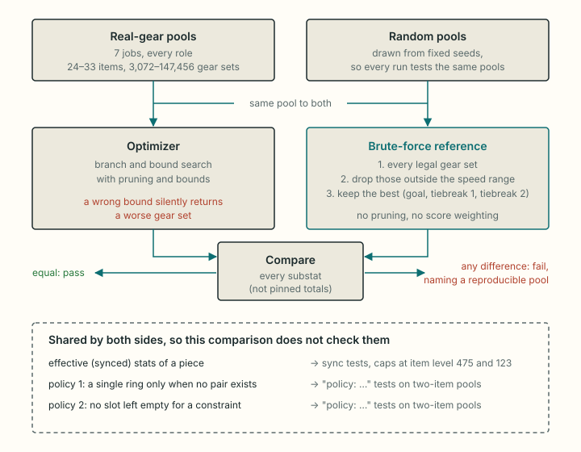
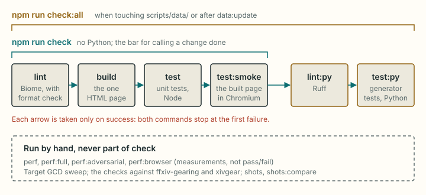

# Testing

How the project is tested: the three test layers, what each file covers, the commands, the conventions every test follows, and which expected numbers are allowed to change after a game patch. The evidence the tests encode (real items, Wiki caps, speed examples) is collected in [validation.md](../mechanics/validation.md). How the parts fit together is in [architecture.md](architecture.md).

Related pages: [validation.md](../mechanics/validation.md) (the evidence behind expected values), [optimizer.md](optimizer.md) (the search the exhaustive tests check), [data-pipeline.md](data-pipeline.md) (the generators the Python tests check), [architecture.md](architecture.md), [glossary.md](../glossary.md).

**The testing problem in one paragraph.** The tool computes numbers nobody can check by eye. One is the stats of a gear piece (an item worn in one body slot) after the game lowers it to a fixed strength. The other is the best combination of pieces out of thousands. A test is only as good as its **oracle**, the source of its expected value. This suite uses four kinds of oracle, in order of preference:

| Oracle | Example | Where |
| --- | --- | --- |
| Published numbers | the Wiki's sync caps at item level 475 | unit tests (section 2) |
| Real game data | a real item level 130 healer head piece | unit and smoke tests |
| An independent reference | a brute force that tries every gear set | section 2.1 |
| A regression that failed before a fix | the ring pruning bug | section 4 |

A number copied from the tool's own output is not an oracle: it only proves the tool still agrees with itself (section 4). Game terms used below (item level, sync cap, GCD, melds, Unique) are defined in [glossary.md](../glossary.md).

## 1. Test layers

What runs, on what, and how much of it?

| Layer | Runs on | Count |
| --- | --- | --- |
| Unit tests (Node) | core logic, view builders, saved state, real game data | about 1,390 tests in 196 files, about 30 to 45 s |
| Long sweep (Node) | tier ranking against its reference on 360 random cases (`tests/sweep/`) | 6 tests in 6 files, about 22 s on their own |
| Generator tests (Python) | the data generators, on small test files | 128 tests in 10 files |
| Component stories (browser) | each Lit element alone, in a gallery page opened from `file://` (`tests/stories/`) | 166 tests in 37 files, in Chromium (about 12 s of test time) and also in Firefox and WebKit (about 30 s for the three) |
| Smoke test (browser) | the built page in headless Chromium | one script (`tests/e2e/smoke.mjs`), its steps in groups listed in `tests/e2e/groups.mjs` |

Notes:

- **Unit tests** import the core logic, the page's view builders and the saved-state repair directly, with the real generated game data. They check formulas, sync, speed, item queries, optimizer correctness on real gear, what each tab shows, the elements' logic that runs without a page, data format, provenance and saved state. A shared brute-force helper serves the optimizer tests (section 2.1).
- **Generator tests** run the item level, item database and job icon generators and the gear category rules on small test CSV and icon files. They check row selection, slot detection and multi-slot gear (a cloak kept on its own slot code, an unsupported combination left out). They also check stat placement, the HQ rule, job mask, sort order, budget table and level data, stat factor kind and table, gear categories and source flags, schema drift, and job icon embedding and numbering.
- **Component stories** mount one Lit element (`src/ui/elements/<domain>/`) in a gallery page with the page's own stylesheet, and drive it with real clicks and keys through Playwright Test. They reach what Node cannot show: focus, keyboard, `aria-*` ids, the page's CSS on light-DOM markup, Lit's development-mode errors. A page error or a console error fails the test (the fixture, `tests/stories/fixtures.ts`), because Playwright does not by itself and `mount()` resolves before Lit renders. A story is a function from plain props to a Lit template in a `*.story.js` or `.ts` file; `tests/stories/build.mjs` lists them in a generated registry, bundles the gallery with esbuild (Lit's development build) and writes `tests/stories/out/` (gitignored). Rules: use real input only (no `dispatchEvent`), focus a control explicitly before a keyboard step (WebKit does not focus a button on click), a touch test (`test.use({ hasTouch: true })`, `.tap()`, `tapOutside` from `look.ts`) skips Firefox, whose touch context cannot be closed under parallel workers (every menu and popover has one: a tap opens, a tap on a row picks, a tap outside closes), props cross as data (a frozen object arrives unfrozen: freeze inside the story), no retries. A look check reads the computed style of the element and compares it with the colour the page's own token resolves to (`tests/stories/look.ts`: `tokenColor`, `styleOf`; the config's colour scheme is dark), never a copied colour value. A forced-colours check (`page.emulateMedia({ forcedColors: 'active' })`, skipped in WebKit, which does not force colours; one for every menu and popover) calls `expectForcedColoursLook` (`look.ts`): the open layer has an edge (a border or an outline), the chosen row differs from a plain row in outline, border, weight, underline or opacity (the page's tints and shadows are gone), and a focused control or the row the keys light has a ring. Further forced-colours checks use `expectLookApart` and `partShows` (`look.ts`): a ticked box differs from an unticked one and its tick shows against the fill behind it (the Expansion and Gear categories boxes), a switch's knob shows against its track and the switch differs on and off (the market board switch, the IL Sync `.switch`), and the worn materia stone differs from a stone not worn. Controllers, view builders and stores stay in Node tests. The screen elements (`<gsa-app>`, `<gsa-sheets-screen>`, `<gsa-math-screen>`) get a real page store from `tests/stories/shared/page-ports.js`. An element that only stories use (a test element standing for a widget the page does not have yet, such as the Zag popover next to a page menu in `tests/stories/shared/layer-elements.ts`) lives beside its story under `tests/stories/`, so the page's bundle never holds it.
- **Smoke test** opens the built page from disk. It checks known numbers on screen, optimizer totals equal to the core's on real gear, no JavaScript errors, no stray "undefined" / "NaN" / "null" text, and no sideways scroll at 960 px (half of a 1920 screen; there is no phone layout). Its steps run in groups (`tests/e2e/groups.mjs`), each on a fresh page, from a shared setup it checks between steps (section 2, *Smoke test*).

**Why most tests need no browser.** The core never touches the page (see [architecture.md, section 1](architecture.md#1-the-system-at-a-glance)), and the page's view builders take plain state objects, so both run in plain Node. The unit tests load the full item database, so they check the model against all 20,210 real pieces, not just hand-made examples. The smoke test is left with only what needs a real page: wiring, layout and interaction.

### 1.1 Domains

Every file of `src/`, `scripts/` and `tests/` belongs to one **domain**, a part of the product a maintainer changes in one sitting. The lists are in `tests/domains.mjs`. `npm run test:<domain>` runs one domain's unit tests, so a change to the set page is checked in seconds instead of in a whole `npm test`.

| Domain | Covers | Unit files | Smoke steps |
| --- | --- | ---: | ---: |
| `model` | the game's number rules: item stats, sync, speed, tiers, food, materia | 22 | 0 |
| `data` | the game data and job facts, and the pipeline that generates them (with the Python tests) | 12 | 0 |
| `solver` | the search for the best gear set, in the core (with the long sweep) | 25 | 0 |
| `auto-fill` | Auto-fill on the page: settings, run, cancel, worker, suggestion | 12 | 16 |
| `set-page` | a gear set's page: rows, hand edits, pins, menus, totals | 20 | 14 |
| `sheets` | the Sheets tab: manager, a sheet's page, dialogs, saved sheets | 21 | 12 |
| `gear-browser` | the Gear browser tab and its filter menus | 5 | 15 |
| `math-page` | How the math works: Piece stats, Substat tiers, GCD | 12 | 14 |
| `app` | the page frame: tabs, Job and sync strip, Job menu, saved settings, startup, shared controls | 43 | 46 |
| `look` | shared CSS: tokens, themes, layout at the five windows, radii | 3 | 6 |
| `tooling` | the build, the test runners, the layout stress tool and the repo's code rules | 22 | 0 |

Notes:

- **A test follows its module.** A unit test takes the domain of the module its path mirrors (`tests/unit/ui/views/gcd.test.js` mirrors `src/ui/views/gcd.ts`, so `math-page`). A test that mirrors no module is listed in its domain's `tests` list. A smoke step names its domain by what it checks, and its file sits in that domain's folder under `tests/e2e/checks/` (`auto-fill`, `set-page`, `sheets`, `gear-browser`, `math-page`, `look`; the app's are `settings`, `saved-state`, `tabs` and `startup`). A file that holds steps of two domains is split. A Python generator test is `data`.
- **One domain per file.** A file that touches two domains is listed once, in the domain of the module (unit) or of the thing checked (smoke). To run the neighbour too, name two domains.
- **The guard** (`tests/unit/scripts/test.domains.test.js`, part of `npm test`) fails, naming the file, when a file has no domain or two, a registry pattern matches nothing, a smoke step has no known domain, a smoke step's file is outside its domain's folders, or `package.json` lacks a `test:<domain>` script.
- **Long files.** `LONG` in `tests/domains.mjs` lists the unit files whose tests add up to more than 5 s (whole-database and brute-force comparisons). `--fast` leaves them out of a domain run. `npm test` and `npm run check` always run them, because they catch a wrong bound in the search (section 4).

## 2. What each file covers

Which file tests what? One line per file; the file itself says the rest.

### Unit tests

**Naming rule.** The folder of a test file under `tests/unit/` is the folder of the module it tests under `src/`, and the file is the module's name, then `.test.js` (`.test.ts` for a module written in TypeScript: Node strips the types, and a `.ts` import names its extension). A file on one concern of a module adds the concern after a dot. So the test for `src/ui/views/gcd.ts` is `tests/unit/ui/views/gcd.test.js`, and the sync clamp of `src/core/formulas.ts` is in `tests/unit/core/formulas.sync-clamp.test.js`. A folder counts as a module (`src/core/optimizer/` is `core/optimizer/index`, so `core/optimizer/index.exhaustive.test.js`). Tests of `scripts/` go in `tests/unit/scripts/` and tests of the smoke test's own helpers (`tests/e2e/lib/`) in `tests/unit/smoke-helpers/`; the CSS tests are in `tests/unit/styles/`, named for the concern. A test that crosses modules goes in the file of the module whose rule it checks, or in the folder that holds the modules it scans (`ui/no-alpine`, `ui/views/no-bad-values`). Sorted by path, a module's files sit together. A test's domain is its module's (section 1.1). The test lists below name a file by its path under `tests/unit/`, without `.test.js`.

| File | Covers |
| --- | --- |
| core/base-stats | the level's main stat base against xivgear; the character panel base against AkhMorning |
| core/clamp | the shared clamp: inside the range, at and past each end, NaN, whole numbers |
| core/constants.level-tables | every table keyed by level reaches the level cap |
| core/damage-defense | weapon damage and defense on real items; weapon damage ranked first |
| core/food | food bonus, meal choices, best meal |
| core/food.reference | every meal of every job against the formula, the best meal against every meal, gearNeeded against a linear scan |
| core/formulas | a piece built from the formula, level caps |
| core/formulas.caps-at-123 | caps at 123 from real pieces, the 296 maximum |
| core/formulas.stat-factor | per-item stat factors |
| core/formulas.sync-cap-order | rounding order of sync caps |
| core/formulas.sync-clamp | the clamp rule at its edges |
| core/formulas.model-accuracy | Wiki caps, accuracy per band, special lines |
| core/formulas.shields | every White Mage and Black Mage shield and one-handed weapon against the formula |
| core/gear-groups | the gear groups Copy sheet offers, from the item data |
| core/item-format | generated data shape; `ROW` against the format's row fields |
| core/items | gear filtering, row conversion, item fields; rows sharing a pool key agree |
| core/items.identity | a piece by its game id: one row per id, the pool item of an id |
| core/items.multi-slot | cloaks, tank multi-slot gear, White Mage and Black Mage shields and the two-handed weapons that cover them |
| core/job-context.keys | the stat keys of all 23 jobs; the labels and short names by key (note 1) |
| core/job-context.weapon-mode | the jobs with shields and their weapon mode, derived from the item data |
| core/meld | materia melds on real items |
| core/meld.apply-stones | a given list of stones on real items; the optimizer's melds give their gains back (note 2) |
| core/meld.overmeld-odds | overmeld odds by grade against the Console Games Wiki table and the MateriaGrade sheet |
| core/meld.real-pieces | bestMeld on 3,000 real pieces against the stone enumerator; its stones applied back |
| core/optimizer/index | real-gear pools, ring-pair bound |
| core/optimizer/regain | regain cuts from a proven maximum against the brute force |
| core/optimizer/search | the search's parts on their own against brute force (note 3) |
| core/optimizer/slot-index | slot positions and blocked-slot masks |
| core/optimizer/index.exact-solver | every job's whole pool over the sync presets against an exact best-item-per-slot solver; melds on a reduced pool |
| core/optimizer/index.exhaustive | random pools, regressions, policies |
| core/optimizer/index.metamorphic | dropped pieces, added tiebreaks, looser speed limits, jobs of one gear group |
| core/optimizer/index.pinned | pinned pieces in the search: kept with their stones, counted in totals and tiers |
| core/optimizer/index.speed-limits | speed minimum, maximum and range |
| core/optimizer/index.stat-minimums | minimums on any stat against the brute force (note 4) |
| core/recipe | a recipe's solve (note 5) |
| core/recipe.pins | a solve's pins: kept pieces and meal, the problems a pin cannot be kept for |
| core/recipe.pool-order | Auto-fill with the job's gear in other orders (seeded shuffles): the ranked totals the same in every order, and the same pieces and stones where one set is best (ties among equal pieces are not asserted here, but in core/recipe.ties) |
| core/recipe.ties | Auto-fill's ties as they are: Sage, Paladin and Bard cases where the pool's order changes which equal pieces show, with the ranked totals the same in every order (tighten it if a fixed tie-break is added) |
| core/recipe.real-gear | a set's Auto-fill on real gear against the core and the brute force (note 6) |
| core/recipe.round-trip | Auto-fill twice, pinned whole or in half, and picked back, on random jobs and recipes |
| core/same-result | other pieces with the same result: shared spare points, Unique rings, cloaks, the owner's level 50 case |
| core/piece.sync-cap-grid | every real piece of every job over a grid of caps against the cap formula; the cap and the stats never fall as it rises (shields left out) |
| core/session | the solver session: the gear of the last four jobs, least recently used dropped first; a job's gear built once |
| core/set | a gear set and what it adds up to (note 7) |
| core/set.average-item-level | a set's average item level: the weapon counted twice when two-handed, once with a shield, an empty set has none |
| core/set.bonuses | a set's panel numbers with a clan and a party bonus: each alone, together, and a meal's Vitality worked out after the party bonus |
| core/clan-bonus | the 16 clans in 8 races, a clan's offsets, the party bonus (1% a role, up to 5), roles held to a whole number |
| core/stat-keys | old position keys read as a job's own, a key moved to another job, and a guard on hard-coded keys (note 8) |
| core/speed | GCD tiers, DoT scalars, the cast and recast multiplier, haste, tier lookup |
| core/sync-target | level sync, its triggers, the optimizer under it |
| core/sync-target.properties | the target over every piece, level and cap: in range, level sync's bounds, order by item level; where raising the cap lowers a piece |
| core/patches | the patch table (a source record, dates in order, each version once, newer than the game data) and `patchOnDay` (the release day counts, two patches on one day, a day before the first patch) |
| core/tables.provenance | source record and footer |
| core/target-gcd | Target GCD: GCD reached, modes, meals |
| core/target-gcd.exhaustive | Target GCD against the brute force |
| core/tier-rank | tier ranking against its own reference (note 9) |
| core/tier-rank.hold-at-start | tier ranking holds a key at the start of the tier it reached, with no spare point (a Dark Knight case) |
| core/tiers | substat tiers; the Substat tiers sub-tab's ladder (every tier up to a most, the last cut at it) and tier sizes |
| scripts/build | the build script and the optimizer's worker bundle (note 10) |
| scripts/gen-max-speed.inputs | the files the max-speed generator hashes: code and JSON under `src/core`, the data files and the generator, in order |
| startup-failure | the failed-to-start script run against a stand-in page: the settings key and the sheets keys are saved data to reset, the reload guard's dev flag and other pages' keys are not |
| ui/elements/gear-browser/filter-menu-model | the Expansion and "Gear categories" menus' data: the tabs (Everyday, Side content and Hard content with the real boxes, hints and Hard content's reading order), the button texts, the piece counts and their words, the lists after a tick, All, None and Default, and the partials' event names |
| ui/elements/gear-browser/gear-browser-model | the Gear browser element's rules with no DOM: its view built once per change and only while its tab is open, the page line going back to page 1, sorting, Reset filters, the / key |
| ui/elements/app/app-root-model | the page root: the strip gets the Gear browser's own panel, the tab links (the math link names the open sub-tab, the loading line, the leave question before leaving a set page), the test data button, and every store part the root draws from is in its selection |
| ui/elements/app/cap-follow | when a cap field lowers its cap or drops its typed text (a stored cap, IL Sync, the level settling, a hidden panel) |
| ui/elements/app/note-timer | a note expires after `NOTE_MS`, and the same note said again restarts the wait |
| ui/views/cap-field | what the item level and level fields show: the error, the lowered note with its flag, the range |
| ui/elements/set-page/edits | a set page's session bound to a real sheet store: edits by hand kept in a draft until Apply, pins saved at once; the draft is a frozen copy in the store, one entry per page |
| ui/elements/set-page/menus | the window's line that the page's menus stay under: the page scrolls to show an opened menu, keeps its button under the pinned header and cuts a menu that does not fit |
| ui/elements/set-page/fill-run.best-meals | "Best for goal": the tied meals saved with an applied Auto-fill, the Food row and its switch |
| ui/elements/set-page/fill-run | a set page's Auto-fill: a real search and its suggestion, Take boxes, the edit lock, Cancel, a failing solver, late replies |
| ui/elements/set-page/leave-guard | the question before leaving for a draft, a running Auto-fill and a waiting result; the store's `unsettled` for each, and a page left holds nothing |
| ui/elements/set-page/fill-settings-edit | the Auto-fill settings popover: a change dropping a waiting result, the Gear to search line, the goal menus |
| ui/elements/sheets/sheets-screen-model | the Sheets screen over a real sheets' store (note 12): the screen to draw, the views each element gets, the answers to the elements' events and the caret menu's pick, a dialog closing on a change of page, and the store parts the screen follows |
| ui/elements/sheets/sheet-dialogs-model | the five dialogs over a real store: a name that follows the job until typed, a refused form keeping what was typed with its reason at the field, Copy and Delete, Escape closing the "?" panel first, a number typed just before Create, the cap lowered with the level, the focus going back to the opener |
| ui/elements/sheets/open-row | a click on a row opens its sheet or set, except on the row's own controls and after a text selection |
| ui/elements/sheets/row-reorder | Up and Down on a handle move a row and the focus follows, a drop goes above or below the row under the pointer, nothing moves while the list is locked |
| ui/elements/math-page/math-inputs | the math screen's inputs and edits: the Job menu's owner per sub-tab, the IL Sync switch and the cap it stores, the settings the bar and Stat Allocation elements are given, and that every edit they read is in the store parts the screen follows |
| ui/hq-font | the HQ glyph font and its fallback |
| ui/no-alpine | nothing in `src/` has an Alpine attribute, binding, magic or import, and the packages are not in `package.json` or the lock |
| ui/overlays | the overlay manager: Escape closes the topmost layer, a press outside, Tab out, a layer a native list leaves alone |
| ui/job-sync-panel.level-sync-cap | the item level level sync gives (`levelSyncCap`, none at the job's level cap), held as the cap while IL Sync is off (`holdLevelSyncCap`); `mathJobOwner`; `panelOf('tiers')` |
| ui/level-cap | the cap lowered to what the level allows, the flag in a cap field's label line |
| ui/level-cap.level-text | a level box's rules: which text is no level at Paladin's, Blue Mage's and Beastmaster's level caps, `LEVEL_TEXT` and the error flag |
| ui/number-commit | the number-box rule as a table: which typed text commits, what the box shows and when the value was clamped, for each kind of box |
| ui/number-field | number boxes (the Target GCD's range), typing and committing |
| ui/ranks | the ranked stat menus (Goal, tiebreaks, Piece stats substats): one rank per stat, swaps |
| ui/sheets/bonus-options | the Clan and Party bonus lists: 16 clans under 8 races, none to five roles, the sizing text |
| ui/sheets/fill | Auto-fill plan and pins, the answer put on the open rows, the line for the pins dropped (`unpinnedText`: the rows named, a relic with its reason) and the conflict line, the pins dropped (a meal problem drops the meal pin) |
| ui/sheets/fill.mixed-weapon | a White Mage's Auto-fill keeps the shield the search picks, and never leaves a 2H cane with a shield |
| ui/sheets/fill-settings | a set's Auto-fill settings: the defaults, a stat the job lacks, the recipe (every setting reaches the request) and the goal line |
| ui/sheets/fill-settings.recipe | the recipe an Auto-fill sends: every Auto-fill setting reaches the request, nothing else does |
| ui/sheets/ops | sheets and gear sets as plain data (note 16) |
| ui/sheets/ops.best-meals | the tied best meals a set saves: shape, old records, damaged values, Copy set and Copy sheet |
| ui/sheets/ops.clan-party | a new sheet has no clan or party bonus; Copy sheet keeps them, and a sheet from before them gets none |
| ui/sheets/dialogs | the sheet dialogs over a real store: fields reach the store call, a refused form gets the reason and its field and is left as it is (a blank name stays blank) |
| ui/sheets/ops.copy-sheet | Copy sheet on random sheets of real pieces: pieces kept and cleared, stats moved, source untouched, round trip |
| ui/sheets/ops.stat-keys | Copy sheet moving the goal and the stones to the new job by position |
| ui/sheets/saved-set | the rows a job uses, ring labels, sameRow; the draft count and an Auto-fill suggestion agree |
| ui/sheets/set-edits | edits by hand: a piece placed, a Unique ring in one ring row, stones in order, the meal, pins |
| ui/sheets/set-edits.covering | a cloak picked over a held head empties and unpins the Head row, names the head and the cloak, refuses a head under a cloak, and leaves the saved set for Discard |
| ui/sheets/set-edits.two-handed | a 2H weapon picked over a held shield empties and unpins the Off-hand row, names the shield, and leaves the saved set for Discard |
| ui/sheets/storage | the saved sheets (index and one record per sheet) through a storage stand-in (note 13) |
| ui/sheets/storage.clan-party | the clan and party bonus saved and read back, an unknown clan read as none, damaged values make the record unreadable |
| ui/sheets/storage.fill-and-meal | the Food-related fields of a saved set: the meal and the Auto-fill food, materia and tier switches, and a wrong type |
| ui/sheets/storage.fuzz | saved sheet records damaged in several fields through every reader and view |
| ui/sheets/storage.stat-keys | a v1 record read with the game's keys, and a record with the game's keys read as it is (note 14) |
| ui/solve | the solver's answers: solveView by kind, an error as an answer, Gear to search |
| ui/solver | the optimizer's solver (note 17) |
| ui/router/focus | the focus and scroll after Back, Forward and a reload: the heading focused, a deep position scrolled to in the call itself with the page held tall and let go once it holds, a newer move taking over, a tab still opening waited for, a tab swapped in shorter than the position giving up the hold in the frame that places it, a screen opened at the top placed once and not pulled back |
| ui/router/plain-click | which clicks on a link the page handles (a plain click) and which are the browser's (Ctrl, Cmd, Shift, Alt, a middle click) |
| ui/router/query | the settings in an address: each view's names, the defaults, a value that is no good, a name the page lacks |
| ui/router/router | the router over a stand-in history: opening each address, the not found screen, pushing and replacing entries, Back and Forward, and the leave guard holding a move back, undoing it and doing it again; the scroll events after a push (the late one of the screen left, the clamps to a shorter page) not noted as the new screen's position, the screen left keeping the deeper of its noted and read position, a screen left by Back or Forward keeping the position read as the browser moves (a wheel scroll whose event has not come), a new screen put at the top and Back and Forward not |
| ui/router/routes | the address of each screen: parse and format round trip, junk addresses, percent-encoded ids, the page title |
| ui/router/scroll-storage | the saved scroll positions: only finite numbers come back, damaged or hostile text, a refusing storage and a blocked `sessionStorage` read as none |
| ui/router/unload-guard | the reload and close guard: asks only while work is held, and the dev flag turns it off |
| ui/state | restoring saved state, including a save with position keys in `piece.subs` and `browse.sort`; loading and saving with a storage that throws |
| ui/state.fuzz | restoreState on settings damaged in several fields: in range, never throws, restores to itself |
| ui/state.tiers-job | Substat tiers' saved job: default, restore repair, a save with none |
| ui/state.panels | each reference tab's own Job and sync panel on restore; an old save's optimizer settings dropped |
| ui/state.split-panel | the saved settings with the Job and sync panel split between the Gear browser and the math tab and the old `opt` dropped |
| ui/store/store (`.test.ts`) | the new store: 1,000 updates in a tick give one notification, a revision per slice, the log of 50 action names, listeners, big data kept by reference |
| ui/store/select (`.test.ts`) | `Select` over a fake host: renders only on a change of what it selected, unsubscribes on disconnect (1,000 cycles leave none), `shallowEq` |
| ui/store/watch (`.test.ts`) | `watch`: once per tick, previous value, `equals`, stop |
| ui/store/autosave (`.test.ts`) | the save 150 ms after the last change on a fake clock, one write for 1,000 changes, `pagehide` flush, a throwing storage ignored |
| ui/store/app-state (`.test.ts`) | the five slices, actions that change nothing are not counted, `panelOf`, `persisted` in the saved shape, gear set pages, `routeOf` against the router's routes |
| ui/store/app-actions, `.panels`, `.sheets-tab`, `.tiers-job` | the app actions through the app facade the screens read: a job switch and Reset, the two panels, the Sheets tab has no panel, Substat tiers' own job |
| ui/store/app-actions.parts (`.test.ts`) | every app action: the parts it counts are the parts that changed |
| ui/store/sheets-actions, `.clan-party` | the sheets' actions through the sheets facade, over a storage stand-in (note 15) |
| ui/store/app-facade, sheets-facade (`.test.ts`) | the two facades the elements read (`app`, `sheets`): each getter reads the revision of its slice, nothing can be assigned to, the number boxes' `setField`, the set page's guard, `unsettled` through `hasUnsettled`, `commitSheet` |
| ui/store/set-page-actions (`.test.ts`) | the gear set pages' actions: the draft, the Auto-fill's status (idle, running, waiting, failed, cancelled), a stale answer ignored by its search id, the Gear to search count, `unsettled` over several pages, two pages open at once |
| ui/store/no-direct-writes | a search of `src/` for any write to a facade that is not an action call: `app.<field> =`, `Object.assign(app...)`, `sheets.<field> =` |
| styles/z-index-scale | every `z-index` is a `--z-*` token, the tokens keep their order (dialog and toast on one level), the rules a library positioner needs are in place |
| styles/theme-tokens | colors only through the CSS tokens (note 19) |
| styles/layers | the stylesheet names its layers once, first, and every rule is inside one |
| styles/gear-column-tint | the Gear browser CSS tints the column of every stat the table can sort or hover |
| smoke-helpers/axe | the smoke test's (`tests/e2e/lib/axe.mjs`) split of axe-core findings into new and known ones: an entry for a rule, for one element, for the elements whose selector holds a text, another rule's entry, an entry that matched nothing |
| smoke-helpers/visual | the smoke test's (`tests/e2e/lib/visual.mjs`) contrast arithmetic and token reader against the WCAG's published values (21:1, #767676 and #777777 on white), large text, translucent layers |
| scripts/test | the test wrapper: its options, the unit files a domain selects, and which domains a changed path points to (`--changed`) |
| scripts/build.notices | the licence notices: every third-party package the page bundles has its notice in the page script, and the LICENSE each group is copied from names that group's own holder (Chakra UI, Floating UI contributors, Daishi Kato) |
| scripts/build.worker | the worker bundle run in Node against the page thread's solver on a series of requests (a tie, pins, melds with tier ranking, a Target GCD with and without tier ranking, three more jobs, the Gear to search line): equal replies whole, so the pieces, stones and meal match |
| scripts/lint-lit | the ESLint config for the Lit elements reports a class field that shadows a property and an `` without `alt` on fixture files |
| scripts/styles | `readStyles` and `expandStyles`: the cascade order, an import replaced by its file, `entry.css` importing every file once |
| scripts/visual | the screenshot baseline wrapper: runs only in the pinned image, skips with a message elsewhere or without baselines, and the image tag matches the workflow and the lock file |
| scripts/test.domains | the domain guard: every file in one domain (a planted `.ts` stray is reported), smoke steps and `test:<domain>` scripts named, and the counts of the domains table in section 1.1 equal to the registry's |
| ui/sync-charts | the math tab's SVG charts: escaping, bands, shading, widths, bars |
| ui/elements/set-page/food-menu-model | the Food menu's state: pills kept or reset on opening, the sort and its fallback, the click on a row, the page's event names |
| ui/elements/set-page/piece-picker-names | the piece picker's click rule (a piece row picks its game id, a disabled row picks nothing) |
| ui/elements/shared/element-width | the width controller with a fake host and observer: the width follows the box in the next frame, a hidden box keeps the last width, a box that comes and goes is followed again, a disconnected host stops watching |
| ui/elements/shared/overlay-bridge | the bridge between a Zag layer and the overlay manager, on the real manager and a fake document: an open layer is registered once and dropped when it closes, the manager closes the machine without moving the focus, a layer inside a manager layer leaves it open, a manager layer above takes the Escape first, the manager alone never closes a Zag layer on Escape |
| ui/elements/shared/zag-controller | the Zag controller with a fake element and a tiny machine: the machine runs from connect to disconnect, 1,000 connect and disconnect cycles leave no effect running, a change asks for a draw and drawing does not, ids start with `zg-`, parts are spread only within their own `data-zag-host`, array parts in order, a part Lit removed is let go |
| ui/text (`.test.ts`) | en-US counts, the one-or-many text |
| ui/tier-window | the rows a Substat tiers card draws: those in view, the margin, when to draw again, where to scroll to center a row |
| ui/view-cache (`.test.ts`) | the view cache, deep freezing |
| ui/views/gcd | How the math works, GCD (note 20) |
| ui/views/gear | Gear browser: rows and synced stats, the Slot menu, sorting, search, Reset filters |
| ui/views/gear.naive-browser | the Gear browser's rows, order and slot counts against a naive filter and sort, on random settings |
| ui/views/meal-menu | the Food menu: what each meal adds on the set's gear, pills, search, sort, the empty list |
| ui/views/piece | Piece stats' step by step: each stat against its ceiling, the off-hand rule, the substat ranks |
| ui/views/piece.accessories | the four accessory slots give one choice and the same numbers (one budget share) |
| ui/views/piece-menu | a set page's piece picker: the pieces of a slot by expansion, the search, the empty text |
| ui/views/piece-menu.search | the piece menu's search: every word, any order and case, empty groups dropped |
| ui/views/piece-menu.limit | the picker drawn in steps: the first rows of the full list, the whole count, the set's part not cached |
| ui/views/set-draft | a manual draft: changed rows, the Now and After figures, Apply and leave texts |
| ui/views/set-page | a set page's view built once per change; the Food menu built only when read |
| ui/views/set-rows | a set's rows: pieces, stones, missing items, pins |
| ui/views/set-suggestion | an Auto-fill suggestion on real Sage pieces (note 21) |
| ui/views/set-suggestion.best-meals | what Apply saves of the tied best meals, and what the Food row shows |
| ui/views/set-suggestion.two-handed-shield | a suggestion taken partly never saves a two-handed weapon beside a shield (White Mage, Black Mage) |
| ui/views/set-totals | a set's totals, tiers and defense |
| ui/views/set-totals.bonuses | a set's totals and header figures with a clan and a party bonus, and the sheet list's note naming them |
| ui/views/sheet-forms | the Sheets tab's dialogs (note 22) |
| ui/views/sheet-manager | the sheet manager: rows, unreadable records, the empty state, text helpers |
| ui/views/stone-menu | a set page's materia menu: the grades an item level takes, the room under the cap, overmeld odds |
| ui/views/math-bar | the math bar's Stat Allocation controls: the Slot menu's groups, the substat and Materia slots menus, a slot change, a substat swap, the item level box held to the slider, the slider's fill |
| ui/views/piece-stats | Stat Allocation as one view: the chart as wide as its box, the sentences, the number lines' gold and materia texts, the empty state |
| ui/views/sync-explainer.chips | the Substats & materia and Sync settings chips: their words and names in every state, the weapon guess, the widest forms (read from the constants) |
| ui/views/sync-explainer | How the math works, Piece stats: a piece against the melded cap, the item level range, melds from the Goal, the special substat caps, the bars at synced levels 1 to 4 |
| ui/views/tiers | Substat tiers: the ladder's columns, every tier as a range (a one-point tier, the open last tier, Tenacity's uneven tiers), the rows kept per job and level; typed values; the sub-tab's own level; the values kept until the job or level changes |
| ui/views/level-sync | level sync across the views, and a cap far above the synced level |
| ui/views/no-bad-values | Piece stats, Substat tiers and GCD over every job and level: no NaN, Infinity, undefined or null |

Notes on the longer rows:

1. `core/job-context.keys`: the keys checked are the main, speed and special key, `stats` and `substats` in order, and six keys without a special substat.
2. `core/meld.apply-stones`: the list is checked for gates, high grades past the big slots, caps, and sync removing them.
3. `core/optimizer/search`: limit tables and their smallest over two or three bands, the Lagrangian bound and reduced-cost fixing, the slot order, the memo's dominance and its full key.
4. `core/optimizer/index.stat-minimums`: seeds; the filters, trial search and fronts on tight cases against the plain search; the fronts alone, also on empty, blockable and ringless slots.
5. `core/recipe`: the gear set by gameId and its record, a piece picked by gameId, a session that has solved before against a fresh one.
6. `core/recipe.real-gear`: the pool and filters, totals, Target GCD, food, rank by tier and relics.
7. `core/set`: 14 real optimizer results recorded from the page before it used `evaluateSet`, number for number; the optimizer's own totals; custom pieces, removed stones, a game id no row has.
8. `core/stat-keys`: `currentStatKey` reads old position keys as a job's own, and `remapStatKey` moves a key to another job by position. The guard is that `src/core` and `src/ui/views` hard-code no job-specific stat key outside the allow-listed tables.
9. `core/tier-rank`: the reference tries every gear set and meal, with the stage rule written out. The cases are 20 of three keys and a Target GCD, a stage stopped at its node limit, an infeasible Target GCD, and 360 more random cases in `tests/sweep/`.
10. `scripts/build`: the DEV marks outside `main` (data, handed to the page as a constant), the page template (the boot shell and one empty `<gsa-app>`), the licence notices (`bundledLicenseNotices` in `scripts/build/build.mjs`, tested in `tests/unit/scripts/build.notices.test.js`: the LICENSE texts of Zag, Floating UI and proxy-compare in the script, and a notice for every other bundled package), two builds of one tree giving the same page, the page's 5 MB ceiling, the data as `JSON.parse`, the startup-failure script first in `<head>` before the `<style>` with no closing script tag, ES5 only, no literal colour, and its key taken from `STORE_KEY`. The optimizer's worker bundle is run in Node: it loads from the posted data texts (the item database in the script once) and answers like the page thread (one request in `build.test.js`, a series in `build.worker.test.js`).
11. `ui/elements/set-page/food-menu-model`: no pill at first, the pinned meals, pills kept across results while they list a meal, the sort and its fallback to ILVL, a pick.
12. `ui/elements/sheets/sheets-screen-model`: the screens, set notes, the answers to the sheet manager's and sheet page's events (a step, a move, an edit of the level).
13. `ui/sheets/storage`: round trip, order, new sheet on top, a save touching only its own record, unreadable records listed with a cause and left alone, delete, a full storage (the edit stays), missing or throwing storage, and a saved time outside the range of a `Date` (1e300) making the record unreadable instead of breaking the Sheets tab.
14. `ui/sheets/storage.stat-keys`: the v1 record has position keys (`main`, `spd`, `spec`) per stat profile.
15. `ui/store/sheets-actions`: making, editing, copying (the White Mage cane cleared after the question), deleting and reordering sheets and gear sets. Also the screen each action leaves open, the level and cap held to their ranges, the edit lock while an Auto-fill runs, a full storage keeping the edit, no storage, unreadable records deleted, and a second store reading back what was saved.
16. `ui/sheets/ops`: names and descriptions as stored, default and copy names, a new sheet and set read back by the storage, Copy sheet clearing the pieces the new job cannot wear, moving a row.
17. `ui/solver`: the request handler as a plain function (the worker's), requests and replies through a structured clone (the solve reply carries the plain gear set and the recipe), the worker solver's ids. Also one request per kind in the worker with the newest waiting, and the fallback to the page thread when the worker cannot start or fails.
18. `ui/store/app-actions.sheets-tab`: going there and back keeps every tab's panel, the save holds none for it, a save made there opens there.
19. `styles/theme-tokens`: no literal #hex, rgb(), hsl() or color name in a rule of `src/styles/*.css`, an inline style or color attribute of the page's HTML (the Sheets markup included) or a quoted color in the UI scripts, with no exception. The scan is run on made-up CSS first. The light and the two dark token lists name the same tokens, and the dark ones are equal.
20. `ui/views/gcd`: the facts for a speed (checked against the optimizer's 2.10 s and +11 at level 50), the step table's window, the level box's correction, the haste menu and chart marks; the stored most speed per level against the searches.
21. `ui/views/set-suggestion`: the rows it changes with their Take boxes, the set as taken, Now and After, Apply's text, pinned rows kept, an empty set, the table rows with Take boxes; bad pins dropped and named, no set.
22. `ui/views/sheet-forms`: New sheet's default name and ranges, where each refusal shows (`errorPlaces`), Copy sheet's jobs by gear group and its list of pieces to clear, Edit sheet and Edit gear set, the Delete questions.

Notes:

- **The long sweep** in `tests/sweep/` is flat, with no folders: `core-tier-rank.gcd-1` to `.gcd-4`, `core-tier-rank.no-gcd` and `core-tier-rank.pinned`. The helpers in `tests/unit/helpers/` are not tests and are named for what they hold.
- **The elements' logic** is unit tested in Node (the files in `tests/unit/ui/elements/`, one folder per domain): each screen's logic is a plain model class (`sheets-screen-model.ts`, `app-root-model.ts`, ...) bound to a plain store, and a set page's logic is a plain session (`src/ui/elements/set-page/session.ts`) tested the same way in `tests/unit/ui/elements/set-page/`. The smoke test checks how they are wired into the page.
- **What each file checks** is in its header comment and test names, and where each expected value comes from is in a comment next to it. They are not repeated here, so they cannot drift apart.
- **Shared helpers** are in `tests/unit/helpers/`:
  - the brute-force reference and real-gear pools (`exhaustive.js`, section 2.1);
  - seeded random numbers, item lookup by name, store-shaped state, and values typed in from outside sources such as the `BaseParam` slot shares and AkhMorning's level table (`common.js`);
  - the tier ranking reference with its random cases, shared with the long sweep in `tests/sweep/` (`tier-reference.js`);
  - the view tests' store-shaped state with sync at 123 and a set's recipe, their small real-gear pools and an Auto-fill's solve (`views.js`);
  - saved sheets of real items for the Sheets tests (`sheet-fixtures.js`);
  - a set page's session bound to a real store with a stand-in for its element and solver stand-ins (`set-page-bind.js`);
  - pin lists for the pinned search tests (`pins.js`);
  - a set and what a search ranks as text, and a seeded shuffle of a pool, for the tests that compare Auto-fill's sets (`recipe-sets.js`);
  - the stat model's check against real items and the Wiki's item level 475 caps (`model-validation.js`: `bandAccuracy`, `wikiChecks`, `MODEL_MIN_ILVL`, for `core/formulas.model-accuracy` and `core/formulas.stat-factor`);
  - an exact best-item-per-slot solver (`exact-solver.js`, with `lexCompare`) and a damager of saved data for the fuzz tests (`fuzz.js`);
  - 14 optimizer results as the page showed them before `evaluateSet` (`optimizer-view-sets.json`, for `core/set`).
- **The kind of evidence** each test uses (published numbers, game data, a derivation, the brute force) is in [validation.md, section 7](../mechanics/validation.md#7-which-tests-assert-what).

### 2.1 The brute-force reference and the real-gear pools

**The question.** The optimizer is a branch and bound search with pruning and bounds ([optimizer.md, section 5](optimizer.md#5-the-search-depth-first-branch-and-bound)); a wrong bound silently returns a worse gear set (one item per gear slot). How do we know its answer is the true best? By comparing it with a search that is too simple to be wrong: try everything. This is differential testing against a reference implementation.

The figure shows:

- Inputs: real-gear pools (7 jobs, every role, 24 to 33 items, 3,072 to 147,456 gear sets) and random pools drawn from fixed seeds. Each pool goes to both sides.
- The optimizer: branch and bound with pruning and bounds, where a wrong bound silently returns a worse gear set.
- The brute-force reference: every legal gear set, drop those outside the speed range, keep the best by goal, tiebreak 1, tiebreak 2; no pruning, no score weighting.
- The comparison is on every substat, not pinned totals: equal passes, any difference fails and names a reproducible pool.
- Shared by both sides and so not checked by the comparison: a piece's effective (synced) stats, covered by the sync tests and the caps at item level 475 and 123; and policies 1 and 2, covered by the "policy: ..." tests on two-item pools.

**What the reference does.** A legal gear set has:

- one item per slot, and two rings;
- the same ring twice only when it has two copies (a Unique ring can be worn once);
- a single ring when no pair exists.

"Best" is lexicographic: compare the target stat first, then tiebreak 1, then tiebreak 2, like words in a dictionary. With no pruning and no score weighting, the reference is independent of the optimizer's search. It tries each distinct total once. Two choices for one slot with the same stats and the same blocked slots give the same gear set totals, so the best cannot depend on which is tried. An example is two ring pairs whose melds add up alike (7 in 8 on a pool with overmelded rings). This exact shortcut made the unit tests about 2.5 times faster (2026-10-19).

**Toy example** (made-up, to show the count). A pool with 3 heads, 2 bodies and 3 different rings, nothing else, has $3 \times 2 \times \binom{3}{2} = 18$ gear sets if each ring has one copy. It has $3 \times 2 \times 6 = 36$ if each has two (the 3 pairs of different rings plus 3 doubles). In general the count is the product, over slots, of the number of choices in that slot, which is why a pool must stay small.

**What it does not check.** Both sides share three rules, so the comparison would confirm them rather than question them:

- The rule for a piece's effective (synced) stats. The comparison does **not** check the clamp (the cut of each stat to the sync cap). The sync tests, the Wiki item level 475 caps, the derived caps at 123 in the caps test, and the same caps in the formula, views and smoke tests do check it.
- Two engine policies copied into the reference rather than derived, stated in [optimizer.md, section 2](optimizer.md#2-formal-statement): (1) a single ring only when no ring pair exists; (2) a slot never left empty to meet a constraint. Both are tested directly on two-item pools, for both the optimizer and the reference (the "policy: ..." tests in the exhaustive test file). Changing either is a deliberate change to the engine, the reference and those tests together.

**Real-gear pools.** A real-gear pool is every database item the job can equip in a small item level window, with equip level 50 or below, small enough to enumerate. The pools in the optimizer tests (speed totals measured on the current data):

| Job (role) | Item levels | Items | Gear sets | Best speed, synced to 123 / unsynced |
| --- | --- | ---: | ---: | --- |
| White Mage (healer) | 130–135 | 24 | 3,072 | 283 / 294 |
| Sage (healer) | 120–130 | 33 | 147,456 | 247 / 255 |
| Warrior (tank) | 130–135 | 32 | 98,304 | 85 / 87 |
| Paladin (tank) | 128–132 | 31 | 65,536 | 85 / 87 |
| Dragoon (melee) | 130–135 | 32 | 98,304 | 195 / 201 |
| Bard (ranged) | 125–135 | 25 | 3,584 | 254 / 262 |
| Black Mage (caster) | 125–135 | 25 | 3,584 | 273 / 288 |

The tests assert equality with the brute force for every substat, not these totals, so they hold if a patch changes the gear in a window. What these comparisons show, alongside the probes outside the tests, is in [optimizer.md, section 8](optimizer.md#8-correctness-and-performance).

**Randomized pools.** The exhaustive tests also draw random pools from fixed seeds, so a failure names a pool that can be reproduced (section 4).

### Generator tests

One test file per generator module in `scripts/data/`, plus a shared helper module:

- `common.py`: the helpers and constants the others share (`stats`, `read_export`, `run_quiet`, `write_param_grow`, `edit_csv`, `ALL_JOBS_MASK`, `STAT_ORDER`, ...), and the one line that puts `scripts/data` on `sys.path`. Each test file starts with `import common` before it imports a generator.
- `test_gen_items.py` (the item database), `test_gen_item_level.py` (the item level data), `test_gen_job_icons.py` (the job icons and the icon numbering in `fetch.py`), `test_gen_gear_groups.py` (the gear groups), `test_gen_food.py` (the food table), `test_gen_patches.py` (the patch table: UTC days, a repeated patch, every check that stops it), `test_pinning.py` (`--commit`, `--patches-commit`, `detect` telling the two source repositories apart), `test_gear_categories.py` (the routes for the Gear categories filter and each piece's gear category) and `test_summary.py` (`summary.json`).
- `test_schema_drift.py`: edited copies of the fixtures, to check that renamed columns and changed slot shares stop the generators.
- `test_pinning.py`: `fetch.py --commit` and `provenance.local_edits`.

Run one file with `python -m unittest discover -s tests/data -p test_summary.py`. A path argument (`python -m unittest tests/data/test_summary.py`) does not work, because `common` is found only when `tests/data` is the start directory.

Most tests run on the CSV files in the test fixtures folder: real sheet headers, real slot and job category rows, made-up item rows, and a synthetic item level sheet in which reading the wrong column gives a visibly wrong number. The fixtures and the full list of rules tested are in [data-pipeline.md, section 10](data-pipeline.md#10-how-the-pipeline-is-tested).

### Smoke test

**The question.** The unit tests prove the core and the view builders right; does the built page actually show what they compute? The smoke test opens the built page from a `file://` address in headless Chromium at 1000 × 900. Its numbers come from `src/core` in Node at test time (`tests/e2e/lib/core-worker.mjs`), so it checks how the page is wired to the core, not the math again.

`tests/e2e/smoke.mjs` is the runner; the checks sit in `tests/e2e/checks/`, one folder per domain (`auto-fill`, `set-page`, `sheets`, `gear-browser`, `math-page`, `look`, and `settings`, `saved-state`, `tabs` and `startup` for the app; section 1.1), and the helpers they share in `tests/e2e/lib/` (assertions, navigation, the shared setup, saved sheets, column measuring, the worker thread, the init scripts). The sections, in order:

| Section | Checks |
| --- | --- |
| Settings panel | defaults (title, Paladin, level 100, sync off), the cap lowered by the level with its note (the field's rules are the stories'), job switch, level caps of limited jobs; the Job strip on the Gear browser only, the math bar 12 px under the tab bar and flush at the top when pinned |
| Auto-fill | a Sage Auto-fill, the Auto-fill settings popover, Cancel, the edit lock, an Auto-fill without a worker (note a) |
| Gear browser | ×2 ring marks, the piece counts of the Gear categories menu in the browser and in the Auto-fill settings (Sage's top gear by box, the numbers following Item level and not the ticked boxes; `checkGearFromCountsBrowser`, `checkGearFromCountsFill`; the numbers' look is `gear-categories.spec.ts`'s), search and Reset filters, the Slot menu's open list staying above the table's sticky header after the pointer lit a row (`checkSlotMenu`), every slot it offers setting its own key and the Expansion and Gear categories menus closing it (`checkSlotMenuPicksAndLayers`); its width, border, keys, wheel and short windows are `slot-menu.spec.ts`'s, a filter's range, the expansion filter's equip level band, Off-hand only for jobs with a shield (Paladin, Beastmaster, White Mage, Black Mage), the columns keeping their edges and the row heights under every sort (960 and 2560 px, PLD and SGE), a four-digit number in every number cell (and a second line under each stat) leaving the heading edges, the row heights and the sideways scroll alone at 960, 1280, 1920 and 2560 px, the column hover tint, a number typed with extra digits ("60.7" in Equip level) staying in its box after another filter changes (`checkTypedNumberStaysAfterOtherFilter`) |
| How the math works | Piece stats (the item level 130 healer head piece: the four rows and its Mind at the cap of 123; the other numbers are `views/piece`'s), Substat tiers (the wiring only: a typed speed in its tier, the level changing the bases; the boxes' rules are `views/tiers`, `number-field` and `tiers-view.spec.ts`'s; each card scrolls on its own: the header, column names and footer stay, the value's row is brought to the middle after a typed value, a level or a job change but not after a click; `checkTiersScroll`), GCD; the math bar (`bar-layout.mjs`): the Job box per sub-tab (Substat tiers' own job), the Sync settings chip and popover (the IL Sync off cap and a level change; the chip's other states are `sync-explainer.chips`'s), the three layouts of the controls row with their rules and gaps, every box one height at 100% and 125% text, the sub-tabs not changing width; `checkLevelBox`: bad text in the Level box flagged, the stored level kept, a good level clearing it |
| Mixed weapon jobs | a 2H cane picked over a held shield on the real page empties the Off-hand row with a note and the covered control is off, and Discard restores both (`checkTwoHandedPick`); the Gear browser's Slot menu and Piece stats' Slot menu list the Off-hand for White Mage and Black Mage and not for Sage (`checkOffhandPills`); the set's 12 or 11 rows, a pinned shield kept by Auto-fill and a cloak over a head are unit tests |
| Saved state | reload keeps the settings, damaged storage (text that is no JSON, an old save with a broken pool) is repaired, Reset to defaults asks first; each tab's own panel and what a restore accepts are unit tests (`state.panels`, `app-actions.panels`, `state`) |
| Across the tabs | level 90 values on each tab at 960 px; every tab for eight jobs (note b) |
| Addresses | every screen has an address; Back, Forward and reload; a sheet or set that is not saved; an address that names nothing; the page title; the links: each tab, sub-tab, sheet and set name and breadcrumb points at its screen, a Ctrl or Shift click leaves the page as it was, a plain click moves (`checkLinkClicks`; forced colors keep the open tab apart, `checkForcedColorsCurrentTab`); the scroll position after Back and Forward, with no other position shown on the way (a frame-by-frame record), and after a reload (`checkScrollOnBack`, `checkScrollOnForward`, `checkScrollOnBackToMath`, `checkScrollOnReload`); a screen opened by a click (sheet from the list, set from a sheet, breadcrumb, tab link) drawn at the top from its first frame, and Back to the screen left at its depth and the Substat tiers sub-tab from a scrolled Stat Allocation (`checkScrollOnOpenedScreen`); Back to a list scrolled with the real mouse wheel landing exactly where it was left, 20 runs in each of two window sizes at normal speed and at 4x slower CPU, for a link acted on as soon as the page shows the scroll, for Back, Forward, a link and Back, and for a Back made in the same task as a script's scroll (`checkBackAfterQuickClick`, `checkBackAfterBackAndForward`, `checkBackAfterScriptScroll`; the link is on screen before and after the scroll, as a click that scrolls an off-screen link into view first moves the page itself); Back asks before it leaves a draft, and a reload or closed tab asks while a draft is open (`checkUnloadGuard`); the settings in an address: a link applies and saves them, a bare address keeps the saved ones, a change writes the address without a history entry, a link names the whole view (`checkRouting`, `checkRoutingGuard`, `checkRoutingAfterReload`, `checkAddressSettings`); the two stores refusing a console change (define, delete, add) with the page still working (`checkStoresSealed`) |
| Sheets | at 960 px, no Job and sync panel: the empty state, New sheet, Copy sheet, Delete, set notes, reordering (note c); the Clan and Party bonus boxes on the real page (`checkClanParty`: Midlander and 5 roles in one main stat, the two lines under the tables; the boxes' size and place are in `sheet-page.spec.ts`); the sheet page's list of gear sets and a set page keeping their column widths: with four-digit and widest effect figures, under each sort, a filled set against an empty one, at 960, 1280 and 2560 px, for Sage and Monk, and the Effects / Stat points switch keeping its place and size within 1.5 px (its chosen option is bold) |
| Startup failure | no message on a healthy load; a throw in the app script, an error while the root or a screen draws (a screen also when the rejection event comes late, as in WebKit) and a file cut inside the style or the app script each show it; a missing start marker shows it, and the marker is absent while the root first draws; Reset keeps another page's keys; no Reset button with storage blocked (note e) |
| Two browser tabs, both color schemes and five windows | `checkTwoTabs` (Sheets), `checkTwoTabsSettings` (Gear browser and Stat Allocation settings), `checkThemes` and `checkViewports` (note d) |

Notes on the longer rows:

- **Note a, Auto-fill.**
  - A Sage Auto-fill on every piece it can wear has the Mind the core finds.
  - The Auto-fill settings popover (Auto-fill is pressed on the bar), in three steps:
    - the goal (Maximize, tiebreaks, Spare points to tiebreaks, Materia, Target GCD with its two modes, no gear on the bar while a result waits, everything kept across a reload);
    - Food (every Total cell with the meal, the Take boxes agreeing with Apply, a meal declined, food with a Target GCD);
    - Gear to search (Expansion, item level, equip level, Gear categories, the market switch, the count line, the browser's boxes left alone; the Gear categories menu (`checkFromMenu`, in the browser and here): no (i) button or info panel; three tabs with their ticked counts and exactly their boxes in reading order (Events & promotions last under Side content, Hard content row by row), each box with a text of two lines at most; the switch in the head with All / None / Default on its line at the right; one size (436 px wide at the least) on every tab and, in the browser, at 960, 1280 and 1920 px, inside the window with nothing scrolling; the Tab order (switch, selected tab, its boxes, All, None, Default), Left, Right, Home and End; a tick changing the tab's count; All, None and Default; Escape closing the menu with the focus on the field's button and the last tab kept; an outside click closing it).
  - The popover's own behaviour is `settings-popover.spec.ts`'s and `set-page.spec.ts`'s (its role and name with no `aria-modal`, the Tab order and no trap, clicks inside its menus and boxes keeping it open, the X, the gear button and a click outside closing it, Escape one layer at a time, the three pop-ups inside the window at 960 and 1925 px, the Goal Tab order, a draft's Apply and Discard in place of Auto-fill, Cancel and the lock, the question before leaving); the smoke test checks the real markup (Goal before Gear to search, no start or Save button in it, `checkSetPageFocus`) and the focus on Apply after a real search.
  - Each control saves into the set's `fillSettings` and changes what Auto-fill finds by what the core finds.
  - Cancel (clicked in the same task as Auto-fill, so no machine speed matters) ends the worker and leaves the set as it was, and the next Auto-fill is answered.
  - Also checked: leaving a running Auto-fill (a worker held by a stand-in that never answers) unlocks the sheet's page (the lock's controls are `set-page.spec.ts`'s), the focus on a set page after a result, the same-result piece menu at 960 x 700, the overmeld odds row, and a stone picked in the materia menu and a meal picked in the Food menu reaching the Total row (equal to the core's for the same set).
  - With no `Worker`, or a worker that fails to load (two groups of their own), an Auto-fill runs on the page's thread with the core's numbers. A changed goal is searched again, Cancel right after Auto-fill drops the search, no worker is left, and the next Auto-fill works.
- **Note b, Across the tabs.** Every tab for eight jobs: caps at 123, no bad text, no sideways scroll at 960 px. A set page of each is also checked: its rows, the special substat column, the Gear to search count, an Auto-fill with food against the core, the Food and Defense rows.
- **Note c, Sheets.**
  - At 960 px, with no Job and sync panel: the empty state, New sheet, Edit name and description (an empty name refused), the level and cap fields. Also New set and the set page's settings line, set notes, reordering by keyboard (the live region) and by drag. Also Copy sheet (and its list of pieces to clear, from a seeded White Mage cane), Delete, a reload keeping it all.
  - The dialogs' blank names and focus, the switch menu.
  - `checkDialogErrors`: at 960 px, the four refusals of New sheet and Copy sheet (no job, a blank name, the tick box, the sheet gone) sit in the label row of their field (or the title row), at the right of the label text, with the field marked and naming the reason, the buttons exactly where they were, a blank name left empty, and an edit clearing the reason. Structure and boxes only, never the sentences.
  - An unreadable record and its Delete question, the level range of Blue Mage and Beastmaster, Copy and Delete from a set page.
  - The widths where a rule switches (1099 and 1100 px, 1299 and 1301 px); no sideways scroll.
- **Note d, two browser tabs, both color schemes and five windows.**
  - `checkTwoTabsSettings` (`checks/saved-state/two-tabs.mjs`) is the same for the saved settings: a tab reads them once, when it opens, and ignores the other tab's saves (it hears the storage event and shows nothing new); each save writes the tab's whole settings, so the tab that saves last wins every field (a Gear browser "min" item level typed in one tab is lost when the other tab saves a Stat Allocation slot, and the other way round), and a reload of either tab shows that whole. There is no merge by field.
  - `checkTwoTabs` uses two pages of one context sharing storage:
    - the second tab reads the first's sheet and set when it opens;
    - its open pages do not change under it (no live sync);
    - a rename in one is read by the other on its next open;
    - two edits of one sheet leave the last saved record whole;
    - a reorder is the order the other reads;
    - a sheet deleted in one that the other lists leads it to the manager;
    - a sheet the other has open and edits is written back (last write wins);
    - an index without a record, a record without an index entry and an unreadable record.
  - `checkThemes` visits the manager, the New sheet dialog, a sheet's page, a set page with an Auto-fill suggestion and its materia menu with the odds row. Each is checked with the system setting dark and light and with `data-theme` forced to each: the tokens against `src/styles/tokens.css`, the body and surfaces painted with them, every probed text at WCAG AA 4.5:1 or 3:1 large.
  - `checkAccessibility` runs axe-core (a dev dependency; its script is injected into the page, never shipped) on the Sheets list, the New sheet dialog, a sheet's page, a set page, the materia menu, the Gear browser with and without its Job menu open and the three Math sub-tabs, in the dark scheme. axe-core's default rules (names, roles, ARIA validity, landmarks, heading order, contrast where it can decide) must find nothing new; what it finds uncertain ("incomplete") is not reported. It takes about 7 s.
  - `checkViewports` runs the five windows of section 3.1 on the manager with 3 sheets, a sheet's page with 5 sets, a filled set page, and its piece and materia menus. It checks no sideways scroll, the container at min(1280, page less 24 px a side) and centered, menus inside the window and below the sticky header, the header and column names on top after scrolling to the bottom, and Tab reaching Auto-fill, Apply and Discard.

- **Note e, Startup failure** (`checks/startup/failure.mjs`, a group of its own). The pages that fail are copies of the built page written to the output folder (`startup-*.html`): a `throw` first in the app's script (blank page: heading "The page failed to start.", the error's text), a render that throws in `<gsa-sheets-screen>` or in `<gsa-app>` itself (patched into `customElements.define` ahead of the bundle: the same heading, the rest of the page hidden), and the file cut inside the `<style>` and near its end (text "The page was not built"). Reset: four page keys are seeded next to `other-app` and `ilvl-stat-lab-v40`; Cancel keeps all six, Delete saved data leaves the two foreign keys and reloads. A `localStorage` getter that throws leaves the message with no Reset button. A copy without the `data-started` line shows "The page was not built"; a patch of `customElements.define` reads that the marker is still absent when `<gsa-app>` first draws, so a marker set before the start fails. A copy whose Sheets screen's draw throws, with `unhandledrejection` listeners told only after the page has loaded and two timer turns (what WebKit does; the smoke test runs Chromium), still shows the message with the error's text.

**Groups and the shared setup.** `GROUPS`, in `tests/e2e/groups.mjs`, lists the steps. Each group runs on a fresh page (its own saved state), in parallel with the others; its steps run one after the other. Every group but the defaults starts from the shared setup (`SHARED_SETUP`: Sage, sync to 123, level 50). Before each step that uses it (all but the job walks), the runner checks the setup; a step that left it changed fails by name, and the setup is made again, so the next step does not fail for it.

Notes:

- **What fails it.** Any uncaught page error or console error. Network errors are ignored, since the web fonts cannot load offline.
- **Waits.** Almost every wait is on a concrete condition (an element appears, a text matches). A few calls wait a fixed time (150 to 300 ms), each to check that something does *not* happen (a page that opens late, a question after a reload, a second search that must not start), so a busy machine can make them pass wrongly but not fail (`grep -rn waitForTimeout tests/e2e` lists them).

  An Auto-fill that must still be running (the edit lock, focus after Cancel) runs on a worker stand-in that never answers (`HOLD_SOLVE`); Cancel clicks Auto-fill and Cancel in one task, so the search cannot have answered between them. The "cancelled search never ran" checks wait for the frames an Auto-fill on the page's thread waits for (`afterFrames`), not for a time.
  Every group starts with the reload and close guard's dev flag set (`NO_UNLOAD_GUARD` in `tests/e2e/lib/init-scripts.mjs`, run by `smoke.mjs` for each group; the flag is `ilvl-stat-lab-v4:no-unload-guard` = `1`, set once per tab), so the many reloads with a draft open are not held by the browser's question. `checkUnloadGuard` sets it to `0` to check the guard itself. The failure screen does not count the flag as saved data, and `checkStartupReset` lists the page's keys without it and checks that the reset leaves it in place.

  The Target GCD label of the Auto-fill settings reads "Target GCD" alone until the Gear to search count lands, so `checkGcdLabel` waits for each case's own settled sentence (the range's figures and the haste, or "off: the target is speed"), never for the absence of figures. A second group runs it on a worker stand-in that answers a count after 300 ms (`SLOW_COUNT`), so a read of the unsettled label fails at once on any machine.

  A search runs only on Auto-fill: the smoke test presses it (`runFill`) and waits for that search's `fill` timing mark.
- **Screenshots.** Taken of:
  - the gear browser, the Substat tiers sub-tab, the level sync check, the 960 px walk and its last job's set page, a sheet's page, the Copy sheet dialog, a set page after an Auto-fill, and the Auto-fill settings popover;
  - in `checkThemes`, the five screens in dark and light (`theme-<screen>-<scheme>.png`);
  - in `checkViewports`, each screen at each window (`viewport-<width>x<height>-<screen>.png`, geometry asserted, no pixel baselines);
  - an Auto-fill with food, the edit lock, the piece menu and the overmeld odds;
  - one per failed step.

  All are written to the smoke test's output folder (gitignored).
- **Known failures.** A finding the look checks make that the page has not fixed yet is a named line printed before `no errors` (`KNOWN FAILURE (contrast, ...)`, `KNOWN FAILURE (layout, ...)`, `KNOWN FAILURE (accessibility, ...)`), from `KNOWN_LOW_CONTRAST` (`checks/look/themes.mjs`), `KNOWN_MENU_OVERFLOW` (`checks/look/viewports.mjs`) and `KNOWN_AXE` (`checks/look/accessibility.mjs`). It does not fail the run, and the run fails when a listed finding stops happening, so the list is emptied as the page is fixed. Today, in `KNOWN_AXE`: no `<main>` landmark (`landmark-one-main`); the drag handles of the sheet and set lists have no accessible name (`aria-command-name`); the materia menu title is an h5 with no h4 before it (`heading-order`); the Gear from button and the piece chip have an `aria-label` that leaves out their visible text (`label-content-name-mismatch`).
- **Success** prints `no errors`. A run that leaves groups out (`--domain`, `SMOKE_DOMAIN`, `SMOKE_ONLY`) prints `no errors (partial: N of M groups)` instead (M is every group in `tests/e2e/groups.mjs`), so it is never taken for the full result; only the bare line counts for `npm run check`.
- **Domains.** Each step carries a `domain` (`step(checkX, 'sheets')` in `GROUPS`; section 1.1). A group runs whole when one of its steps is in a named domain, because the steps of a group share a page and may depend on the step before.

## 3. Commands

Which command runs which check? Run from the repository root.

The figure shows:

- `npm run check` runs lint (Biome, with a format check, then ESLint for the Lit elements), typecheck (`tsc --noEmit`), build (the one HTML page), test (unit tests in Node), test:stories (the component stories in Chromium) and smoke (the built page in Chromium), in that order. It needs no Python and is the bar for calling a change done.
- `npm run check:all` runs check, then test:stories:all (the stories in Firefox and WebKit too), lint:py (Ruff) and test:py (generator tests in Python). Run it when touching scripts/data/ or after data:update.
- Both stop at the first failure.
- The perf commands, the Target GCD sweep, the checks against ffxiv-gearing and xivgear, the screenshot scripts and the layout stress tool are run by hand and are never part of check. The screenshot baselines (`npm run test:visual`) run in their own CI workflow, in a pinned Linux image, and never in `check`.

Every command, with what it runs and how long it takes, is listed once, in [README, Develop](../../README.md#develop). `npm run check` took about 45 s on a 12-thread machine on 2026-10-19 (about 1 min when the machine is busy): lint 4 s, build 2 s, unit tests 19 s, smoke 20 to 40 s. The notes below say what the test commands check.

Notes on the pass/fail commands:

- **`npm test`** runs the unit tests with Node's built-in test runner, which runs files in parallel, so the slowest file sets the time.
- **`npm run test:fast`** runs every unit test file except the `LONG` ones (`scripts/test.mjs --fast`): the unit tests but the long files in about 12 s, where `npm test` takes 37 to 45 s (four runs back to back, two each, on a busy 12-thread machine). It is for work in progress.
- **`npm run test:<domain>`** (`model`, `data`, `solver`, `auto-fill`, `set-page`, `sheets`, `gear-browser`, `math-page`, `app`, `look`, `tooling`) runs the unit tests of one domain (section 1.1) through `scripts/test.mjs`; `test:data` adds the Python tests. It is for work in progress: `check` is the bar for done. Options go after `--`: `--fast` leaves out the long files, `--py` and `--sweep` add the Python tests and the long sweep, `--smoke` builds a private copy of the page (in the system's temporary folder, so `dist/` and `tests/e2e/out/` stay untouched and two sessions do not share a build) and runs the domain's smoke groups on it, `--full` is all three, `--list` prints the selection and runs nothing, `--domain a,b` names two domains (`node scripts/test.mjs --domain set-page,auto-fill`), and flags after a second `--` go to `node --test`. The run prints what it selected (`unit: 17 files (set-page)`) and stops at the first failing step. An unknown domain exits 2 with the names.
- **`npm run test:changed`** (`scripts/test.mjs --changed`) runs the unit tests of the domains that own the files `git status` lists as changed, added or untracked. It prints one line per path with its reason (`src/ui/views/gcd.ts: source file, owned by math-page`), then the picked domains. A test file maps by the registry's test rules, a file of `src/` or `scripts/` by its `src` list, `package.json`, `biome.jsonc`, `.github/` and `.githooks/` to `tooling`, and a file of `docs/`, `.claude/` or a top-level `.md` to nothing. A path no domain owns prints a warning, and a deleted file with no domain is skipped. Options after `--`: `--fast`, `--smoke` (the picked domains' browser checks on a private build), `--list` (print the mapping and the picked domains, run nothing). It does not follow imports across domains: a change to a shared module is checked in its own domain only. It ends with a line that `npm run check` is still the full gate, and exits non-zero only when a test fails.
- **`npm run test:full`** adds `tests/sweep/`: 360 random cases of tier ranking against its reference, split in five files so they run at the same time. They take about 22 s on their own, most of it one case (case 92 of seed 33818, a Paladin pool whose reference tries millions of gear sets). `npm test` keeps the first 20 of the Target GCD cases, so every case runs in `test:full` and the first 20 in both.
- **`npm run test:py`** runs the generator tests with Python `unittest`. The Python npm scripts (`test:py`, `lint:py`, `format:py`, `data:update`) start Python through `scripts/py.mjs`, which runs `python3` or `python`, whichever exists, so they work on Windows, macOS and Linux.
- **`npm run test:smoke`** needs the page built first; it is a Node script (Playwright) that takes its expected values from `src/core` directly (computed in a worker thread, `tests/e2e/lib/core-worker.mjs`). Its steps run in groups, in parallel, each group on a fresh page with its own saved state (about 20 s on a 12-thread machine on 2026-10-19, up to about 55 s when the machine is busy). Options: `SMOKE_TRACE=1` prints each step's time, `SMOKE_PAGE` tests another page file, `SMOKE_ONLY=<pattern>` runs only the groups with a step whose name matches. `--domain <names>` (or `SMOKE_DOMAIN=<names>`) runs only the groups with a step of those domains (comma-separated; an unknown name exits 2 and lists the valid ones); it combines with `SMOKE_ONLY`, and a group must pass both. `SMOKE_WORKERS=<n>` sets how many groups run at once (default half the cores, up to 6). `SMOKE_TIMEOUT=<ms>` sets the wait for any single condition (default 10000); a page load or reload waits 30000 ms, or `SMOKE_TIMEOUT` if that is more (`NAV_TIMEOUT`, set with the timeouts by `newPage` in `tests/e2e/lib/nav.mjs`). A failed `expect` names its element: `expect locator('#sh-list') to have count 0: last seen 1` (a locator described with `.describe('Apply button')` is named by that text). The 4x CPU long-task check of the set page menus (`checkMenuSteps`) opens each menu three times and takes the shortest longest task, since a busy machine only lengthens a task; every run still checks the rows. Its limit (1000 ms) is for a machine as fast as the one it was measured on: a calibration task (a fixed loop, timed in the page at the same 4x before and after each menu's runs) says how much slower the machine is now, and the limit grows by that factor, so a menu that takes several times more work still fails and a busy machine does not. On a busy machine the run takes 4 to 5 times as long (about 4 minutes with a CPU-burning process per core), so a run under load needs the time, not a looser check.
- **`npm run lint`** lints, then reports formatting differences without changing files; a lint warning fails it, as an error does. Beyond Biome's recommended rules, these are errors: `useBlockStatements` (every `if`, `else`, `for` and `while` body is a braced block), `noVar`, `useConst`, `noUnusedVariables`, and `noConsole` in `src/` JS and TS files only (scripts and tests print on purpose). `src/startup-failure.js` is ES5 on purpose and is exempt from `noVar`. `scripts/validate/xivgear/xg_sync_test.ts` is left out of the lint (it runs inside xivgear's own test runner against their types; the reason is in `biome.jsonc`) but is still format-checked. `lint:py` does the same with Ruff.
- **`npm run test:stories`** builds the gallery (`tests/stories/build.mjs`) and runs `playwright test` with `tests/stories/playwright.config.ts`, project `chromium`; **`npm run test:stories:all`** runs the `chromium`, `firefox` and `webkit` projects. Extra Playwright options go after `--` (`-- -g "Slot menu"`, `-- --repeat-each 10`). The fixture's own proof is `render-error.spec.ts` (a story whose element throws in `render()` must fail a test) and the class-field guard is `class-field-trap.spec.ts`. A story reads an open layer only once it is ready (`tests/stories/layers.ts`): `layerPlaced` (Zag shows a layer a frame or two before it places it), `focusInside` (Zag moves the focus into it after that, over a control the test focused first) and `layerArmed` (Zag watches for a Tab or a press outside a frame after it opens, so an earlier one closes nothing); a style that a CSS transition changes is read after `settled` (`look.ts`). A slow runner shows what a fast machine hides: `STORIES_FRAME_DELAY_MS=40 npm run test:stories` makes every animation frame of the page 40 ms late.
- **`npm run lint:lit`** runs ESLint (`eslint.config.js`) on `src/ui/elements/**` only: `lit/no-classfield-shadowing`, the `eslint-plugin-lit` recommended rules and `lit-a11y` recommended. Biome keeps formatting and the plain JavaScript rules; no rule is on in both. `tests/unit/scripts/lint-lit.test.js` lints the fixtures in `tests/unit/scripts/fixtures/lit-lint/` and expects the class-field and missing-`alt` findings, so it fails when the config stops loading a plugin.
- **`npm run check`** and **`npm run check:all`** run the steps in the diagram above; `check` is the bar for calling a change done. For UI changes, also open the built page and look at it at the windows in section 3.1 below (five to look at, or `npm run stress:layout` for the whole matrix).

Notes on the measurements and checks run by hand (none is part of `npm run check`):

- **The `perf` commands** are performance measurements, not pass/fail tests. They write one JSON row per run to `scripts/perf/out/` (gitignored) and print a summary against the budgets. The results are in the [performance log](perf-log.md), and the current timings in [optimizer.md, section 8](optimizer.md#current-timings).
  - `db-parse.mjs` times how long Chromium takes to read and run the inlined item database at page open (results in [perf-log.md, section 3.2](perf-log.md#32-the-inlined-database-at-page-open)).
  - Two more scripts there are run by hand. `split.mjs` times each step of one run. `compare.mjs` checks that a faster version gives exactly the results of a fresh copy of `src/` from the old commit. You make that copy yourself, outside the repo or under the gitignored `scripts/perf/out/`. How to run it, the budgets and what to do when one fails are in [optimizer.md, section 8](optimizer.md#what-the-perf-scripts-measure).
  - Every perf script takes its options the same way, `--name value` or a bare `--flag` (`scripts/perf/args.mjs`).
- **`target-gcd-sweep.mjs`** runs Target GCD (a wanted global cooldown, which the optimizer turns into a speed range) over a large grid:
  - every job;
  - every sync setting of the other scripts but cap 795 (it syncs nothing, so it repeats no sync);
  - the page's default "Gear categories" boxes;
  - every goal and tiebreak order;
  - six GCDs, from the no-speed one to the fastest the gear reaches;
  - both modes;
  - food off and "Best for the goal".

  It checks itself two ways. On every fourth run with food off, it searches the same candidates with the plain search (no speed tables, groups or memo) and compares. For each job and sync setting, it also checks four small pools against the brute force. A difference is counted as a mismatch, and the results are in [optimizer.md, section 8](optimizer.md#8-correctness-and-performance).
- **The check against ffxiv-gearing** (`scripts/validate/gearing/`): `fetch.py` clones and builds that tool at a pinned commit. `run.mjs` (Node, Playwright) compares every synced stat with it in a browser (about 6 minutes; `--site live` against its published page) and fails on a difference with no known cause. Results in [validation.md, section 9](../mechanics/validation.md#9-against-another-tool-ffxiv-gearing).
- **The check against xivgear** (`scripts/validate/xivgear/`), run the same way: `fetch.py` clones xivgear at a pinned commit and installs its dependencies (with install scripts off). `run.py` runs our bundled core inside xivgear's own test runner and compares every synced stat, job and sync setting (about 30 minutes, one process per job and level). Their item data is cached in `data/xivgear-cache`, so later runs are offline. Their two known sync faults are corrected on their side before comparing, and the run fails on any other difference with no known cause. Results in [validation.md, section 10](../mechanics/validation.md#10-against-another-tool-xivgear).
- **Screenshots before and after a change** (`scripts/shots/`):
  - *What it takes:* `npm run shots -- --out <dir>` takes a full-page PNG of every view of the page, at 1440 and 960 px, light and dark: 144 shots for the 36 views (the list is under Screenshot baselines below): the Sheets screens, the set page with a result, a draft and its menus and dialogs, the browser filtered, sorted and with its menus, each How the math works sub-tab, Blue Mage.
  - *Which page:* it builds its own copy of the page from `src/` into `<dir>/page.html`, as the live page looks (no DEV badge or footer branch line to differ between branches), and leaves `dist/index.html` alone. Run it on the base and on the change, into two folders. `--page` shoots another page file instead, `--only` takes a pattern on view names.
  - *Comparing:* `npm run shots:compare -- <dirA> <dirB>` compares same-named PNGs pixel by pixel and lists each differing one with its pixel count, bounding box and largest channel difference; it exits 1 when a pixel differs by more than `--threshold` (default 2 of 255).
  - *Noise:* two runs of the same page gave identical bytes for 94 of 104 shots and differed by at most 1/255 on a few antialiased edges in the rest (2026-10-19), so the default threshold reports no difference.
  - *Failure:* `shots` itself exits 1 on a page error or a sideways scroll.
- **Screenshot baselines** (`tests/visual/`, `npm run test:visual`, the Visual workflow). The page's views as images that CI compares, so that a change that moves pixels shows up in a pull request:
  - *What it takes:* `tests/visual/screens.spec.mjs` is a Playwright test (the runner inside the `playwright` package already installed, `playwright/test`) with one `toHaveScreenshot` per view of `scripts/shots/views.mjs` (the views `npm run shots` takes: 36 views) at 1440 and 960 px wide, dark scheme only, full page: 72 images expected in `tests/visual/__screenshots__/`, named `<view>-<width>-dark.png`. A full-page shot draws a dialog's backdrop only over the first window height, so a dialog view on a long page looks lighter below the fold; the shot is the same every time. The views, by number:
    - 01 to 08, Sheets: the empty manager, the manager with a sheet, the sheet page, the set page, a set with an Auto-fill result, its Food menu, its piece menu, an empty set filled and applied.
    - 09 to 12, 21, 22, 24, 26, Gear browser: the default list, filtered, sorted, the Gear from menu, the Expansion menu, Paladin's off-hand list, no job saved, Blue Mage.
    - 13 to 20, How the math works: Stat Allocation (with the steps open, its help, sync off, a Warrior weapon with sync off), GCD Scaling (default, with haste and a speed), Substat tiers (default, with a stat's help).
    - 27 to 29, Sheets dialogs: New sheet, Edit sheet, the Delete question for a sheet.
    - 30 to 35, the set page: the Edit gear set dialog, the Auto-fill settings popover, its Spare points note, the materia menu on a piece, a materia pick waiting as a draft (Apply and Discard), the Leave question that a draft raises.
    - 36 to 38, the Job menu open on the Gear browser, the Slot menu open on the Gear browser, the Job menu open on Stat Allocation.
    The Linux CI job makes the images (below) and they are committed from its artifact; with none in the folder the run does nothing. It also fails on a script error or a sideways scroll in a view.
  - *Which page:* its own build of the live page (no DEV badge, `global-setup.mjs`), so `dist/` is left alone and two branches give the same page.
  - *Fonts:* the page's web font requests (Google Fonts, the HQ glyph font) are answered with an empty stub (`fonts-stub.mjs`), so every shot uses the fallback fonts, and any other request that leaves the machine is aborted. The page works without the fonts, so the fallback look is valid; a shot never waits for a font host.
  - *Date and language:* the browser context runs in UTC and en-US (`playwright.config.mjs`), so the days drawn on the page (the seeded sheets' created and changed days) do not depend on the machine.
  - *What they stand in for:* the smoke test no longer reads exact radii or the prototype's paddings, borders and weights off the page. The views above carry them (dark, both widths): the manager (02), the sheet page (03), the set page and its menus (04 to 07, 33), the dialogs (27, 29), the Auto-fill settings (31) and the Expansion menu (12). `checkRadii` keeps what no view draws (the breadcrumb menu, the scrollbar thumbs, the stuck column-name row's arc) and `checkVisualParity` the Copy dialog's warning rule. A look that is wrong but unlike any view stays unpinned in the light theme and in forced colours, where the stories' own checks stand.
  - *Tolerance:* no pixel may differ (`maxDiffPixels: 0`), no retries; CSS animations and transitions are off, the caret is hidden, the pointer is parked off everything. Before the shot `openView` (`scripts/shots/views.mjs`) waits until the timed note after an action has cleared itself, and scrolls the window to the top and waits until the page and its open menu or popover stop moving: a click that scrolled its target into view would otherwise leave the sticky parts of a full-page shot at the scroll offset. It then gives every sticky part (the set page's header and table header, the math bar, the ladder header) `position: relative`, which puts it where it already is at the top: a sticky box at a fractional offset is drawn sometimes in its own layer and sometimes in the page's, and its text then lands on another subpixel (a few hundred pixels differed between two runs of one commit, mostly with a dialog open and four workers busy).
  - *Where it runs:* only in the pinned image `mcr.microsoft.com/playwright:v1.64.1-noble` (`PINNED_IMAGE` in `scripts/visual.mjs`, the same tag in `.github/workflows/visual.yml`; a unit test checks that they match each other and the Playwright version in `package-lock.json`). Screenshots differ between operating systems (fonts, antialiasing), so a Windows run cannot make valid baselines; the file names carry no platform, so a baseline made elsewhere would be taken for a valid one. When Playwright is updated, the image tag changes with it and all baselines are made again.
  - *The command:* `npm run test:visual` outside the pinned image prints why it did nothing and exits 0; so does a run in the image before baselines exist. It is never part of `npm run check` or `check:all`. `-- --local` runs anywhere against a scratch folder named by `GSA_VISUAL_SNAPSHOTS` (to try the tests, not to judge the page); `GSA_VISUAL_OUTPUT` moves the result folder (`tests/visual/test-results/`, gitignored; the HTML report goes beside it in `test-results-report/`).
  - *CI:* the **Visual** workflow's `compare` job runs on pushes to `dev` and `main` and on pull requests, in the image, and on a difference uploads the expected, actual and diff images and the HTML report as the `visual-diff` artifact. Its `update-baselines` job runs only by hand (Run workflow): it makes the baselines in the same image, runs the comparison a second time on the same commit (it must find no difference), and uploads the images as the `visual-baselines` artifact (also when the second run finds a difference: then it uploads the second run's actual, expected and diff images as `visual-second-run-diff`, and the baselines are not committed). It never commits or pushes. To make or renew the baselines: run the workflow on the branch (`gh workflow run visual.yml --ref <branch> -f update-baselines=true`, or Run workflow on GitHub), download the `visual-baselines` artifact once the run is green (`gh run download <run id> -n visual-baselines -D tests/visual/__screenshots__`), look at the images, and commit them on that branch. Do this again whenever a view, the page's look or the pinned image changes: a `compare` run fails on an image that is out of date.
  - *Noise:* in the pinned image two runs of one commit are expected to give identical images; if the second run of `update-baselines` fails, the baselines are not committed and the cause is found first.

Running a subset:

- one unit test file: `node --test tests/unit/core/formulas.sync-clamp.test.js`
- unit tests by name: `node --test --test-name-pattern="brute force" "tests/unit/**/*.test.js"`
- generator tests by name: `python -m unittest discover -s tests/data -p "test_*.py" -k hq`
- one domain's unit tests: `npm run test:set-page`; with its browser checks: `npm run test:set-page -- --smoke`
- one domain's browser checks on the built page: `npm run test:smoke -- --domain sheets`

**Setup.** The requirements (Node, Playwright's Chromium, Python for the generator tests, Ruff and the data pipeline, and the Python versions CI runs) are in the [root README](../../README.md#requirements); Playwright's Chromium serves the smoke test and `perf:browser`.

### 3.1 Viewports to look at for UI changes

A window is named by the **physical screen and Windows scale** it comes from, because that decides the CSS size the page gets. A maximised browser on a screen of W x H CSS pixels gives the page (W - 15) x (H - 155) px: the vertical scrollbar is 15 px wide (`innerWidth` minus `clientWidth`, a classic scrollbar), the taskbar 40 px (`screen.height - screen.availHeight`) and the browser's tabs, address bar and bookmarks bar 115 px (`outerHeight - innerHeight`). All three are one Windows 10 machine's numbers (Chrome, one maximised window, 2026-11), not a survey.

**Five windows to look at** when nothing else flags a place. They are the same five windows `checkViewports` (smoke test) visits:

| # | CSS screen | Window (width x height) | What it covers |
| --- | --- | --- | --- |
| 1 | 960 floor | 960 x 700 | The minimum width. Not a real screen; the layout is tightest here (item names wrap to two lines) |
| 2 | 1280 x 720 | 1265 x 565 | The shortest common window. A 1080p laptop at 150%, a 1440p panel at 200%, a 4K panel at 300% |
| 3 | 1536 x 864 | 1521 x 709 | A 1080p laptop at 125% (Windows' recommended scale for 15.6 inch), a 4K laptop at 250% |
| 4 | 1920 x 1080 | 1905 x 925 | A 1080p monitor at 100% (about half of Steam users in October 2026), a 4K laptop at 200% |
| 5 | 2560 x 1440 | 2545 x 1285 | A 1440p monitor at 100%, a 4K monitor at 150%: the margins of a capped container |

Screen shares (Steam hardware survey, October 2026, primary display, [source](https://wccftech.com/october-2026-steam-hardware-survey-16-gb-ram-reclaims-top-spot-intel-gains-cpu-share-linux-approaches-4/)): 1920 x 1080 50.2%, 2560 x 1440 21.8%, 2560 x 1600 5.5%, 3840 x 2160 5.1%. The shares of Windows scales are unknown, so the matrix below finds failures but cannot weight them.

**The matrix.** `npm run stress:layout` (the tool in `scripts/layout-stress/`; options below) builds the table of 6 physical screens (1366 x 768, 1920 x 1080, 2560 x 1440, 2560 x 1600, 2880 x 1800, 3840 x 2160) x 8 scales (100% to 300%): 48 setups, of which 37 have a CSS screen of at least 960 px, and 30 distinct windows (some setups give the same window: 1920 x 1080 at 100% and 3840 x 2160 at 200% are both 1905 x 925). The windows run from 945 x 385 (a 1080p screen at 200%, the shortest) and 1009 x 421 up to 3825 x 2005 (4K at 100%). The report lists each window with the screens it stands for and its findings. A fractional scale is not rendered: the layout depends on the CSS width, so the tool uses the rounded window at scale 1 (Playwright takes whole-pixel sizes).

**The width sweep.** Between the matrix windows the tool sweeps the width from 960 to 2560 px (a coarse step of 40 px) at a short height (565 px) and a tall one (900 px). It splits each interval where the layout changes down to 1 px, so the report lists the exact widths where a control group changes rows, and checks that the layout at a width is the same whether the window was resized to it or the page was loaded at it, and that widening never adds a row.

**The setups.** The page's own fonts in every window, then the other setups in 8 windows each (945 x 385, 1009 x 485, 1137 x 565, 1265 x 565, 1521 x 709, 1691 x 805, 1905 x 925, 2545 x 1285): Google Fonts blocked (the page's fallback fonts), a wide font forced (Verdana), and 125%, 150% and 200% text (the root font size and the body's 15 px scaled). A last setup is a test-only copy of the page with level 888 and item level 8888 (patched in a private build; `src/` is not touched), to see how the widest numbers lay out.

**The content.** Fixtures are seeded into `localStorage` before the page loads: ordinary sheets, an extreme set (23 job sheets, 60-character names, 40 sets, the longest piece names), empty sheets and sets, no sheets, and a storage that rejects writes (the failing-save message). Each screen is visited in its views (the sheet manager, a sheet, a set, the Gear browser, the three How the math works sub-tabs), with its menus and dialogs opened one by one, all 23 jobs picked in the Job menu, the sub-tabs switched back and forth, the pinned bar scrolled, and Tab pressed through the focus stops.

**The rules.** Each check is a named rule with a severity (`scripts/layout-stress/rules.mjs` and `math-rules.mjs`; `npm run stress:layout -- --rules` prints this table). A `fail` finding makes the run exit 1; a `warn` is only reported.

| Rule | Severity | What it checks |
| --- | --- | --- |
| no-sideways-scroll | fail | The page never scrolls sideways (the document is no wider than the window). |
| no-clipped-cells | fail | No cell, panel, field or button holds text wider than itself (a name cut with an ellipsis is meant). |
| nothing-past-window | fail | No visible element extends past the window's right edge by more than 1 px. |
| control-in-container | fail | No control is outside its container (the nearest box around it, unless that box scrolls on its own). |
| no-overlap | fail | No two controls overlap. |
| label-one-line | fail | Every label, field name and button text is on one line. |
| boxes-equal-height | fail | Boxes in a row are as high as each other and start at the same height. |
| widening-adds-rows | fail | Making the window wider never gives a group of controls more rows. |
| resize-equals-fresh | fail | A window resized to a width lays out like a page loaded at that width. |
| content-independent | fail | A header's layout does not depend on its content (names, jobs, numbers). |
| menu-inside-window | fail | An open menu or popover ends inside the window. |
| menu-not-clipped | fail | An open menu or popover is not cut off by a box around it. |
| menu-below-pinned-header | fail | An open menu starts below the pinned header and column names. |
| focus-ring-clipped | fail | A control's focus ring is not cut off by a box around it or by the window's edge. |
| dialog-fits | fail | A dialog fits the window, or scrolls inside itself. |
| rows-visible | fail | At least 2 gear rows are fully visible under the pinned header (a warning below 3). |
| pinned-share | warn | The pinned header (with the column names) is at most 40% of the window height. |
| names-max-lines | warn | An item name takes at most 2 lines in its button. |
| popup-inside-window | warn | A help popup ends inside the window when the page is at the top. |
| sticky-bar-share | warn | The math bar is at most 25% of the window height. |
| menu-keeps-layout | fail | Opening a menu or popover does not move the controls around it. |
| tabs-start-at-top | fail | A sub-tab opened by a click starts at the top of the page, switching between the sub-tabs does not move the tab strip, the ? button or the Job box, and a round trip gives the same layout. |
| pinned-bar-at-top | fail | A sticky bar stays at the top of the window when the page is scrolled, and its controls keep their places. |
| bar-dividers | fail | The math bar's dividers show exactly when their section is not first on its line, in the middle of the gap. |
| bar-breakpoints | fail | Stat Allocation's controls change rows at 56 rem and 78 rem and nowhere else (at the page's own text size). |
| bar-box-height | fail | Every box of the math bar is as high as the Job box. |
| bar-slider-track | warn | The Item level slider's track is at least 100 px wide. |
| no-page-errors | fail | No script error is raised on the page. |
| check-completed | fail | The scripted steps ran to the end (a step that cannot run is a fault of the page or of the check). |

**Running it.** It is a hand-run tool, never part of `npm run check`: run it after a layout change and before a merge to `main`. It builds its own copy of the page in the system's temporary folder (the DEV badge and test data button on), leaves `dist/` alone and removes the copy at the end.

| Command | What it does | Time (2026-11-22, this machine) |
| --- | --- | --- |
| `npm run stress:layout -- --quick` | 4 windows (960 x 700, 1265 x 565, 1905 x 925, 2545 x 1285), one sweep height, a coarse sweep, Chromium | about 1.5 min |
| `npm run stress:layout` | All 30 windows and the sweeps, page fonts, Chromium | about 7 min (6 workers) |
| `npm run stress:layout -- --fonts` | Also the font and text setups | about 16 min (6 workers) |
| `npm run stress:layout -- --quick --browsers=firefox,webkit` | The quick run in Firefox and WebKit (`npx playwright install firefox webkit` once); Firefox is the slow one | about 13 min (6 workers); Firefox alone about 10 min with 3 |

Other options: `--screens=sheets,set,gear,math-piece,math-gcd,math-tiers`, `--report=<path>` (a self-contained dark HTML report, with a `.json` next to it), `--workers=<n>` (pages measured at once, default 4), `--no-stress` (leave out the 888 build) and `--keep` (keep the private builds). Customizable selects exist in Chromium only; Firefox and WebKit show their own lists, which are not measured. A finding the page has not fixed yet is listed in `scripts/layout-stress/known-failures.mjs` and printed as `KNOWN FAILURE (...)` with a count; the run fails when a listed finding stops happening, as in the smoke test. Today: none.

**What it does not cover.** Real devices and real display scaling (fractional scales are rounded, text size is simulated), other browser versions, the light theme (dark only), a window narrower than 960 px (not supported), and any content the fixtures do not hold. Findings are measures of the layout: a menu that ends below the window may be a menu the page scrolls to by design, so read the report before changing the page.

`checkThemes` covers contrast in both color schemes. Still by looking: that a screen reads well (spacing, wrapping, a menu's look), and the shots of the windows the report flags.

A rule that switches at a width, such as the `@media (min-width: 1300px)` rule on `.twopanel` in `src/styles/math-piece-stats.css`, shows in the sweep as a change point (1299 and 1301, with the scrollbar counted). A container that stops growing at a maximum width does not.

## 4. Conventions

What makes a test here worth having? Six rules, each with the reason behind it.

**Expected values come from outside the code under test.** Prefer, in this order:

1. published numbers (the Wiki's item level 475 sync caps, AkhMorning's GCD tier tables);
2. real items from the game data (the item level 130 healer head piece, real-gear pools);
3. independent references written in the test (the brute force; caps derived from the raw `ItemLevel` rows and slot shares rather than by the function under test).

Cite the source (a URL for a published number) in a comment next to the value. A number copied from the tool's own output only proves the tool still agrees with itself. If a value has no outside source, say so in the test name or a comment.

**Pick real items by their properties, not their names.** A test asks for what it needs and finds it in the database. Examples are a head piece at item level 130 with Spell Speed above the cap, a Unique ring, and every item a job can equip in a window. The test then states its requirement, and does not depend on one gear set.

**Reproduce a reported bug before fixing it.** When the owner reports a bug (often from a screenshot), first write a unit test or smoke check that fails on the current code, then fix, and keep the test as a regression check. This is the hand-made counterpart of mutation testing: the buggy code is a known mutant, and the test must kill it. The ring pruning and tiebreak weight regressions in the exhaustive tests fail on the code before those fixes ([history.md](../history.md)), and 8 of the original 14 saved-state tests failed on the old restore code.

**Check the optimizer against exhaustive search.** The optimizer's pruning and bounds are where subtle bugs hide: the ring pruning bug returned a worse ring pair on real gear while every fixed-value test passed ([history.md](../history.md#results-of-the-tool)). So:

- The shared brute force (section 2.1) tries every legal gear set under the same rules; real-gear, constraint and view tests compare against it rather than pinning totals, and random pools come from fixed seeds so a failure can be reproduced.
- Any change to scoring, pruning or the search must keep these tests green; also re-time a large pool ([optimizer.md, section 8](optimizer.md#8-correctness-and-performance)).

**Keep shared logic job-agnostic in tests too.** The tool supports all 23 combat jobs. Tests of shared logic should either loop over several jobs (the real-gear optimizer tests cover every role) or use the job only as an example of a role (Sage for healers, Warrior for tanks). Do not encode a Sage-only assumption into a test of shared code.

**Assert, don't print.** A check that only prints a value cannot fail. The band accuracy test prints its per-band shares as diagnostics but asserts the thresholds.

## 5. Adding a test

Where does a new test go?

| What changed | Where the test goes |
| --- | --- |
| Formula, sync, speed, item query, optimizer | The module's unit test file (`core/<module>`) |
| What a tab shows | Its view's unit test file (`ui/views/<view>`) |
| An element's own logic (no page needed) | `ui/elements/<domain>/<module>` |
| Saved state shape or restore rules | `ui/state` |
| A generator rule | The generator tests |
| One Lit element's behaviour in a real browser (focus, keys, ARIA, CSS) | A story and a spec in `tests/stories/<domain>/` |
| Something only visible on the page | A new smoke test step |

Notes:

- **Unit test file.** Named for the module under the naming rule (section 2): add to the module's file, or start one under that name, with a header comment on line 1 saying what it covers. A test name says the behaviour checked, not a roadmap code (keep the code in the comment). Use `node:test` and strict assertions, and import from the core directly. For the optimizer, compare with the shared brute force.
- **Views.** Labels, totals, colouring, empty and error states, on a plain state object (`makeApp` in `tests/unit/helpers/views.js`).
- **State.** Add both a valid round-trip and a damaged value that must be repaired.
- **Generator.** Add a row to the fixture CSVs if needed, using the real header, and assert on the generated output.
- **Component story.** `<name>.story.js` (a function from props to a Lit template, imports the element) and `<name>.spec.ts` (imports `test` and `expect` from `tests/stories/fixtures.ts`, mounts with `mount<typeof Story>('<domain>/<file>/<Export>', props)`) side by side in `tests/stories/<domain>/`. No registration: the generator finds `*.story.*` files, and `tests/stories/**` is `tooling`. An element goes in `src/ui/elements/<domain>/`, which `tests/domains.mjs` lists in that domain's `src`.
- **Smoke test.** For a layout, a binding or an interaction: a new check function in its screen's folder under `tests/e2e/checks/`, added to a group in `GROUPS` (`tests/e2e/groups.mjs`). A step that changes the job, cap, sync or level sets the shared setup back at its end (`setUpShared`). Wait on a concrete condition, never a fixed delay, and record failures with the shared check helper so the run continues.

**Which domain.** A new test needs no registration in most cases (section 1.1):

1. A unit test is placed by the naming rule, and its domain follows its module's.
2. A unit test that mirrors no module (a scan over many files, a CSS test) is added to one domain's `tests` list in `tests/domains.mjs`.
3. A smoke step is written `step(checkX, '<domain>')` in `groups.mjs`, with the domain of what the step's comment says it checks, in a group of the same domain.
4. A generator test is `tests/data/test_<generator>.py`; it is `data`.
5. A unit test file whose tests take over 5 s together goes on `LONG`.
6. A new file in `src/` or `scripts/` must match a domain's `src` list.

The guard test fails with the file's path when a step is missed.

**Which command.**

| When | Run |
| --- | --- |
| While iterating on one part | `npm run test:<domain>`, with `-- --smoke` for page work; `npm run test:changed` picks the domains from `git status` |
| Before saying something works | `npm run check` |
| Touching `scripts/data/` or after `data:update` | `npm run check:all` |
| Changing scoring, pruning or the search | also `npm run test:full` and `npm run perf` |

Run the whole check afterwards. A new test is only useful if it passes on the fixed code and fails on the broken one, so when possible, also confirm it fails before the fix.

## 6. After a game patch

**The question.** A game patch adds gear, and the data is refreshed from the new game files. Which failing tests then mean "the data moved, update the expectation" and which mean "something is wrong"? Refreshing the data can legitimately change some expected values and must not change others. The refresh steps are in [data-pipeline.md, section 9](data-pipeline.md#9-updating-after-a-game-patch).

| Expectation | After a patch |
| --- | --- |
| Row counts, highest real item level | may move |
| Accuracy share per item level band | may move; thresholds hold |
| Real-gear pool totals | may move |
| Values of specific old items | must not move |
| Wiki caps at 475, caps at 123 | must not move |
| Generic maximum at cap 123 | must not move |
| Format, row shape, provenance, generator tests | must not move |
| Level tables | fail when the level cap rises, until extended |

The rule behind the table: a value that depends on what gear exists may move; a value that depends only on old, unchanged game rows must not.

- **Row counts and the highest real item level** move when new gear is added. The page computes the highest item level itself.
- **Accuracy shares** are currently 99.7% to 100.0% exact. They can move as new gear arrives, but the thresholds (98.5% exact and within ±1) should still hold. A drop below them means the model needs a look, not a lower threshold.
- **Real-gear pool totals** (optimizer, constraints, views, smoke) follow the data, because the tests compare with the brute force. A pool check can fail if a patch adds gear to a window (more than 200,000 gear sets, or a slot left with a single item); choose a new window rather than loosening the check.
- **Specific old items** do not change: the item level 130 healer head piece (Mind 33, Vitality 32, substats 31 / 22 / 6) in the formula, views and smoke tests, and other item lookups and optimizer totals tied to named old items.
- **The Wiki caps at item level 475** are published numbers; a change means the game changed old `ItemLevel` rows. The same holds for the item level 123 caps.
- **The generic maximum at cap 123** (296 Spell Speed, 2.22 s GCD) depends only on `ItemLevel` rows 123 and 475. Investigate if it moves.
- **Format, row shape, provenance and generator tests** test the pipeline, not the game data.
- **Level tables** fail when a patch raises the level cap, naming each hand-kept table that stops short (the main stat base per level, the expansion list, the haste steps). Extend those tables; see [data-pipeline.md, section 9](data-pipeline.md#9-updating-after-a-game-patch).

## Where this lives

| Concept | File |
| --- | --- |
| Unit tests | `tests/unit/<src folder>/<module>.test.js`, named by the rule in section 2 |
| Brute-force reference and real-gear pools | `tests/unit/helpers/exhaustive.js` (`exhaustive`, `gamePool`, `loadoutCount`) |
| Shared test helpers and typed-in outside values | `tests/unit/helpers/common.js` (`rng`, `itemRow`, `appState`, `SLOT_PERMILLE`, `AKH_LEVEL`) |
| Tier ranking reference and its random cases | `tests/unit/helpers/tier-reference.js` (`tierLex`, `checkNoGcd`, `checkGcd`); the long sweep in `tests/sweep/` |
| View test state, small real-gear pools and an Auto-fill's solve | `tests/unit/helpers/views.js` (`makeApp`, `solveOf`, `windowPool`) |
| Saved sheets of real items | `tests/unit/helpers/sheet-fixtures.js` (`sageSet`, `warSet`, `sheetOf`, `fakeStorage`) |
| View builders tested without the browser | `src/ui/views/` |
| Accuracy check against real items and the Wiki | `tests/unit/helpers/model-validation.js` (`bandAccuracy`, `wikiChecks`) |
| Generator tests and fixtures | `tests/data/test_*.py`, `tests/data/common.py`, `tests/data/fixtures/` |
| View test setup | `tests/unit/helpers/views.js` (`makeApp`, `WINDOW`, `windowPool`, `uniqueRingPool`) |
| Smoke test, its steps and its screenshots | `tests/e2e/smoke.mjs` (`runGroup`, `main`), `tests/e2e/groups.mjs` (`GROUPS`), `tests/e2e/checks/<folder>/` (the checks), `tests/e2e/lib/` (the helpers, `SHARED_SETUP`), `tests/e2e/out/` (gitignored) |
| The smoke test's look checks | `tests/e2e/lib/visual.mjs` (the contrast arithmetic, the token reader and the in-page probes; the unit tests import it from there), `tests/e2e/lib/axe.mjs` (running axe-core and splitting its findings into new and known) |
| Before-and-after screenshots | `scripts/shots/shots.mjs`, `scripts/shots/views.mjs` (`VIEWS`, `openView`), `scripts/shots/compare.mjs` |
| Domains: the lists, the guard | `tests/domains.mjs` (`DOMAINS`, `LONG`, `unitFilesOf`), `tests/unit/scripts/test.domains.test.js` |
| The domain runner | `scripts/test.mjs` (`parseArguments`, `main`) |
| Commands | `package.json` (`test`, `test:<domain>`, `test:changed`, `test:full`, `test:py`, `test:smoke`, `lint`, `lint:lit`, `typecheck`, `lint:py`, `format`, `check`, `check:all`, `test:stories`, `test:stories:all`, `test:visual`) |
| Component stories | `tests/stories/` (`build.mjs`, `fixtures.ts`, `playwright.config.ts`, the gallery and the stories next to each element) |
| Screenshot baselines | `tests/visual/` (`screens.spec.mjs`, `global-setup.mjs`, `fonts-stub.mjs`), `scripts/visual.mjs`, `.github/workflows/visual.yml` |
| TypeScript and Lit lint | `tsconfig.json`, `eslint.config.js` |
| Lint and format configuration | `biome.jsonc`, `pyproject.toml` |
| Pinned Python tools | `requirements-dev.txt` |
