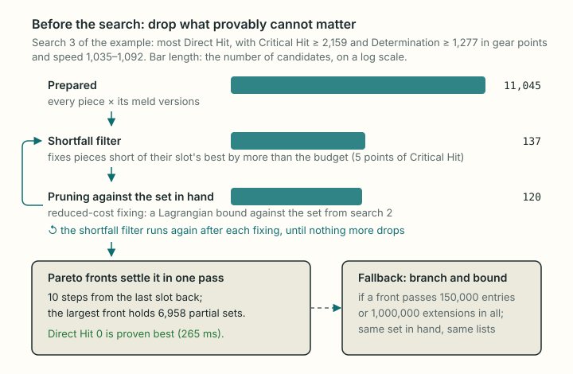

# Tier ranking

How the optimizer ranks gear sets by the **tiers** of the target and tiebreak stats instead of their raw totals (roadmap A7), and the three techniques that make those searches fast enough: a shortfall filter, pruning against a set already in hand, and Pareto fronts. Written for a reader who knows algorithms (branch and bound, dynamic programming) but not this code base or the game.

Related pages: [optimizer.md](optimizer.md) (the search this builds on), [math.md, section 6](../mechanics/math.md) (tiers, speed and food), [materia.md](../mechanics/materia.md) (melds), [glossary.md](../glossary.md).

## 1. The problem

**Tiers.** A secondary stat's effect moves in steps. Critical Hit's rate, for example, is $\lfloor 200\, g / \text{div} \rfloor$ per mille plus a base 5%, where $g$ is the gear's points of the stat (plus food) and $\text{div}$ a constant per character level (community reference: AkhMorning, matched by xivgear). At level 90 one step is about 14 points, so 2,309 and 2,317 Critical Hit give the same 29.3%: the points between two steps do nothing. Speed's effect is the GCD (the global cooldown, the time between most actions), which drops 0.01 s at a time. Main stat and Vitality have no useful steps here; every point counts.

**Raw order versus tier order.** The plain optimizer ([optimizer.md, section 2](optimizer.md#2-formal-statement)) maximizes the raw totals $(T_0, T_1, T_2)$ of the target and two tiebreaks, lexicographically. Its target always lands in its best tier, but a tiebreak can end a few points under its next step while points sit unused above a step of the target. Tier ranking maximizes

$$
(\tau_0, \tau_1, \tau_2,\; T_0, T_1, T_2)
$$

lexicographically, where $\tau_j$ is the tier of key $j$: first the best tier of each key in order, then the raw totals, so leftover points go to the target (the owner's decision, 2026-10-16, "order A"). Totals count food; speed's tier counts the job's haste and the 1.50 s GCD floor.

**Choices by the owner (2026-10-16).**

| Choice | Decision |
| --- | --- |
| Default | On, for now; a later comparison with raw ranking may change it |
| Leftover points | To the target (order A above) |
| Where a key is held | One point above the start of its tier, so a one-point error in the model does not drop the tier |
| Speed's tier | The GCD step, not the finer step of damage-over-time ticks |
| Tenacity's tier | Its mitigation step ($\lfloor 200\, g / \text{div} \rfloor$), since players stack Tenacity for damage taken; the result table's Tier row still shows the damage step |

## 2. The stages

Tier ranking runs one search per key, then one more:

1. For key $k_0$: find the most of $k_0$ any set reaches, $M_0$, and its tier $t_0$. Every set with $\tau_0 = t_0$ has at least $\text{start}(t_0)$ points of $k_0$, so from now on require $T_{k_0} \ge \min(\text{start}(t_0) + 1,\, M_0)$: the **hold**.
2. For key $k_1$: the same, among the sets that meet the hold on $k_0$. Then for $k_2$, with both holds.
3. Last: the plain lexicographic search on $(T_0, T_1, T_2)$ under all holds.

**Why this is exact.** Each tier is a non-decreasing function of the total (a floor of an increasing function; for speed, the GCD only shortens with more speed). So the sets whose $k_0$ is in its best tier are exactly the sets with $T_{k_0} \ge \text{start}(t_0)$, and searching for the most $k_1$ among them finds the best $\tau_1$ among them, and so on by induction. The "+ 1" narrows each set to the ones a point inside the tier; that is the owner's rule, not a relaxation.

**Food.** A meal adds $\min(\text{max}, \lfloor p\,(b + g)/100 \rfloor)$ to a stat with $g$ gear points ([math.md, section 6](../mechanics/math.md)); this never falls as $g$ rises, so a hold on the total with food becomes a minimum on gear points: the fewest $g$ whose total reaches the hold (a binary search). Each meal runs the stages on its own; after each stage only the meals that reach the best tier go on (the others lose on that tier whatever follows), and meals asking for the same search share it.

**A Target GCD** turns into a band on gear speed per meal ([optimizer.md, section 2](optimizer.md#target-gcd-from-a-gcd-to-a-speed-range)), which holds in every search.

**Seeds.** Each search after the first starts from the previous search's set for that meal. That set meets every limit of the next search (each hold is at most what it reached), so the next search only has to look for something strictly better, and if it stops early (its node limit) it still has a valid set.

The worked example above, as the code runs it (Dark Knight, level 90, item level 660, exactly 2.30, every meal; measured 2026-10-16 on this machine, data `d9582a6`):

| Search | Limits (gear points) | Candidates | Kept after the filters | Settled by | Result (with food) |
| --- | --- | --- | --- | --- | --- |
| Most Critical Hit (one per meal band, 6) | speed band only | 1,358 | 1,210 | search, 10–17 nodes | 2,310 with Nachos |
| Most Determination | Critical Hit ≥ 2,159 | 2,975 | 78 | fronts | 1,288 |
| Most Direct Hit | and Determination ≥ 1,277 | 11,045 | 120 | fronts | 0 |
| Raw order | all three | 2,976 | 77 | fronts | 2,310 / 1,288 / 0 |

"Candidates" counts every piece with each meld version worth keeping ([optimizer.md, section 6](optimizer.md#6-melds-in-the-search)); a version is a way to fill the piece's materia slots.

## 3. Why the plain search struggles here

The engine is a depth-first branch and bound over the 11 or 12 slots ([optimizer.md, section 5](optimizer.md#5-the-search-depth-first-branch-and-bound)). It prunes a branch when an upper bound on what the remaining slots can add cannot beat the best set found. Without limits that bound is exact (each slot's best score, summed), and searches end in a few hundred nodes.

A stage of tier ranking adds tight limits: two or three stats each held within a few points of the most any set reaches, and with a Target GCD a speed band about 60 to 85 points wide. Two things go wrong:

- **Many more candidates.** Dominance pruning ([optimizer.md, section 4](optimizer.md#4-fewer-candidates-dominance-pruning)) may drop a piece only for one at least as good on the score and every limited stat, and under a speed maximum only for one with the same speed. The full White Mage pool at level 100 keeps 19 to 26 candidates per slot in a plain search, 115 to 173 with a GCD band, and 770 to 1,570 in a tier stage with a band: about $10^{35}$ sets.
- **Weak bounds.** The engine's bound for limits is a table per limited stat: the most score the remaining slots add while still reaching that stat's minimum. Each table ignores the other limits, so each one says "maybe" for sets that would trade the other held stat, or the speed band, away. The search only learns at the leaves that the limits cannot all hold. In one White Mage stage the true best had Direct Hit 0, and proving that nothing reaches 1 took 1.2 million nodes.

Sections 4 and 5 replace most of that search. All three techniques are exact: they only remove what provably cannot be part of a better set.

## 4. Before the search: filters

### 4.1 The shortfall filter

For a stat $d$ with a minimum $m_d$, let $u_{d,i}$ be the most of $d$ any candidate adds in slot $i$, and $U_d = \sum_i u_{d,i}$. Any set has $T_d \le U_d$, and a set holding candidate $x$ in slot $i$ has

$$
T_d \;\le\; U_d - u_{d,i} + v_d(x).
$$

If that is below $m_d$, no set with $x$ meets the minimum, and $x$ goes. Put differently: the set may fall short of "the best in every slot" by at most the **budget** $U_d - m_d$ in total, so a piece whose own shortfall $u_{d,i} - v_d(x)$ exceeds the budget is out.

Holding a key one point above its tier start leaves a tiny budget: 5 points of Critical Hit in the example, 43 points of Piety for White Mage at level 100. Most meld versions spend a stone elsewhere and fall short by more than that, so the filter removes most candidates (11,045 to 137 in the example). Removing pieces lowers the $u_{d,i}$, which can shrink the budget, so the filter repeats until nothing more goes.

The bounds handle the game's slot rules the same way the search's own bounds do: a piece that leaves later slots empty (a two-handed weapon and the off-hand) is counted at its value minus those slots' bounds, and the two ring slots share one list, so a ring is bounded with the best ring as its partner.

This idea came from a research report the owner commissioned through Perplexity (2026-10-16), which also traces it to the normalization step of standard multiple-choice knapsack algorithms.

### 4.2 Pruning against the set in hand

The seed (section 2) gives a set with score $S^\star$ that meets every limit. A candidate can be dropped if no set holding it can score more than $S^\star$. To bound that, every limit gets a price $\lambda \ge 0$ per point:

- for a minimum $T_d \ge m_d$, the term $\lambda_d (T_d - m_d)$, which is $\ge 0$ on every valid set;
- for the speed maximum $T_s \le M_s$, the term $\mu (M_s - T_s)$, also $\ge 0$.

So on every valid set $L$,

$$
\text{score}(L) \;\le\; \text{score}(L) + \sum_d \lambda_d (T_d - m_d) + \mu (M_s - T_s).
$$

The right side is a sum over slots plus a constant, so its largest value over all sets, valid or not, is easy: for each slot take the candidate with the highest **priced value** $a(x) = \text{score}(x) + \sum_d \lambda_d v_d(x) - \mu v_s(x)$, written $A_i$ (at least 0), and

$$
\text{bound} = \sum_i A_i - \sum_d \lambda_d m_d + \mu M_s .
$$

This is the Lagrangian relaxation of the limits; any prices give a valid bound, and good prices give a low one. They come from a subgradient descent (Polyak steps toward $S^\star$) that lowers the bound.

**Reduced-cost fixing.** Forcing candidate $x$ into slot $i$ lowers the bound by exactly $A_i - a(x)$. If

$$
\text{bound} - \bigl(A_i - a(x)\bigr) \;\le\; S^\star ,
$$

no valid set with $x$ beats the seed, and $x$ goes. After it, the shortfall filter runs again, since the slot maxima may have dropped.

The same bound also prunes nodes inside the branch and bound, with the prices fixed at the root.

Points to note:

- **Bad prices cannot make it wrong**, only weak. With every price at 0 the bound is the plain score bound. A test that flipped the prices' signs got prices near 0 back from the descent and removed 2 candidates instead of 6,743, with the same answers.
- **Rounding.** Prices are fractions, so the bound is a float. Every comparison keeps a margin far above the possible rounding error (scores stay below $2^{53}$).
- **Ties.** A set equal to $S^\star$ has the same target and tiebreak totals (the score packs them exactly, [optimizer.md, section 3](optimizer.md#3-turning-the-lexicographic-order-into-one-number)), so it needs no search.
- **Its limit.** The bound is the same as the linear-programming relaxation: it may mix fractions of two candidates to land exactly in the speed band, which no real set can. Re-tuning the prices at every node therefore cut nothing (section 6); it is used as a filter, not as the search's main bound.

In the example the shortfall filter does most of the work (137 to 120 here), but on other cases this pruning matters more: Black Mage at level 90, exactly 2.30, takes 2.8 s with it and 6.4 s without, Summoner 2.1 s and 6.1 s (measured 2026-10-16).

## 5. Pareto fronts

After the filters each slot holds about 10 to 100 candidates. That is small enough to drop the search tree and build the answer by dynamic programming over the slots, keeping a **Pareto front**: the partial sets that no other partial set beats.

**The recurrence.** Process the slots from the last to the first. Let $F_i$ be the front for slots $i, \dots, n$. Start with $F_{n+1} = \{\varnothing\}$ (score 0, all totals 0). Then

$$
F_i = \text{nondominated}\bigl(\{\, x + e \;:\; x \text{ a choice for slot } i,\; e \in F_{i+1} \,\}\bigr),
$$

and the answer is the best entry of $F_1$ that meets every limit.

**When one entry beats another.** Entries $e$ and $f$ compare only when they leave the same slots empty, their pieces block the same slots and, under a speed maximum, they have the same speed. Then $e$ beats $f$ when it has at least $f$'s score and at least $f$'s total of every other limited stat. Any way to complete $f$ into a full set also completes $e$, with no lower score and no broken limit, so $f$ can go. Two rules make far more entries comparable:

- **A total past its minimum counts as the minimum.** Once Determination reaches 1,277, more of it cannot matter to the limit, so 1,280 and 1,300 compare as equal.
- **Speed past its minimum counts as the minimum when there is no maximum.** With a maximum (a band) speed stays exact, since more speed can break it.

**Bounding (Morin and Marsten).** An entry whose score plus the most the earlier slots can add cannot beat the seed goes, and so does one that cannot reach a minimum even with the most the earlier slots add of that stat.

**The game's rules.** The two ring slots are one step whose choices are the legal pairs (the same item twice only with 2 copies; one ring and an empty slot only when no pair exists). Blocked slots are tracked per entry: a blockable slot may be left empty, and a full set counts only if the slots it leaves empty are exactly the slots its pieces block. These are the same rules as the search ([optimizer.md, section 2](optimizer.md#2-formal-statement)).

**Why this replaces the proof.** Branch and bound spends most of a tier stage proving that nothing beats the set it already has, one branch at a time. With fronts the proof is built in: every full set is either in $F_1$ or was dropped for one at least as good on everything that matters, so the best valid entry of $F_1$ is the best valid set.

**When it fails.** A front grows when a held stat has a wide budget: many partial totals sit below the minimum, where nothing merges. The Determination budget in the example's third search is 887 points, and its largest front holds 6,958 entries (265 ms). The fronts give up past 150,000 entries in one front or 1,000,000 extensions in all, and the branch and bound runs instead; it still has the seed and the filtered lists.

This is the classic dynamic program for knapsack problems (Nemhauser and Ullmann for the Pareto fronts, Morin and Marsten for the bounding), as Perplexity's report pointed out; what is specific here is the capping at the minimums and the game's slot rules.

## 6. What did not work

Recorded so that nobody tries them again without a new idea.

| Idea | Why it failed |
| --- | --- |
| Ordering each stage's search by the held keys | Finding a good set was never the problem; proving nothing beats it was |
| A bound table on the weighted sum of the held stats | Like each single-stat table, it is an average of the limits: a set can meet it while failing one limit |
| Re-tuning the Lagrangian prices at every node | Never cut a node: the bound mixes candidates to land in the speed band (the integrality gap) |
| A table on exact speed × the shortfall of a held stat | Exact, but the shortfall filter and fronts already capture what it adds; it only cost time |
| Meet in the middle (listing the last few slots' completions) | No consistent gain once the fronts existed |

## 7. Correctness evidence

| Claim | Status | Evidence |
| --- | --- | --- |
| The stages give the lexicographic optimum of tiers then raw totals | **Verified** | Tests against a reference that enumerates every set and meal and applies the stage rule with its own tier and food formulas: two and three keys, main stat, food off, one meal and every meal, levels 50 and 100, Target GCD in both modes with haste |
| The shortfall filter, the pruning against the seed and the fronts change no result | **Verified** | A test on 120 tight cases (bigger pools, a minimum within 5 points of the most, a narrow speed band) against the plain search, which also checks that pieces were dropped and that fronts settled some searches; 2,000 more random cases by script |
| Minimums on any stat are exact in the search | **Verified** | Tests against the brute-force reference, with and without melds, with blocked slots and a speed band |
| The tests catch errors in these parts | **Verified** | Broken on purpose: pruning twice as aggressive, fronts comparing the score only, tier holds at the start instead of one above, Tenacity's damage step, no haste: each made a test fail |
| A seed that breaks a limit is ignored | **Verified** | A test |
| The tier formulas and food formula | **Community reference** / **inferred** | As in [math.md, section 6](../mechanics/math.md) |

## 8. Performance

Every combat job, two goals each (Critical Hit > Determination > Direct Hit and the reverse order of the job's substats), level 100 with no sync and level 90 synced to item level 660, every meal; a Target GCD halfway between 2.50 s and the fastest the gear reaches. Node 22 on the owner's machine, 2026-10-16, data `d9582a6`.

| | No Target GCD (84 runs) | Target GCD "exactly", before sections 4 and 5 (70 runs) | Target GCD "exactly", now (70 runs) |
| --- | --- | --- | --- |
| Median | 174 ms | 3.2 s (level 90), 4.2 s (level 100) | 774 ms |
| Slowest tenth from | 236 ms | about 13 s | 1.9 s |
| Over 1.5 s | 0 | 54 | 9 |
| Over 5 s | 0 | 28 | 1 |
| Stopped at the node limit | 0 | 25 | 1 |
| Slowest | 395 ms | 15.7 s | 6.8 s |

The one search that still stops early is White Mage at level 100, exactly 2.32, Piety > Direct Hit > Determination (1.07 million nodes); the next slowest are White Mage, Astrologian, Black Mage, Scholar and Sage at 1.9 to 2.6 s. The 14 runs of the haste jobs are left out (section 9).

The remaining time is mostly building the candidate lists (meld versions and pruning), which happens once per stage.

## 9. Known limits

- **Searches that stop early.** A few cases still reach the node limit; they return the seed or better, marked as possibly not the best, like any truncated result.
- **Haste jobs in the sweep.** Monk, Samurai, Ninja and Viper have a GCD below 2.50 s with no speed at all; the sweep's halfway GCD lands above it, so those runs end at once ("unreachable") and are left out of the timings.
- **The page.** Tier ranking runs in the core only; the switch, readout and progress indicator are not built yet (roadmap A7).

## Where this lives

| Concept | File |
| --- | --- |
| The stages, holds, meals and seeds | `src/core/tier-rank.js` (`rankByTier`) |
| Tier per stat for ranking, tier start | `src/core/tiers.js` (`rankTierOf`, `tierStart`) |
| A speed band per meal | `src/core/target-gcd.js` (`gearBand`) |
| Minimums on any stat, seeds | `src/core/optimizer/index.js` (`prepare`, `solve`) |
| Pruning with limits | `src/core/optimizer/candidates.js` (`pruneForLimits`) |
| Shortfall filter, Lagrangian bound, reduced-cost fixing, the search | `src/core/optimizer/search.js` (`dropShortfalls`, `lagrangeBound`, `fixByReducedCost`, `branchAndBound`) |
| Pareto fronts | `src/core/optimizer/front.js` (`frontSearch`) |
| Tests | `tests/unit/tier-rank.test.js`, `tests/unit/stat-minimums.test.js` |
