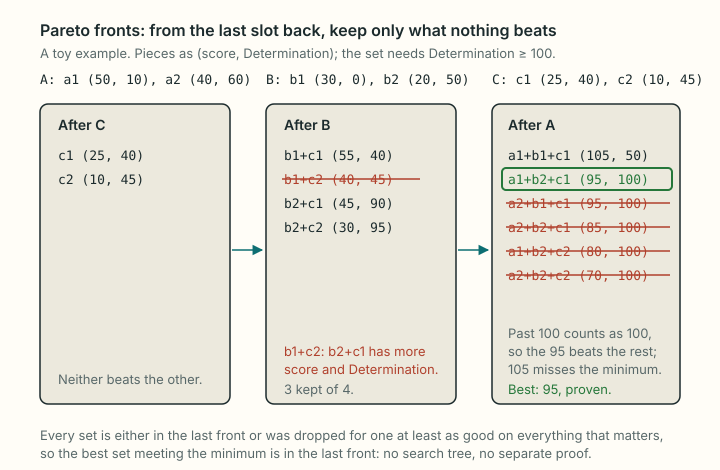

# Tier ranking

How the optimizer ranks gear sets by the **tiers** of the target and tiebreak stats instead of their raw totals (roadmap A7), and the reductions that make those searches fast enough. In optimization terms: a preemptive (lexicographic) objective over step functions of the totals, solved as a sequence of multi-dimensional multiple-choice knapsack problems (MMKP) with minimums; each is reduced by bound-based variable fixing (the shortfall filter), Lagrangian reduced-cost fixing against a known feasible set, and valid inequalities from the earlier stages' proven optima (regain cuts), then settled by a short trial search or, failing that, a bounded Pareto-front dynamic program (Nemhauser–Ullmann with Morin–Marsten fathoming), with the branch and bound as the last resort. Written for a reader versed in integer programming and knapsack methods but new to this code base and the game; notation follows [optimizer.md, section 2](optimizer.md#2-formal-statement).

Related pages: [optimizer.md](optimizer.md) (the model and the search this builds on), [math.md, section 6](../mechanics/math.md#6-speed-and-substat-tiers) (tiers, speed and food), [materia.md](../mechanics/materia.md) (melds), [glossary.md](../glossary.md).

## 1. The problem

What does "rank by tiers" mean, and why is it a different objective from the plain optimizer's?

**Tiers.** A secondary stat's effect moves in steps. Critical Hit's rate is $5\% + \lfloor 200\, g / \text{div} \rfloor$ per mille, where $g$ is the gear's points of the stat (plus food) and $\text{div}$ a constant per character level (community reference: AkhMorning, matched by xivgear). Speed's effect is the GCD (the global cooldown, the time between most actions), which drops 0.01 s at a time. Main stat and Vitality have no useful steps here; every point counts.

Write $\tau_d(T)$ for the tier of stat $d$ at total $T$, and $\text{start}_d(t)$ for its least total. Every $\tau_d$ is a **non-decreasing step function**: a floor of an increasing function, or for speed, a GCD that only shortens with more speed.

**Raw order versus tier order.** The plain optimizer ([optimizer.md, section 2](optimizer.md#2-formal-statement)) solves $\operatorname{lex\,max}\,(T_{k_0}, T_{k_1}, T_{k_2})$ over the target $k_0$ and tiebreaks $k_1, k_2$. Its target always lands in its best tier, but a tiebreak can end a few points under its next step while points sit unused above a step of the target. Tier ranking solves

$$
\operatorname{lex\,max}\ \bigl(\tau_{k_0}(T_{k_0}),\ \tau_{k_1}(T_{k_1}),\ \tau_{k_2}(T_{k_2}),\ T_{k_0},\ T_{k_1},\ T_{k_2}\bigr)
$$

over the same feasible set: first the best tier of each key in order, then the raw totals, so leftover points go to the target (the owner's decision, 2026-10-16, "order A"). Totals count food; speed's tier counts the job's haste and the 1.50 s GCD floor.

The step functions make the first three criteria non-linear in $x$, so the weighted-sum scalarization of [optimizer.md, section 3](optimizer.md#3-turning-the-lexicographic-order-into-one-number) does not apply to them directly. Section 2 turns them into linear minimums instead.

**Choices by the owner (2026-10-16, the first two rows revisited 2026-10-17).**

| Choice | Decision |
| --- | --- |
| Default | On; kept after a comparison with raw ranking (2026-10-17) |
| Tied sets | No tie rule yet (2026-10-17; section 9) |
| Leftover points | To the target (order A above) |
| Where a key is held | One point above its tier start, so a one-point model error does not drop the tier |
| Speed's tier | The GCD step |
| Tenacity's tier | Its mitigation step |
| Weapon damage | Ranked before every key, held at its most (2026-10-18; section 2) |

- **Speed:** the GCD step, not the finer step of damage-over-time ticks.
- **Tenacity:** its mitigation step ($\lfloor 200\, g / \text{div} \rfloor$), since players stack Tenacity for damage taken; the result table's Tier row still shows the damage step.

## 2. The stages

How is a lexicographic objective over step functions solved with a linear-objective engine? As a preemptive (goal-programming) sequence: one problem per key, each adding a minimum that fixes the previous key's optimal tier.

![Four searches for Dark Knight at level 90, item level 660, a GCD of exactly 2.30 with food: the most Critical Hit (2,310, held at 2,310 or more; it proves at most 2,164 gear points), the most Determination with that hold (1,288, held at 1,277 or more; proves at most 1,288), the most Direct Hit with both holds (0, proven), then the raw order under all three holds. Each proof becomes a regain cut in every later search. The first search is a full search of 12 nodes; the others start from the set before and end in a trial search of 764, 2,648 and 5,262 nodes.](../diagrams/tier-ranking-stages.svg)

**The sequence.** Let $X$ be the feasible set of [optimizer.md, section 2](optimizer.md#2-formal-statement) (choice, conflict, copy and speed rows). For $q = 0, 1, 2$:

$$
(P_q)\qquad M_q = \max\ \bigl\{\, T_{k_q}(x) \;:\; x \in X,\ \ T_{k_r}(x) \ge h_r \ \text{ for } r < q \,\bigr\},
$$

with $t_q = \tau_{k_q}(M_q)$ and the **hold**

$$
h_q = \min\bigl(\text{start}_{k_q}(t_q) + 1,\ M_q\bigr).
$$

Last,

$$
(P_3)\qquad \operatorname{lex\,max}\ \bigl\{\, (T_{k_0}, T_{k_1}, T_{k_2})(x) \;:\; x \in X,\ \ T_{k_r}(x) \ge h_r \ \text{ for } r = 0, 1, 2 \,\bigr\},
$$

which is the plain optimizer under three extra minimum rows, scalarized as in [optimizer.md, section 3](optimizer.md#3-turning-the-lexicographic-order-into-one-number). Each $(P_q)$ is an MMKP: the plain model plus one covering row per earlier key.

**Why this is exact.** Since $\tau_d$ is non-decreasing, $\{x : \tau_d(T_d(x)) \ge t\} = \{x : T_d(x) \ge \text{start}_d(t)\}$, a single linear covering row. So the sets whose $k_0$ is in its best tier are exactly the feasible sets with $T_{k_0} \ge \text{start}(t_0)$; maximizing $T_{k_1}$ over them finds the best $\tau_{k_1}$ among them (monotonicity again), and so on by induction. This is the standard preemptive scheme (Ehrgott 2005, *Multicriteria Optimization*, Springer, on lexicographic optimization), with the optimal value of each stage turned into a minimum for the next. The "+ 1" narrows each set to the ones a point inside the tier; that is the owner's rule, not a relaxation.

**Food.** A meal adds $f(g) = \min(\text{max}, \lfloor p\,(b + g)/100 \rfloor)$ to a stat with $g$ gear points ([math.md, section 6](../mechanics/math.md#6-speed-and-substat-tiers)). $g + f(g)$ is non-decreasing in $g$, so a hold on the total with food becomes a minimum on gear points: the least $g$ whose total reaches the hold (found by bisection). Each meal runs the stages on its own. After each stage only the meals that reach the best tier go on (the others lose on that tier whatever follows), and meals asking for the same problem share it.

**Weapon damage first.** Every search ranks the weapon's weapon damage before the target ([optimizer.md, section 1](optimizer.md#1-the-problem); not for Blue Mage). Tier ranking runs it as one more stage before $(P_0)$: weapon damage has no tiers, so its stage finds the most, $M_{\text{wd}}$, and holds it there ($h_{\text{wd}} = M_{\text{wd}}$, no "+ 1"). The keys above then run under that hold, and the last stage ranks weapon damage first among the raw totals. A stage of its own keeps the regain cuts (section 4.4) valid: each later stage has every row of the one before. Weapon damage is not named in the "Ranked by tier" line; a note under the result says it comes first.

**A Target GCD** turns into a band on gear speed per meal ([optimizer.md, section 2](optimizer.md#target-gcd-from-a-gcd-to-a-speed-range)), a capacity and a covering row present in every stage.

**Seeds (warm starts).** Each stage after the first starts from the previous stage's optimal set for that meal. That set is feasible for the next stage (each hold is at most what it reached), so it is an incumbent with score $\sigma^\star$ from the start: the next stage only has to find something strictly better, and if it stops early (its node limit) it still returns a feasible set. Sections 4.2 and 5 use $\sigma^\star$ for fixing and fathoming.

**Proven maxima.** A stage that finishes (does not stop at its node limit) also proves $M_q$, the most of its key under its rows. Every later stage of the meal has those rows and more, so it gets $M_q$ as a cut (section 4.4).

The worked example above, as the code runs it (Dark Knight, level 90, item level 660, exactly 2.30, every meal, the page's pool without Savage, Ultimate and PvP gear; measured 2026-10-17, data `d9582a6`):

| Search | Limits (gear points) | Candidates | Kept after the filters | Settled by | Result (with food) |
| --- | --- | --- | --- | --- | --- |
| Most Critical Hit (one per meal band, 6) | speed band only | 1,192 | 1,192 | search, 12 nodes | 2,310 with Nachos |
| Most Determination | Critical Hit ≥ 2,159 | 2,935 | 74 | trial search, 764 nodes | 1,288 |
| Most Direct Hit | and Determination ≥ 1,277 | 10,846 | 68 | trial search, 2,648 nodes | 0 |
| Raw order | all three | 10,846 | 76 | trial search, 5,262 nodes | 2,310 / 1,288 / 0 |

"Candidates" counts the variables $x_{s,i}$ after dominance reduction: every piece with each meld version worth keeping ([optimizer.md, section 6](optimizer.md#6-melds-in-the-search)); a version is a way to fill the piece's materia slots, and each is one item of its class. Before the changes of 2026-10-17 (section 4.4, section 5) the last three searches were settled by Pareto fronts.

## 3. Why the plain search struggles here

Why can the plain branch and bound not just solve each $(P_q)$?

The engine is a depth-first branch and bound over the 11 or 12 slot positions ([optimizer.md, section 5](optimizer.md#5-the-search-depth-first-branch-and-bound)). Without limits its separable bound is exact, and searches end in a few hundred nodes. A stage of tier ranking adds tight limits: two or three stats each held within a few points of their maximum, and with a Target GCD a speed band about 60 to 85 points wide. Two things go wrong:

- **Many more candidates.** Dominance reduction ([optimizer.md, section 4](optimizer.md#4-fewer-candidates-dominance-pruning)) may drop a piece only for one at least as good on the score and every limited stat, and under a speed maximum only for one with the same speed. The full White Mage pool at level 100 keeps 19 to 26 candidates per slot in a plain search, 115 to 173 with a GCD band, and 770 to 1,570 in a tier stage with a band: about $10^{35}$ sets.
- **Weak bounds.** The engine's bound under minimums is the smallest of one exact DP table per limited stat ([optimizer.md, section 5](optimizer.md#with-minimums-on-other-stats)); each table keeps one limit row and drops the others, so each accepts sets that trade the other held stat, or the speed band, away. Joint infeasibility of the limit rows is only detected at complete assignments. In one White Mage stage the true best had Direct Hit 0, and proving that nothing reaches 1 took 1.2 million nodes.

The difficulty is usually the optimality proof, not finding the optimum: the seed is usually already optimal. Not always: the seed is the best set for the previous key, and it can be far from the best for this one (section 4.3). Sections 4 and 5 replace most of that proof. Every technique there is exact: it only removes variables or partial solutions that provably cannot be part of a set better than the incumbent.

## 4. Before the search: filters

Which variables can be fixed to 0 before the search? Three arguments, applied in turn: one from the minimum rows alone, one from a Lagrangian bound against the seed, and one from what the earlier stages proved.

![The filters on the example's third search: 10,846 candidates, 133 after the shortfall filter (a budget of 5 points of Critical Hit), 117 after pruning against the set in hand from search 2, 68 after the regain cuts from searches 1 and 2 (room 5 points of Critical Hit and 11 of Determination); the shortfall filter runs again after each fixing until nothing more drops. A trial search of at most 20,000 nodes then settles it in 2,648 nodes; only if it does not finish do Pareto fronts run, and past 150,000 entries in one front or 1,000,000 extensions in all, the full branch and bound, with the same set in hand and lists.](../diagrams/tier-ranking-filters.svg)

### 4.1 The shortfall filter

When can a single candidate never appear in a set meeting a minimum? When even the best of every other slot cannot make up for it. This is bound-based variable fixing on a covering row, the activity-bound argument of MIP presolve (Savelsbergh 1994, *ORSA Journal on Computing*, on preprocessing and probing).

**The rule.** For a stat $d$ with a minimum $m_d$, let $u_{d,s} = \max_i v_d(i)$ over the candidates of position $s$ (the most of $d$ any candidate adds there), and $U_d = \sum_s u_{d,s}$, the row's maximum activity. Every set has $T_d \le U_d$, and a set with $x_{s,i} = 1$ has

$$
T_d \;\le\; U_d - u_{d,s} + v_d(i).
$$

If that is below $m_d$, the row cannot hold with $x_{s,i} = 1$, so fix $x_{s,i} = 0$. Equivalently, the set may fall short of "the best in every slot" by at most the **budget** $U_d - m_d$ in total (the row's slack at maximum activity), and a candidate whose own shortfall $u_{d,s} - v_d(i)$ exceeds the budget is out.

**Why it matters here.** Holding a key one point above its tier start leaves a tiny budget: 5 points of Critical Hit in the example, 43 points of Piety for White Mage at level 100. Most meld versions spend a stone elsewhere and fall short by more than that, so the filter fixes most variables (10,846 candidates to 133 in the example). Fixing variables lowers the $u_{d,s}$, which can shrink the budget, so the filter repeats to a fixed point.

**The conflict and copy rows.** The maximum activities are the same separable bounds the search uses: a piece that leaves later slots empty (a two-handed weapon and the off-hand) is counted at its value minus those slots' bounds, and the two ring positions share one list, so a ring is bounded with the best ring as its partner.

This idea came from a research report the owner commissioned through Perplexity (2026-10-16), which also traces it to the normalization step of standard multiple-choice knapsack algorithms (Kellerer, Pferschy and Pisinger 2004, *Knapsack Problems*, Springer, MCKP chapter).

### 4.2 Pruning against the set in hand

Given the seed with score $\sigma^\star$, which candidates cannot be part of any strictly better feasible set? A Lagrangian bound answers this per candidate, by reduced-cost fixing.

**The relaxation.** Dualize every limit row: each minimum $T_d \ge m_d$ (the held keys, and a speed minimum) with multiplier $\lambda_d \ge 0$, and the speed maximum $T_{\text{spd}} \le M$ with $\mu \ge 0$. Each penalty term is $\ge 0$ on every feasible set, so for $x \in X$ meeting the limits,

$$
\sigma(x) \;\le\; L(x; \lambda, \mu) = \sigma(x) + \sum_d \lambda_d \bigl(T_d(x) - m_d\bigr) + \mu \bigl(M - T_{\text{spd}}(x)\bigr).
$$

The remaining subproblem keeps the choice rows (at most one item per position, empty allowed) and **drops** the copy and conflict rows, so it separates by position. With the **priced value** $a(i) = \sigma(i) + \sum_d \lambda_d v_d(i) - \mu\, v_{\text{spd}}(i)$ and $A_s = \max\bigl(0, \max_i a(i)\bigr)$ over the candidates of position $s$,

$$
L(\lambda, \mu) \;=\; \sum_s A_s - \sum_d \lambda_d m_d + \mu M .
$$

Any $\lambda, \mu \ge 0$ give a valid upper bound (weak duality); the Lagrangian dual $\min_{\lambda, \mu \ge 0} L$ gives the best one (Geoffrion 1974, *Mathematical Programming Study* 2; Fisher 1981, *Management Science*).

**The multipliers: projected subgradient with Polyak's step.** Starting from $\lambda = \mu = 0$, a subgradient $g$ of $L$ is the slack of each dualized row at the subproblem's maximizer $\hat{x}$: $g_d = T_d(\hat{x}) - m_d$ and $g_\mu = M - T_{\text{spd}}(\hat{x})$. The update is

$$
(\lambda, \mu) \leftarrow \max\Bigl(0,\ (\lambda, \mu) - \theta\, \frac{L(\lambda, \mu) - \sigma^\star}{\lVert g \rVert^2}\, g\Bigr),
$$

Polyak's step (Polyak 1969, *USSR Computational Mathematics and Mathematical Physics*) with the target value $\sigma^\star$, a lower bound on the dual optimum. $\theta$ starts at 1 and is halved after 15 steps without a lower $L$, the usual safeguard (Held, Wolfe and Crowder 1974, *Mathematical Programming*; Fisher 1981). It runs at most 300 steps, stops at a zero subgradient, and keeps the best multipliers found.

**Reduced-cost fixing.** Forcing $x_{s,i} = 1$ changes the subproblem only at position $s$, so it lowers $L$ by exactly the reduced cost $A_s - a(i)$. If

$$
L(\lambda, \mu) - \bigl(A_s - a(i)\bigr) \;\le\; \sigma^\star ,
$$

no feasible set with $x_{s,i} = 1$ beats the seed, and $x_{s,i}$ is fixed to 0 (the standard argument, as in Crowder, Johnson and Padberg 1983, *Operations Research*).

The same bound also fathoms nodes inside the branch and bound, with the multipliers fixed at the root.

Points to note:

- **Bad multipliers cannot make it wrong**, only weak. With every multiplier at 0 the bound is the plain separable score bound. A test that flipped the multipliers' signs got multipliers near 0 back from the descent and fixed 2 candidates instead of 6,743, with the same answers.
- **Rounding.** Multipliers are fractions, so the bound is a float. Every comparison keeps a margin far above the possible rounding error (scores stay below $2^{53}$).
- **Ties.** A set equal to $\sigma^\star$ has the same target and tiebreak totals (the score packs them exactly, [optimizer.md, section 3](optimizer.md#3-turning-the-lexicographic-order-into-one-number)), so fixing at "$\le \sigma^\star$" loses nothing.
- **Its limit.** The subproblem has the integrality property, so the dual bound equals the linear-programming relaxation's value (Geoffrion 1974; strictly, the LP relaxation of the model without its copy and conflict rows, since the subproblem drops them): it may mix fractions of two candidates to land exactly in the speed band, which no real set can. Re-optimizing the multipliers at every node therefore cut nothing (section 6); it is used for fixing, not as the search's main bound.

In the example the shortfall filter does most of the work (133 to 117 here), but on other cases reduced-cost fixing matters more: Black Mage at level 90, exactly 2.30, takes 2.8 s with it and 6.4 s without, Summoner 2.1 s and 6.1 s (measured 2026-10-16).

### 4.3 Improving the seed first

The fixing above is only as strong as $\sigma^\star$. The seed is the previous stage's optimum, chosen for another key, so it can be poor for this one. Before the Lagrangian step, a **1-opt local search** improves it: at each position, any candidate that keeps every limit, the copies and the blocked slots, and raises the score. The best such swap is made, and the passes repeat until none helps (`improveStart`).

- **Exact:** the result is still a legal set meeting every limit, and the search still looks for anything strictly better.
- **The case that showed it.** White Mage at level 100, exactly 2.32, Piety > Direct Hit > Determination, every meal. In the Determination stage (Prune Ponzecake), the seed had Determination 188 and the best has 710: the same set with the body and both rings swapped.
  - Without the swaps, the search ran 700,000 nodes without finding any better set, so the page showed 188 and held Determination's tier at 12 where 40 was possible.
  - It needed 812,472 nodes to finish. The Lagrangian gap was 885 points of Determination against the seed.
  - With the swaps, the seed starts at 710, the gap is 361 points, fixing keeps 330 of 2,268 candidates, and the search needs 7,397 nodes.

### 4.4 Regain cuts from the stages before

The hard stages are the last ones: the key is held near its most, the answer is often 0 or a few points, and the search must prove that nothing does better. The earlier stages already proved something about those sets: stage $q$ found $M_q$, the most of key $k_q$ under its rows. Can a later stage use that? Yes, as a valid inequality (a cut).

**The exchange argument.** Take any set $x$ feasible for a later stage $q' > q$ (or $P_3$). Its rows include stage $q$'s: the same speed rule, and holds on the same keys that are no lower. In each position, swap the chosen piece $i$ for a piece $j$ of the same position that

- leaves the same positions empty (so the conflict rows still hold);
- has the same speed under a band, or at least as much under a minimum only;
- has at least $i$'s value of every key stage $q$ held;
- for a ring: is another meld version of $i$, or a ring with 2 copies (so the two ring positions never hold one Unique ring twice).

Other positions each hold a different item, so any such swaps together give a legal set $x'$ that meets stage $q$'s rows. So $T_{k_q}(x') \le M_q$. With the **regain** $\rho_q(i)$ = the most of $k_q$ such a swap adds to piece $i$ (0 when none adds any),

$$
T_{k_q}(x) + \sum_s \rho_q(x_s) \;\le\; M_q, \qquad\text{and since } T_{k_q}(x) \ge h_q:\qquad \sum_s \rho_q(x_s) \;\le\; M_q - h_q .
$$

Every feasible set of the later stage meets this row, so adding it removes no feasible set. The room $M_q - h_q$ is the hold margin plus whatever the tier start leaves, usually less than one materia stone, so the row says: the set may put almost no stone, and no whole piece, against key $k_q$ where a swap could have put it back.

**In the search.** The regain is a column of a new knapsack row with a small capacity:

- a candidate whose own regain passes the room is fixed to 0;
- the row joins the search's limits as a maximum, with its own limit table (an exact DP on the row, [optimizer.md, section 5](optimizer.md#with-a-speed-range));
- it is computed after the other filters, on the few candidates left, with the full lists (and each piece's every meld version) as the pieces a swap may bring in.

Three details keep it exact:

- **Only finished stages.** A stage stopped at its node limit proves nothing; a wrong $M_q$ would cut good sets. Such a stage passes no cut.
- **The memo ignores the row.** Two partial sets with the same totals of the real rows have the same completions that meet those rows, and every such full set meets the cut, so the row's total stays out of the state key ([optimizer.md, section 5](optimizer.md#with-minimums-on-other-stats)).
- **The fronts ignore it too.** An entry is compared on the real rows only (section 5), for the same reason; entries past the room are dropped.

**Gain.** In the example's third search, the cuts from stages 1 and 2 (room 5 points of Critical Hit and 11 of Determination) keep 68 candidates of 117 and the trial search needs 2,648 nodes against 4,800 without them, in about the same time (120 against 106 ms: working out the regains costs what the nodes save). On the hardest stages the gain is far larger. With the other changes of 2026-10-17, White Mage at level 100, sync off, Direct Hit > Critical Hit > Determination, exactly 2.25, food off, went from 8.9 s and a stop at the node limit to 1.1 s and 1,118 nodes in all (section 8). In Perplexity's ablation (each change switched off in turn, on its prototype), the cuts and the band-reach tables ([optimizer.md, section 5](optimizer.md#with-minimums-on-other-stats)) were what turned the healer stages that stopped at the node limit into finished proofs.

The idea and its proof came from a solver review the owner commissioned through Perplexity (2026-10-17), with a prototype; the code here is that prototype rewritten. In integer-programming terms it is an exchange (swap) argument turned into a valid inequality; Perplexity's review found no tighter bound that was cheap enough (section 6).

## 5. Pareto fronts

After fixing, each position holds about 10 to 100 candidates. Can the stage be solved without a tree? Yes, by the multi-criteria dynamic program over positions: keep, per stage, the nondominated partial solutions in (score, limited totals) space, fathom the ones that cannot beat the incumbent, and read the optimum off the last stage.

**A trial search first (2026-10-17).** Building the fronts takes 0.1 to 1.4 s, often for a stage the branch and bound finishes in a few hundred nodes, and on the hard stages the fronts grew too large and were given up after that time was spent (Perplexity's profile of the slow cases: 25 to 40% of their time). So the branch and bound runs first for at most 20,000 nodes. Only if it does not finish are fronts built, starting from the best set it found; most stages never build them (the example in section 2 builds none). Exact: the trial search is the same search with a lower node limit, and a stage it finishes is proven.

**The recurrence.** Process the positions from the last to the first. Let $F_s$ be the front for positions $s, \dots, n$, with $F_{n+1} = \{\varnothing\}$ (score 0, all totals 0). Then

$$
F_s = \text{nondominated}\bigl(\{\, i + e \;:\; i \text{ a choice for position } s,\; e \in F_{s+1} \,\}\bigr),
$$

and the answer is the best entry of $F_1$ that meets every limit. This is Nemhauser and Ullmann's dynamic program for knapsack problems (1969, *Management Science*), with one criterion per limited stat instead of one weight.

**State dominance.** Entries $e$ and $f$ compare only when they leave the same positions empty, their pieces block the same positions and, under a speed band, they have the same speed. Then $e$ dominates $f$ when it has at least $f$'s score and at least $f$'s total of every other limited stat (at most, for a stat with a maximum only). Any completion of $f$ is also a completion of $e$, with no lower score and no broken limit, so $f$ can go. Two state truncations make far more entries comparable:

- **A total past its minimum counts as the minimum.** Once Determination reaches 1,277, more of it cannot matter to the row, so 1,280 and 1,300 compare as equal.
- **Speed past its minimum counts as the minimum when there is no maximum.** With a maximum (a band) speed stays exact, since more speed can break it.

Two more rules, for rows the stages did not have before 2026-10-17:

- **A regain cut (section 4.4) is not compared.** Entries past its room go, but two entries are compared on the real rows only: any completion of $f$ that meets the real rows is a completion of $e$ that meets them too, and a full set meeting the real rows always meets the cut.
- **A second band** (a maximum and a minimum on a stat other than speed) makes the fronts give up, and the search runs. Only speed has a band today; the rule keeps the dominance test right if another one is added.

**The filter.** The kept entries of a group are compared with each new one, best score first. With at most two compared totals (the usual case: one or two held keys under a speed band) the kept entries of a group reduce to a staircase, and one binary search per entry decides it (Kung, Luccio and Preparata 1975, *Journal of the ACM*, on the maxima of a set of vectors). With three or more, each kept entry is compared in turn.

**Fathoming (Morin and Marsten).** An entry whose score plus the most the earlier positions can add cannot beat $\sigma^\star$ goes, and so does one that cannot reach a minimum even with the most the earlier positions add of that stat. This is the bounding of Morin and Marsten (1976, *Operations Research*, "Branch-and-bound strategies for dynamic programming"); [optimizer.md, section 5](optimizer.md#5-the-search-depth-first-branch-and-bound) uses the reverse, DP state dominance inside the branch and bound.

**The game's rules.** The two ring positions are one stage whose choices are the legal pairs (the same item twice only with 2 copies; one ring and an empty slot only when no pair exists), which enforces the copy rows exactly. Blocked positions are tracked per entry: a blockable position may be left empty, and a full set counts only if the positions it leaves empty are exactly the ones its pieces block, which enforces the conflict rows. These are the same rules as the search ([optimizer.md, section 2](optimizer.md#2-formal-statement)).

**Why this replaces the proof.** Branch and bound spends most of a tier stage proving that nothing beats the incumbent. With fronts the proof is built in: every full set is either in $F_1$ or was dropped for one at least as good on everything that matters, so the best feasible entry of $F_1$ is optimal.

**When it fails.** A front grows when a held stat has a wide budget: many partial totals sit below the minimum, where the truncation merges nothing. Measured 2026-10-16, when fronts settled the example's third search: its Determination budget was 887 points, and its largest front held 6,958 entries (265 ms). The fronts give up past 150,000 entries in one front, 1,000,000 extensions in all, or 30 million entry comparisons in the dominance filter in all, and the branch and bound runs instead, still with the seed and the reduced lists, from the top with its memo cleared (the trial search's memo holds states it never finished). Giving up never changes the answer, only who proves it.

- **Why the comparison limit.** Without the staircase, the filter compares each new entry with the kept ones of its group, so a large front costs its size squared. Black Mage at level 90, item level 660, 2.32 or faster, Critical Hit > Determination > Direct Hit, food off, spent 21 s in that loop before the front gave up on its size; the search after it took 25,359 nodes. With the limit the whole run takes 1.3 s. The limit now applies only with three or more compared totals.
- **Ring pairs.** The ring stage gives up before building its pairs when they alone pass the extension limit. Building 2 million pairs (Direct Hit first, GCD 2.30 or 2.31, healers at level 100) overflowed the stack and showed an error on the page.

What is specific here, beyond the classic method that Perplexity's report pointed to, is the truncation at the minimums and the game's slot rules.

## 6. What did not work

Recorded so that nobody tries them again without a new idea.

| Idea | Why it failed |
| --- | --- |
| Branching order by the held keys | Finding the optimum was never the problem; proving it was |
| A bound table on a weighted sum of the held stats | A surrogate row: a set can meet it while failing one limit |
| Re-optimizing the multipliers at every node | Never fathomed a node (the integrality gap, section 4.2) |
| A table on exact speed × the shortfall of a held stat | Exact, but fixing and fronts already capture it; cost time |
| Meet in the middle (enumerating the last positions' completions) | No consistent gain once the fronts existed |
| A score to beat without the tiebreaks | Same nodes (11.75 against 11.77 million) |
| Fronts for feasibility only | 716 million extensions at the third stage |
| A stage that looks only for the next tier | No gain on the slow cases; looser regain cuts (P) |
| A stage that maximizes its key alone | No gain; one healer stage stopped at the node limit again (P) |
| Proven maxima as plain maxima on the keys | No effect on the LP bound; unsafe with the old group bounds (P) |
| Regain filter only, without the sum row | No faster; one run stopped at the node limit (P) |
| Slot order by the lists before the filters | Slower than the old fixed order (P) |
| Two-row exact DP and surrogate DP bounds | Bounds of 72 to 1,330 where the answer is 0 (P) |

(P): tried on Perplexity's prototype in its review (2026-10-17), its measurements.

Notes:

- **Weighted-sum table.** Like each single-stat table, it bounds an average of the limits (a surrogate relaxation), so it is no tighter on the joint infeasibility.
- **Per-node multipliers.** The Lagrangian bound mixes fractions of candidates to land in the speed band, so re-tuning it below the root gained nothing.
- **Score to beat.** When a stage's seed is already its best (section 9), the search must show that no set has one more point of the target. Asking only that, with the tiebreaks out of the score, fathomed almost nothing more: the nodes that survive are the ones whose bounds cannot see the rows' joint infeasibility, not the ones kept alive by a tiebreak.
- **Feasibility fronts.** The same question as fronts with every score at 0, the target as a minimum, and every total capped at its minimum. On White Mage at level 100, exactly 2.31, the second stage already held 4,834 entries.

## 7. Correctness evidence

| Claim | Status | Evidence |
| --- | --- | --- |
| The stages give the lexicographic optimum of tiers then raw totals | **Verified** | Tests against a reference that enumerates every set and meal and applies the stage rule with its own tier and food formulas: two and three keys, main stat, food off, one meal and every meal, levels 50 and 100, Target GCD in both modes with haste |
| The shortfall filter, the pruning against the seed, the trial search and the fronts change no result | **Verified** | A test on 120 tight cases (bigger pools, a minimum within 5 points of the most, a narrow speed band) against the plain search, which also checks that pieces were dropped and that the trial search or fronts settled some searches; 2,000 more random cases by script |
| The fronts alone give the best set, for each way they compare entries | **Verified** | A test of the fronts without the trial search against the plain search: a band with one or two held stats (the staircase), a speed minimum with two (pairwise), a speed maximum alone (less is better) |
| The regain cuts remove no feasible set | **Verified** | A test against the brute-force reference on small real pools: the proof's maximum, the second search's totals, and every piece of the plain search's answer passing the cut with its regains summing to at most the room; 360 more random tier ranking cases against the reference (three keys with a Target GCD among them) |
| The 2026-10-17 changes (regain cuts, trial search, slot order, band reach) change no ranked result | **Verified** | Sweeps against the code before, section 8: the same ranked totals and meal in all 5,028 cases (held tiers too, but for one the code before had cut short), and the same ranked totals in the 4,160 cases the 2026-10-18 sweep shares with it on every job. The 17,648-case sweep on every job ran Perplexity's prototype, which gives the merged code's sets in all 5,028 cases; on the rest that is **inferred** |
| Minimums on any stat are exact in the search | **Verified** | Tests against the brute-force reference, with and without melds, with blocked slots and a speed band |
| The tests catch errors in these parts | **Verified** | Broken on purpose: pruning twice as aggressive, fronts comparing the score only, tier holds at the start instead of one above, Tenacity's damage step, no haste: each made a test fail. Since 2026-10-17 also: a Unique ring allowed to swap for any ring, the regain ignoring the held keys, the fronts comparing a maximum-only total the wrong way, the staircase ignoring its second total |
| A seed that breaks a limit is ignored | **Verified** | A test |
| The tier formulas; the food formula | **Community reference** (tiers) / **verified** in a synced duty (food) | As in [math.md, section 6](../mechanics/math.md#6-speed-and-substat-tiers) |

## 8. Performance

How long does a full tier ranking take, and how much did sections 4 and 5 save?

Every combat job, two goals each (Critical Hit > Determination > Direct Hit and the reverse order of the job's substats), level 100 with no sync and level 90 synced to item level 660, every meal; a Target GCD halfway between 2.50 s and the fastest the gear reaches. Node 22 on the owner's machine, 2026-10-16, data `d9582a6`.

| | No Target GCD (84 runs) | Target GCD "exactly", before sections 4 and 5 (70 runs) | Target GCD "exactly", now (70 runs) |
| --- | --- | --- | --- |
| Median | 174 ms | 3.2 s (level 90), 4.2 s (level 100) | 774 ms |
| Slowest tenth from | 236 ms | about 13 s | 1.9 s |
| Over 1.5 s | 0 | 54 | 9 |
| Over 5 s | 0 | 28 | 1 |
| Stopped at the node limit | 0 | 25 | 1 |
| Slowest | 395 ms | 15.7 s | 6.8 s |

The one search that stopped early was White Mage at level 100, exactly 2.32, Piety > Direct Hit > Determination (1.07 million nodes); the next slowest are White Mage, Astrologian, Black Mage, Scholar and Sage at 1.9 to 2.6 s. The 14 runs of the haste jobs are left out (section 9).

**After the seed swaps, the memo dominance and the comparison limit** (sections 4.3 and 5; [optimizer.md, section 5](optimizer.md#with-minimums-on-other-stats)). The same sweep, run side by side with the code before so both saw the same load (2026-10-16): Target GCD median 691 → 728 ms, slowest tenth from 1,973 → 1,781 ms, over 1.5 s 10 → 9, slowest 7.2 → 4.0 s, stopped at the node limit 1 → 0. The White Mage case now ends at 199,759 nodes with Determination 801 with food (240 before, truncated); alone it takes 2.7 s against 6.0 s. Every run that ended before gives the same answer.

Some slow cases from a wider comparison (one run at a time, page pool):

| Case | Before | After |
| --- | --- | --- |
| BLM 90, cap 660, 2.32 or faster, Crit > DH > Det, food | 87 s | 1.6 s |
| BLM 90, cap 660, 2.32 or faster, Crit > Det > DH, no food | 21 s | 1.3 s |
| SGE 100, cap 690, 2.36 or faster, Piety > Crit > Det, food | over 180 s | 5.0 s, truncated |
| WHM 100, exactly 2.32, Piety > DH > Det, no food | 4.6 s | 1.6 s |

The Black Mage and Sage times came from the fronts' dominance filter, not from nodes: 266,179 nodes took 108 s in one search.

The remaining time is mostly building the candidate lists (meld versions and dominance reduction), which happens once per stage.

### After the regain cuts, the trial search, the slot order and band reach (2026-10-17)

A sweep of six jobs (White Mage, Sage, Black Mage, Paladin, Monk, Dancer), six settings (level 100 with no sync and synced to 690, 90 to 660, 80 to 475, 70 to 345, 50 to 123), 10 to 13 goals per role, food off and every meal, and no Target GCD or one at a quarter, half and three quarters of the way from the GCD with no speed to the fastest the gear reaches, in both modes: 5,028 cases, each ranked both ways, on the page's pool. Eight workers on the owner's machine, Node 22, data `d9582a6`. "Before" is the code at `582568f`, "prototype" is Perplexity's prototype of these changes, and "merged" is the code that went into `dev`; all three were swept on the same machine the same day. Other work may have shared the machine in any run.

| Tier ranking (runs) | Median | 95th percentile | Slowest | Over 1.5 s | Over 5 s | Stopped at the node limit |
| --- | --- | --- | --- | --- | --- | --- |
| No Target GCD (780), before | 0.30 s | 0.59 s | 2.5 s | 1 | 0 | 0 |
| No Target GCD (780), prototype | 0.16 s | 0.35 s | 0.7 s | 0 | 0 | 0 |
| No Target GCD (780), merged | 0.23 s | 0.44 s | 0.6 s | 0 | 0 | 0 |
| Exactly (2,124), before | 0.69 s | 5.9 s | 37 s | 445 | 132 | 35 |
| Exactly (2,124), prototype | 0.32 s | 1.1 s | 15 s | 67 | 8 | 2 |
| Exactly (2,124), merged | 0.47 s | 1.5 s | 18 s | 105 | 10 | 2 |
| Or faster (2,124), before | 0.53 s | 3.0 s | 23 s | 323 | 52 | 25 |
| Or faster (2,124), prototype | 0.23 s | 0.64 s | 13 s | 15 | 4 | 2 |
| Or faster (2,124), merged | 0.34 s | 1.0 s | 17 s | 18 | 8 | 2 |

- **The prototype is faster than the merged code**, though they give the same sets (below). Raw ranking shows the same gap with a Target GCD (median 0.10 s in the prototype against 0.19 s merged in exactly mode, 0.05 s against 0.13 s in or faster mode; 0.05 s for both without one), which points outside the tier search. **Verified** (2026-10-18, 288 of these runs timed one at a time, every version on every run): the prototype keeps meld versions in a cache across runs, keyed by the sync settings, while the merged code builds them once per ranking. In a sweep that cache explains all of raw ranking's gap and 70–80% of tier ranking's; with a new sync object per run, as the page makes, the prototype is within 5% of the merged code (that last 5% is not explained). The page builds new sync settings on every render, so the prototype's cache would not carry across renders there.
- **In all:** the merged code's tier ranking took 2,671 s against 5,710 s before (the prototype: 1,904 s). Raw ranking (with a Target GCD it uses the same search, with no stage proofs) is about the same: slowest 1.0 s against 1.8 s, medians within 0.02 s.
- **Same answers:** in every case both rankings give the same totals of the ranked keys and the same meal; the held tiers are the same in all but one, where the code before had stopped at the node limit in a stage and held Critical Hit one tier lower (Paladin, level 100, item level 690, Determination > Direct Hit > Critical Hit, exactly 2.30, food off; the final totals are the same). Other pieces with the same score came back in 1,802 tier and 984 raw cases (the search now visits sets in another order, which decides which of several tied sets it finds first). The merged code and the prototype give the same sets and meals in all 5,028 cases, in both rankings.
- **Still stopped at the node limit:** 4, White Mage and Sage at level 100, item level 690, Piety > Critical Hit > Determination, GCD 2.29 (section 9); all 4 stopped before too.

Slow cases, one at a time on an idle machine, before (the code at `b923b1d`) and after:

| Case | Before | After |
| --- | --- | --- |
| BLM 90, cap 660, exactly 2.32, Crit > Det > DH, no food | 6.7 s | 2.1 s |
| WAR 100, no sync, exactly 2.33, DH > Crit > Det, food | 15.5 s, truncated | 1.7 s |
| WHM 100, no sync, exactly 2.25, DH > Crit > Det, no food | 8.9 s, truncated | 1.1 s |
| WHM 100, cap 690, exactly 2.29, Piety > Crit > Det, no food | 7.3 s, truncated | 5.8 s |
| WHM 100, cap 690, exactly 2.29, Piety > Crit > Det, food | 8.0 s, truncated | 6.9 s, truncated |
| WHM 100, cap 690, exactly 2.29, Piety > Det > DH, food | 7.5 s, truncated | 5.6 s |
| SGE 100, cap 690, 2.29 or faster, Piety > Crit > Det, no food | 4.9 s, truncated | 6.2 s, truncated |
| WHM 100, cap 690, exactly 2.36, Piety > Crit > Det, food | 5.5 s, truncated | 4.1 s |
| SCH 100, cap 690, exactly 2.36, Piety > Crit > Det, food | 4.7 s, truncated | 2.5 s |

The worked example of section 2 takes 1.0 s in all. The quick benchmark of the plain optimizer (`npm run perf`, no limits, so no proofs or trial search) is unchanged: median 19.0 ms with melds and 12.7 ms without, against 18.8 and 12.8; its largest searches fell from 555 to 458 nodes with melds and 380 to 310 without (the slot order).

**The prototype on all 23 jobs (2026-10-17).** Before the merge, Perplexity's prototype was swept against the code before it on every job: six sync settings, 10 to 12 goals per role, food off and every meal, and no Target GCD or one at a quarter, half and three quarters of the way from the slowest GCD to the fastest, in both modes. That is 17,648 cases, eight workers. The times below are the prototype's, not the merged code's: the two give the same sets (above), but the merged code is slower (the table above). The merged code's times on every job are in the next subsection.

| Tier ranking with a Target GCD | Median | 95th percentile | Slowest | Over 1.5 s |
| --- | --- | --- | --- | --- |
| Exactly, before | 0.60 s | 3.9 s | 44.2 s | 1,201 |
| Exactly, prototype | 0.30 s | 0.97 s | 15.2 s | 155 |
| Or faster, before | 0.49 s | 2.3 s | 24.2 s | 836 |
| Or faster, prototype | 0.21 s | 0.61 s | 12.7 s | 34 |

- **Speed:** with a Target GCD, the prototype's tier ranking ran 2 to 4 times faster than the code before (about twice at the median, about four times at the 95th percentile). Exactly mode over 5 s: 252 runs before, 8 in the prototype. The whole sweep took 930 s against 2,333 s.
- **Same answers:** the prototype gives the same ranked totals as the code before in all 17,648 cases, in both rankings. That the merged code does too is **inferred** (strongly supported: it gives the prototype's sets in all 5,028 cases above, and the code before's ranked totals in the 4,160 cases of the next subsection).
- **Stopped at the node limit:** 138 tier ranking runs before, 4 in the prototype. The 4 are the White Mage and Sage cases at 2.29 of section 9 (9.5 to 15.2 s); they stopped before too, with the same ranked totals.
- **Tied sets:** 905 tier and 529 raw cases returned another set with the same ranked totals (section 9).

### The merged code on all 23 jobs (2026-10-18)

Raw and tier ranking, each run, on `dev` at `ef9575a`, with the item data as of code commit `cce7f34` (a commit of this repo; datamining commit `d9582a6`): all 23 jobs; 13 sync settings within each job's level cap (level 100 with no sync and item level caps 123, 290, 400, 530, 600 and 690; level 90 with no sync and cap 660; level 80 with cap 475, 70 with 345, 60 with 290, 50 with 123); 12 to 14 goals per role; food off and the best meal; and no Target GCD or one at 10%, 25%, 50%, 75% and 90% of the way from the GCD with no speed to the fastest the gear reaches, in both modes (Speed first runs without one). That is 71,264 runs. The page's settings: the default groups left out, melds on, the page's node limit, a cold candidate cache per run. Ten workers on the owner's machine, Node 22; other work may have shared the machine.

| Runs | Median raw / tier | 95th percentile raw / tier | Slowest raw / tier | Over 1.5 s raw / tier |
| --- | --- | --- | --- | --- |
| All (71,264) | 135 ms / 361 ms | 400 ms / 1.34 s | 1.67 s / 37.6 s | 2 / 2,670 |
| No Target GCD (6,984) | 60 ms / 235 ms | 91 ms / 419 ms | 0.34 s / 1.06 s | 0 / 0 |
| Exactly (32,140) | 168 ms / 445 ms | 462 ms / 1.71 s | 1.67 s / 28.1 s | 1 / 2,089 |
| Or faster (32,140) | 131 ms / 345 ms | 353 ms / 1.09 s | 1.55 s / 37.6 s | 1 / 581 |

- **Tier against raw:** per run, tier ranking takes 2.85 times as long as raw ranking at the median, 5.2 times at the 95th percentile and 15.7 times at the 99th. It picks other ranked totals than raw ranking in 43.6% of runs, which is what it is for.
- **Stopped:** 66 tier ranking runs stopped at the node limit, no raw ones; no run passed the sweep's 60 s limit. By sync: 46 at item level 400, 8 at 123, 8 at 530 and 4 at 690, all at level 100 (section 9).
- **Slow spots:** level 100, item level 400 has a tier 95th percentile of 5.30 s and 297 runs over 5 s; its 46 stops are all food off and 43 of them damage dealers (Determination > Critical Hit > Direct Hit 20, Critical Hit > Determination > Direct Hit 15, Critical Hit > Direct Hit > Determination 7). Item level 123 at level 100 holds the slowest runs: healers, Piety > Determination > Direct Hit, GCD 2.46 to 2.48, 18 to 38 s (the 8 stops are White Mage and Sage; Scholar and Astrologian finish in 21 to 25 s). Item level 530 at level 100 has a 95th percentile of 2.90 s. The other ten settings stay at or under 2.15 s.
- **Against `582568f`:** the 4,160 runs this sweep shares with a sweep of the code before (2026-10-16; six sync settings, GCD points 25%, 50% and 75%) give the same ranked totals in all. Tier ranking's 95th percentile fell from 1.77 s to 1.26 s and runs over 1.5 s from 265 to 92, but its median rose from 303 to 357 ms (215 to 274 ms without a Target GCD). Why the medians rose is **not measured**; a guess (**assumed**) is machine load: that sweep ran 5 workers, this one 10 with a raw ranking beside each run.

## 9. Known limits

- **Searches that stop early.** A few cases still reach the node limit; they return the seed or better, marked as possibly not the best, like any truncated result.
  - In the 2026-10-17 sweeps (section 8), 4 of 5,028 (merged code) and 4 of 17,648 (prototype; 138 before the 2026-10-17 changes): White Mage and Sage at level 100, item level 690, Piety > Critical Hit > Determination, GCD 2.29.
  - In the 2026-10-18 sweep of every job (section 8), 66 of 71,264, all at level 100: 46 at item level 400, mostly damage dealers with Determination or Critical Hit first, all food off; 8 at item level 123, White Mage and Sage with Piety > Determination > Direct Hit (the slowest runs, up to 38 s); 8 at 530; and the 4 cases at 690. Why item levels 400 and 123 are this hard is **open** (under investigation).
  - Before the regain cuts (2026-10-16): of 264 runs near the White Mage case (Scholar, Astrologian and Sage with food, White Mage without; GCDs 2.30 to 2.40; six goals), 14 stopped early. In each one checked (five), the seed already was the best; the search could not prove it. Finished with no node limit they took 1.1 to 11.8 million nodes (White Mage, exactly 2.31, Piety > Determination > Direct Hit, food off: 11.8 million, 78 s, to show Direct Hit cannot leave 0).
  - The rows that make "one more point of the target" impossible are three or four tight limits at once (the speed band and two held keys). Every bound here keeps or prices one row at a time, or relaxes integrality, so none sees it. The Lagrangian bound allows 213 points of Direct Hit in that case. The regain cuts see one earlier stage's row each, which is why they help, but not all of them together.
  - Open: a bound that sees the held rows, the band and the copy and conflict rows at once. Perplexity measured a linear-programming relaxation with those rows at 17 points of Direct Hit on a Black Mage stage where the Lagrangian bound here allows 191; nothing of the kind is built.
- **Tied sets.** Several sets can share the same ranked totals; the search returns the first it finds, so which one comes back depends on the search order (the slot order since 2026-10-17, [optimizer.md, section 9](optimizer.md#9-known-behaviours-and-limits)). They can differ in the stats that are not ranked. In the 17,648-case sweep (section 8), where the code before and the prototype returned different tied sets, the expected damage per second differed by −2.8% to +2.9% in tier ranking and −1.5% to +1.9% in raw ranking. That estimate uses Character Panel Refined's expected damage per hit (**community reference**) divided by the GCD; it is not a simulation. There is no tie rule (**owner's decision**, 2026-10-17: the search may still change); options discussed were the most main stat then the least spare speed, or the tiers of the unranked substats.
- **Time per node.** Searches run about 5 to 12 µs a node, so the node limit bounds the time of the search part (about 4 to 8 s at 700,000). The limit is per search and a ranking runs several, so a ranking that stops takes longer: 9.9 to 37.6 s in the 2026-10-18 sweep. The fronts are bounded by their own limits (section 5); before the comparison limit, a front that gave up could take minutes first.
- **Haste jobs in the 2026-10-16 sweep.** Monk, Samurai, Ninja and Viper have a GCD below 2.50 s with no speed at all; that sweep's halfway GCD lands above it, so those runs end at once ("unreachable") and are left out of the timings.
- **The page.** Tier ranking is on by default and holds the page's thread while it solves (in the 2026-10-18 sweep: median 0.24 s and at most 1.1 s without a Target GCD; with one, median 0.35 to 0.45 s, 95th percentile 1.1 to 1.7 s, and up to 38 s in the slow spots above), so a progress bar shows meanwhile; the controls are in [ui.md, section 2](ui.md#spare-points-to-tiebreaks-rank-by-tier).

## Where this lives

| Concept | File |
| --- | --- |
| The stages, holds, meals and seeds; each stage's proven maximum | `src/core/tier-rank.js` (`rankByTier`, `provenMost`) |
| Tier per stat for ranking, tier start | `src/core/tiers.js` (`rankTierOf`, `tierStart`) |
| A speed band per meal | `src/core/target-gcd.js` (`gearBand`) |
| Minimums on any stat, seeds | `src/core/optimizer/index.js` (`prepare`, `solve`) |
| Pruning with limits; meld versions built once per ranking | `src/core/optimizer/candidates.js` (`pruneForLimits`, `itemVersions` with `versionCache`) |
| Shortfall filter, Lagrangian bound, reduced-cost fixing, slot order, trial search, the search | `src/core/optimizer/search.js` (`dropShortfalls`, `improveStart`, `lagrangeBound`, `fixByReducedCost`, `shortListsFirst`, all run by `prepareSearch`; `TRIAL_NODES`, `branchAndBound`) |
| Regain cuts | `src/core/optimizer/regain.js` (`addRegainCuts`) |
| Pareto fronts, the staircase dominance | `src/core/optimizer/front.js` (`frontSearch`, `paretoFilter`, `beatenOnStairs`) |
| The page: switch, held marks, progress bar | `src/ui/views/optimizer.js` (`optimizerView`, `tierLists`), `src/ui/components/optimizer.js` (`solve`), `src/index.html` (`#o-by-tier`, `#o-busy`) |
| Tests | `tests/unit/core-tier-rank.test.js` (reference in `tests/unit/helpers/tier-reference.js`; 360 more cases in `tests/full/`, `npm run test:full`), `tests/unit/core-optimizer.stat-minimums.test.js`, `tests/unit/core-optimizer-regain.test.js`; the page in `tests/unit/ui-views-optimizer.test.js` and `tests/e2e/smoke.mjs` (`checkRankByTier`) |
