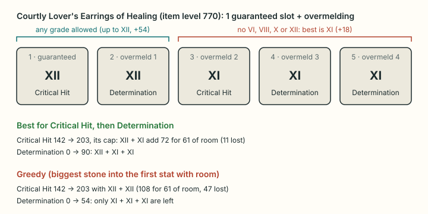

# Materia melds

The gear optimizer can give each piece its best materia melds for the chosen objective, together with the choice of gear. This page states the meld rules, how the best melds of one piece are found, why choosing them piece by piece is exact, and how the results were checked.

Related pages: [optimizer.md](../engineering/optimizer.md) (the search), [math.md](math.md) (caps and sync), [glossary.md](../glossary.md).

## 1. Terms

- **Materia** are stones that add one combat substat to a piece of gear: Critical Hit, Determination, Direct Hit, Skill or Spell Speed, Tenacity or Piety. Placing one is **melding**.
- **Grades** run from I to XII. A higher grade is not always worth more (section 2).
- A piece has 0 to 5 **guaranteed slots**. Some pieces (crafted gear and the old PvP sets) also allow **overmelding**, also called advanced melding: extra slots up to 5 in all, which can fail in game. The tool assumes every meld succeeds (owner's decision).
- A **synced** piece is one that item level sync or level sync applies to: its item level is above the duty's item level cap, or its equip level is above the synced level ([math.md, section 5](math.md#which-pieces-are-synced)). Its stats may or may not drop, but it loses all its melds (section 2).

## 2. The rules

**Values and item level gates.** Every combat substat has the same values. Read from the game files (`Materia` sheet, and each materia item's item level); **verified**. The gate also appears on the Lodestone, the official game website, as "Base Item: Item Level N".

| Grade | I | II | III | IV | V | VI | VII | VIII | IX | X | XI | XII |
| --- | --- | --- | --- | --- | --- | --- | --- | --- | --- | --- | --- | --- |
| Value | 1 | 2 | 3 | 4 | 6 | 16 | 8 | 24 | 12 | 36 | 18 | 54 |
| Gear item level at least | 15 | 30 | 45 | 70 | 160 | 290 | 420 | 420 | 560 | 560 | 690 | 690 |

- **Main stats and Vitality cannot be melded:** their materia have value 0 (**verified**).
- **Grades VI, VIII, X and XII** go into a guaranteed slot or the first overmeld slot, never later. Their overmeld success rate is 0% past the first overmeld slot (game files, `MateriaGrade`; **verified**).

**Slots.** With $g$ guaranteed slots (`Item.MateriaSlotCount`) and overmelding allowed (`Item.IsAdvancedMeldingPermitted`), a piece takes

$$
B = \min(5,\ g + 1) \ \text{"big" stones}, \qquad S = 5 - B \ \text{"small" stones},
$$

and without overmelding $B = g$, $S = 0$.

- A big stone fits a guaranteed slot or the first overmeld slot: the most valuable grade the item level allows.
- A small stone fits a later overmeld slot: the most valuable grade the item level allows that is not VI, VIII, X or XII.

| Gear item level | Big stone | Small stone |
| --- | --- | --- |
| 100 to 159 | IV (+4) | IV (+4) |
| 160 to 289 | V (+6) | V (+6) |
| 290 to 419 | VI (+16) | V (+6) |
| 420 to 559 | VIII (+24) | VII (+8) |
| 560 to 689 | X (+36) | IX (+12) |
| 690 and up | XII (+54) | XI (+18) |

The table starts at 100, the lowest item level in the database.

In the item data, no piece has 4 guaranteed slots or more than 5. 15 Paladin shields have no guaranteed slot but allow overmelding. The tool gives them no melds. That is **inferred**: xivgear gives them 5 slots, and no source says which is right.

**Cap.** On each piece, each substat is capped at that piece's own sync cap: the cap of its slot share and stat factor at its own item level ([math.md, section 5](math.md#the-clamp-rule)). This is **verified** for substats with a stat factor of 100: the top substat of real pieces equals it, and the Wiki's Kirin's Osode of Fending (item level 300 body) caps at 110 with its 77 melded up to 110. Where the factor is below 100 (for example Piety on kind 0 earrings, at 90%), the cap uses the factor-first cap order, which is **inferred** beyond three second-hand in-game values. A stone's points above the cap are lost. With $x_k$ the piece's own value of substat $k$ and $C_k$ its cap, the room left is

$$
h_k = \max(0,\ C_k - x_k),
$$

and a meld never lowers a stat already above its cap.

**Sync.** A piece keeps its melds only if it is not synced: its item level is at or below the item level cap (with item level sync on), and its equip level is at or below the synced level. **Verified** in game by the owner. A piece exactly at the cap keeps them.

## 3. The best melds of one piece

The objective ranks substats in order, keys $k_1, k_2, k_3$: the target, then up to two tiebreaks. Only keys that are combat substats can take stones; a main stat target alone melds nothing.

A meld plan puts $b_j$ big and $s_j$ small stones into key $k_j$. The rest are spare. With big value $V$ and small value $v$, the gain on key $k_j$ is

$$
\text{gain}_j = \min\bigl(h_{k_j},\ b_j V + s_j v\bigr), \qquad \sum_j b_j \le B, \quad \sum_j s_j \le S .
$$

The best plan maximizes $(\text{gain}_1, \text{gain}_2, \text{gain}_3)$ in lexicographic order: first the target's gain, then the first tiebreak's, then the second's.

- **Ties** go to the plan whose spare stones are worth the most. Those go into the job's other substats in order, each up to its room. Any left over are shown as free.
- **The search tries every split** of the $B$ big and $S$ small stones among the keys and the spare bucket. That is at most 200 splits per piece, and the result is cached for each combination of stones, values and rooms.
- **Always the best grade:** for a fixed split, a bigger stone never lowers a gain, so using the most valuable allowed grade loses nothing.

**Greedy filling is not exact.** Putting the biggest stone into the first key that still has room loses on some pieces. Courtly Lover's Earrings of Healing (item level 770) has Critical Hit 142 against a cap of 203, so 61 of room, and takes 2 big stones (XII, 54) and 3 small (XI, 18), as in the diagram. With Critical Hit as the target and Determination as the tiebreak:

- Greedy puts both XII into Critical Hit: 108 for 61 of room, 47 lost. The three XI give Determination 54.
- XII + XI reach the cap just as well and leave a XII for Determination: 54 + 18 + 18 = 90.

Over every meldable piece of all 22 jobs and every ordered pair of substats (615,204 cases), greedy is worse in 13,543 (2.20%). **Verified** by running both.

**A missing substat can be melded.** Kirin's Osode of Fending (5 guaranteed slots, grade VI) maximizing Skill Speed, which it doesn't carry, gets five VI: $5 \times 16 = 80$, below its cap of 110. Maximizing Determination instead, it gets three VI ($77 \to 110$), and the two spare VI give Direct Hit 32.

**Order.** The page lists the stones in slot order, the order they are melded in: the big stones (slots 1 to $B$), then the small ones. Read left to right, every list is a legal melding order. A test checks this for every meldable piece of three jobs under four objectives.

## 4. Why one melded version per piece is exact

The optimizer scores a loadout as the sum of per-piece scores, $\sigma(L) = \sum_i \sigma(x_i)$, with the weights of [optimizer.md, section 3](../engineering/optimizer.md#3-turning-the-lexicographic-order-into-one-number). Those weights are derived from the vectors the search can use, so they are computed after melding.

- **Melds belong to one piece.** A piece's melds change only that piece's vector. Copies (a Unique ring is worn once) and blocked slots (a cloak empties the head) depend on the item, not on its melds.
- **The best version wins every swap.** Take any legal loadout and replace one worn piece's melds with that piece's best plan. The loadout stays legal, and its score can only go up, because $\sigma$ restricted to one piece orders plans exactly as their lexicographic gain tuples. Repeat for every piece.
- **So one version per piece is enough.** Some best loadout uses only best-melded pieces, so each meldable piece enters the search as one candidate and the search itself is unchanged. This holds even for two copies of one ring, since each copy takes the same best plan.
- **It does not hold with a speed range.** Under a speed minimum or maximum, a piece's best melds depend on the rest of the loadout. The engine therefore refuses melds together with a speed range rather than risk a wrong answer. The page sets no speed range.

## 5. Breakpoints

A substat's effect (critical rate, Determination multiplier, GCD) moves in steps, so points between two steps do nothing. The optimizer maximizes raw totals.

- **The target:** since every effect only rises with more points, the highest raw target total is always in the highest reachable step. Proved from the formulas and confirmed on 736 full-pool runs.
- **Tiebreaks:** in 200 of 572 two-key runs, another loadout keeps the target's step and puts the tiebreak a step higher. This happens mostly at level 100, where steps are 14 to 25 points wide, and rarely at level 50 (cap 123), where they are 1 to 3. It nearly always needs different gear, not different melds.
- **What the tool does:** it keeps raw totals and shows the steps instead. Under the result it shows each substat's effect from gear (no food), the points above the start of its step and the points to the next.

**Measured** by an independent dynamic program. The step formulas are the community ones from AkhMorning, matching xivgear (**inferred**).

## 6. Checks

- **Against xivgear** (its own code at commit `6c3c878` and its data API, 10,534 pieces of 8 jobs, item levels 100 to 795):
  - every meld cap matches (67,433 of 67,433);
  - every best stone per slot, every materia value and gate, and every sync decision match;
  - slot layouts match except the 8 zero-slot Paladin shields the API serves (section 2).

  On the target value, xivgear's autofill falls short of ours in 4,140 of 38,290 piece and stat cases. It refuses a stone that overshoots the cap by more than 2 points and never tries a smaller grade. With that allowance lifted, it matches ours on all 38,290. **Verified** (both run).
- **Brute-force reference:** the tests' reference enumerates every placement of the best allowed stone per slot on its own, without the code above, and agrees with the optimizer on 40 random pools of real pieces (some meldable, some synced).
- **Real items:** Kirin's Osode of Fending, Courtly Lover's Earrings of Healing and Pendulums, Rainbow Robe of Healing; every gate edge; synced and level-synced pieces; the 0-slot shields.

## 7. Effect on results

Pieces that keep their melds, out of the full pool:

| Setting | Sage (1,999 pieces) | Warrior (2,383) |
| --- | --- | --- |
| Cap 123, level 50 | 18 | 41 |
| Cap 290 | 318 | 459 |
| Cap 400, level 70 | 591 | 776 |
| Cap 530, level 80 | 967 | 1,186 |
| Cap 660, level 90 | 1,338 | 1,557 |
| No sync | 1,749 | 1,968 |

Under sync, a piece above the cap gets its stats lowered to the cap and loses its melds. A meldable piece at or below the cap is limited by its own, lower cap.

- **Full database pool, synced (caps 123 to 660, five objectives):** melds never raised the target. They moved tiebreaks only.
- **Without sync,** they do raise it. Sage's Spell Speed goes from 2,609 to 2,899, Critical Hit from 3,135 to 3,168.
- **Pools gathered around a cap** are different: there melds raise the target often (in about 6 of 10 runs, measured in the planning prototype; **inferred** from that prototype).

## 8. Verified and assumed

| Claim | Status |
| --- | --- |
| Values, item level gates, no main stat or Vitality materia | Verified (game files, Lodestone) |
| High grades not past the first overmeld slot | Verified (game files) |
| Meld cap = the piece's own sync cap | Verified (real items, Wiki, xivgear) for factor 100; inferred below 100 |
| Melds lost on synced pieces | Verified (owner, in game) |
| Every meld succeeds | Assumed (owner's decision: odds are out of scope) |
| 0-slot pieces with overmelding take nothing | Inferred (xivgear gives them 5 slots) |
| Shield and cloak caps (2H − 1H, share 220) | Inferred ([math.md, section 3](math.md#3-slot-shares)), and xivgear agrees |
| HQ and NQ share a cap | Inferred; the tool models HQ stats |
| Custom-stat relics melded on their base stats | Limitation: their real stats are set by the player |

## Where this lives

| Concept | File |
| --- | --- |
| Stones by item level, slots, caps, best melds, meld text | `src/core/meld.js` (`stoneValues`, `meldSlots`, `meldCaps`, `bestMeld`, `meldText`) |
| Materia table, slot count and overmeld flag per item | `scripts/data/gen_items.py`, `src/core/items.js` (`meldInfo`), `src/core/tables.js` (`MATERIA`) |
| Melds in the candidate lists; speed-range refusal | `src/core/optimizer/candidates.js` (`itemCandidate`), `src/core/optimizer/index.js` |
| The Materia switch, meld line and note | `src/ui/views/optimizer.js`, `src/index.html` |
| Tests | `tests/unit/meld.test.js`, `tests/unit/helpers/exhaustive.js` (`meldVectors`), `tests/unit/optimizer-exhaustive.test.js` |
