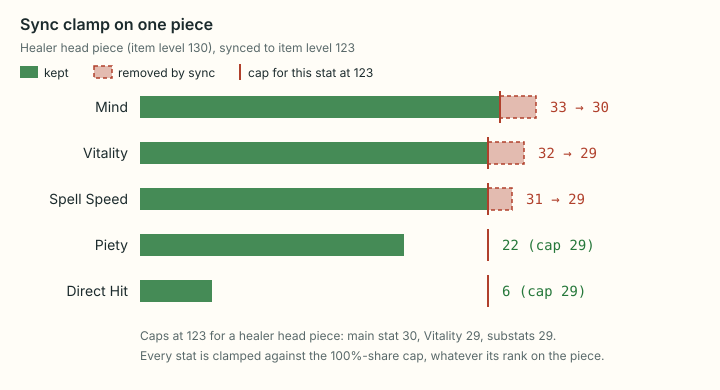

# The stat model: from item level to synced stats

This page explains how the stats on a piece of gear follow from its item level, and what item level sync does to them. It covers the formulas the tool uses, a worked example with real game data, and which parts are verified and which are inferred. Its last section turns the stat totals of a gear set into effects: the global cooldown, substat tiers and food.

Related pages: [optimizer.md](../engineering/optimizer.md) (how the tool picks the best gear set), [data-pipeline.md](../engineering/data-pipeline.md) (where the game tables come from and how they are regenerated), [validation.md](validation.md) (how the model is checked against real items, the Wiki and AkhMorning) and [glossary.md](../glossary.md).

All numbers below come from the game tables in this repository (ffxiv-datamining commit `d9582a6`, 2026-09-30) or from running the tool's own code against them.

**The model at a glance.** A stat on a piece is a chain of table lookups, each followed by a rounding:

1. The item level picks a row of the budget table: one budget per stat (section 2).
2. The slot (head, body, ...) takes a fixed fraction of that budget (section 3).
3. The item's stat factor and the substat's rank on the piece scale it again (section 4).
4. Under sync, each stat is cut down to a cap computed the same way at the cap item level (section 5).

## 1. Terms

The game, Final Fantasy XIV (FFXIV), has its own vocabulary. These are the terms the rest of the page needs; [glossary.md](../glossary.md) has the others.

- **Item level**: a number on every piece of gear. It is not a strength rating by itself. It is a row number in a game table that holds a stat budget for each stat.
- **Slot**: where the piece is worn: weapon, off-hand (shield), head, body, hands, legs, feet, earring, necklace, bracelet, and two rings.
- **Item level sync**: some content lowers your gear to a cap. For example, a duty run with the Minimum Item Level option and no Echo uses a fixed cap ([glossary.md](../glossary.md)). Pieces above the cap lose stats; pieces at or below it are unchanged. The owner's main case is cap 123, but every formula here works for any cap.
- **Level sync**: content for a lower character level lowers your level to match. Gear whose equip level (the character level needed to wear it) is above that level is synced to an item level the game assigns to the level (section 5). A duty can do both at once: T13, a level 50 raid, run with Minimum Item Level is level 50 and item level 123.
- **Stats.** Each of the 23 combat jobs uses one of five role profiles. The tool uses role-neutral names:

| Neutral name | Meaning | Tank | Healer | Melee (Str) | Dexterity | Caster |
| --- | --- | --- | --- | --- | --- | --- |
| main stat | primary damage/healing stat | Strength | Mind | Strength | Dexterity | Intelligence |
| Vitality | hit points | Vitality | Vitality | Vitality | Vitality | Vitality |
| substats | Critical Hit, Determination, Direct Hit | same | same | same | same | same |
| speed | shortens the global cooldown (GCD) | Skill Speed | Spell Speed | Skill Speed | Skill Speed | Spell Speed |
| special substat | role-only substat | Tenacity | Piety | none | none | none |

Notes on the table:

- The "Melee (Str)" column covers Monk, Dragoon, Samurai, Reaper and Beastmaster; the "Dexterity" column Ninja, Viper, Bard, Machinist and Dancer.
- Speed and the special substat also count as substats.
- Paladin and Beastmaster wear a one-handed weapon and a shield (section 3); every other job a two-handed weapon.
- Beastmaster's speed stat and missing special substat are *inferred* from its melee role (no game column names a job's substats; xivgear uses the same), and its own gear carries neither.

- **Level cap.** Two limited jobs stop below the game's level cap of 100: Blue Mage at 80 and Beastmaster at 50 (**verified**: the Lodestone's [Patch 6.45 Notes](https://na.finalfantasyxiv.com/lodestone/topics/detail/2a6c65f39b5b16b58bd4f0d9b1edaa8c0b7ec4f3), "The level cap for blue mage has been increased to 80", and [Patch 7.56 Notes](https://na.finalfantasyxiv.com/lodestone/topics/detail/a8a526ad64db45c8ca8d1c7fdcce8a5eedaa18bc), "begins at level 1 with a maximum level of 50"). The game files hold no level cap; their `ClassJob` sheet flags exactly these two jobs as limited (`IsLimitedJob`).
  - A job cannot wear gear whose equip level is above its cap, so the tool leaves such gear out of the gear list and the search, and the synced level goes no higher than the cap.
  - At its cap a limited job is never level-synced (section 5).

## 2. The budget table

Where do a piece's stats come from? From one row of a game table, picked by the item level.

The game's `ItemLevel` sheet has one row per item level (rows 0 to 920). Each row holds a budget for each of the 12 stat columns the tool reads (the 14 stored stats use these 12: Main Attribute reads the Strength column and Secondary Attribute the Direct Hit one; weapon damage and defense have their own columns, section 5). Most columns repeat each other. In this data:

- The four main-stat columns (Strength, Dexterity, Intelligence, Mind) are identical in every row.
- Determination, Direct Hit, Skill Speed and Spell Speed are identical to Critical Hit in every row.
- Piety and Tenacity match Critical Hit except in 6 rows (540, 565, 570, 590, 595, 596), where they are 1 to 8 higher. The caps use each stat's own column, so a Piety or Tenacity cap is 1 higher than Critical Hit's at those rows in some slots.
- Vitality has its own column.

So in practice there are three curves: main stat, substat and Vitality. We write them as $\text{budget}_s(i)$ for stat $s$ at item level $i$.

What the curves look like (read from the table):

| Item levels | Shape |
| --- | --- |
| Up to 130 | Both rise slowly, by 2 to 4 per item level (from 130 to 135 the substat gains 22). At 123 the main stat is 355 and the substat is 346. |
| 135 to 150 | The substat budget jumps by about 10 per item level, from 385 to 528. The main stat keeps its slow pace (394 to 426). From 138 to 252 the substat budget is larger than the main-stat budget. |
| After 150 | Substats grow by 0 to 2 per item level again. |
| About 250 to 450 | The two curves stay within a few points of each other and cross several times. |
| About 450 upward | The main stat and Vitality pull far ahead. At 795 the main stat is 6,050, the substat 3,190 and Vitality 6,736. |

The highest item level on any real piece is **795**. Rows 796 to 920 are in the sheet but no gear uses them, so the tool limits item level inputs to 795. The data does not say why those rows exist.

## 3. Slot shares

How much of a row's budget does a piece get? A fixed fraction that depends only on where it is worn.

That fraction is the slot's **slot share**, stored in per mille (thousandths) in the game's `BaseParam` sheet:

| Slot | Share $p$ (‰) |
| --- | --- |
| Two-handed weapon | 140 |
| One-handed weapon | 100 |
| Off-hand (shield) | 40 |
| Head, hands, feet | 85 |
| Body, legs | 135 |
| Body that also covers the head (cloak) | 220 |
| Earring, necklace, bracelet, ring | 67 |

**Verified**: these are the values in `BaseParam.csv` for all 14 stats the database stores; the generator stops if one differs.

- The sheet's waist column is 0; the game no longer has a belt slot.
- The cloak share is the game's body-plus-head column. The two real cloaks (Vermilion Cloaks, item level 300) are reproduced exactly with it ([validation.md, section 2](validation.md#2-every-real-piece-by-item-level-band)).
- Paladin and Beastmaster are the only combat jobs with a one-handed weapon plus a shield (100 + 40). Every other job uses a two-handed weapon (140).

**The off-hand is the two-handed value minus the one-handed value.** Real shields do not follow the 40 ‰ share directly. Each stat on an off-hand equals the two-handed weapon's value minus the one-handed weapon's value at the same item level and substat share, each computed with the formula of section 4. That is 140 − 100 = 40, but rounded as two weapons rather than once at 40. Two examples, then the count:

- Vanguard Shield, item level 672: Critical Hit 63 = 218 − 155, where 40 ‰ gives 62.
- The item level 120 shields: Tenacity 13 = 47 − 34, where 40 ‰ gives 14.
- It reproduces 224 of 226 real off-hands exactly, against 195 for the 40 ‰ share.

**Inferred**: it fits the data, but the game files do not say how shields are built. Sync uses it too, so a shield's caps are the two-handed cap minus the one-handed cap (section 5). xivgear, a community gear planner, computes shield caps the same way: its source says to ignore the off-hand percentage and take the two-handed cap minus the one-handed cap ([datamanager_new.ts](https://github.com/xiv-gear-planner/gear-planner/blob/6c3c878e708b9d98f1c4cb091723a2a0a6343603/packages/core/src/datamanager_new.ts#L118-L240)). That is agreement, not confirmation in game.

## 4. The stats on a piece

Given a slot's share of the budget, what number ends up on the piece? Up to three multipliers apply in order, and the result is rounded after each one:

1. the **slot share** $p$ (section 3), giving the slot budget;
2. the item's **stat factor** $f_s$, which is 1 for most stats;
3. the **substat share** $w$, which depends on the stat's rank on the piece.

The diagram follows two stats of the worked example (at the end of this section) through every step, including the sync of section 5.

### The formula

For a stat $s$ at item level $i$ in a slot with share $p$, the **slot budget** is

$$
B_s(i) = \operatorname{round}\!\left(\frac{\text{budget}_s(i) \times p}{1000}\right)
$$

and the stat on the piece is

$$
\text{stat}_s = \operatorname{round}\big(B_s(i) \times w\big)
$$

where $w$ is the stat's **substat share** (below). The main stat and Vitality always take $w = 1$.

**Rounding is half up**: $\operatorname{round}(x) = \lfloor x + 0.5 \rfloor$, so 31.5 becomes 32. The code adds a tiny epsilon so that floating-point noise such as 22.4999999 still rounds as 22.5 would.

**Rounding happens twice**: once for the slot budget, then again after the share. An example where it matters: Antiquated Atlas, a level 60 healer two-handed weapon at item level 200, has Piety 57. The substat budget at 200 is 587:

$$
587 \times 140/1000 = 82.18 \to 82, \qquad 82 \times 0.7 = 57.4 \to 57
$$

Rounding once gives $587 \times 0.14 \times 0.7 = 57.526 \to 58$, which is wrong. Over the item database, rounding only once at the end reproduces 13,306 of the 16,629 checked pieces exactly (80.0%); rounding twice reproduces 16,605 (99.9%). Both figures come from running the model over the item database.

### The stat factor of an item

Why can an Intelligence earring carry less Vitality than a Strength earring of the same item level and slot? Because some stats get one more factor $f_s$ between the slot budget and the substat share:

$$
\text{stat}_s = \operatorname{round}\Big(\operatorname{round}\big(B_s(i) \times f_s\big) \times w\Big) \qquad (\text{the inner rounding only when } f_s \ne 1)
$$

**Where the factor comes from.** The factor belongs to the **item**, not to the job. The game files hold it: `BaseParam` has a table of percentages (`MeldParam`) with one row per stat and 13 columns, and each item names a column with `Item.BaseParamModifier` (its **kind**). The page keeps each item's kind and the table, and reads $f_s = \text{MeldParam}[s][\text{kind}] / 100$.

| Kind of item | Main stat | Vitality | Pieces |
| --- | --- | --- | --- |
| Strength (1, 2, 3, 10), Dexterity (4, 11, 12) | 100% | 100% | 12,733 |
| Intelligence (5), Mind (6) | 100% | 90% | 6,528 |
| Strength + Dexterity (7) | 100% | 100% | 411 |
| Intelligence + Mind (8) | 100% | 90% | 297 |
| All four main stats (0) | 90% | 90% | 62 |

Counts are database pieces (item level 15 and up, data `d9582a6`, 2026-10-16). Notes on the kinds, at item level 100 and up (60, 5 and 19 pieces of kinds 7, 8 and 0; below 100 they also cover older sets, such as the Replica Allagan "of Striking" gear and the Grand Company Elite sets):

- Kind 7 is the Beastmaster gear (its job sets, Guttler, the Beastliege's and Kornago weapons and shields), the Gloam, High Allagan and Guardian's "of Striking" sets and the Occult "of Blood" accessories. Kind 8 is the Occult "of Magic" accessories. (Occult accessories are item level 745 field operation gear.)
- Kind 9 is crafter and gatherer gear, which the database leaves out.
- Kind 0 is the Lieutenant's, Field Commander's and Warlord's sets and Proto Ultima Mesh (13 pieces with all four main stats), plus six earrings and rings every job can wear, which carry the game's generic Main Attribute (Halone's, Azeyma's, Bozjan, Menphina's, Aetheryte, Neophyte's).

**Substats.** Every substat (Critical Hit, Determination, Direct Hit, both speeds, Tenacity) is 100% in every column. Piety is 70% or 90% in most columns, but no piece carries Piety in such a column, so it never applies to an item's own stats. It does apply to a cap: a Secondary Attribute counts as Piety for a healer ([data-pipeline.md, section 3](../engineering/data-pipeline.md#3-the-shared-format-definition)), and on a kind 0 earring it is capped at the 90% Piety cap (Azeyma's Earrings at 430: 71 for Sage in game; [validation.md, section 8](validation.md#8-open-question-in-game-captures)).

**What this means in practice.** For a piece with a single main stat the factor is exactly the job rule: **Vitality × 0.9 on Intelligence and Mind gear, 1 everywhere else**. The difference shows on two kinds of piece:

- Pieces with all four main stats have every main stat and Vitality at 90%. Field Commander's Coat, item level 160 body: $\operatorname{round}(448 \times 135/1000) = 60$, $\times 0.9 = 54$, which is what it carries.
- Pieces with no named main stat (the Occult accessories at 745) take the factor of their kind: "of Magic" Vitality 307, "of Blood" 341, from the same budget ($5085 \times 67/1000 = 340.695 \to 341$, $\times 0.9 = 306.9 \to 307$).

An Intelligence earring every job can wear (Alexandrian Earrings of Casting) still has Vitality × 0.9, because the factor goes with the item.

**Verified** in the game files: the table and the item column are read from the client data on every regeneration, and the generator stops if an item names a column the table does not have. The order of the rounding (slot share first, then the factor) is read off real items. Applying the 90% first, as xivgear does for its sync caps, is right on only 18 Intelligence/Mind pieces where the two orders differ, and wrong on 1,349 (data `d9582a6`, 2026-10-16).

**Where no item is involved** (How the math works, which describes a slot for a job), the page uses the factor the job's own gear carries: main stat 1, Vitality 0.9 for Intelligence and Mind jobs, 1 otherwise. A unit test checks this against the game files for all 23 jobs: every database piece a job can wear that carries that job's main stat and no other has exactly those factors. The only pieces whose factors differ from the job's are of kind 0: the 13 four-main-stat pieces and the six all-jobs earrings and rings.

### Substat shares (empirical)

How is a slot budget split between the substats on a piece? The game does not say: it stores only the final numbers on each item. Real gear follows this pattern, ranked by size on the piece:

| Rank on the piece | Share $w$ |
| --- | --- |
| Largest substat | 100% |
| Second | 70% |

For example, the worked example below has Spell Speed 31 (100%) and Piety 22 (70% of 31, rounded). Two refinements, both read off real pieces:

- **Equal substats share the higher rank.** The relic weapon steps Hyperconductive, Manderville, Amazing Manderville and Phantom carry two substats at 100% (141 pieces). A relic weapon is upgraded in steps through a long quest line.
- **Every main stat on a piece is at full share.** Ten item level 110 pieces carry Strength and Dexterity at the same value.

**Direct Hit on healer gear is a fixed 20% line, outside the ranking.** On gear whose only main stat is Mind, Direct Hit sits at 20% of its slot value whatever its size next to the other substats: as the third line (113 pieces), as the second (4), or as the only substat (8 early relic weapons). It is the old Accuracy stat, renamed Direct Hit in patch 4.0 ([validation.md, section 2](validation.md#what-the-misses-look-like)).

- It is the only third substat in the game but one. Over every combat piece in `Item`, at any item level, the only pieces with three substats, and the only substat lines below half their slot value, are Direct Hit on Mind-only gear at item level 50 to 135, and Herklaedi (item level 50), whose second and third substats are equal and both at 70%.
- Where Direct Hit is larger than another substat it ranks like any substat (one piece, Wolf Ringbands, item level 55).
- Strength, Dexterity and Intelligence gear never has a third substat, and Direct Hit on any other gear ranks like other substats.
- High quality (HQ) crafted pieces carry bonus stats over the normal version. On HQ pieces this line gets no HQ bonus while the other substats do (all 16 HQ-able pieces).

**Inferred** (measured; not in the game files).

**On green crafted pieces the line is 25%.** Green and blue are item rarities, shown as the colour of the item's name (`Item.Rarity` 2 and 3). Eight item level 110 crafted healer pieces carry Direct Hit at exactly 25% of the slot value: Ebony Cane, Kirimu Codex, Platinum Planisphere, Platinum Circlet, the Arachne Robe and Culottes, and the Kirimu Gloves and Boots of Healing.

- Before patch 4.0 they carried it at 20% (the Ebony Cane's Accuracy 9; [validation.md, section 2](validation.md#what-the-misses-look-like)), and 4.0 raised them.
- In the data they are exactly the Mind-only pieces with Direct Hit that are green, can be HQ and carry three substats. Their blue crafted siblings (High Adjudicator's Gavel, Mighty Thunderdome, The Law of Levin First Edition) and green pieces that cannot be HQ stay at 20%.
- The model applies 25% under exactly that condition.

**Inferred**, and fitted to these eight: no other piece matches it, and since gear above item level 135 never carries this line, no new piece will test it. Adopted by the owner because it changes no other piece.

**Three exceptions go by item name**, because nothing in the data marks the pieces (owner's decision):

- **Atma weapons carry their Zenith stats.** The 11 Zodiac Atma weapons (item level 100; Zenith, Atma and Animus are steps of the Zodiac relic weapon) are exact copies of their Zenith step (item level 90): the same main stat, Vitality, substats and weapon damage (**verified**, `Item`; Curtana Zenith and Curtana Atma both carry Strength 22, Vitality 24, Direct Hit 26, Tenacity 18 and damage 61). The following Animus step, also item level 100, carries item level 100 stats. The model predicts an item whose name ends in " Atma" (exactly these 11) at item level 90. This only affects the whole-database accuracy figure; the pieces are below the banded check's item level 110.
- **The all-jobs earrings and rings carry their own factors.** The six kind 0 pieces with Main Attribute (Neophyte's Ring and the Aetheryte, Bozjan, Menphina's, Azeyma's and Halone's earrings) were edited by hand patch by patch (**verified**, datamining history). So their main stat and Vitality follow no one factor: Main Attribute full and Vitality 90% (Neophyte's, Aetheryte), both full (Bozjan, Menphina's, Azeyma's), both 90% (Halone's). The model gives each its own pair of factors. This applies to stored stats only: synced, the game applies the file's 90% (second-hand in-game values; [validation.md, section 8](validation.md#8-open-question-in-game-captures)).
- **18 dungeon pieces at item level 46 carry reduced stats.** Main stats at 90% of the usual value, Vitality and substats at 80%, rounded after (fits 17 of 18; **inferred**, fitted to them). The other pieces of their sets at that level follow the usual rule ([validation.md, section 2](validation.md#below-item-level-100)).

**How well the shares fit.** **Inferred**: the shares are a measured pattern, not a game rule. Predicting every combat piece at item level 110 or above that has at least two substats this way (main stats and Vitality at full share times the item's stat factor, substats by rank, the Direct Hit line, off-hands as in section 3) reproduces 99.9% of them exactly (16,605 of 16,629), and every one within 1. The per-band table, and what the misses look like, are in [validation.md, section 2](validation.md#2-every-real-piece-by-item-level-band).

**Where the shares matter.** Piece stats uses them, with the two ranked substats (it does not build the fixed Direct Hit line), and so does the "generic maximum" in section 6, which is built from formula pieces. The item pool and the optimizer read each real item's own stats, so they do not depend on the shares.

### Worked example: a healer head piece at item level 130

Take a healer head piece at item level 130 with Spell Speed and Piety, plus the fixed Direct Hit line of older healer gear. A real piece like this is in the game files with Mind 33, Vitality 32, Spell Speed 31, Piety 22 and Direct Hit 6 (**verified**: exactly one database row has all five values; two other item level 130 head pieces carry the same numbers on different substats). Head share $p = 85$. Table values at row 130: main stat 385, Vitality 414, substats 363.

| Stat | Budget | $\times\,85/1000$ | Round | Share | Round | Game file |
| --- | --- | --- | --- | --- | --- | --- |
| Mind | 385 | 32.725 | 33 | 100% | 33 | 33 |
| Vitality | 414 | 35.19 | 35 | ×0.9 = 31.5 | 32 | 32 |
| Spell Speed (rank 1) | 363 | 30.855 | 31 | 100% | 31 | 31 |
| Piety (rank 2) | 363 | 30.855 | 31 | 70% = 21.7 | 22 | 22 |
| Direct Hit (fixed line) | 363 | 30.855 | 31 | 20% = 6.2 | 6 | 6 |

Every value matches the real piece. The Vitality line also shows the half-up rule at work: 31.5 rounds to 32. Piece stats, given Spell Speed and Piety, shows the first four lines; the Direct Hit line comes from the accuracy check's model.

### Weapon damage and defense

Besides its 14 stats, a piece carries four more numbers, read from their own `Item` columns (plus the HQ bonus, `BaseParamSpecial` ids 12, 13, 21 and 24, when the item can be HQ):

| Number | `Item` column | Budget column (`ItemLevel`) | Carried by |
| --- | --- | --- | --- |
| Physical weapon damage | `DamagePhys` | `PhysicalDamage` | main-hand weapons |
| Magic weapon damage | `DamageMag` | `MagicalDamage` | main-hand weapons |
| Defense | `Defense` | `Defense` | armor, shields |
| Magic Defense | `MagicDefense` | `MagicDefense` | armor, shields |

**Weapon damage** multiplies nearly all of a job's damage, so a higher one is worth more than any substat difference within a tier. A job uses physical weapon damage when its main stat is Strength or Dexterity, magic weapon damage when it is Intelligence or Mind. Blue Mage uses neither: its spells scale with Intelligence only. A weapon's own value equals the `ItemLevel` budget at its item level on 5,566 of the 5,579 combat weapons (**verified**, game files; for example 157 at item level 790, 131 at 660, 64 at 123). The optimizer ranks it before the goal ([optimizer.md](../engineering/optimizer.md)).

**Defense** reduces damage taken: the share removed, in whole percent, is $\lfloor 15 \times \text{defense} / \text{DIV}(L) \rfloor$, with $\text{DIV}(L)$ the level's `LevelModifier` (2,780 at level 100; AkhMorning's Defense page, **community reference**). For example, 2,958 Defense at level 100 removes 15%. It multiplies with cooldowns. The page shows each set's Defense and Magic Defense and their shares; the optimizer never ranks them.

**Under sync** each of the four is clamped like a stat (section 5): to the cap $\operatorname{round}(\lfloor \lfloor \text{budget} \times \text{factor}\% / 100 \rfloor \times \text{share} / 100 \rfloor / 10)$ at the synced item level, with the column's own factor per item kind (`BaseParam.MeldParam`) and slot share (`BaseParam`, per mille). Weapon damage has share 1,000 on main-hand weapons and 0 elsewhere. Defense has head, hands and feet 176, body and legs 236, the two-slot body and legs codes 412, the full-body code 824, and 0 on weapons, shields and accessories.

- Defense under sync: **verified** in-instance by xivgear's tests: item level 663 chests synced to 660 go from 842 to 837 Defense (Maiming) and from 481 to 478 Defense (Healing), and an accessory's 1 goes to 0. The formula gives all of them (tests/unit/damage-defense.test.js).
- Weapon damage under sync: that sync lowers it is **verified second-hand** (players' reports from synced duties, 2019: a higher-level relic in The Weapon's Refrain, synced to 375, hit like the 375 weapons or one point under; Square Enix forum threads 385429 and 385378). The exact value, the `ItemLevel` table's at the synced item level, is **inferred**: the formula gives every weapon's own weapon damage at its own item level (5,452 of 5,465; the exceptions are 10 Atma weapons and 3 at item level 30), and xivgear and ffxiv-gearing clamp it so in code; the Character Panel Refined plugin's item tooltips show the same value under sync (`ItemTooltipAugments.cs`; weak support: its other tooltip rules scale main stat, Vitality and Defense by a ratio, which does not match xivgear's in-instance Defense). No synced value was measured. In 2019 the server seemed to use a value one under the client table's at 375 (raised from 104 to 105 in the 2018 game files), so the two tables have differed before. The page does not show weapon damage, so it marks nothing; the optimizer still ranks it first.

## 5. Item level sync

What happens to a piece when a duty lowers gear? Two questions, one subsection each: which item level is the piece synced to, and what does that do to each stat (the clamp rule). Section 4's worked example, synced to 123, runs through both.

### Which pieces are synced

**The two triggers.** A piece is synced in two cases (**verified** by the owner in game):

1. **Item level sync**: the duty has an item level cap $C$ (item level sync on) and the piece's item level is above $C$. The piece is synced to $C$.
2. **Level sync**: the piece's equip level is above the synced character level $L$. The piece is synced to the item level the game assigns to $L$, $\text{sync}(L)$.

A synced piece also loses its materia melds (**verified** by the owner in game; [materia.md, section 2](materia.md#2-the-rules)).

**Gear that scales with the wearer.** A third kind of piece follows the level whatever its equip level: gear whose item level **scales with the wearer** (`Item.SubStatCategory` 2; 260 pieces: the level 89 and 99 boost gear at item level 560 and 690, and six all-jobs earrings and rings such as Menphina's Earring).

- The game's own description says so: "IL and attributes synced to current job level." (242 pieces), or that attributes and item level vary with the current level (the six accessories); the Pictomancer and Viper starting sets (12 pieces) have no text (**verified**, game data `d9582a6`, recounted 2026-10-16).
- That the target is $\text{sync}(L)$ at every level is *inferred*: it gives the Wiki's artifact armor item levels (548 at level 89, 678 at level 99; *second-hand*), and ffxiv-gearing applies the same rule at levels 50 to 90 ([validation.md, section 9](validation.md#9-against-another-tool-ffxiv-gearing)).

**The level sync table.** $\text{sync}(L)$ is the `ItemLevelSync` column of the game's `ParamGrow` sheet (**verified**: read from the game file):

| Synced level $L$ | 1 to 49 | 50 | 60 | 70 | 80 | 90 | 100 |
| --- | --- | --- | --- | --- | --- | --- | --- |
| $\text{sync}(L)$ | $L$ | 130 | 270 | 400 | 530 | 660 | 690 |

- Between the level caps it rises in steps of 3 (54 → 133, ..., 59 → 148).
- No real piece has an equip level above 100, so at level 100 level sync never applies.
- The same holds for a limited job at its own cap (Blue Mage 80, Beastmaster 50, section 1): it cannot wear gear of a higher equip level, so How the math works shows no level sync there.
- Scaling gear (above) is the exception: at 80 a Blue Mage wears Azeyma's and Halone's Earrings (item level 560 and 690) at 530, at 50 a Beastmaster wears the five scaling accessories it can equip at 130.

**When both apply, the item level cap wins**, even where it is the higher of the two, **up to $\text{top}(L)$**, the highest item level of gear made for level $L$. In Aloalo Island (level 90, item level 665) a player saw level 95 and 96 gear at item level 666 and 669 with item level 665 stats, not 660; level 94 gear at item level 663 (below the cap) was synced to 660 by its level ([xivgear issue #317](https://github.com/xiv-gear-planner/gear-planner/issues/317)). *Second-hand*: a player's report quoted by xivgear, which applies the same order; not captured by this project. In the owner's case the order does not matter: at T13 the cap 123 is below $\text{sync}(50) = 130$.

**The ceiling $\text{top}(L)$.** It is the highest item level of gear with equip level $L$ (scaling gear left out, since its item level is not tied to its equip level), or $\text{sync}(L)$ where that is higher. It is the Wiki's "the max IL achievable by gear matching the class level" ([Item Level, "Item Level vs. Class Level"](https://ffxiv.consolegameswiki.com/wiki/Item_Level)), read from the page's database:

| Level $L$ | 50 | 55 | 60 | 70 | 75 | 80 | 90 | 95 | 99 |
| --- | ---: | ---: | ---: | ---: | ---: | ---: | ---: | ---: | ---: |
| $\text{sync}(L)$ | 130 | 136 | 270 | 400 | 406 | 530 | 660 | 666 | 678 |
| $\text{top}(L)$ | 135 | 136 | 275 | 405 | 406 | 535 | 665 | 666 | 678 |

- At each level cap the weapons are 5 above the rest (the Wiki's table: 130, weapons 135, at level 50; 660, weapons 665, at 90), and between them $\text{top}(L) = \text{sync}(L)$. Below level 50 it is up to 5 above $L$, and 50 at level 1 (Ala Mhigan Earrings, equip level 1, item level 50).
- Aloalo Island's 665 is $\text{top}(90)$, and every real duty cap below level 100 is at or under $\text{top}(L)$ (**verified**: the 492 caps of every duty with a level sync, Minimum IL ones included, at the datamining commit in the footer). So the ceiling changes no real duty.
- What a cap above it does is *untested*: no duty has one. The ceiling keeps such settings to what a duty can do. At level 50 with cap 400, a level 70 piece at item level 405 is synced to 135, not 400; a level 60 piece at 270, under the cap, to 130. Without it the cap alone gave level 50 characters item level 400 stats and a 1.50 s GCD. A cap at or under $\text{top}(L)$ is used as typed.

**Caps real duties use** (**verified**, game files: `ContentFinderCondition.ClassJobLevelSync` and `ItemLevelSync`, 567 duties at the datamining commit in the footer). Real duties pair the level and the cap closely:

| Synced level | Caps in real duties | $\text{sync}(L)$ |
| --- | --- | ---: |
| 1 to 49 | none (level sync only; Sastasha is level 18), except the level 15 tutorials' 5 | 1 to 49 |
| 50 | 50 to 135 | 130 |
| 60 | 150 to 240 | 270 |
| 70 | 290 to 395 | 400 |
| 80 | 420 to 525 | 530 |
| 90 | 550 to 665 | 660 |
| 100 | 680 to 795 | 690 |

Below level 100 no duty's cap is more than 5 above $\text{sync}(L)$; the 7 that are above it are the level 90 Mount Rokkon and Aloalo Island duties (665) and Second Master's Board (level 50, 135). This holds for every kind of duty (**verified**, all 567 rows).

What the table leaves out (the evidence is in the duty sync research of 2026-10-18):

- **A character below a duty's level keeps its own level**: level sync only lowers (**verified**: the Wiki's Level Sync page). Many duties can be entered below their synced level (Mt. Gulg: entered at 79, synced to 80, cap 420). Such a character's cap lowers nothing it can wear: at level 79 the best gear a Sage can wear is item level 418 (**verified**, the page's database), so its setting is level 79 with item level sync off.
- **Some duties set stats instead of syncing**: The Bozjan Southern Front, Zadnor, Delubrum Reginae (normal and Savage) and The Merchant's Tale set every character to level 80 (100) and give each slot fixed stats at item level 430 (765), with melds ignored (**verified**: the Wiki; `ContentFinderCondition.FixedItemLevelSync`). The page does not model them; their caps in the table are not clamps.
- **Minimum Item Level** syncs gear to the duty's minimum item level (`ItemLevelRequired`) and also forces level sync, even in an unrestricted party (**verified**: the patch 3.0 notes, read by the research agent). Only duties with `AllowMinimumIL` offer it; Ultimates do not.

The page lowers a cap above $\text{top}(L)$ to $\text{top}(L)$ (the owner's decision, 2026-10-18; for a day before that it computed nothing for a cap above $\text{sync}(L) + 5$ and showed an error). It does so once the level field settles (typing 80 passes through 8), when a cap is entered, when item level sync is switched on, and on loading a saved state, and only while level sync can apply; at the job's level cap, where it cannot, a cap above the highest real item level (795) is lowered to that. The cap field takes any whole number of 1 or more, so 999 is lowered the same way, with a note under the field ("Lowered to 135, the highest for level 50."). Above $\text{top}(L)$ the level, not the cap, decides what gear made for a higher level syncs to, so the field shows the cap that applies. A cap is never raised: a low cap is a real duty's (Minimum IL).

**The rule in one formula.** The synced item level $t$ of a piece at item level $i$ with equip level $e$ is therefore

$$
t =
\begin{cases}
\min(C, \text{sync}(L)) & \text{if the piece scales, } \text{sync}(L) < i \text{ and item level sync is on with } i > C \\
\text{sync}(L) & \text{else if the piece scales and } \text{sync}(L) < i \\
\min(C, \text{top}(L)) & \text{else if item level sync is on, } i > C \text{ and } e > L \\
C & \text{else if item level sync is on and } i > C \\
\text{sync}(L) & \text{else if } e > L \\
\text{none (untouched)} & \text{otherwise}
\end{cases}
$$

![Decision flow for the synced item level, tried top to bottom, first yes decides. A piece that scales with the wearer, with sync(L) below its item level, goes to sync(L), or to the cap C where lower (with item level sync on and the item level above C); at T13 (level 50, cap 123, sync(50) = 130) a scaling earring at 560 goes to 123. Otherwise, with item level sync on and the item level above C, it goes to C, even above sync(L), but for a piece whose equip level is above L no higher than top(L), the best gear made for level L; the worked example head at 130 goes to 123. Otherwise, with the equip level above the synced level, it goes to sync(L); item level 120, equip level 51 goes to 130. Otherwise it is untouched (item level 120, equip level 50). Each stat is then clamped at the target; a target at or above the piece's own item level keeps its stats, and only its materia stops counting.](../diagrams/math-sync-target.svg)

The clamp below is applied with $t$ in place of $C$.

**Two edge cases.**

- **Weapons.** The game file has one `ItemLevelSync` column for every slot. xivgear's sheet code uses a separate weapon table from its own data service for the sheet-wide target, but syncs each item with the one table. That weapons use the same value is *inferred*; the player report above saw level 100 weapons synced to item level 660 in P12S, a level 90 duty, which fits it at level 90.
- **Pieces with no equip level.** Generated and hand-made pieces, and How the math works (which has no item behind it), know only an item level. A generated or hand-made pool piece is synced only by the item level cap. How the math works uses the item level cap when item level sync is on; with it off and a synced level below 100, or with a cap above $\text{top}(L)$, it shows $\text{sync}(L)$, the item level a piece with a higher equip level gets (under the cap).

**What it changes, measured on the current data.** At T13 (level 50, cap 123), 71 pieces (all equip level 51, item level 120) are synced by their level alone, to 130. That is above their item level, and a direct clamp to the item level 130 caps lowers none of their stats for any job that can wear them, so no stat changes. Every other piece is synced exactly as by the cap alone.

With item level sync off, level sync alone syncs this many of the 20,031 database pieces (the 50 Beastmaster pieces, equip level 50 or below, are synced at none of these levels; scaling gear is counted in, 1 to 5 pieces a level that the equip level alone would leave):

| Synced level | $\text{sync}(L)$ | Pieces synced | Above $\text{sync}(L)$ | With a stat lowered |
| --- | --- | --- | --- | --- |
| 50 | 130 | 16,188 | 15,975 | 15,954 |
| 60 | 270 | 13,014 | 12,795 | 12,795 |
| 70 | 400 | 9,503 | 9,278 | 9,278 |
| 80 | 530 | 6,247 | 6,016 | 6,016 |
| 90 | 660 | 3,266 | 3,035 | 3,035 |

A stat is lowered on every piece above $\text{sync}(L)$ except 21 at level 50: item level 133 pieces whose stats equal the item level 130 caps.

### The clamp rule

Once a piece's sync target is known, what happens to each stat? It is cut down to a **cap**, and nothing else changes. For a piece at item level $i$ and sync cap $C$:

$$
\text{synced}_s =
\begin{cases}
\text{stat}_s & \text{if } i \le C \\
\min\big(\text{stat}_s,\ \text{cap}_s(C)\big) & \text{if } i > C
\end{cases}
$$

Pieces at or below the cap are untouched. Above the cap, each stat is cut down to the cap value. Stats that are already below the cap stay as they are.

**The cap value.** Intuitively, the cap is what a full-share piece of the same slot would carry at item level $C$. Precisely: each piece has a cap value for each stat, computed from budget row $C$, the piece's slot share $p$ (‰) and its stat factor $F_s$ in percent (section 4; $F_s = 100 f_s$). The factor comes first and each step is floored; only the last step rounds:

$$
\text{cap}_s(C) = \operatorname{round}\!\left(\frac{1}{10}\left\lfloor \frac{\lfloor \text{budget}_s(C) \times F_s / 100 \rfloor \times p}{100} \right\rfloor\right)
$$

**This is not the order of an item's own stats** (section 4), which is right for items: it fits 6,492 of 6,515 Intelligence and Mind pieces on Vitality, the factor-first order 5,161 (data `d9582a6`, 2026-10-16). Caps follow the factor-first order because the game's sync values do (below).

**With $F_s = 100$ the two orders give the same number**, so every cap of a stat without a factor (all substats, the main stat on single-main-stat gear, Vitality on Strength and Dexterity gear) is the full-share value of a piece of the same slot at item level $C$, $B_s(C)$. Why: write $x = \text{budget}_s(C) \times p / 100$. Then $\lfloor x \rfloor / 10$ is a multiple of 0.1 at most 0.1 below $x / 10$, so no rounding threshold ($k + 0.5$) lies between them, and $\operatorname{round}(\lfloor x \rfloor / 10) = \operatorname{round}(x / 10) = B_s(C)$. A unit test checks this at every item level 1 to 795 for every slot share and the off-hand.

**With a factor below 100 the orders differ**, and the cap can be 1 above or 1 below what a same-slot piece of the same kind carries at $C$.

- For Intelligence and Mind Vitality (factor 90) that happens in 1,159 of 4,770 item level and slot combinations (item levels 1 to 795; head, body, accessory, two-handed and one-handed weapon, off-hand): 405 times 1 higher, 754 times 1 lower.
- The same holds for the main stat, Vitality and Piety (factor 90) of the kind 0 pieces (all four main stats, and the all-jobs earrings and rings): about one item level in four per slot changes.

**Whose factor.** For a real piece $F_s$ is the piece's own factor. For How the math works, which has no item behind it, it is the job's (Vitality 90 for Intelligence/Mind jobs). The two differ only for the kind 0 pieces. Synced to 123, Field Commander's Coat (item level 160, body) is capped at main stat 43 and Vitality 45 for every job, where the job rule gives a Warrior 48 and 51:

$$
\lfloor 355 \times 0.9 \rfloor = 319,\ \lfloor 319 \times 1.35 \rfloor = 430,\ 43.0 \to 43; \qquad \lfloor 375 \times 0.9 \rfloor = 337,\ \lfloor 337 \times 1.35 \rfloor = 454,\ 45.4 \to 45
$$

**Evidence for the cap order.** xivgear computes caps this way (`statCapWithJob`, [xivmath.ts](https://github.com/xiv-gear-planner/gear-planner/blob/6c3c878e708b9d98f1c4cb091723a2a0a6343603/packages/xivmath/src/xivmath.ts#L647-L649)), and three in-game values quoted in its tests fit the factor-first cap and miss the item order by 1; the values, the arithmetic and the sources are in [validation.md, section 8](validation.md#8-open-question-in-game-captures). **Verified** by these three second-hand in-game values; for the other factor-below-100 caps the order is **inferred** from them.

### Caps at item level 123

Cap 123 uses budget row 123: main stat 355, substat 346, Vitality 375. The Intelligence/Mind Vitality column takes the 90% factor first ($\lfloor 375 \times 0.9 \rfloor = 337$): body 45 (the diagram in the clamp rule above) and two-handed weapon $\lfloor 337 \times 1.40 \rfloor = 471 \to 47$, each one below a native piece of the slot (46, and $\operatorname{round}(53 \times 0.9) = 48$). Head and accessories come out the same either way.

| Slot | Substat cap | Main-stat cap | Vitality cap (Str/Dex) | Vitality cap (Int/Mind) |
| --- | --- | --- | --- | --- |
| Head, hands, feet | 29 | 30 | 32 | 29 |
| Body, legs | 47 | 48 | 51 | 45 |
| Earring, necklace, bracelet, ring | 23 | 24 | 25 | 23 |
| Two-handed weapon | 48 | 50 | 53 | 47 |
| One-handed weapon (Paladin, Beastmaster) | 35 | 36 | 38 | – |
| Shield (Paladin, Beastmaster) | 13 | 14 | 15 | – |

- On the worked example piece, cap 123 changes Mind from 33 to 30, Vitality from 32 to 29 and Spell Speed from 31 to 29. Piety (22) and Direct Hit (6) stay as they are.
- For jobs with no special substat (melee, Dexterity and caster DPS), Piety or Tenacity on a piece is ignored, so its cap is 0.

These caps are computed, not read off real gear: the game has no gear at item level 123 (the items jump from 120 to 125). A unit test derives every slot's cap from budget row 123 and the slot shares without calling the code, and checks the same rule against every real piece at item level 120 and 125 ([validation.md, section 3](validation.md#the-caps-at-item-level-123)).

### Check against published caps

The FFXIV Wiki's Item Level Sync page lists substat caps at item level 475. The clamp rule above reproduces all five published values (accessory 88, head 112, body 177, one-handed weapon 131, shield 53). **Verified**; the table and what it does not cover are in [validation.md, section 3](validation.md#3-published-sync-caps-at-item-level-475).

### What is assumed

Three parts of the clamp rule rest on less than the Wiki check above:

- **Main stat and Vitality** are clamped the same way as substats, with the piece's own stat factor.
  - The Wiki table covers substats only. The three second-hand in-game values of the clamp rule above (two Vitality caps and a kind 0 earring's main stat at its kind's 90%; [validation.md, section 8](validation.md#8-open-question-in-game-captures)) support it. This project has no capture of its own, so it stays *inferred* in general, and so does using the piece's factor rather than the job's.
  - xivgear does the same: its caps take the factor from the item (`BaseParamModifier`), and its `applyStatCaps` ([gear.ts](https://github.com/xiv-gear-planner/gear-planner/blob/6c3c878e708b9d98f1c4cb091723a2a0a6343603/packages/core/src/gear.ts)) clamps every stat on a synced piece, main stats and Vitality included, exempting only weapon delay (`NO_SYNC_STATS`, [geartypes.ts](https://github.com/xiv-gear-planner/gear-planner/blob/6c3c878e708b9d98f1c4cb091723a2a0a6343603/packages/xivmath/src/geartypes.ts)). With the factor-first order, its cap formula and this page's are the same.
- **Lower-ranked substats** are clamped against the full-share cap. The alternative would clamp them against their own share at the cap (for example $\operatorname{round}(29 \times 0.7) = 20$ for a 70% Piety on a head piece at 123, instead of 29). *Verified* (published): the FFXIV Wiki's Item Level page shows accessories synced to item level 475 (cap 88): an item level 600 piece's 127 / 89 becomes 88 / 88, so the 70% line reaches the full cap, and an item level 500 piece's 93 / 65 becomes 88 / 65 (the formula gives the same six numbers; tests/unit/sync-explainer-view.test.js). A player's in-game report and The Balance's item level thresholds for "both substats capped" agree. The evidence is in [validation.md, section 8](validation.md#8-open-question-in-game-captures).
- **No scaling up**: sync never raises a stat. *Verified* for substats (published): the Wiki's 65 stays 65 above, and its page says "Substats will not be scaled up".

An in-game capture under a known sync would settle the first point; what to capture is in [validation.md, section 8](validation.md#8-open-question-in-game-captures).

## 6. Speed and substat tiers

Sections 2 to 5 give the stats on each piece. How does a set's total of a stat become an effect in the game? Through formulas that floor at every step, so most effects move in discrete steps (tiers). Speed is the most visible case.

Speed shortens the **global cooldown (GCD)**, the shared recast timer of most actions, normally 2.5 s. It also makes damage-over-time (DoT) and heal-over-time (HoT) effects tick harder. The tool uses AkhMorning's community formulas with two per-level values from the game's `ParamGrow` sheet:

- $\text{sub}$ (`BaseSpeed`): the character's own speed at that level
- $\text{div}$ (`LevelModifier`): the level's scaling divisor

| Level | sub | div |
| --- | --- | --- |
| 50 | 341 | 341 |
| 60 | 354 | 600 |
| 70 | 364 | 900 |
| 80 | 380 | 1300 |
| 90 | 400 | 1900 |
| 100 | 420 | 2780 |

**Gear speed** $g$ is the sum of Skill Speed or Spell Speed on the gear. **Total speed** is $\text{sub} + g$; at level 50, 296 gear speed is 637 total. The optimizer's Total and With food rows, and the GCD line under the result, show total speed, the number on the character panel (since 2026-10-16; before, gear speed).

**The GCD formula.** AkhMorning writes it with total speed; the right-hand form uses gear speed:

$$
m = 1000 + \left\lceil \frac{130\,(\text{sub} - \text{total speed})}{\text{div}} \right\rceil = 1000 - \left\lfloor \frac{130\, g}{\text{div}} \right\rfloor
$$

$$
\text{GCD} = \frac{1}{100}\left\lfloor \frac{b \cdot m}{10000} \right\rfloor \ \text{seconds}
$$

where $b$ is the base recast in milliseconds (2,500).

**A floor of 1.50 s.** The game never lets speed and haste take the recast below **1.50 s**, and $m$ never below 0 (*second-hand*: the game client's recast step as reverse-engineered by ffxiv_bossmod, which ends in "min 1500", and players' reports of a 1.50 s cap; xivgear clamps only at 0 and AkhMorning gives no floor). The tool applies both. No real setting comes near the floor (the fastest found is 1.83 s, a level 90 Samurai with Fuka); only a cap no duty pairs with a low level does (section 5).

**The DoT/HoT tick multiplier** is

$$
\text{tick multiplier} = 1 + \frac{1}{1000}\left\lfloor \frac{130\, g}{\text{div}} \right\rfloor
$$

Example at level 50 with $g = 296$: $\lfloor 130 \times 296 / 341 \rfloor = \lfloor 112.85 \rfloor = 112$, so $m = 888$. That gives $\lfloor 2500 \times 888 / 10000 \rfloor = 222$, a 2.22 s GCD, and a tick multiplier of 1.112.

**GCD tiers at level 50.** Because of the floors, the GCD drops in steps. The tool finds them by scanning gear speed from 0 to 1,200; after 3, a new tier starts about every 10.5 points.

**Generic maximum under cap 123.** What is the most speed gear can give at cap 123? Give every armor and accessory slot the full-share speed cap: head, hands and feet at 29 each, body and legs at 47 each, and five accessories (earring, necklace, bracelet, two rings) at 23 each (weapon excluded):

$$
3 \times 29 + 2 \times 47 + 5 \times 23 = 87 + 94 + 115 = 296
$$

- 2.22 s, one point below the 2.21 s tier. A real set usually falls short, because a piece rarely has speed as its top substat in every slot.
- With the weapon (48 on a two-handed weapon, and the same on a one-handed weapon and shield together): 344, 2.17 s; 685 on the character panel.

### Haste

Four jobs run faster all fight, from a trait or a buff kept up the whole time. The Target GCD counts their haste $h$ (percent), so the box takes the GCD their guides give. Short buffs (Presence of Mind, Ley Lines, Army's Paeon, Inspiration) and party buffs are not counted (owner's decision, 2026-10-15). xivgear counts the same four jobs.

| Job | Source | Haste | From level |
| --- | --- | --- | --- |
| Monk | Greased Lightning (trait) | 5 / 10 / 15 / 20% | 1 / 20 / 40 / 76 |
| Ninja | Increase Attack Speed (trait) | 15% | 45 |
| Samurai | Fuka (buff) | 10 / 13% | 18 / 78 |
| Viper | Swiftscaled (buff) | 15% | 20 |

**Sources.** Percentages and levels are from the official job guides (**verified**, rechecked 2026-10-16): Monk's traits Greased Lightning, Enhanced Greased Lightning, II and III; Ninja's role trait Increase Attack Speed; Samurai's Fuka from Shifu (a level 18 combo action) and Enhanced Fugetsu and Fuka (78); Viper's Swiftscaled from Swiftskin's Sting (20). Samurai's 10% below 78 is *second-hand* (Game8, xivgear): the guide gives only today's 13% and the trait that raises it.

**Which level counts.** The step's own level decides, not the job's starting level: a level synced below it is real, so a Samurai (from 50) synced to Sastasha (18) has Fuka. xivgear applies the Ninja and Viper haste at every level.

**The formula.** Haste applies after the speed step, then the result is rounded down again (xivgear's formula, **inferred**):

$$
t = \left\lfloor \frac{b \cdot m}{1000} \right\rfloor \ \text{ms}, \qquad \text{GCD} = \frac{1}{100}\left\lfloor \frac{t\,(100 - h)}{1000} \right\rfloor \ \text{seconds}
$$

With $h = 0$ this equals the formula above at every speed (tested to 3,000). Example: a level 100 Samurai with 1,000 gear speed has $m = 1000 - \lfloor 130 \times 1000 / 2780 \rfloor = 954$, $t = 2385$ ms, and with Fuka $\lfloor 2385 \times 87 / 1000 \rfloor = 207$: 2.07 s (2.38 s without). With no speed at level 100 the GCD is 2.17 s for Samurai, 2.12 s for Ninja and Viper, and 2.00 s for Monk. These are the tiers in xivgear's curated best-in-slot set names (tested).

### Target GCD

The player often wants a particular GCD rather than the most speed. A target GCD $G$ asks for a band of speed: the gear plus food speeds whose GCD is exactly $G$, from $m_G$ to $M_G$. "Or faster" uses only $m_G$. Example at level 100, no haste: exactly 2.45 s is 364 to 449, and 2.49 s is 22 to 106 (AkhMorning's level 100 table starts 2.49 at 22 and 2.48 at 107).

- **No value is skipped.** With or without haste, one more point of speed lowers the GCD by at most 0.01 s (tested to 6,000 at levels 50, 90 and 100, hastes 0 to 20%). So every GCD between the one with no speed and the fastest has a band.
- **Slower than no speed:** exactly a GCD slower than the GCD with no speed (2.40 for a level 100 Ninja) has no band. That GCD or faster is met by any set.
- **Food counts:** the band is on gear plus food. Since gear plus food rises with every gear point ([Food](#food)), each meal turns it into a band on gear speed alone. That is how the optimizer searches it ([optimizer.md, section 2](../engineering/optimizer.md#2-formal-statement)).

Verification status: the formulas are a community reference, not game files. Which GCD values are asserted in tests, and their sources, is in [validation.md, section 5](validation.md#5-speed-and-gcd). Whether a particular action's recast is reduced by speed depends on the job, so the tool reports only the 2.5 s base GCD and the tick multiplier.

### Substat tiers (breakpoints)

Like the GCD, every other substat's effect moves in steps (critical rate, Determination multiplier, Direct Hit rate, Tenacity, Piety), because its formula floors too, so points between two steps do nothing. The optimizer maximizes raw totals, not effects ([optimizer.md](../engineering/optimizer.md)). What that means for its answers:

- **The target:** since every effect only rises with more points, the highest raw target total is always in the highest reachable step. Proved from the formulas and confirmed on 736 optimizer runs on full pools.
- **Tiebreaks:** in 200 of 572 runs with a target and one tiebreak, another loadout keeps the target's step and puts the tiebreak a step higher. This happens mostly at level 100, where steps are 14 to 25 points wide, and rarely at level 50 (cap 123), where they are 1 to 3. It nearly always needs different gear, not different melds ([materia.md](materia.md)).
- **What the tool does:** by default it ranks by step (tier ranking, [tier-ranking.md](../engineering/tier-ranking.md)): it holds the target and each tiebreak at the start of its best step plus one point, in order, then ranks the raw totals. With Rank by tier switched off it ranks raw totals only. Either way, under the result it shows each substat's effect (from gear, and with food when Food is on), the points above the start of its step and the points to the next.
- **Substat tiers sub-tab:** How the math works shows every substat's steps around a value (`tierLadder` in `src/core/tiers.js`). Where a substat has two effects, a step ends where either changes: Critical Hit's rate and what a critical hit adds (40% plus the rate's step, so always the rate + 35%) step together; Tenacity's damage and healing (112) and damage taken (200) step apart, so its steps are 1 to 14 points at level 100. Critical Hit, Determination and Tenacity's first effect apply to outgoing healing too, Direct Hit to damage only (AkhMorning, checked 2026-10-17). The sub-tab has its own level, the synced level until another is typed into the box after its title (owner, 2026-10-18), so the tiers at level 80 can be read while the settings say 50; the optimizer result fills the values only at the synced level.

**Measured** by an independent dynamic program. The step formulas are the community ones from AkhMorning, matching xivgear (**inferred**).

### Totals as on the character panel

Which number does the page show for a total: gear points only, or what the character panel in game shows? The result's Total and With food rows show every stat as the character panel does: the character's base plus gear (plus food), apart from the clan's bonus.

- The base is $\text{sub}$ for Critical Hit, Direct Hit, Skill or Spell Speed and Tenacity, and the level's base main stat (AkhMorning's table, in no game sheet; **inferred**) for Determination and Piety: at level 50, 341 and 202; at level 100, 420 and 440.
- The effects and tiers come out the same either way, since each formula subtracts that base again.
- The main stat and Vitality start from $\lfloor \text{main}(L) \times m / 100 \rfloor$, with $\text{main}(L)$ the level's base main stat above and $m$ the job's modifier of that attribute (`ClassJob`, **verified** game file: Sage Mind 115 and Vitality 100, Warrior Strength 105 and Vitality 110; tanks' Vitality 110, Dragoon's and Reaper's 105, everyone else's 100). The formula is AkhMorning's and xivgear's (**inferred**). At level 50 a Sage starts from 232 Mind and 202 Vitality.
- The panel also adds the clan's bonus (`Tribe`, **verified** game file): −1 to +3 Strength, −3 to +3 Dexterity and Intelligence, −2 to +3 Mind and Vitality. The page does not ask for the clan, so its main stat and Vitality can be up to 3 points off the panel's (owner's decision, 2026-10-18; until then both stayed gear points).
- AkhMorning's level table equals the tool's at all 100 levels, and its effect formulas on panel numbers equal the tool's ([validation.md, section 5](validation.md#5-speed-and-gcd)).

### Food

A meal raises one or two substats (and Vitality) for 30 minutes. Each stat $k$ of a high-quality (HQ) meal has a percentage $p_k$ and a maximum $M_k$ (`ItemFood`, **verified** game file):

$$
f_k = \min\Bigl(M_k,\ \Bigl\lfloor \frac{p_k\,(b_k + g_k)}{100} \Bigr\rfloor\Bigr)
$$

with $g_k$ the points from gear (synced, melds included) and $b_k$ the character's base at the synced level: $\text{sub}$ (`ParamGrow.BaseSpeed`) for Critical Hit, Direct Hit, speed and Tenacity; the level's main stat base for Determination and Piety. The total with food is $g_k + f_k$, and the effects and tiers use it in place of $g_k$; the base still cancels in the tier formulas.

| Claim | Status |
| --- | --- |
| Percentages and maximums | Verified (game files): every combat stat from item level 51 up is 8% NQ, 10% HQ |
| Of the whole stat (base plus gear), floored, then capped | Verified: the owner, in game (2026-10-18); also xivgear's and Ariyala's code |
| Applied unchanged under item level and level sync | Verified: the owner, in a synced duty (2026-10-18); also player reports, xivgear |
| Determination and Piety start from the main stat base, at every level | Inferred: AkhMorning, the FF Wiki, xivgear; no capture below level 50 |
| The main stat base per level | Inferred: not in any game sheet; AkhMorning's table, whose other two columns equal `ParamGrow` at all 100 levels and whose values equal xivgear's at 50, 60, ..., 100 |

**Percentage or maximum.** At low levels the percentage, not the maximum, is what limits food. At level 50 with cap 123, a Sage with 344 gear Spell Speed has $341 + 344 = 685$, so any HQ meal whose maximum is at least 68 adds 68: the GCD goes from 2.17 s to 2.10 s, seven steps. Across substats and jobs at that setting, food moves a stat a median of 27 tiers. From about level 80 up the maximum binds and the newest meal is best.

**Which meals.** The tool models HQ meals only (owner's decision).

- Within one ordered stat pair (primary, secondary), a newer meal never has a lower maximum (all 255 two-substat meals), so each pair is represented by its newest meal.
- A meal is left out when another one has each of its stats at an equal or higher maximum (an old Critical Hit + Determination meal next to a new Determination + Critical Hit one), so a job has 7 to 13 choices.
- Vitality from food is counted like a substat's, from the Vitality base above (since 2026-10-18). Without the clan's bonus it can be a point lower than in game. It never decides the meal unless Vitality is the goal or a tiebreak: the "most food points" step after the goal and tiebreaks counts substats only.

**Food does not change the gear** (with no target GCD). For each stat, $g + f(g)$ rises with every gear point (the floor and the cap never make it fall). So ranking gear sets by gear totals and by totals with food gives the same order, and the optimizer is unchanged. With a target GCD the meal does change which gear fits, since its speed counts toward the GCD; meal and gear are then chosen together ([Target GCD](#target-gcd)). The best meal for the goal keeps the optimizer's gear and takes the meal that gives the highest target, then tiebreak 1, then tiebreak 2, with food added (the result's Food menu shows the oldest meal with the same result, and any other meal can be picked: [optimizer.md, section 7](../engineering/optimizer.md#7-the-pages-pool-and-its-filters)). A test checks this against every (gear set, meal) pair of a small pool.

## 7. Verified and assumed

| Claim | Status | Evidence |
| --- | --- | --- |
| Item level indexes the `ItemLevel` budget table | Verified | Game table; real items |
| Slot shares 140/100/40/85/135/220/67 | Verified | `BaseParam.csv`, all 14 stats |
| Two roundings, half up | Verified | 99.9% exact; 80.0% with one |
| Per-item stat factor | Verified | Game files; real items (1) |
| Item stats: slot value first, then the factor | Verified (real items) | Factor first: 1,349 wrong (2) |
| Sync caps: factor first, floored, rounded once | Verified (three second-hand in-game values); inferred in general | xivgear's test notes (3) |
| Job's factor where no item is involved | Verified (game files) | Every single-main-stat piece |
| Sync cap uses the piece's own factor | Inferred (supported second-hand) | Azeyma's Earrings (4) |
| Substat shares 100% / 70% by rank, equal substats share a rank | Inferred (measured pattern) | 99.7–100.0% per band |
| Direct Hit on Mind-only gear: fixed 20% line | Inferred (measured pattern) | 125 of 133 such pieces |
| That line is 25% on green, HQ-able three-substat pieces | Inferred (fitted to 8 pieces) | All 8, no other |
| Atma weapons carry item level 90 stats | Verified (game data); applied by name | All 11 equal their Zenith step |
| All-jobs earrings and rings carry their own factors | Verified (datamining history); applied by name | All 6 exact |
| 18 item level 46 dungeon pieces at 90% / 80% | Inferred (fitted to 18); applied by name | 17 exact, 1 within 1 |
| Off-hand = two-handed − one-handed value | Inferred (fits data) | 224 of 226 off-hands (5) |
| Sync clamps each stat to its cap at the cap item level | Verified for substats | Wiki caps at 475, 5 of 5 |
| Caps at 123 | Inferred (derived from the verified cap rule; no gear at 123) | Row 123 × slot share (6) |
| Same clamp for main stat and Vitality | Inferred (supported second-hand) | Three in-game values (7) |
| Lower-ranked substats clamp to the full-share cap | Verified (published) | Wiki Item Level page; player report; The Balance (8) |
| Melds ignored on synced pieces | Verified (owner, in game) | Section 5 |
| Level sync: equip level above the synced level | Verified (owner, in game) | Section 5 |
| Level sync item level = `ParamGrow.ItemLevelSync` | Verified (game file) | 50 → 130, ..., 90 → 660 |
| Both triggers: the item level cap wins | Second-hand | xivgear issue #317 |
| Weapons use the same level sync item level | Inferred | One column; same report |
| No scaling up under sync | Verified for substats (published) | Wiki Item Level page |
| Weapon damage = the `ItemLevel` budget at the weapon's item level | Verified (game files) | 5,566 of 5,579 weapons |
| Defense clamped like a stat under sync | Verified (in-instance, second-hand) | xivgear's tests, 3 of 3 |
| Sync lowers weapon damage | Verified second-hand (player reports) | Square Enix forum, 2019 |
| Synced weapon damage = the table's at the synced item level | Inferred (as xivgear and ffxiv-gearing do) | No in-game value |
| Defense removes $\lfloor 15 \times \text{defense} / \text{DIV} \rfloor$ % | Community reference (AkhMorning) | [Weapon damage and defense](#weapon-damage-and-defense) |
| GCD and tick formulas | Community reference (AkhMorning) | AkhMorning tier tables (9) |
| Haste percentages and levels | Verified (official job guides) | [Haste](#haste) |
| Haste applied after the speed step, rounded down again | Inferred (xivgear's formula) | Its best-in-slot GCD tiers |
| Food percentages and maximums | Verified (game files) | `ItemFood`, HQ columns |
| Food: of base plus gear, floored, capped; unchanged under sync | Verified (owner, in a synced duty) | [Food](#food) |
| Main stat base per level (Determination and Piety food) | Inferred (AkhMorning table) | Its `ParamGrow` columns match, 100 of 100 |
| Rows 796–920 carry no gear | Verified (data) | Highest real item level 795 |

Notes:

1. Vitality × 0.9 on Intelligence/Mind gear, every main stat and Vitality × 0.9 on four-main-stat gear; read from `BaseParam.MeldParam`, column `Item.BaseParamModifier`. Reproduces real items, the 13 four-main-stat pieces included.
2. On the 1,349 Intelligence/Mind pieces where the two orders differ and the item order is right; factor first is right on 18.
3. Three in-game values quoted in xivgear's tests fit factor first and not the item order ([validation.md, section 8](validation.md#8-open-question-in-game-captures)). With a factor of 100 the two orders are the same.
4. Azeyma's Earrings (kind 0) synced to 430 show the 90% main-stat cap of its kind for Ninja in game, not the job's full cap (xivgear's test note; [validation.md, section 8](validation.md#8-open-question-in-game-captures)). xivgear does the same; no capture of this project's own.
5. Against 195 for the 40 ‰ share. xivgear uses the same rule for shield caps. It sets the shield cap at 123 to 13.
6. The table in [Caps at item level 123](#caps-at-item-level-123). No gear exists at item level 123; real pieces at 120 and 125 follow the same rule in every slot ([validation.md, section 3](validation.md#the-caps-at-item-level-123)).
7. The three values in note 3. No capture of this project's own; xivgear clamps them too.
8. A player's in-game report (Determination 129 → 123 at 345, not 86), The Balance's thresholds and the Wiki ([validation.md, section 8](validation.md#8-open-question-in-game-captures)). No capture of this project's own.
9. Level 50, 90 and 100 tier tables, asserted in tests ([validation.md, section 5](validation.md#5-speed-and-gcd)).

## 8. Where this lives

| Concept | File |
| --- | --- |
| Budget table, level data and stat factor table (generated) | `src/data/item-level.json` |
| Highest row, highest real item level | `src/core/tables.js` |
| Slot shares, substat shares, role profiles, the Direct Hit line, Atma and all-jobs accessory rules | `src/core/constants.js` |
| Per-job stat mapping, the job's Vitality factor, weapon mode, level cap (`maxLevel`) | `src/core/job-context.js` |
| Level caps of the limited jobs, with their sources | `src/core/constants.js` (`JOB_LEVEL_CAPS`) |
| Gear above the job's level cap left out | `src/core/items.js` (`browseItems`, `wearable`) |
| An item's stat factors (from its kind) | `src/core/items.js` |
| Rounding, slot budget, piece stats (`buildPiece`), caps (`capValue`, `capsFor`), sync clamp, step-by-step derivation, real-piece prediction (`predictRaw`) | `src/core/formulas.js` |
| Which item level a piece is synced to (item level and level sync) | `src/core/sync-target.js`; for pool items `itemSyncIlvl` in `src/core/optimizer/candidates.js` |
| The ceiling $\text{top}(L)$ on gear made for a higher level, and the cap lowered to it | `src/core/sync-target.js` (`capCeiling`, used by `syncTarget`); `src/ui/state.js` (`limitCapToLevel`, called by the settings component in `src/ui/components/page.js`; `shownSync` for How the math works) |
| The cap shown on How the math works; level sync off at the job's cap | `src/ui/state.js` (`shownSync`, `levelSyncOn`) |
| GCD, tick multiplier, GCD tiers, haste, speed for a target GCD | `src/core/speed.js` (`gcdFor`, `hasteFor`, `speedForGcd`); haste table `HASTE` in `src/core/constants.js` |
| The 1.50 s GCD floor | `src/core/constants.js` (`GCD_FLOOR_MS`) |
| Target GCD: meals and gear together | `src/core/target-gcd.js` (`optimizeGcd`) |
| Food: bonus, base, choices per job, best meal for a goal, gear needed for a total | `src/core/food.js`; meals in `src/data/food.json`; main stat base `LEVEL_MAIN` in `src/core/constants.js` |
| Weapon damage and defense: synced values, a set's defense, mitigation | `src/core/damage-defense.js`; budgets, factors and shares (`SHARES`) in `src/data/item-level.json`; the job's weapon damage `damageKey` in `src/core/job-context.js` |
| Accuracy against real items, Wiki 475 check | `src/core/validation.js` |
| Slot share check against `BaseParam.csv` | `scripts/data/item_format.py` (`check_slot_percents`) |
| Tests for the above | `tests/unit/formulas.test.js`, `sync.test.js`, `sync-cap-order.test.js`, `level-sync.test.js`, `speed.test.js`, `validation.test.js`, `stat-factor.test.js` |
